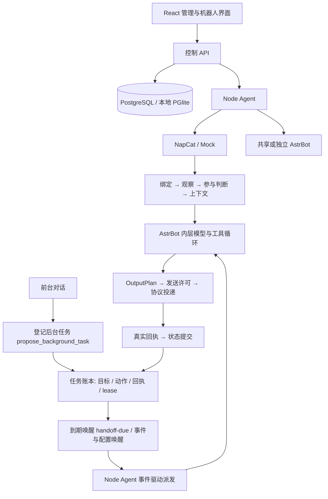

# FishBot

面向多租户的 QQ AI 机器人平台。支持网页扫码登录、共享 AstrBot、人格与记忆、群聊参与，以及由模型驱动的主动模式。

同一套 TypeScript / Python 源码运行于 Windows 与 Linux。Web 使用 React，控制 API 使用 Fastify；Node Agent 管理协议与 AI 运行实例。生产数据保存在源码目录之外。

## 能做什么

- **账号与运营**：激活码注册、多租户权限、管理员运维、机器人启停、QQ 登录状态与异常提示。
- **QQ 接入**：NapCat 扫码与已有登录会话恢复；Mock 仅用于开发测试，不代表真实 QQ 在线。
- **日常对话**：人格、可信主人身份、关系与情绪、群聊触发和跟聊、平台表情包、图片处理、分段发送。
- **记忆**：已有记忆摘要与尚未压缩的近期对话共同构成上下文；跨会话信息按机器人、真实身份与会话授权边界读取，不在租户间共享。
- **主动模式**：前台对话可将真实请求登记为后台任务，平台账本按到期时间唤醒内层 Agent 执行并回写真实回执；到期的委托处理完毕即休眠，等待下一次事件唤醒，不再有常驻规划循环。
- **运行监控**：整机 RAM、Swap、zswap、组件 PSS 与 QQ 状态分组展示；共享 AI 按实际进程统计，缺失指标显示未知。

主动模式已经接入持久化与真实运行链路，但自主行为质量、长期资源成本和完整场景验收仍需持续验证。工具是否可用取决于配置、授权和协议支持，不能将模型说出的“已完成”视为执行成功。

## 架构与公共管线



平台账本负责“现在有什么到期的事”，内层负责完成具体任务。当前内层采用 AstrBot 原生 `ToolLoopAgentRunner`，没有为每个 QQ 增加一个常驻自主 Agent，也没有独立的外层规划模型循环：到期委托由 Node Agent 直接派发，结果回写账本后即结束本次唤醒。

普通消息响应与自主任务复用人格、记忆、授权工具、输出和回执管线。主动模式与原有主动调度使用同一套发送许可与账本，避免两套定时器重复发送；正常用户交互保持优先。执行身份、来源与回执全部来自平台账本，不能从模型文本取得主人权限或改变真实发送身份。

共享 AstrBot 默认按组承载多个机器人，可减少重复 Python 运行时。共享成员拥有各自的配置、目标、记忆与预算；同一 Python 进程不构成任意第三方插件的安全沙箱。共享模式只接入平台受控能力。

## 主动与被动模式

| 模式 | 行为 |
| --- | --- |
| 被动 | 保留消息响应、群参与、主人联系及已有定时能力 |
| 主动 | 保留正常响应与原有主动联络；前台可登记后台任务，到期由内层执行并回写回执 |

每个机器人可独立切换；切换使用配置代次和任务所有权撤销过期执行，不需要重新登录 QQ。目标、动作、回执、lease 和唤醒条件持久化。QQ 离线时自主任务挂起，不为后台活动擅自重启 QQ。后台任务在登记时确定最早执行时间（相对秒数仅在此处换算为到期时刻），到期前不会提前执行；pending 只表示已登记待确认，不保证准点，登记也不授予额外权限。

内层勾选的能力形成实际工具清单。聊天、群上下文、签名、空间和资料搜索仍受各自权限约束。B 站当前提供搜索与公开资料获取，不代表已经具备观看视频、评论或投稿能力。模型调用、工具、时间、Token 与外部动作保护可以配置，不能取消末端授权与真实回执校验；结果不明时不能盲目重发。

标准群参与的判断间隔属于标准模式；主动模式下白名单、安静时段、拒绝联系及发送安全检查继续生效，原有主动联络（主人联系与日程发起）在两种模式下都保持工作。

## 本地开发

需要 Node.js 22+、npm、Python，以及 AstrBot 安装所需的 uv。真实 QQ 还需要适合当前系统的 NapCat 依赖。

```sh
npm ci
npm run setup:astrbot
npm run setup:napcat
```

首次使用时，将 `.env.example` 复制为 `.env`；已有配置请直接编辑，勿覆盖。Linux 上将 `ASTRBOT_PYTHON` 改为实际环境路径，例如 `references/astrbot/.venv/bin/python`。

```sh
npm run dev
```

开发模式 Web 通常为 `http://127.0.0.1:5173`，API 默认 `http://127.0.0.1:8787`。Windows 也可使用 `scripts/Start-Dev.ps1` 与 `scripts/Stop-Dev.ps1` 管理本地开发进程。

创建初始管理员：先设置环境变量 `BOOTSTRAP_ADMIN_PASSWORD`（至少 12 个字符），再运行：

```sh
npm run admin:create -- owner@example.com
```

该命令会创建管理员；若邮箱已存在，会更新其管理员权限和密码。完成后移除临时密码环境变量。普通用户通过管理员发放的激活码注册。

在页面配置模型服务地址、模型 ID 和 Key，选择 NapCat 并完成手机扫码确认。二维码已扫描与 QQ 真正在线是不同状态，必须等待协议连接成功；首次登录失败不会自动切换成 Mock。

## 配置与数据

| 配置 | 用途 |
| --- | --- |
| `HOST` / `PORT` | API 监听地址与端口 |
| `APP_ORIGIN` | 浏览器访问的完整 origin；部署时与反向代理一致 |
| `DATA_ROOT` | 本地持久化数据根目录，默认 `.local` |
| `DATABASE_URL` | 外部 PostgreSQL；留空使用本地持久化 PGlite |
| `MASTER_KEY` | 凭据加密密钥；未指定时保留首次生成的 `master.key` |
| `ASTRBOT_SOURCE` / `ASTRBOT_PYTHON` | AstrBot 源码与 Python 环境 |
| `FISHBOT_MEMORY_POLICY` | 系统支持时启用空闲页面回收 |
| `FISHBOT_CGROUP_ROOT` | Linux 已委派的 cgroup v2 根目录 |

本地 PGlite 与生产独立 PostgreSQL 是两种部署方式。生产 API、Agent 可独立运行，不能让多个进程同时打开同一 PGlite 数据目录。数据库迁移位于 `packages/database/migrations`；已有数据迁移到 PostgreSQL 使用专用迁移脚本，并先完成备份与验证。

**恢复必须同时具备数据库、原 Master Key 和机器人持久化目录。** QQ Session、身份文件、模型凭据、人格、记忆、图库和账号配置应完整保留。丢失原密钥后生成新密钥不能解密旧凭据。

## 构建与部署

```sh
npm run build
npm run build:production
npm run start:production
```

`build` 执行 TypeScript 检查和 Web 构建；`build:production` 生成生产产物；`start:production` 启动编译后的入口，不常驻 Vite。上述命令是本地生产入口示例，不等于现有 Linux 独立 API / Agent 的滚动更新操作。

容器构建、初始化、持久卷与恢复步骤见 [Docker 部署说明](docker/README.md)。对外部署应使用 HTTPS 与正确的 origin，仅公开平台入口，不公开 NapCat / AstrBot 管理端口。

更新只部署受影响组件：Web / API 更新不能顺带重启 Agent、NapCat 或在线 QQ。Agent 与 AI 运行时更新必须另行安排可回退的受控替换，并核对运行身份与持久数据。**源码同步、构建完成与线上部署完成是不同状态。**

Windows 和 Linux 使用同一个仓库与 `main` 分支。提交前先回收两端有效修改，保留并行前端成果；同步后核对提交号。运行数据、配置、研究副本和原始生产采样不进入 Git。

## Linux 内存与生命周期

当前生产策略保留 zswap + 磁盘 Swap、空闲动态回收、OOM / PSI Guard 和自动回退：

- NapCat 与共享 AstrBot 的空闲 `memory.high` 为 48 MiB，独立 AstrBot 为 16 MiB；活跃任务按实际参与组件放宽。
- 空闲 PAGEOUT 最短间隔 40 秒，结合活动识别与回退冷却，避免持续无效换页。
- 不以低 `memory.max` 硬限制追求占用数字；具体阈值需由 Linux 的 cgroup 与控制器实际生效，Windows 不具备相同内核机制。
- 启动超过 120 秒、等待 QQ 连接超过 180 秒、确认持续离线超过 5 分钟，按生命周期规则清退对应运行资源；用户主动停止与短暂断线分别处理。
- 清退释放协议、AI 及相关子进程，保留账号与登录数据；共享组按实际成员释放，不误停其他在线成员。

PSS 是分摊共享页面后的物理驻留内存，USS 是独占驻留内存；Swap 是换出的逻辑页面，zswap 池本身仍占物理 RAM。**不能将 PSS、USS、Swap 相加作为实际 RAM，也不能按关联机器人数量重复统计共享 AI。** 判断优化收益应同时观察整机 RAM、zswap、Swap IO、PSI、CPU、在线状态和真实消息延迟，不能用瞬时 USS 低点代表稳定成本。

## 验证

```sh
npm run build
npm test
npm run test:web
```

Python 适配器测试位于 `tests/*_test.py`；涉及 AstrBot 原生事件、模型工具循环和协议的测试需要匹配的 AstrBot Python 环境，不能把替身测试当成真实模型或真实 QQ 验收。浏览器测试需要相应服务、环境和浏览器依赖。

优先在隔离数据目录运行测试。完整运行时测试可能启动服务和临时数据库，应保证磁盘与内存余量，不在生产服务器上盲目执行整个测试集合。部署验收另行检查消息回执、多租户边界、模式切换、重启恢复、资源成本与回退。

## 源码导航

| 路径 | 职责 |
| --- | --- |
| `apps/web` | React 页面、配置与运维界面 |
| `apps/control-api` | 认证、配置、管理与监控 API |
| `apps/node-agent` | 进程生命周期、清退、维护与自主任务协调 |
| `adapters/astrbot` | 公共机器人管线、模型工具、记忆和社交能力 |
| `adapters/protocol` | QQ 协议接入 |
| `packages/contracts` | 配置与跨组件合同 |
| `packages/database` | 数据访问、迁移与自主生命周期存储 |
| `tests` | 单测、运行时与浏览器验证 |
| `scripts` / `docker` | 安装、构建、启动和容器交付 |

进一步阅读：[机器人管线合同](docs/robot-pipeline-20261101.md)、[主动操作合同](docs/proactive-operations-contract-20261102.md)、[B 站工具与内层 Agent](docs/bilibili-tools-and-inner-agent-20261102.md)、[主动系统实施记录](docs/proactive-ai-implementation-20261101.md)。历史实验记录只证明对应版本的结果，不能代替当前版本的实际验收。
