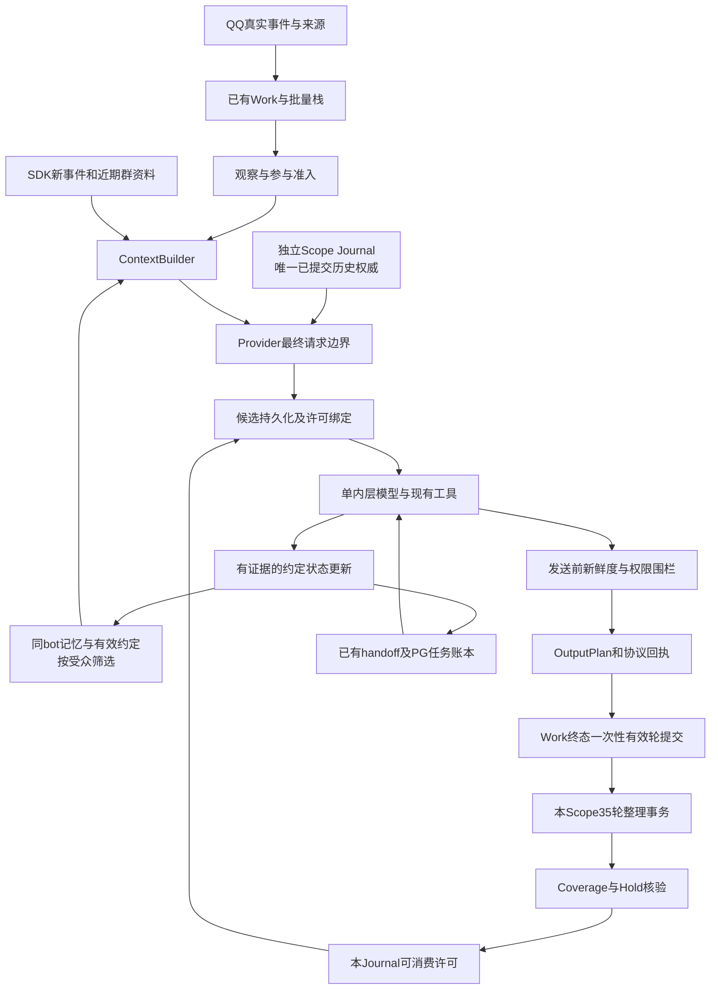

# FishBot 全系统独立复核与架构整改执行计划

日期：2026-11-08。核验基线：本地 `5ba2735` 加既有未提交修改；生产取证窗口约03:07—03:15，北京时间。本文是后续实施计划，**本轮没有修改业务代码、生产数据库、配置或运行状态，没有部署、重启、发送QQ消息或主动调用付费模型**。

## 1. 执行结论

系统当前可以完成真实对话、合法摘要和工具发送，两个共享AI Worker就绪，但不能评价为“全系统健康、历史安全已经完整闭环”。应保留多Journal、各Scope独立35轮、单内层决策及现有任务账本，在这些边界内整改。

本轮最重要的新结论：

1. **同人不等于同受众。** 当前私聊原文、私聊Facts及匹配的私聊摘要可以进入群聊请求。底板“跨Scope只有Facts和pending、摘要/Claims被受众闸门阻断”的描述不成立。02:25事件的私聊内容确实进入群模型，传输及时，但也暴露了隐私权限设计缺口。
2. **许可存在重用及非35轮授权路径。** 死进程的reserved许可被直接恢复available，没有核实该候选是否可能已发送；认证网页配置保存还可产生Journal重构许可。这两条均与本次最高不变量冲突。已有“unknown不退许可”测试没有覆盖进程死亡回收路径。
3. **计轮提交点过早，记忆没有覆盖一个Work的完整输出。** `send()`中记轮，以事件唯一键防重；一个Work在工具循环中先发送文字、后继续输出时，第一段已经入账，后段不能补全该轮。生产02:25记录与离线复现吻合。这不仅是少记一个气泡，还可能把主模型尚未完成的Work提前作为有效轮次。
4. **未摘要原始轮次会被全局限额清理。** 离线32个Scope各34轮，接收1088轮后只剩1000轮；首Scope只剩31轮。没有任何Scope达到35，也没有摘要/覆盖证明。Journal可能还保存原文，但记轮与整理材料已经缺口，不能称为合理自然遗忘。
5. **生产有源码与产物分叉。** 61份Python源码与本地完全一致；65项TS构建来源中6项与服务器当前TS不符。当前运行编译JS仍为单内层，服务器这些TS却含旧orientation/planning逻辑。必须在下一次构建前收回差异，不能从服务器TS直接重建，也不能未经对照覆盖它们。
6. **任务“partial→completed”存在确定性状态缺陷。** 当前本地和生产编译JS均会把无unknown副作用的旧partial动作直接完成目标。生产3个目标的最新动作partial而目标completed，尚不能逐笔证明目标实际未达成，但代码不足以保证业务完成。

推荐实施顺序：**发布来源固定与诊断补证 → 许可/轮次/材料保留安全 → 隐私与旧wire处置 → 容量及合法恢复 → 即时约定及任务闭环 → 私聊防过时与表情自动化 → 按证据做轻量优化。** 不统一Journal，不统一35轮周期，不新建外层规划AI或第二套通用记忆系统。

## 2. 取证方法、版本与证据边界

### 2.1 实际做了什么

- 完整阅读313行调查底板，复核相关最终验收、B站紧急整改和结构性优化报告；重要判断重新对照源码与现场，不以旧报告互相引用作证明。
- 检查工作树、项目AGENTS、上下文/管线合同。原有7个已跟踪脏文件、3个既有未跟踪交付物均保留。本轮业务源码零修改。
- 只读SSH读取容器入口、进程状态、文件摘要、Worker健康、各bot的SQLite元数据和现有诊断；PostgreSQL使用`BEGIN READ ONLY`，SQLite使用`mode=ro`及`query_only`。
- 私聊材料仅在服务器内做结构/存在性核对；报告不复制完整聊天、凭据、Token或登录数据。为版本比较读取的12份TS/JS是业务源码，不是聊天数据。
- 本地临时SQLite复现权限、许可、去重和清理问题；运行现有离线测试。使用异步生命周期审查方法检查Work所有权、await之后的代次围栏及unknown副作用。

可复核的本地私有证据位于`.local/independent-plan-20261108/`，不进入Git：`current.txt`、`evidence.txt`、`cache_schema.txt`、`version_db.txt`、`task_runtime.txt`、`reproduce.py/txt`、测试日志及`remote-source/`。这些文件用于工程复核，不是新的生产观察系统。

### 2.2 当前实际部署

| 层 | 本轮证据 | 判断 |
|---|---|---|
| 本地 | HEAD `5ba2735`；behavior、incoming_media、inner_tools、readonly_journal等已有脏修改 | 不能把HEAD单独当作交付版本 |
| Linux检出 | `source-commit`为`bf172db074084a62166b1a1fb4b38acfc3f3ab36` | 与运行目录、当前本地不是同一发布基线 |
| Python | 运行目录61个`.py`逐文件SHA与本地一致 | 已证明磁盘源码一致；不等于逐个模块的内存代码均已取指纹 |
| API | PID 808331；入口`scripts/production-start.mjs`；启动00:58:26 | 不能按TS源码推断运行行为 |
| Agent | PID 797344；入口`dist-server/apps/node-agent/src/main.js`；启动00:50:49 | 当前执行编译JS |
| AI Worker | PID 2242881、2243415；ready=true；memberErrors为空 | 进程级就绪；不是全部bot业务PASS |
| 构建 | `build.json.builtAt=2026-11-07T16:38:22.397Z`，即11月8日00:38:22 | Python热修时间不能替代TS构建时间 |
| 活跃业务PG | 实际连接库的迁移001—011齐全 | 本轮没有证实当前011缺失 |

6项TS分叉：`apps/{node-agent,control-api}/src/autonomous.ts`、`apps/control-api/src/qq-favorites.ts`、`packages/contracts/{autonomous,index}.ts`、`packages/database/autonomous.ts`。它们的本地摘要与构建manifest相符，服务器TS不同。服务器Agent TS新增旧规划器导入、think/orientation路径；编译JS仍有`ledgerOnly:true`、`planHandoff`及目标active校验。**已证实源码/产物分叉；未证实运行中外层已复活。** 不以字符串中出现orientation就判定实际模型调用。

第一次读取PG容器默认库只见001—005，随即核对API和Agent进程`DATABASE_URL`，实际业务库001—011完整。默认库结果已排除，不能列为迁移事故。这说明数据库取证也必须确认真实连接目标。

### 2.3 当前运行与资源

- 根分区88%，可用4.9GiB；内存总1775MiB、available534MiB，swap已用1279MiB。水位偏紧，**不能仅凭swap已用就断定当前抖动或OOM**；需要换页速率、进程RSS和磁盘增长趋势。
- 三个有Journal的活跃bot分别2个ready Scope，快照约2.75MB、2.21MB、1.31MB；本轮没有容量overflow现场。第四bot未建立该表，不能把“查表失败”算成Journal损坏。
- 检查点：大肥鱼3 consumed+1 available；梁沅芷16 consumed+1 pending_coverage；小双白1 consumed。后两者各1个uncovered Hold。pending检查点创建于11月7日20:24，当前存在不等于死锁，也不构成24小时恢复SLA。
- 48小时账本保留33次foreground_capacity_timeout、90次model_error、39次TypeError，来自不同部署阶段。不能直接归因当前版本，更不能把它们全部当作上下文护栏故障。
- Worker指标中梁沅芷本代有6次失败、156次成功；小双白本代40次成功、0次失败。第四bot本代无事件，不足以确认旧401已经恢复。

## 3. 对调查底板的重要结论逐项复核

| 底板结论/建议 | 独立结果 | 原始证据、修正及后续处理 |
|---|---|---|
| 单内层已经替代外层 | **运行链已证实；发布存在回归风险** | 当前编译JS是wake→planHandoff→execute，服务器TS包含旧逻辑。先固定来源，不重写调度器 |
| 多Journal、per-Scope35 | **代码及生产成立** | scope键、progress/checkpoint及merge_group均分Scope；保留产品决定 |
| 35轮合法闭环完整 | **局部现场成立，整体结论过度** | 有真实摘要及消费；但死进程许可重用、网页重构许可、提前计轮、未摘要清理未覆盖 |
| @不强制回复、主人important | **代码成立且有现场沉默记录** | `annotate_speaker:174`仅真实主人新入站加标记；mentioned跳过presence但仍可NO_REPLY。social参与提示仍有“被点名…正常回应”措辞，应消除提示冲突，不增加程序强制回复 |
| 5秒栈普遍适用 | **需限定** | 热群固定5秒，其余群及私聊默认800ms，最多20条；每条先observe再合并。保留，不能改成所有消息都等5秒 |
| SDK窗口是15 | **当前过时/未获支持** | 本轮4个生成配置`max_turns=35`；`native_history.LogicalTurnLimiter`按完整user-turn截断。群近期资料还受独立窗口控制，不能把两者混为同一个数量 |
| 跨Scope只有Facts/pending，摘要Claims不能跨 | **此前结论错误** | `summary_rows:214`允许同QQ参与的外Scope摘要；`memory_audience:26`允许该人的私聊到群；summary_item附protected_claims。rolling限制不等于查询召回限制 |
| 同QQ共享可保证隐私 | **此前结论错误** | 群里该QQ发言只证明其身份，不能代表其他群成员获准读取其私聊。离线私聊pending及摘要均可进入群候选 |
| 02:25群模型没收到私聊约定 | **已排除** | 当前group wire87条，第82条资料包含该源事件及约定内容；两事件账本分别confirmed1、confirmed2 |
| 02:25“模型知道约定但判断错误”实锤 | **输出违背要求已证实；内部理解程度未查明** | 可证明文本到达、最后发送；无法观察模型是否正确解析条件、是否把它视为有效指令。应称“已送达但未执行；权限/指令框架及状态接线存在缺陷”，不能证明心理意义的“知道” |
| “不是用户指令”必须移除 | **不采纳** | 不可信引用仍必须防注入。应另给有可信来源且经授权的有效约定状态，不能把所有记忆升级成当前命令或权限 |
| 群freshness完整有效 | **有真实采用，存在作用边界** | 只检查本群草稿期间变化，不能代替跨Scope约定及完整任务取消；失败fallback保留带原始引用的回复，属于权衡而非绝对正确 |
| 私聊没有语义防过时 | **成立** | 只有生命周期/代次检查，无私聊cursor围栏；不能以Work还活着证明用户意图没变 |
| 忙碌挂起无消费者，必须补回所有回复 | **结论过度** | 已有presence.defer→pending→initiative sweep→原事件重入；但后来互动会让旧pending不再eligible。02:25“想吃”已被freshness看到，不能认定必须另回一句；需要明确采纳/淘汰原因 |
| 多气泡只记第一段 | **特定链路成立，影响被低估** | 单个OutputPlan内已聚合text；问题主要是同Work多次send/工具循环输出。INSERT OR IGNORE留第一段，且计轮早于Work结束 |
| 提议/未知不保护 | **不成立** | proposed/unknown有protected标志，accepted为open；executed/canceled可退出。问题是缺双方确认关系、即时状态及履约绑定，不能把protected当业务成立 |
| Claims69条转录问题仍普遍存在 | **旧自动转录已改，不重复开发** | `derive_claims`按摘要模型evidence选择，Prompt约12项、无每类2项硬帽；历史69条不会自动消失，当前96条/32KiB是存储上限，不是目标输出量 |
| Protected预算外直接丢失 | **描述不准确** | small未承接来源进Hold，big受保护继承失败会停合并。数据不直接丢，但可能容量/进度停摆，应解决状态退役和无法承接原因 |
| commit落盘失败必然“磁盘无新基线” | **条件化风险，不能一概而论** | HTTP前已stage完整候选，正常情况下磁盘已有候选。仍需覆盖settle异常、旧内存与磁盘分叉、许可回退；已有stage修复不可撤销 |
| assistant尾部匹配死角应补兜底 | **证据不足，不单独排整改** | 没有本轮真实复现；已有strict拒绝在保护历史。不能仅因函数返回None就新增宽松匹配 |
| 冷却轮有表情规则无菜单是Bug | **低价值毛刺** | 规则允许纯文本，不证明误发送；只在表情闭环中顺手统一状态，不另建门控 |
| 已采集贴纸可自动使用 | **不成立** | 标注成功只更新meaning，catalog/image只读approved。4个bot均10条pending，无approved；pending满10还阻止新采集 |
| 表情不发送一定是程序拦截 | **无证据** | 本代小双白imagesSent4、最新qf收藏发送；大肥鱼20次候选19次纯文本选择。池关闭、无合适候选与自由选择需分别统计 |
| /health不可达是架构问题 | **此前探针目标错误** | 从Agent容器读取group.json的真实healthPort及鉴权可正常访问；指标按botId嵌套，不能读错层后宣称指标缺失 |
| 02:04低缓存确定因节点不一致 | **具体原因未查明** | 同模型/tools/parameters，18条完整前缀延伸到22条仍cached=0；后续约4K命中。支持“本地消息前缀变化不能解释全部现象”，不证明中转节点拓扑 |
| 24h/7d统计代表完整窗口 | **不成立** | 诊断只有当前+previous两份，忙bot本轮保留约25分钟；是截断样本，不是完整24小时。不能把缺失缓存字段计0，也不能累计request和request_result两次 |
| 容器约02:47重启过 | **不符合现场** | 实际API00:58、Agent00:50；不能以文件时间或探针运行时间推断启动 |
| 693的401与TypeError同源 | **未查明** | 本轮无对应错误堆栈/新的真实模型验证；保留历史阻塞描述，不能指定根因 |
| B站故障说明B站工具坏了 | **不成立** | 紧急事故已证明其中一例是后台提议工具证据/Hold阻塞，另一例是窗口匹配。保留v2证据与Hold恢复；本轮未重新执行B站操作，不能宣称全部B站能力现场PASS |

## 4. 推荐目标架构与不可变合同

### 4.1 职责与数据流

不是所有箭头都需要新表：Work、OutputPlan、Journal、summary、Hold、coverage、handoff已经存在，优先移动提交点和修正约束。

| 组件 | 权威职责 | 明确边界 |
|---|---|---|
| SDK | 协议、新事件、当前群近期窗口、工具循环运行对象 | 其持久化窗口不决定已经提交历史的删除；不反向用SDK重建旧Journal |
| Scope Journal | 实际或可能已提交的消息序列和固定System；追加、候选恢复、合法退休 | scope固定；每次HTTP前持久化；不能因配置、重启、epoch或SDK重载换基线 |
| ContextBuilder | 组装当前真实新增事件、获准共享记忆、约定状态及必要工具候选 | 不另存通用历史；不从昵称推断身份，不授予权限 |
| Facts/Claims/摘要/Core Note | 有来源的长期知识与压缩表达 | 来源和受众分别记录；旧说法不因摘要重新变成当前事实 |
| 约定投影 | 一件约定的当前业务状态、条件、参与方及证据 | 只存需要管理的约定，不转录普通聊天；不复制任务调度器 |
| 任务账本 | notBefore、执行租约、副作用、取消与回执 | 原话/承诺不等于任务已登记，协议confirmed不等于目标达成 |
| freshness | 已有Work的未发送部分是否仍合时宜 | 不能收回已提交HTTP或QQ操作；不负责产生新权限或新的任务 |

关系值可以继续按场景保留。跨场景连续身份来自稳定bot人格、可信同人身份及受众正确的事实/经历/有效约定，不要求把所有群关系值合成一个分数，也不要求先做全局事件时间线服务。

窗口需要分别理解：本轮生成的SDK配置为`max_turns=35`，它是原生模型历史窗口；`memory-defaults.json`中的`groupRoundMessages=13`约束群轮整理材料；`runtime_care.Ambient`另收集最多50条、每条180字符、10分钟内的群文字（受`ambientContextMessages`配置约束，已确认内容可退出）；批量栈最多20条、热群5秒。它们不是一个“最近N条”配置。Ambient存有at但其context视图去掉时间，presence又精选最多12条，补时间锚点应在首次构造新资料时做，不能回填旧wire。SDK原生窗口的生成参数与实际runner仍需在正式发布预检中对照，不能只改任意一个数字就宣称减少重复。

### 4.2 有效轮合同——实施前先固定

逻辑轮身份为`bot + scope + 原始真实Work/event`，一个Work最多一次。辅助模型调用、主模型工具中间请求、气泡数量均不增加轮次。

| 情形 | 是否计有效轮 | 证据要求 |
|---|---|---|
| 主模型正常完成、本Scope计划答复全部confirmed | 1 | 主模型终态、同Scope输出及真实receipt、完整材料 |
| 同Work多个气泡/多次send | 最终最多1 | Work终结后聚合全部实际确认内容，不能首段先计 |
| 媒体/表情单独回复且已确认 | 1 | 诚实媒体类型及完整可支持证据；无法摘要则Hold，不能伪造图像语义 |
| NO_REPLY且没有真实回复 | 0 | 保存真实沉默原因，保留可能已提交历史 |
| 工具向本Scope实际代发答复，主模型完成 | 最多1 | 必须是可证明的本轮业务回复，和最终文本合并去重；不能只据模型“发了” |
| 私聊要求工具向其他群发消息 | 不给目标群铸轮 | 目标群未发生对应主Journal回合；私聊有完整确认答复才按私聊计，不能借发送把许可转给群 |
| partial、unknown、取消、模型失败 | 当前0 | 已确认部分仍保留为证据；未知操作不重试。晚到ACK只有在整个Work完成条件都满足时才能幂等补结一次 |
| 主动任务/内部研究/辅助判断 | 不借入普通聊天轮 | 继续使用自己的任务及回执合同；未来若需将真实主动对话计轮，另证明同Scope主Journal身份后增量开放 |

当前“memory开关关闭就不计轮”还会使Journal无限追加而没有整理许可。必须明确：用户关闭长期记忆不代表关闭历史安全；保留最小受权的压缩/连续性合同，或者在设置时明确容量边界并停接超限内容，不能暗中压缩、存长期人物Facts或默认可以无限聊。

### 4.3 35轮、Coverage、Hold与退休

1. 同Scope恰好35个新增有效轮构成一次批次；重入Hold不重复计数、不多签许可。
2. 整理模型语义选择，代码验证事件、作者、角色、引用、回执、范围、格式及容量。800字小摘要、1500字大摘要默认保留。
3. 同一SQLite事务写入摘要、Claims及修订、完整coverage、watermark、Hold、检查点。材料不完整可以登记pending_coverage，但不授予退休权。
4. Journal退休必须核对**实际要删除的块**全部有可信覆盖及保留结果。一个35轮许可不是对任意旧消息的通行证；其它Scope及未覆盖工具/媒体不能搭车退休。
5. Big Merge继续按原受众分组；原子转移coverage和checkpoint引用，保留scope/epoch/消费状态/请求绑定，不使已消费许可复活。
6. lost是“证据确实不可得”的阻塞，不是超时后可自动忽略的标志。先从已有精确Journal/备份恢复证据；无法恢复就报告不可兼得边界。
7. 配置保存、进程死亡、模型失败次数、清理数据库、换epoch均不产生退休许可。

### 4.4 跨Scope共享合同

必须把三个不同维度拆开：`author/person`、`source_scope`、`allowed_audience/application_scope`。来源不等于可见范围，约定适用群不等于允许公开其私聊原话。

- 默认私聊原文仅原私聊可见，群资料默认原群。跨群/私聊共享使用有来源、获授权的最小事实或状态投影；同QQ身份只用于归属匹配。
- “私聊要求在指定群暂不回复”可以向该群决策提供一条限定条件的有效行为约定，**无需暴露整段私聊问答**。它不授予群操作、读别人私聊或修改主人身份的权限。
- 模型决定语义、是否为约定、对象/条件及重要性；程序核对真实来源、发言人权限、目标Scope和可公开范围。模型建议扩大受众不能独自完成授权。
- 人物Facts与约定共用这一受众合同；搜索、语义召回、rolling、Core Note、工具inspect、执行经历和已保留wire检查必须一致，不能只修pending一个入口。
- 正在到达的新资料只合法追加。旧wire已含不该出现的私聊内容时，筛掉下一份资料包不能撤销旧内容；见P0隐私处置，不准直接改旧wire。

## 5. 整改工作包与准确依赖

以下8个工作包覆盖全部必要工程修改。安全/数据正确性不受“5%收益”门槛限制；效果收益无法可靠量化，不编造百分比。复杂度为相对工程量，不是工期承诺。

### R0：发布基线、错误证据与现状备份（P0前置，必须）

**根因与证据：** 第2.2节TS/JS分叉，且诊断256KiB×2轮转；错误堆栈保留不足。`model_cache.record_error_site`目前只在部分ImportError/AttributeError路径调用，TypeError及外层execute异常往往只有类名。没有记录的根因不能只怪轮转。

**最小实现：**

- 先建立一次精确发布清单：本地脏修改、生产实际JS/Python、6份TS差异、配置合同及迁移。逐项选择回收到可信Git的代码，不把服务器旧外层整包拉回；保留不明差异供评审。禁止先git pull覆盖或直接npm build服务器TS。
- 构建产物记录实际JS摘要、Python摘要、合同/迁移摘要、构建提交及dirty补丁标识；启动健康返回产物ID/进程出生时间，沿用现有build/health，不新建发布服务。
- Python/Node统一现有attemptId与wireIndex。终态、提交阶段、采用/放弃、错误模块/符号/行、HTTP状态分类都进入同一诊断；TypeError和执行边界增加安全raise-site，禁止原始异常正文或聊天正文。
- 现有诊断轮转采用可配置有界分片及按类/时间保留，在同一观察体系保住故障摘要。Python与Node同时写同一文件的rename竞态必须覆盖；可使用进程分片、读取时统一聚合，不新增另一套统计库。不要仅无限扩文件。
- 统计只计一次request_result/attempt；真实重试按wireIndex单列。缓存缺失保持unknown，费用无可靠账单就unknown。

**依赖/边界：** 先于生产发布；可以与R1代码设计并行。纯诊断不得改变模型或QQ结果，不产生模型请求。备份含权限严格的数据库一致性副本及现有Journal，只在正式执行获得授权后操作。

**验收：** manifest、运行入口、实际文件及加载版本可对应；6项差异逐项处理；模拟并发Python/Node轮转及TypeError均保留来源和终态、不含敏感正文。当前日志无法找回的旧错误保持未查明。复杂度低到中，收益是避免下一次构建复活旧外层与再次失去故障根因。

### R1：Journal与许可安全闭环（P0，必须）

**模块/链路：** `behavior.prepare_chat_payload/settle_journal`→`readonly_journal.stage_candidate/commit/retain_submitted`；`memory_reflection.reserve_context_reconstruction:231`；`system_contract`；`model_cache`最终HTTP检查。

**确定缺陷：**

- `reserve_context_reconstruction`按abandoned_request把reserved直接available；进程不在不能证明HTTP未发。离线明确复现许可二次签发。
- config.saved审计ID经`behavior:1359`传web_proof，无35轮也能得到Journal重构许可。网页认证能证明操作者身份，不能证明其授权删除既有模型历史。
- `SystemContract`是bot全局单System基线，而用户要求各Scope独立退休；一个Scope在合法35轮采用新System时，另一个仍持旧System，二者可能被全局guard互相阻断。离线确认同Scope许可并不是该guard的授权输入；本轮未复现生产故障。
- consumed后request_id清空，候选没有完整持久化许可绑定；难以审计崩溃窗口。commit失败分支还会释放原子许可，需要与已stage候选一并处理。

**推荐最小方案：**

1. 把精确候选快照、许可身份、基线hash和许可消费放在**同一stage事务**。一旦stage成功，即认为本次许可已用于这份候选，不因后续失败/死亡退回available；即使HTTP最终未发，也保守保留候选及消费结果。stage前拒绝不消费。少量未发请求保守耗用许可，是简单且可审计的安全取舍，不能把“可能未发”当作自动退款条件。
2. 死进程reserved仅在有持久化证明“未进入stage/尚未提交”时可释放；缺证明保守隔离，关联候选后消费/恢复。无需新增常驻恢复模型；使用现有状态及少量绑定字段。
3. 移除网页保存对已有Journal历史的退休授权。配置版本可变化，当前Journal继续使用已提交System；新System在本Scope下一枚合法35轮许可时生效。当前身份与实际后端权限可及时收紧，但不改旧消息。
4. strict持久化Journal已保护完整System向量，前台不应再由一个bot全局可变System基线重复裁决。优先让该检查退为诊断/迁移校验，最终HTTP仍严格比较Journal候选；先覆盖跨Scope新旧System并存、冷加载和无Journal旧档案，之后再切换，不能简单删除所有System检查。
5. stage失败必须阻止HTTP，保留现有修复；stage/settle抛异常后只能从同一精确候选恢复，不能用旧内存覆盖它。每个Scope同时最多一个候选写者，SDK重载只是新事件来源。

**迁移：** 加绑定字段/快照版本保持旧版可读；旧consumed不能改回available，旧reserved缺证据不得补造request或改写历史。旧快照无许可绑定时按真实现存快照恢复，不反推曾发送阶段。新旧代码不可并行写同一bot库。

**验收：** stage前后、HTTP提交前后、收到headers后、settle中分别kill模拟；重启后精确前缀一致且许可最多消费一次。跨Scope、跨bot、重复request、System配置变化、写满、事务失败均不可绕过；正常35轮及工具v2/Hold恢复仍通过。必须测真实持久化，不只patch方法返回值。

**成本/风险/回滚：** 中；优先解决高风险不变量。回滚保留已经消费的许可和候选，不能回退数据库到旧快照或重用checkpoint；旧写者不兼容时停该写者而非强行降级。生产迁移、进程更新均需正式实施授权。

### R2：有效轮与材料生命周期统一（P0，必须；依赖R1合同）

**根因：** `behavior.send:1115`按当前send结束记轮，`Reflection.record:338`按(scope,event) INSERT OR IGNORE；全局1000轮清理只排除Hold，不排除尚未被摘要承接的轮。已经复现首段固化及1088→1000材料损失。

**最小实现：**

- 将成功轮的最终提交移到已有`guarded_execute`/Work终态，与`pipeline.finish`邻接；各send只累计带receipt的本Work输出。无需另一套执行状态机。
- 同一Work所有文本、媒体、工具代发与实际受众分别聚合；summary材料同时保存已确认输出及模型native原文，不能把未投递草稿当作已经说过。
- `memory_rounds`的幂等不应静默吞内容冲突。相同Work、相同证据重复提交无效；内容/receipt版本不一致应对照权威Work修订或诊断拒绝，不覆盖其他事件。晚到ACK通过同一终态结算入口一次性补结。
- Round/材料/关联pending的提交原子化。进程在QQ确认后、记轮前死亡时，从已有回执/动作账本恢复材料，不重新发送，不凭一条日志猜业务完成。
- 清理只回收已被真实摘要/coverage承接且无未完成Hold/许可依赖的原始材料；未处理轮不能为满足1000上限直接删。触顶应先安排已有整理/受控背压并暴露原因。分Scope35不变，不能用全局35替代。
- 启动`DELETE memory_summaries ... LIMIT1000`也要遵守protected、有效约定、coverage及checkpoint依赖；不能把条数配额当作任意删除许可。普通低价值已整理历史仍可自然遗忘。

**迁移/历史补账：** 仅凭现存明确receipt、Work、原始事件及主模型终态恢复；缺任一证明保持历史缺口，不追造35轮。旧第一段轮次若已参与许可，保留历史审计并阻止未经完整材料的退休；不能简单重置watermark重新算一遍。

**验收：** 2气泡+后续工具+最终文本一个Work只计1、包含全部确认片段；首段发送后模型失败计0且保存证据；unknown→晚到ACK不重复；NO_REPLY、辅助调用、平台故障通知为0；异群工具不赚目标群许可；32×34轮不丢未处理证据。媒体placeholder不能自动等于内容已覆盖。

**收益/成本：** 中，消除提前铸证与记忆缺口；可能使当前实际计轮更慢，必须与R4容量预算一起上线，不能靠继续错误计轮维持可用性。

### R3：受众权限及旧上下文隐私处置（P0，必须；R5前置）

**根因：** `person_filter`只验证同人，`memory_audience`把同人私聊向群开放；pending/Facts甚至未通过统一受众闸门。摘要查询亦可跨Scope，整份群摘要还可能夹带其他参与人的内容。

**最小实现：**

1. 复用现有source_scope、subject、sourceRefs，补最小明确受众/可分享投影。默认来源私聊不外发；模型提议共享，程序依据真实授权决定。不要把所有同人材料迁为public。
2. 统一Facts、pending、summary/Claims、Core Note、工具召回、execution_memory的候选筛选。针对“同一件已授权事实跨场景生效”输出有界单条视图，不先建bot全局聊天镜像。
3. 摘要含多受众内容时默认原Scope；只允许独立验证的可分享Claims跨场景，不能凭当前用户参加过该群就公开整段总结到另一个群。
4. 检查保留wire：当前validator主要识别特定rolling摘要，不足以覆盖pending/Facts及所有delta。必须验证完整平台包及增量合并后的视图；遇到确定不应给当前受众的旧内容就停止继续提交该wire，不能先泄露再等待摘要。
5. 旧wire整改严格区分：有合法35轮许可且覆盖完整，正常退休；能恢复授权且用户明确允许的共享按真实授权处理；两者都没有，保持阻塞并请求独立、具体、可审计处置。不得“修隐私”时直接删除旧消息。新建对话若需舍弃旧历史，必须明确说明这是额外授权的破坏性恢复，不冒充同一Journal无损续聊。

**迁移：** 不改旧聊天文本；元数据默认收紧，无法判定的旧行标legacy/来源私有。已经提交内容无法收回，报告影响Scope及时间，不宣称追溯消除泄露。owner不能凭机器人管理身份自动公开第三人的秘密。

**验收：** 私聊秘密→本人群发言不能出现在群请求；同人不同群、不同人、不同bot/tenant均有负向样本；获明确授权的最小约定状态可及时到达目标群；已污染wire无许可时必须BLOCKED。采用完整最终HTTP消息验证，不能只测查询返回列表。

**成本/收益：** 中到高；安全必要。可能收紧此前“什么都记得”的体验，与R5受控共享同时规划，分两次灰度，不能为体验先放开隐私。

### R4：容量、SDK与合法恢复（P0/P1，必须；依赖R1/R2/R3）

**当前事实：** SDK回放与Journal通过多个精确窗口适配函数协调；已有热修真实恢复过对话。本轮没有新的窗口失配复现，不推倒这些修复。512K文本、2MiB wire字符、4MiB请求检查、16MiB/bot快照以及模型实际输入容量是不同维度。

**最小方案：**

- 在新增大内容/工具循环前检查本Scope剩余文本、wire、持久化空间以及已知模型上下文余量；为完成当前Work、必要tool-result和摘要调度留出预算。只约束尚未提交的新材料/新工具步骤，不截断旧wire或伪造完整材料。
- bounded工具返回在首次进入模型前结构化保留必要证据、大结果分页读取；超过预算以真实受阻结果结束，不在unknown后自动重做。工具循环设置本Work调用/耗时/新增字节上限，复用已有预算。
- 有真实35轮且Hold可补证时，优先运行已有hold_recovery，不要求再35新轮。无法支持的媒体/丢证据不能重复付费提取。记录阻塞类型和恢复所需的真实证据。
- 增量减少SDK协调：当前Journal完整负责已提交历史，SDK只提供带来源的新事件/工具续接和近期群资料。先保留适配器为兼容读取，新增明确信息所有权及重启测试；不在同次上线直接删五个适配函数、换序列化或批量重写旧base。
- 合法退休成功后回收不再承担恢复/审计职责的重型旧payload；保留必要小墓碑/许可绑定，不能手工删除所有retired行。当前快照预算包含retired，长期风险成立，但生产本轮无retired膨胀实证。
- 资源维护采用已知目录增长统计、保留期限和备份大小上限；禁止未核实路径的批量清理。磁盘清理及持久化容量调整不代替内存/模型Token容量规划。

**数学边界：** 任意长度新输入、无限工具循环、连续失败/NO_REPLY造成的可能提交增长，与有限上下文且35有效回复之前绝对不可变，无法无条件同时保证继续聊天。必须限制尚未提交的新工作规模；已经触顶又没有合法许可时只能准确阻塞、恢复精确旧证据，或获得额外审计授权处理历史。不得以重试次数、epoch、自动新基线解决。

**验收：** 35轮前最大合法输入+多图+工具、失败连续追加、重启/SDK窗口滑动、System待更新、memory关闭、并发Scope、磁盘满均有明确PASS/BLOCKED；旧字节不变。恢复应验证能完成后续真实请求，而不是仅让prepare返回。需要真实模型/QQ部分待另行授权。

**成本/收益：** 中；避免容量死锁和兼容补丁持续叠加。暂不换媒体存储、不永久携图、不盲目扩大摘要或传输上限。

### R5：即时约定与履约状态——一份业务投影，复用现有任务（P1；R3完成后上线）

**现状与缺口：** 35轮摘要模型已能生成有证据agreement，stage区分存在；claims JSON是长期记忆，不是即时业务槽。`due`是原话片段，无到期消费者；`propose_background_task`已有真实登记/唤醒/回执链，聊天约定、修改与取消没有可靠接线。`settle_commitments`要求同speaker，更不能代表双方确认关系。

**推荐数据设计：** 在现有bot SQLite内增加一份小型约定业务投影，字段至少：稳定id、参与方QQ、主题/条件、来源Scope与证据event/role/quote、适用Scope、可见受众、状态、修订号、时间原文/可验证时间区间、可选handoffId。可用单表及JSON证据列，不建立通用知识图谱或第二个任务库。

权威关系：当前约定状态以该投影为准；摘要Claims保留历史证据并引用同一id/revision，不成为另一个可独立写的状态源；PG目标负责执行租约和效果，不复制约定语义判断。避免三处各自判“已完成”。

**即时写入方式：** 单内层在既有真实请求中通过一个受约束状态工具登记/修订/取消；通过`inner_tools.features`共用现有身份与证据校验。无需每条消息新发一个提取模型。35轮摘要可补充遗漏的历史语义，但无新证据不得覆盖更新版本。是否重要、是否达成、是否同件事由模型理解，不能退回“约定/承诺/取消”等关键词规则。

**状态合同：** proposed、accepted、fulfilled、canceled、expired、uncertain；accepted必须有适用的双方/机器人承诺证据。提议不是双方约定，时间不明确保持原文及uncertain，程序不猜时间；冲突以版本CAS和来源顺序防旧结果覆盖，语义关系交给模型。到期不自动算完成，expired与取消分开。

**履约接线：**

- 需要实际后续执行的accepted事项复用handoff。SQLite→PG仍沿现有幂等handoff/ACK通道，先保存修订，再确认登记；ACK不明不重复建目标。不能只说“记住了”就宣称提醒已设置。
- 状态变更通过同一幂等通道更新/撤销对应PG目标；既有goal锁、generation/epoch、revision和实际工具权限继续生效。到期前及每次副作用前重验最新修订。
- 已经提交或结果unknown的操作无法被一句“取消”撤回；取消后禁止新效果，继续对已提交效果查回执，记载实际完成部分。
- 约定变更立即向相关新请求追加有界“当前有效事项”视图，明确主体、条件、修订、来源和适用范围。保留“不可信记忆不是当前授权”的防注入框架，不给全部召回添加important或System权威。
- 完成/取消/过期可解除旧protected；有必要才保留简短历史，不永久保护所有提议与未确认事项。清理业务投影不等于删除已经提交wire。

**旧数据迁移：** 不把旧accepted/proposed盲目转换成已登记任务，不批量设置due立即执行。先只读兼容旧Claims；仅有完整证据且当前仍有效者进入投影，关联旧任务需原始handoff身份，语义相似不能充当外键。历史模糊冲突保留uncertain。

**验收：** 无关键词约定、单方提议/双方接受、不同人同主题、跨Scope修改、取消与工具已提交竞争、过期、重启、重复ACK、两代大压缩后的修订召回及真实履约。02:25同类“私聊约定在下一次指定群@时不回复”必须验证最终真实发送为0，且群模型不含无关私聊原文。只做“不回复”测试不能证明提醒执行能力。

**成本/收益/回滚：** 中，业务能力所需，不能用改一句Prompt替代。先上线状态与召回，后上线调度接线，不同批发布。关闭新写入口后保留已有任务结算及只读状态，不能回滚时删表、重建任务。真实模型/QQ履约试验需另行授权。

### R6：任务目标终态、取消与历史孤儿（P1，必须；与R5调度接线前完成）

**证据：** `apps/node-agent/src/autonomous.ts:199`及生产JS262行把prior partial无条件completeGoal。PG3个目标latest partial；另有10条executing动作创建于11月5—6日，不能把它们当作10个当前任务仍在运行。

**最小修复：** 将“动作/协议结束”与“业务目标完成”分开；只有实际结果满足已有success condition且无unfinished/unknown才完成。partial保存已完成效果及剩余事项；下一次只规划未完成且可安全执行的部分，副作用unknown继续查账，禁止整任务重放。聊天取消进入既有目标版本修订，不绕过目标锁；复用现有wake和ACK，不新增周期性模型规划。

旧executing逐笔按lease、cycle、持久化dispatch和receipt判为真正活跃、待回执或历史孤儿。没有发送证据不等于没发，不能批量置canceled或重跑。readonly研究可证明没有外部效果时，才按现有中断恢复合同收口。

**验收：** 两个子目标只完成一个，不得completed；完成操作但业务被拒绝不得成功；聊天取消后新的效果为0；取消发生在HTTP已提交后允许真实晚到ACK但不得再派发。重复wake、重启、跨tenant同目标ID、模式变化和已完成目标不重复执行。已有40个调度/生命周期测试保留，在其上补缺口。

**成本/收益：** 低到中，状态正确性必要；不恢复orientation/planning。历史状态更正需单独审计，不能仅凭本报告修改生产记录。

### R7：会话防过时、自然表达与表情自动闭环（P1，分两批）

**A. 防过时和表达：**

- 将现有freshness观察buffer/cursor扩展到私聊，先做低成本目的地版本围栏。没有新消息不复核；无关消息不必再付费。新消息明确影响当前草稿的判断复用现有主模型/既有复核能力，不能写关键词规则；有歧义时允许一次有界复核或停发未发送尾部并由新Work接管，不能在尚未提交前擅改旧请求。
- 新版本到达不证明旧回复必错；也不能简单“有新消息一律取消”，否则连发会饿死。合并只合并尚未提交事件，提交后的只能追加新上下文/另Work。
- 协议dispatch前校验实际目标cursor与Work/lease；媒体下载、typing sleep、模型复核之后均重验。无法撤回已发气泡/工具，保持已确认前缀和真实状态。
- presence.defer已有消费者，主要改清晰原因和有界淘汰。底板个案不构成“必须补回一条回复”，已被其他Work实际承接时可自然淘汰；不为每条普通群消息排永久任务。
- 同一Work通过工具循环再次生成时，提示它已确认说过什么、当前还缺什么；复用确认输出记录，不复制整段自言自语。关闭的收藏池明确返回不可用，工具结果应让模型停止重复同参查询；预算围栏只阻止同一无变化结果的空转，不屏蔽合法两次用户请求。
- 对齐social“被点名正常回应”与“@仅立即激活、可NO_REPLY”。主人important只附真实新入站，不回填旧wire、不授予额外权限。平台故障通知继续排除SDK人物历史、表达样本、Facts/Claims及主动经历；普通技术聊天保留。

**验收：** 私聊“先做A→改B/取消”、群新插话、媒体await期间变化、第一气泡后取消、工具已发但结果不明；观察模型原决定、围栏采用和实际QQ输出。确认没有每条私聊固定+1请求，没有把新消息静默丢掉。

**B. 表情自动闭环：**

- 复用`sticker_collection`已有采集、缩略图安全检查、语义标注及approved读取。来源真实、标注suitable=true且meaning有效的普通素材，用版本CAS自动转为可用；不确定/不适合的保持不可用或拒绝，人工纠错是可选覆盖，不是正常必经步骤。
- 当前pending满10将停止采集，日标注最多3且只对新插入执行。给既有pending增加**有界**补标任务，使用同一日预算，不把10条存量一次性全部付费跑完；不适合的不能永久占pending。原图哈希、source_scope、实际QQ账户和语义版本继续保留。
- `qq-favorites/index.json.enabled`和item enabled是用户配置意图，不能为自动化擅自改成true。区分允许自动采集、允许自动使用和账户收藏池总开关，复用现有配置，必要新增最小显式开关且默认兼容。
- 收藏和贴纸候选仍按本bot/QQ账户/原群范围验证；模型自然选择，发送前重新校验文件、语义版本和使用授权，禁止模型生成任意文件路径/URL。相同字节去重，不能语义相似就合并不同表情。
- QQ_FACE保持单独能力开关；当前实现有可识别标记/Face发送，但选择规则明确禁止输出标记，与qqFaces=true的意图不一致。先确定产品要开启的范围，复用现有白名单和组件，不另造渲染器、不强制表情频率。

**验收：** 真正从采集到自动可用再到实际QQ发送；普通照片不采集、不适合内容不启用、账号切换/权限关闭/版本变更/下载失败不误发；素材不被选择是允许结果。真实视觉标注和QQ发送需要授权与预算，离线mock不能冒充端到端PASS。

**复杂度：** 两部分均中；分开发版，优先私聊过时与约定相关行为，再做素材可用性。冷却轮菜单提示只顺手对齐，不建情绪引擎/表情强制策略。

## 6. 模型、缓存、记忆与工具：保留项及成本判断

### 6.1 辅助模型继续独立存在

| 能力 | 决策 | 最小必要改进 |
|---|---|---|
| group_presence | 保留有界精选请求 | 补真实时间/年龄与当前事件锚点；保留10分钟间隔、auth退避及版本围栏。无需完整Journal |
| owner_contact、companion_plan | 保留 | 输入获准的当前有效约定/任务摘要，避免与已登记提醒重复；不是所有聊天承诺都转换成主动联系 |
| style_learning | 保留按阈值批量 | 已有跨真实说话人证据和原话核验，重点检查采用后的角色效果；不因模型存在独立请求就合并到主对话 |
| freshness | 保留变化才调用 | 私聊扩展按R7，无变化零调用；限制总耗时与重评次数 |
| 小/大摘要、Hold恢复 | 保留已有模型 | 不重复实时提取；语义选择、纠错/状态退役参与big，保留800/1500限制 |
| summary_image、sticker/favorite caption、video_evidence | 保留按实际材料触发 | 一次可靠标注复用，未知/过期结果不采用；不为缓存再造视觉服务 |
| embedding | 暂不普遍启用 | 当前没有足够效果证据；优先修受众与语义状态，避免给权限错误加召回放大器 |
| probe/重试/内部工具 | 沿用统一观察与预算 | 手动探测不是后台健康免费调用；unknown不得当零费用或未执行 |

本轮实际检查Python的`model_cache/embedding_turn`、Node的`model-diagnostics`及favorite/video/probe接线。已有统一观察应继续使用；不能以“所有入口有函数”声称每笔请求都已完整可追踪。缺raise-site、终态关联和轮转保留需R0补齐。

### 6.2 缓存与上下文增长

02:04独立重查确认：主模型74558输入后小摘要13144；合法重构后23857/cached0，下一次26112/cached23808，再下一次27523/cached0，随后28809/cached3968、30964/cached4160。相关请求同为deepseek-v4.1-flash，toolsSha、parametersSha相同，历史前缀14→18→22→26→30完整延长。

结论是**缓存波动存在，不能全部用本地消息重写解释**。没有中转节点/路由日志，原因仍未查明；不据此更换缓存系统、不伪造cache key、不延迟合法摘要。appendOnlyStatus=verified证明当前候选与HTTP前缀一致，还要结合Journal和合法许可判断跨请求历史，不是对所有安全合同的一句万能证明。

本轮按唯一request_result、且只在有可靠input/cached字段的样本计算：大肥鱼80笔约64.7%，梁沅芷112笔约65.1%，小双白63笔约97.7%；小双白另有47笔已报input但缓存字段缺失。这些包含不同phase/模型且窗口长度不同，**不能与底板24小时74.8%直接比较，也不能当全量主聊天命中率**。后续只按model/phase/Scope及相同窗口分层观察，费用未知就不报节省金额。

现有工具目录排序/readonlyChanges去重、warm Journal图片复用修复保留。合法压缩前不能改旧图片；压缩后由必要文字信息承接即可。新增材料大并不自动表示重复，字节/字符不是Token账单。任何进一步压缩先量出新增事件正文、媒体、动态元数据、工具结果各自占比，再只改尚未提交部分。

### 6.3 记忆质量

- 保留摘要模型语义重要性选择和逐字证据校验；不恢复正则自动自述、关键词约定引擎或每类最多2项硬限制。
- 提议/未知保留不确定性；确认/取消/完成必须有相应来源。相同speaker约束是归属防护，不能替代参与双方确认，R5解决业务关系。
- Big Merge按Scope/相同来源受众分组和checkpoint继承已实现，不重复开发；必须补两代merge后的状态变化/纠错/召回验收。摘要存着不等于一定能被选中或正确使用。
- 现有bound_claim_views约1200字符视图预算可能装不下某条大约定，应给出溢出可见原因、相关活跃事项优先和按需查询，不能把隐藏当删除；不默认扩成无限注入。
- protected积累优先靠真实完成/取消/过期与模型自然取舍收敛，不按年份一刀切、不为永久保存全部闲聊建立额外记忆系统。
- 角色人格和必要权限规则保留；内部任务、工具回执、故障通知应按可信来源隔离。不能为真人感删除用户真实开发讨论。

## 7. 高风险迁移、兼容与回滚边界

| 对象 | 增量方法 | 禁止做法 | 回滚条件 |
|---|---|---|---|
| 已提交Journal | 旧格式只读兼容；新请求追加；新绑定字段不改wire序列化 | 批量重序列化旧消息、SDK重放覆盖、换scope/epoch重新bootstrap | 降级读取必须仍保留新stage候选及已消费许可；不恢复旧库覆盖新写 |
| reserved/consumed许可 | 绑定真实候选hash；缺证据保守隔离；消费幂等 | 死进程自动退款、复活consumed、网页保存签35许可 | 不兼容则暂停该写者，不能宽松恢复available |
| watermark/Hold | 原事务推进；只补有原始证据的coverage；lost明确上报 | watermark回退重算制造额外轮、跳过Hold、借其他Scope许可 | 迁移前后批次身份一致；不删除修复后的证明 |
| Facts/摘要/受众 | 默认收紧的新元数据，保留来源和旧记录审计 | 全部私聊迁public、模型推定授权、把旧全文注入群 | 可停新共享入口；已提交内容不可用数据库回滚收回 |
| 约定投影 | 新id/revision及可信来源；旧Claims只读兼容，按证据提升 | 批量推断accepted/due并立即执行、相似文字关联任务 | 关闭写入口仍结算已派发任务；不删表、不重放 |
| PG任务 | 既有目标锁/CAS、handoff幂等、receipt回流 | 把unknown置失败后重跑、partial直接completed | 关闭新派发，持续查账，保留已生效效果 |
| 表情 | 旧pending按原预算渐进处理，版本CAS | 批量自动开池、跳来源校验、盲批所有素材 | 停自动采纳，新旧发送仍核实当前状态 |
| 配置/部署 | 一个来源构建，受影响组件更新，旧Journal继续旧System至许可 | 热修混源、构建服务器旧外层TS、顺带重启QQ | 产物回退兼容当前schema及Journal，保持协议登录态 |

并发要求：同Scope候选持久化/许可操作串行且有序；不同Scope仍可并行，不能为解决竞争全bot串行化所有消息。SQLite事务内不做远程模型/QQ请求，模型返回后重验epoch、版本、来源、scope与当前权限；模型超时/取消不证明副作用撤销。

发布拆分：R1/R2/R4历史安全为一次兼容设计、分阶段验证；受众收紧必须先清查旧wire，不能与约定执行及表情自动使用同批盲开。新约定状态先读后写、先状态后调度；停用新功能时已有任务继续回执收口。

## 8. 已完成验证与后续最小测试矩阵

### 8.1 本轮实际结果

| 本地验证 | 结果 | 能证明什么 |
|---|---|---|
| structural_context_test.py | 10 PASS | SDK精确续接、目录无损delta、候选容量及近期图复用已有回归 |
| group_freshness_test.py | 13 PASS | 群版本变化、模型复核/围栏等现有合同 |
| summary_material_test.py | 18 PASS | 来源、覆盖、工具材料等现有合同 |
| memory_pipeline_audit_test.py | 5 PASS | 现有记忆管线边界 |
| model_observation_review_test.py | 8 PASS | 统一模型观察部分边界 |
| autonomous-coordinator + autonomous-lifecycle TS | 40 PASS | 既有handoff、回执、重启、预算及迁移合同 |
| model-observation TS | 2 PASS | Node诊断内容隔离及HTTP拒绝状态 |

合计96个既有离线测试通过。另有本轮合成数据复现脚本，确认私聊pending/summary跨群可见、死进程许可可重签、网页保存无35许可、消费绑定清空、bot级System独立门槛、首段记忆固化、32×34配额删轮等机制。**这些复现结果是“发现缺陷”，不是整改PASS。** 测试没有改动业务源码、没有真实模型/QQ操作。

未重跑全部历史测试，不声称全仓测试通过。离线测试不能证明最新生产模块全部加载、角色效果正确、B站每种工具都可用或693凭据恢复。

### 8.2 后续实施必须验收

| 范围 | 最小场景 | PASS | BLOCKED/失败条件 |
|---|---|---|---|
| 历史不可变 | stage/HTTP/响应/settle各窗口崩溃；图片/工具/System变化 | 逐条最终HTTP前缀与原始字节/顺序/媒体一致，合法重构例外有同Scope绑定 | 静默截断、无证据退款、重序列化或使用配置许可 |
| 计轮/覆盖 | 多次send、工具代发、partial/unknown、late ACK、NO_REPLY | 全Work最多1；失败不计；材料完整且scope一致 | 首段计轮、工具循环算多轮、事后伪造计数 |
| 清理 | 32×34、摘要失败积压、Hold、big合并 | 未承接证据不丢，背压有明确状态 | 超额直接删未处理轮、protected静默丢失 |
| 隐私 | 同人私聊→群、群→另群、多人摘要、另一bot/tenant | 最终HTTP不含未授权材料；合法最小共享准确 | 只测查询不检查旧wire、靠Prompt保密代替筛选 |
| 约定 | 提议/双方确认/修订/取消/过期/两代merge/到期履行 | 状态、人物、适用Scope及真实效果一致，取消后不新增效果 | 记住即宣称已设置、旧摘要复活状态、unknown重发 |
| 防过时 | 用户连发改意图、媒体等待、第二气泡前变化 | 实际发送与最新有效意图一致；已发前缀真实保存 | 私聊固定多一次模型、连续新消息永远饿死 |
| 工具/任务 | B站只读及写操作unknown、重复wake、重启、partial | 原账本幂等，部分结果不当全部完成 | 为验收重复结果未知的写操作 |
| 素材 | 采集/补标/自动可用/选择/撤销/发送 | 一套来源与权限，普通素材无需人工必审 | 私人照片混采、开池越权、错误标注无法停用 |
| 诊断 | Python/Node并发轮转、成功未采用、取消、超时、无usage | 每次真实wire能关联attempt/source/终态；unknown如实保留 | 日志缺失当0调用、重复计费、记录正文/凭据 |
| 发布 | 实际DB/产物/进程/配置/最终参数 | 来源一致且旧Journal可续接；QQ登录态保持 | 只看Git或ready、加载旧模块、新旧写者并行 |

真实模型语义、跨Scope不回复、表情理解/选择、B站接口现状、真实QQ ACK及连续对话必须在**后续获得授权**后做小规模真实验收；当前全部标待验，不用mock替代。对高风险unknown只查已有回执，不发第二次操作验证。

## 9. 执行阶段、优先级与发布策略

| 阶段 | 必做内容及依赖 | 出口条件 | 发布/回滚边界 |
|---|---|---|---|
| S0 可信基线 | R0版本差异清单、安全诊断、备份设计；明确没有恢复旧外层 | 源码/实际JS/迁移/配置映射可审查；原热修全部保留 | 不得从服务器分叉TS重建；不操作QQ |
| S1 历史安全 | R1许可stage原子绑定，R2有效轮提交/清理；R4最小容量围栏 | 故障注入矩阵PASS；无回收可能已用许可、无首段铸轮 | 不回退DB/许可；小范围bot灰度，停写可退，已发送不重放 |
| S2 隐私与恢复 | R3统一受众及旧wire清查；R4 Hold/容量/SDK职责 | 负向隐私与精确恢复PASS；每个阻塞Scope有可解释路径 | 无合法许可的旧私密wire单独BLOCKED，不以整批发布自动重建 |
| S3 约定与任务 | 先R6终态和取消围栏，再R5状态投影；状态稳定后接PG执行 | 即时跨场景状态、修订冲突和真实履约各自验收 | 分状态与执行两批；保留既有任务ACK，关闭新派发可回退 |
| S4 行为与素材 | R7A私聊防过时/提示一致；独立R7B素材自动可用 | 用户行为效果、无额外固定模型调用、真实素材发送确认 | 功能开关隔离，保持素材/任务数据向前兼容 |
| S5 观察后优化 | 分层缓存/增长/队列/资源数据，决定是否进一步轻量化 | 证明实际问题及收益后才排改动 | 没有新证据不继续重构 |

生产操作前必须另获授权：部署受影响组件、SQLite/PG结构迁移、备份与受控资源清理、已阻塞历史的主动重建、付费语义/视觉验证、QQ发送测试。授权部署不默认包括清空历史或处理unknown副作用。

正式上线检查：单一发布包校验→备份/迁移兼容预检→停止受影响写者并确认没有未知外部动作被重放→增量迁移→只启动受影响AI/API/Agent组件→核对PID/产物/真实连接DB/配置规范化→自然流量或授权最小真实链路→观察每个bot/Scope成功、错误、排队、Hold与检查点。NapCat/QQ不属于一般业务发布必须重启项。

短期复查至少覆盖一轮正常多消息对话、一枚合法35轮整理与消费（可优先复用自然流量，不为凑35刷模型）、一次任务/回执恢复、一次跨Scope约定及一次素材闭环。到时仍无自然样本的项目保持待验，不延伸为“全系统PASS”。监控阈值按实际磁盘增长、最老Hold原因、队列等待和各bot失败率设置，不拿总容器healthy遮盖单bot失效。

## 10. 必须修改、值得优化、暂缓及舍弃

| 分类 | 事项 | 不做的后果或暂缓理由 |
|---|---|---|
| 必须 | R0来源/诊断；R1许可；R2计轮/清理；R3隐私；R4容量边界；R6任务终态 | 涉及历史安全、隐私、证据丢失、错误成功及再部署架构回退 |
| 产品必要 | R5即时约定、R7私聊防过时与普通素材自动可用 | 否则“记住”不能等于可靠履约，用户改意图仍可能发旧回复，素材积累后仍不可用 |
| 值得顺手优化 | group_presence时间锚点、候选/规则状态一致、工具明确不可用、资料去重 | 少量代码可改善误判与空转，但要随相应工作包验收 |
| 暂缓 | assistant尾部新兜底、并发数上调、全面embedding、缓存节点推断、401/TypeError指定修复 | 缺现场根因/效果证据；先补诊断和版本，不凭猜测增加状态或模型 |
| 不建议 | 统一所有Journal/全局35、bot全量聊天镜像、恢复外层、每条私聊再审核模型 | 违背产品方向或增加隐私/并发/成本与维护负担 |
| 不建议 | 永久原图、新媒体仓库、无限扩大摘要、永久保护所有Claims、近似文本跨事件去重 | 不能解决根因，可能制造容量死锁或误吞合法回复 |
| 明确否决 | config/epoch/重启绕35，死进程许可自动退款，失败凑轮，强行删除lost/Hold | 直接突破不可变合同，不能作为恢复方案 |

普通优化没有证据支持可观净收益时直接舍弃，不给“更真人”“更高缓存”编造百分比。语义理解与实际输出效果必须单独观测；权限和完整性由代码保障，不能推给模型自觉。

## 11. 可直接交给开发AI的实施总指令

> 按本文S0—S4顺序实施，先固定本地脏修改、生产编译JS及服务器6份分叉TS，禁止恢复旧外层。先修许可stage原子绑定、Work终态计轮及未摘要证据清理，再统一受众和旧wire合法处置，配合容量围栏；之后修partial目标终态，增量上线即时约定投影与现有handoff接线，最后分批做私聊防过时和素材自动可用。保持多Journal、各Scope35有效主回复、单内层及800/1500默认限制。每阶段保留已有热修，执行对应离线故障/权限/并发测试；真实模型、QQ、生产迁移及部署必须另获授权。不能恢复的旧会话诚实BLOCKED，不改旧wire、不假造许可、不重复unknown操作。最终按计划与实际实现逐项收口，明确未验事项和回滚兼容边界。
