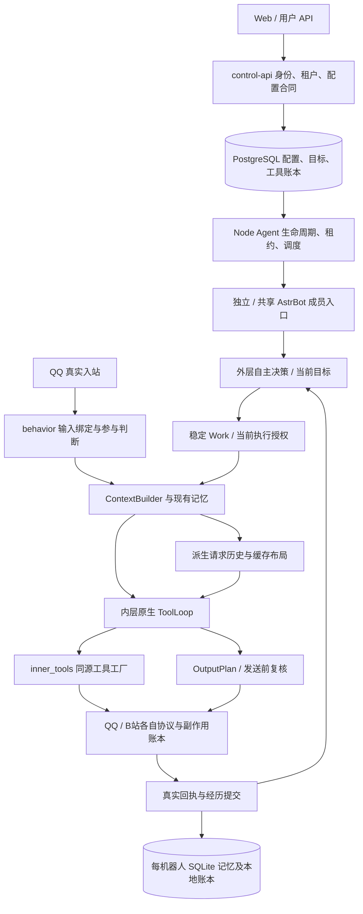

# FishBot 统一架构审查与整改计划

日期：2026-11-06。范围：当前工作树、真实调用链、此前已取得的 Linux 运行记录，以及本轮无网络/无生产写入的最小复现。

**本文件是待执行计划，不是整改完成报告。本轮没有修改产品代码、部署、重启机器人、调用模型或执行 Git 写操作。** 已有前端与后端未提交修改均保留。

## 1. 结论与决策边界

当前系统有可复用的公共管线，并非需要重建。最需要整改的是：**同一事实在多个边界的解释不一致、状态失效原因丢失、成功结果与未提交候选混用清理逻辑，以及部分工具返回值未真正履行公共结果合同。**

不建议引入总管所有功能的 GuardManager、第二套权限系统、第二套记忆或通用事件总线。建议在现有权威层内统一事实与结果语义，用跨入口合同测试保证不同实现一致；只有证实相同逻辑重复时才提取小函数。

必须保持：

- 已有 ContextBuilder、原生 ToolLoop、Work、OutputPlan、投递与回执链路。
- 外层决定目标，内层组合所有已启用且获授权的工具；research/message 等任务标签不能重新成为额外工具权限。输出合同的差异不等于执行能力的差异。
- 当前稳定前缀、不可变历史追加、资料变化增量、有效状态覆盖语义；不为整改改回每轮重排完整上下文。
- 身份、权限、工具可用性由后端当次校验；历史资料不能授予权限。
- PostgreSQL 保存平台生命周期和外部任务；每机器人 SQLite 保存现有人物/记忆/本地账本；请求缓存只是可丢弃的派生数据。
- 默认压缩轮数与群单轮消息上限继续由 `packages/contracts/memory-defaults.json` 提供，当前为 35 / 13。本计划不调整摘要长度、压缩频率或遗忘策略。
- 共享 AstrBot、多租户隔离、QQ Session、独立 API/Agent、现有内存治理。
- NapCat/共享 AI 的 48MiB 是各自实例的空闲软阈值，不是全组共享额度；40 秒 PAGEOUT 与 Guard 不作为缓存修复的调参手段。本轮没有重新测量生产 cgroup 或内存容量。

### 纳入的“另外三个问题”

本计划按前序三项明确理解为：①26 号不同自主任务的首请求低命中；②26 号外层历史在未完成请求后清空；③26 号同一前台会话 27.8K/12.2K 与约 27.6K 未报告缓存交替。不把它们预设为同一故障。

## 2. 调查证据与可信等级

| 标记 | 含义 | 本轮证据 |
|---|---|---|
| 源码已证 | 当前实现能明确定位，不等于已在生产造成用户可见事故 | 下列路径、函数与 SQL 条件 |
| 最小复现 | 直接运行现有纯函数，无替身模型/协议 | `.local/architecture-review-20261106/reproduce.py`、`reproduction.json` |
| Linux 已观察 | 本会话此前取得的生产诊断与账本，未重新制造事件 | `.local/cache-1255-20261106/{diagnostics,providers,ledger}.log` |
| 待验证 | 风险、候选原因或拟实施方案 | 不当作故障根因，不计入验收通过 |

此前缓存发布报告仅提供背景：`cross-stage-cache-release-20261106.md`、`inner-toolloop-cache-optimization-20261106.md`。本次结论以源码和实际记录为准，不继承“已全部高命中”的结论。

本轮复现结果：

1. `project('QQ接口已确认操作成功。', write=True)` → `receipt.status=unknown`。
2. `project('未执行：QQ账号已变化。', write=True)` → 同样 `unknown`。
3. B 站 `execution=pending / receipt=not_applicable` 进入公共投影后 → 外层 `confirmed`，原始 pending 被嵌进 data。
4. AppendHistory 已提交 3 个消息块后，对下一次候选调用 discard → 已提交历史变为 0。
5. ReadonlyJournal 已有成功基线后，下一次候选 discard → 原成功基线被清空。

这些实验没有验证 QQ/B 站真实副作用，也没有测量新的缓存率。

本地复核命令：`python -B -X utf8 .local/architecture-review-20261106/reproduce.py`。该脚本不连接生产数据库、模型或协议，仅调用当前纯函数。

## 3. 实际架构与调用链



### 3.1 需要保留的四个权威层

| 层 | 当前模块 | 应当负责 | 不应负责 |
|---|---|---|---|
| 平台与持久任务 | control-api、database/autonomous、database/tool-effects | 租户绑定、配置版本、账号授权、任务认领/恢复 | 为模型编排聊天内容、猜测平台写入成功 |
| 运行时与工作 | node-agent/autonomous、autonomous_runtime、bot_pipeline | 当前成员/Work/租约、模式所有权、执行末端有效性 | 把“消息存在”当工具成功，把取消当撤销副作用 |
| 能力与协议 | inner_tools、QQ/B站适配器、媒体模块 | 当前工具授权、目标验证、协议调用、实际回执 | 新建独立调度/记忆/发送体系 |
| 上下文与传输 | ContextBuilder、context_protocol、summary_material、context_transport、journal | 来源表达、摘要覆盖、追加复用、失效退役 | 决定真实权限、替代任务数据库、通过冻结状态提高缓存 |

## 4. 约束归属：哪些统一，哪些分开

| 约束/事实 | 权威及统一要求 | 必须保留的独立职责 |
|---|---|---|
| tenant / bot / QQ / sender | API 的 owned 查询、成员清单、真实协议事件；上下文只引用 | 管理员登录身份不等于 QQ 主人；内部服务不冒充主人 |
| generation / config revision | 当前数据库与成员绑定；所有异步写入使用同一含义 | 配置代次、记忆 epoch、模式 epoch、goal revision、lease owner 不是同一个版本号 |
| 工具权限 | 现有 feature 配置、B站 scopes 与账号绑定；目录从同源工厂投影 | 工厂筛选便于模型选择，执行末端再校验用于防止 await 后权限变化；这两次检查不是可删的重复 |
| 工作有效性 | Work、运行时 lease、当前成员、截止时间 | 新动作有效性与旧动作回执归档不同：旧动作失效后仍可记录真实回执，但不能继续新动作或污染新代次 |
| QQ 在线 | runtimeStatus、持久调度 SQL 的同一健康时间合同 | “监控过期”“协议离线”“AI 未就绪”“确认可清退”不能压成一个 offline 布尔值 |
| 主动/被动所有权 | 当前自主模式 epoch 与既有调度归属 | 正常 @/私聊答复、未点名群参与、主人主动联系、跨会话工具发送有不同入口条件 |
| 群回复新鲜度 | 同 scope 的观察游标、当前草稿与投递状态 | 模型决定语义是否过时；末端程序防止复核后又插入新消息，不取代语义判断 |
| action / step 幂等 | 现有 pipeline / tool_effects 账本 | 一次聊天行动与多个分条投递分别计量，保留逐条确认与中止 |
| 执行结果 | `execution` 与 `receipt` 分轴、真实 evidence | 只读完成、待处理、准备附件、平台接受、公开可见是不同事实 |
| 记忆版本 | 原 SQLite 存储、reflection epoch、summary coverage | 源记忆整理与派生请求历史退役分开；不能仅清 journal 就声称遗忘完成 |
| 缓存状态 | 当前 provider / scope / schema / 摘要及遗忘版本 | 上游缓存 TTL/路由不是本地 journal 所有权；本地复用不保证平台报告命中 |
| 资源保护 | 独立 Guard、cgroup、实例生命周期 | 内存回收不能清除业务目标/Session；媒体子进程独立归属不能误杀共享 AI |

**统一的是事实、错误含义、必要输入和合同测试，不是把所有入口套在同一组 if 上。**

## 5. 发现与整改项目

### F01：失败候选与成功缓存基线共用破坏性清理（P1，已复现）

源码：`autonomous_runtime.py:503–544`、`decision_history.py:110` 及 AppendHistory.commit、`readonly_journal.py:59–64`、`behavior.py:1065–1074`。

外层模型未完成、异常、JSON 不合格或身份失效，最终走相同 discard；其语义是清除整个成功历史。前台/内层 journal 也有同类行为。合理的安全失效与普通失败被混为一谈。

影响：一次网络错误/取消可能使下次全量重建，掩盖成随机低命中；不能因此反过来一律保留历史，因为遗忘、换号、换权限确实要求退役。

整改：在**原 journal 类**内区分 `abort_candidate` 与 `retire_committed(reason)`；失败候选不写入成功历史，普通失败保留最近成功基线，下次仍检查完整 scope/native-prefix 等复用前提。提交按 serial 与 owner 比较，迟到候选不得清掉较新成功结果。身份/权限/摘要/遗忘失效按现有合同退役；未知副作用的工作不自动重放。

### F02：缓存诊断有入口覆盖与失效原因盲区（P1，源码及记录已证）

源码：`model_cache.py:16/36/60`、`ReadonlyJournal.prepare` 的 `initial_or_boundary`；外层只记录 prepare 的 resetReason，discard 未记录具体终止原因。前台 SDK provider stats 不足以还原最终 messages 或原始 usage。

整改：在现有模型请求边界增加有限、无正文的 attempt ID、阶段、Work、序号、成功/取消/异常终态、journal prepare/commit/abort/retire 原因、system/tools/routing 摘要、消息块长度与哈希。按上游可见范围计算稳定前缀；不擅自发明 tokenizer 精确值。

`cached_tokens` 拆为 `reported(value)` / `missing`，显式 0 与未报告分列。聚合按 request ID 去重，区分首请求/后续工具步、orientation/planning/foreground/freshness/摘要学习。**总输入 Token 是输入量；不要把 SDK 的 token_input_other 当总输入。**

有需要才短期开启现有 owner 范围原文采样，不默认采所有租户或永久保存生产正文。

### F03：公共工具结果合同没有端到端贯通（P0，已复现）

源码：`tool_outcome.py:5–41`、`qq_actions.py:75–136`、`group_actions.send`、`bilibili_tools.py:113`、`packages/contracts/bilibili.ts:75`。

QQ 资料/空间已有尝试账本和 confirmed 状态，但返回自然语言；公共包装对写工具只能判 unknown。明确“未执行”也可能变 unknown。B站 not_applicable 不在 Python STATES 中，pending 只读结果被包成外层 confirmed。原始 data 仍在，但上层必须猜哪层语义有效。

整改：沿用现有结果版本，规范 `execution` 与 `receipt`，保留 not_applicable；QQ 在适配器内部根据真实协议回执生成结构化结果，不通过关键词猜成败。read-completed 不代表写入确认；prepared 不等于 sent；confirmed 不等于平台公开可见。旧账本状态先读映射，不将旧 unknown 补写为 confirmed。

接线顺序：QQ 原始结果 → 公共 wrapper → native_internal evidence/checkpoint → autonomous feedback → execution_memory/UI。不得只改最外层显示。

### F04：本地操作幂等键仍有作用域差异（P1，源码已证、生产碰撞未证）

`group_actions.send` 使用会话、作者、消息 ID 组合，注释明确 OneBot 群/私聊 ID 可碰撞；`qq_actions.initialize/execute` 仍以 `(event, action)` 为主键。`bot_pipeline` 的 pipeline_events 则是 `(scope, subject, event)`。

风险：不同会话碰撞可能错误阻止合法资料操作；不能据此断言存在跨租户执行漏洞，每机器人数据库已有隔离。

整改：复用可信 Work 的来源构造小型键函数，逐步补全 QQ 操作 origin/scope/subject，不接受模型提供身份。旧数据保守兼容，旧 unknown 不因键升级获得重发资格；迁移采用新增字段/索引或明确版本映射，不清表。不把聊天分条消息的 sequence 键与工具 step 键强行合一。

### F05：隐含限额与能力目录表达不完全一致（P1，源码已证）

`qq_actions.py` 仍有全类 QQ 操作过去 24 小时 20 次、签名按模式配额；`inner_tools.features` 已同源装配工具，但不等于每项执行限制都自动出现在目录。B站目录也依赖 settings/account/media 状态快照。

整改：先列出每个现存限额的目的、作用域、配置入口与报错。安全/平台约束继续保留；可配置产品额度从已有合同读取，避免散落常量。不在架构任务中顺手取消所有限额。目录表达 available_to_attempt 与动态受限原因，执行前后仍以真实校验为准，绝不能把目录缓存当授权。

### F06：在线事实存在跨语言复写，边界有漂移风险（P1，风险项）

源码：`packages/shared/runtime-status.ts` 的 90 秒/未来 5 秒；`database/autonomous.ts:9` 的 SQL 时间窗；`node-agent/autonomous.ts:10`。目前关键时间窗基本对齐，不应报告为已不一致。SQL 时间戳强转与 TS Date.parse 对畸形数据处理不同，需要故障样本测试。

整改：保留数据库原子过滤与运行时检查；共享规范化健康合同和数据样本，统一边界结果。离线宽限仍由 `offline-policy.ts` 管理，不直接用 90 秒监控过期触发清退。不得为“统一”把数据库原子 claim 改成应用层先查再写。

### F07：主要耦合点是集成接线顺序，而不是功能类数量（P1/P2，源码已证的维护风险）

`behavior.install_runtime` 同时装配入站、上下文、工具、发送复核、provider payload、缓存提交和 SDK hook；修改其中一段可影响其他入口。当前确实 patch 了 WakingCheckStage.process、ProviderOpenAIOfficial._prepare_chat_payload/text_chat、PipelineScheduler.execute、AiocqhttpMessageEvent.send。

整改：先补 hook 合同与安装顺序测试：重复安装、共享成员增删、SDK 签名变化、stream/non-stream、工具续接和内部调用。仅在测试稳定后，把纯投影/键计算/终态分类提取到已有相应模块，behavior 继续负责接线。避免一次拆文件引发 ContextVar 或闭包 owner 丢失。

### F08：多个账本是必要分层，但缺少明确的对账关系（P1，结构已证）

现有 PostgreSQL autonomy_actions/tool_effects 与 SQLite pipeline_actions/pipeline_events/QQ 尝试表分别管理长任务、外部工具、本地聊天。不能全部合并，否则跨进程恢复与消息分条会丢失语义。

整改：固定 Work→action→tool step→dispatch sequence→receipt 的关联和 owner；真实结果归档与当前社交/记忆提交分别记状态。重启恢复走原账本对账，不从模型回复推断成功；unknown 只能 reconcile 或人工核实，不换 ID 再发。新增关联字段必须确有缺口才添加，优先复用已有 ID。

### F09：摘要覆盖和遗忘保护应成为所有缓存入口的共同退役合同（P1，保护已存在，需补覆盖）

已有 `memory_reflection.py` 的 epoch、源摘要覆盖、成功后事务删除 pending/materials；`ContextBuilder` 固定读取背景和来源；`memory_strength.py` 集中衰减参数；兴趣/表达巩固已有独立证据和频率限制。不能说这些都未实现，也不能只因表存在就宣称全链路健康。

整改：统一“源记忆发生何种变化必须退役派生资料”的事件含义与测试。验证前台、外层、内部 Work、发送复核都不会把遗忘内容复活；当前摘要提交、core note 更新、pending 清退必须仍是现有事务的一部分。稳定事实不因缓存清空消失；召回本身不增加兴趣。

本轮未进行新的生产学习迭代测试、真实遗忘或数据库重启实验，这些属于实施验收。

### F10：媒体与资源安全已有独立边界，不能统一成字符串 URL 正则（P1 回归/P2 整理）

Python `media_egress` 已有 DNS/socket 校验、逐次重定向、流式 32MiB 上限、45 秒总时限、临时文件清理；Node `media/lifecycle` 有 CDN 地址限制、流式预算、Guard admission、专属 cgroup、子进程等待退出。B站凭据不应被转发到 CDN。

整改：跨语言共享安全用例和资源指标，不强行共用同一下载实现；保持协议允许域、认证头、大小、音视频流程各自差异。缓存/上下文整理不改媒体资源保护。重点回归取消、超时、地址重绑定、重定向、磁盘不足和进程树清理。

### F11：来源、事实与模型指令的边界需要回归，不靠提示词补丁（P1）

`ContextBuilder` 保护 identity/origin 等字段所有权；`annotate_speaker` 保留真实作者；群工具返回 member ID、mentions/reply_to；shared/headless 入口校验成员代次。当前机制应保留。

整改：验证昵称冒充主人、引用他人文本、工具/视频内容包含指令、跨会话回忆和同名群友；这些只作为数据。每入口必须由可信绑定生成身份，不允许缓存中的旧 owner 或外层目标文本改写 sender/tenant/目的地。本轮没有证据证明当前存在可复现的跨租户越权，不夸大为已发现安全事故。

## 6. 三个缓存问题的独立分析

### C1：不同自主任务首请求低命中

**已知：** 内层 journal 按 autonomous Work ID 临时拥有，执行结束释放；同任务可连续追加。新任务携带新的任务说明、可信工作身份、选取资料，不是旧 Work 的继续。`model_cache.routing_key` 按租户/机器人/scope 等路由，不是简单把 Work ID 当上游缓存键，因此不能说“每换任务 ID 就必然换 Key”。

Linux 记录：26 号 12:32:58 的 Work 首请求约 15,762 输入、未报告缓存；后续 16,926/15,616，约 92.3%。12:33:51 另一个 Work 首请求约 15,761、未报告缓存；后续约 97%。证明任务内修复有效，但跨任务首请求仍需调查。

**计划：** 先对不同 Work 的最终 wire 比较 system、工具定义、任务指令、只读包位置、消息块、路由摘要与共享前缀长度；区分必要身份变化和可后置的普通任务资料。只在公共 provider/context 边界整理非权威数据，不复用旧任务的执行身份、旧工具调用或助手执行记录。候选结构必须在同一语义输入下验证内容等价与首请求实际费用，不能用同任务第二步的高命中冒充跨任务首请求通过。

### C2：外层历史清空

**源码根因已确认到机制：** F01。Linux 26 号 12:32:27 有 planning prepare、没有匹配 usage；12:32:46 下一次 prepare 为 initial_or_cleared；随后约 44,266 输入/10,112 缓存（22.8%）。

**尚未确认：** 12:32:27 那次究竟是异常、取消、工作失效还是其他退出，现有日志不足以精确区分，不能直接宣布上游报错就是那一次的根因。

同类结构也在前台 journal 存在。先 F02 补终态，后 F01 分离候选回滚/基线退役，联合验收普通失败不破坏成功缓存、权限变化仍立即退役。

### C3：同会话 27.8K/12.2K 与约 27.6K 未报告缓存

Linux provider stats 同一 conversation 中，约 27,794、27,774 总输入有 12,160 缓存（约 43.8%）；下一次约 27,591 输入/SDK 缓存字段 0。SDK 可能把上游缺失记成 0，历史时点缺少完整原始 wire，**目前不能定因**。

候选原因：native prefix 不再是严格扩展、旧候选失败导致 F01、摘要/权限退役、工具合同变化、前台附加复核/其他阶段误混统计，以及上游未报告/缓存 TTL 或路由。每项通过 F02 的 request ID、终态、基线哈希和首差异排除，不凭 Token 近似或总命中率猜测。

### 三者相互影响与验收口径

- 相同 discard 机制可同时影响 C2/C3，但不证明 C3 的历史记录就是它引起。
- 回执不清会影响外层重规划和目标更新频率，间接增大动态资料与请求量；不能仅修缓存而保留错误反馈。
- 任务隔离与高缓存存在可优化的组织边界，不应靠跨 Work 复用敏感历史解决。
- 小双白 12:55:36 的约 55,313 输入未报告缓存，当次 prepare 没有 reset；12:55:41 才出现 history_size_boundary。不能倒置时间线，把后一个重建解释为前一个低命中。
- 后续外层曾恢复约 90%–95%，只说明部分路径有效，不代表所有入口均已收口。
- 不预设“极限 50%”或“理论必有 99%”。分别统计可复用前缀占比、真实 reported cache、缺失率、费用和语义正确性。

## 7. 异步与状态失效处理合同

| 情况 | 缓存候选 | 真实外部动作 | 记忆/当前状态 |
|---|---|---|---|
| 模型请求超时，尚无副作用 | 丢弃候选，保留仍合法的已提交基线 | 不伪造完成、不因缓存自动重做任务 | 不写助手答复或成功经历 |
| 非法 JSON | 不把非法决定加入历史；允许同合法基线重新组装 | 不执行该决定 | 不提交目标变更 |
| 摘要成功 / 遗忘 / 身份与权限变化 | 按原合同退役，下一请求由当前权威完整构建 | 阻止未派发新动作 | 源事务与 epoch 保持原子；旧回调不得复活 |
| 新消息打断 | 区分旁听、新的明确请求、已开始的真实执行 | 前台优先；已派发动作不当作撤销 | 合并事实，不把普通旁听误当工具结果 |
| 发出后失联 / 超时 | 不靠重放上下文重试写操作 | unknown，按原 action 对账 | 保存未确认状态，不写成功记忆 |
| 真实确认后配置变化 | 不污染新代次缓存 | 保存原动作真实确认，不继续后续动作 | 当前社交计数/记忆是否可提交按所属版本判断 |
| 模式切换 / QQ 清退 | 失效自主 owner，不恢复旧 Work | 未执行取消；已执行对账 | 目标保留；不能为自主活动重启 QQ |

实施时用 barrier/可控 Future 制造时序，不以长 sleep 碰运气。每个 owner 验证“释放自己持有的资源”，不得因为同 key 有缓存就清掉另一 owner 的资源。

## 8. 统一实施顺序与交付门槛

### 阶段 0：冻结基线与可观测性（先做，不改变业务）

涉及：`model_cache.py`、journal 两类、`behavior.py`、`native_internal.py`、诊断读取/展示。

交付：版本/产物摘要、当前配置合同、真实入口图、request 生命周期原因；缺失缓存与 0 分开。记录工作树已有修改归属，避免覆盖并行前端。

验收：所有既有主要入口能关联到一次实际请求的开始与终止；统计不重复、不泄露凭证和正文；诊断失败不影响聊天。有限采样前明确 owner 范围、大小与自动过期。

### 阶段 1：先修事实语义与幂等（F03/F04/F08）

涉及：QQ 工具、tool_outcome、native_internal、现有 feedback/execution_memory、必要数据库增量合同。

交付：结构化结果逐入口贯通；prepared/pending/read/write 不混；幂等来源统一，保留旧 unknown。

门槛：明确未发不显示 unknown；超时已发不显示 rejected；真实确认只记一次；状态提交失败不导致重新发送；群/私同 ID、共享成员、多租户均隔离。

### 阶段 2：安全失效与普通失败分离（F01/F02/F06/F09）

涉及：原 journal、autonomous_runtime、behavior、健康事实合同与回归用例。

交付：只读候选/成功基线的事务语义、退役原因、跨入口测试；保留已有布局算法。

门槛：普通失败后合法基线可复用；并发迟到不覆盖/清除新基线；遗忘/摘要/身份变化仍退役；不放宽已有真实权限校验。与阶段 1 的 unknown 对账一起验证，不让缓存保留变成副作用重放。

### 阶段 3：三个缓存问题逐项收口

涉及：C1 的任务数据投影、C2 的失败退役、C3 的最终 payload 差异；继续用现有 tool factory 与 transport。

交付：按任务/入口隔离的时间线，首差异定位，等价 A/B 候选与真实 usage/费用；可无收益而不采用。

门槛：同输入、同模型、同工具与权限对比；至少分别覆盖自主新 Work、同 Work 多工具步、前台追加两轮、外层两阶段、发送复核；每次低命中有本地可解释原因或明确标为上游待证。缓存率按 reported 样本统计同时公布 missing 比例，不把 missing 全当命中或 0。

不为提高命中延迟摘要、冻结联系人状态、遗漏新消息、跨租户缓存正文、添加虚构 assistant 确认，或假设当前中转支持显式断点。

### 阶段 4：最小结构整理与新能力接入约束（F05/F07/F10/F11）

交付：能力目录/限制的同源投影、hook 合同、复用键/结果/判定小函数；只迁移阶段 0–3 已证明重复的逻辑。

不做：整拆 behavior、大改 ContextBuilder 格式、替换 AstrBot、合并所有账本、加入常驻服务或新的多租户 ACL 引擎。

门槛：新能力只需接现有工厂/权限/结果/账本，不再手写另一套外层能力列表；旧入口调用路径与输出一致，stream 与 non-stream 都覆盖。

### 阶段 5：独立部署与完整回归

先隔离环境，后授权测试 QQ，最后按共享组受控更新。Web/API 可独立发布，不借此重启 Agent/QQ；AI 模块更新采用已有安全运行时更新方案，在受控空闲点处理，不能宣称 Python 已加载模块会自动热变。Agent 合同更新核对运行中解析器，不只看磁盘和 applied_revision。

交付：Windows/Linux 源码与实际产物一致性、运行 PID/创建时间、Plan vs Actual、异常回退记录。未来提交推送只按届时明确授权。

## 9. 回归矩阵与既有测试入口

以下是实施时要运行/补齐的检查，**本轮没有执行整套测试**。

| 入口或风险 | 现有测试基础 | 必须补充/确认的场景 |
|---|---|---|
| Work/投递/分条 | `bot_pipeline_test.py`、`pipeline_boundaries_test.py`、`pipeline-runtime.test.ts` | 群私同 ID、发出后失联、已确认但状态提交失败、分条中途换代 |
| 内部任务/模式/租约 | `autonomous_pipeline_test.py`、`autonomous-lifecycle.test.ts`、`autonomous-coordinator.test.ts` | 读工具 awaiting 时切模式、写动作派发后取消、租约到期再认领与旧回执归档 |
| 缓存与上下文 | `readonly_journal_test.py`、`decision_context_test.py`、`context_transport_test.py`、`model_cache_test.py` | 非破坏性 abort、双候选次序、每种 retire reason、首 Work 与后续工具步区分 |
| 记忆 | `structural_memory_test.py`、`memory_pipeline_audit_test.py`、`self_interest_test.py` | 摘要成功才覆盖/移池；遗忘后缓存不可复活；35 轮/13 条默认一致；群私来源准确 |
| B站/QQ工具 | 现有 B站与收藏测试，`pipeline_boundaries_test.py` | not_applicable/pending/prepared 与 confirmed 不混；unknown 不换 ID 重发；配置/账号换代 |
| 在线/清退 | `offline-eviction.test.ts`、`autonomous-maintenance.test.ts` | TS/SQL 健康边界相同，坏时间戳安全失败，短暂断线不清 Session，其他共享成员不受影响 |
| 媒体/进程 | `bilibili-media.test.ts`、`media_separation_test.py` | 恶意重定向、下载超限、取消子进程树、磁盘不足、Guard stale、清理幂等 |
| UI/API | 现有 API 与浏览器测试 | 管理员/租户可见范围、旧配置读取、真实执行状态与监控未知区分、并行前端保留 |

项目真实入口：`npm test`、`npm run build`、`npm run build:production`；Python 按文件/测试既有说明运行，涉及原生 SDK 的用现有 AstrBot 虚拟环境。先跑受影响测试，再完整相关回归；不为“通过”删弱断言。

### 性能与产品验收

- 正常私聊、@、引用、热跟聊、未点名参与、主人联系、主动/被动并存与工具续接不退化。
- 保留平台/QQ 收藏表情、图片/语音、引用、分条意图和记忆来源；不为省 Token 合并用户要求保留的气泡。
- A/B 同时记录总输入、新增未缓存输入、reported cached、missing、输出、实际费用、TTFT、总时延与请求次数；避免只报最好的一轮。
- 额外 P95 延迟目标仍 ≤5 秒；模型服务异常单列。没有同等样本不宣布满足 P95。
- 记录整机 RAM、共享 AI PSS/USS、Swap IO、zswap 池、PSI、CPU、journal 保留大小；不增加常驻进程、高频模型轮询、无界诊断或无界历史。
- 新接口必须有独立入口清单和权威来源；“单元测试通过”不等于 Linux真实在线功能通过。

## 10. 兼容与回退

1. 先保留当前产物和哈希、配置版本与测试结果；原始凭证/Session/记忆不进入仓库。
2. 缓存投影候选可独立退回当前布局；退回时只丢派生 journal，不删除源摘要、事实、兴趣、历史或账本。
3. 结果合同优先兼容读取旧记录，不无条件改写旧状态；必要数据库变更只做加法。回退应用不恢复旧整库覆盖期间新增的真实回执。
4. 已派发 unknown 和 confirmed 的动作永远沿原 action/step 对账；版本回退不重置幂等表。
5. 若出现越权、重复副作用、遗忘内容复活或正常消息丢失，停止受影响候选/自主功能的新动作，保留被动服务及真实回执，恢复最后可靠产物。
6. 内存 Guard/离线清退保持原部署，不能为了回退业务改动移除资源保护。
7. 共享组与成员分别核对；只更新受影响组件，不停止其他租户在线 QQ。

## 11. 不确定项与完成定义

尚缺：C2 具体那次未完成请求的终止原因；C3 历史最终请求与原始 usage；跨 Work 首请求中可信身份/普通任务资料分别造成多少前缀变化；健康 SQL 畸形字段的真实故障测试；全部入口的迟到副作用对账故障注入；新的真实 Linux 性能基线。

这些缺口不阻止制定计划，但阻止宣称所有根因已查明、已无越权风险或已达到全入口高缓存。本轮只复现了结果投影和 journal 清理语义，不冒充生产修复。

后续最终交付必须逐项对照本文件 F01–F15、C1–C3 和阶段 0–5：实现文件、保留/变化的边界、实际测试、Linux 证据、未完成与合理偏移。合理不采用某项缓存候选也可收口，但要给出无净收益的实际数据，不能偷偷换成另一套业务语义。

**整改目标：同一事实只在所属权威层定义，跨入口解释一致；每项执行保留末端校验和真实回执；缓存优化继续沿现有追加机制推进，不损害上下文、记忆和正常功能。**

## 12. 追加范围：群私互通、收藏语义、2644 表情及人格前缀

本节根据追加要求纳入同一计划，仍然不实施。新增证据为本轮 Linux 只读 SELECT、只读 SQLite 计数及收藏索引存在性检查，脚本和输出位于 `.local/architecture-review-20261106/social-read.sh`、`social-read.log`。没有登录 QQ、触发收藏同步、调用视觉模型、修改配置或给机器人发消息。

### F12：群聊/私聊互通应验证分层语义，而非把原生历史合成一池（P1）

**当前源码已接线：**

- `memory_scope.person_filter/fact_rows`：同一个机器人的同一可信 QQ，可从其群聊和该 QQ 私聊读取人物事实，保留 source_scope；不根据昵称认人，也不打开其他机器人数据库。
- `memory_scope.summary_rows`：本会话摘要以及有该 QQ 真实参与证据的相关跨会话摘要可召回，不因摘要文本提到一个 QQ 就把它视为作者。
- `pending_messages`：尚未压缩的跨会话消息也可桥接，当前有近 7 天、最多 16 条、合计约 3000 字符的读取限制；并非跨会话全部原文无限互灌。
- `memory_reflection.rolling`：当前大摘要与小摘要作为共享背景组装，附来源会话；`core_note` 为同一机器人固定背景。当前会话群原文和 AstrBot 原生历史仍保留自己的 scope，不应为“互通”混成全机器人单一会话。
- ContextBuilder 标明当前群/私、真实作者、来源和参与者；前台与外层各自采用现有共享记忆投影。

**Linux 只读观察：**2644425204 的 memory 开启；pending 有群记录 143 条、私聊 2 条；memory_rounds 群 18 条、私聊 2 条；摘要有私聊 2 条及其他 scope 1 条。计数只证明数据存在，不证明本轮模型收到全部正确来源，不能据此宣布互通验收通过。

**后续调查/修复：**

1. 用同一可信 QQ 的群→私、私→群、新消息未摘要、摘要后、三小摘要合并后依次检查最终上下文；比较原始事件、事实、摘要及内外层实际注入。
2. 区分“根本没进上下文”“进入但被压缩舍弃”“召回预算未选中”“模型看见但未正确表达”，不要一律加大上下文或追加提示词。
3. 检查来源 ID、reply_to、mentions、当前收件人，不让跨会话内容被描述成当前群现场；其他人的私聊不能串成当前说话者经历。继续沿用当前群私互通，不新增复杂披露权限系统。
4. 回归遗忘、人物纠正、账号不可切换、bot/tenant 隔离，以及外层和内层对同一记忆版本的读取。

**验收：**正确来源与身份、未摘要信息可及时桥接、摘要后不重复、遗忘不复活；使用固定测试内容核对最终 wire，不只看聊天回复像不像记得。

### F13：QQ 收藏已有按需语义标注，但自动补全生命周期不完整（P1）

**源码证据：**

- `apps/control-api/src/app.ts:118` 已把 `createFavoriteCaptioner` 接到 registerQQFavorites。
- `qq-favorites.ts` 的 POST sync 下载/复用图片，在没有 meaning、manual、semantic 时尝试视觉标注；一次同步最多尝试 8 项。超过的保持 pending，注释要求重新同步继续。
- `qq-favorite-semantics.ts` 已具备串行视觉任务、缩略图、内存/PSI 与聊天忙碌检查、临时文件清理、当前账号/配置回写校验；不是另一聊天 Agent。
- uncertain 项已有 semantic 对象，后续同步受 `!item.semantic` 条件影响，不会自动重新尝试；已有 OCR/描述不为空也不进入无语义补全分支。文字存在不一定等于语义质量已经验收。
- `qq_favorites.descriptions/catalog` 和 `qq_favorite_tools` 读取同一 index；缓存候选还要求账号匹配、总开关开启、单项启用、有 meaning、文件有效。实时收藏工具可以使用协议原描述兜底，但不意味着本地候选与视觉语义已齐备。

**结论：**不能说“没有自动加语义功能”，也不能说“任意新收藏都会自动持续补齐”。当前是同步入口内的有限标注，QQ 端新增、机器人保存后、进程重启后剩余 pending 的自动推进需要补齐与验证。

**实施要求：**

1. 沿现有收藏索引、标注器和后台执行/维护入口接线：真实收藏确认、导入发现新项、待处理恢复时登记有界补全，不为每张图新增定时器，不创建第二套语义库。
2. 先复查可复用的长期执行 owner，再确定续跑位置；不能长期持有已结束 HTTP 请求身份来做后台授权。账号、bot、tenant、配置版本、取消和人工修改需在回写前重验。
3. 以账号内稳定图片标识与标注版本去重；已有人工 meaning/avoid/enabled 优先，不被迟到模型结果覆盖。平台 OCR 与视觉语义注明来源；不确定时不伪造语义，不无条件自动启用。失败/压力/忙碌应有有界退避和可见原因，禁止每条聊天重复标注。
4. 保持视觉缩略图和现有资源保护，模型输入最长边 ≤384 的既有全局要求需对标注拼帧输出单独核验；GIF 抽样保留覆盖限制。费用归属只用该机器人已配置且获授权的模型，不使用其他租户 Key。
5. 标注结果只作为工具/候选数据进入现有 ContextBuilder/readonlyChanges；候选实时变化不塞入 system、人格前缀或函数定义。无变化不重复注入，变化追加一次，保持同一素材版本的消息块不可变。
6. 模型调用与统计单列 `favorite_annotation` 类别，避免和聊天缓存率混算；不修改聊天 prompt_cache_key、provider、journal、原生历史或工具顺序来迁就标注。**先保证其他入口缓存不回退，再评估标注自身缓存与费用。**

**验收：**首次/增量导入、新收藏保存后、pending 跨重启、uncertain 人工纠正、配置/账号变更、两租户同图、聊天繁忙/Guard 压力、取消时迟到返回。新语义最终在平台候选/QQ 收藏工具均可见，准备与真实投递分开验证。对无语义变更的聊天请求，稳定前缀、tools 哈希和缓存路由不应被标注工作改变；有真实语义更新按现有增量合同追加，不承诺完全不影响当次新增 Token。

### F14：2644425204 不发表情包，先定位链路而非盲开配置（P1）

本轮 Linux 数据库只读结果：机器人 `d18ad07d-4b6f-45ec-90ca-330debc48983`、revision 10，running 且协议 online；`memeEnabled=true`、`qqFavoriteSaveEnabled=true`、`memePacks=["blue-fat-fish"]`、memory=true。该机器人目录没有 `qq-favorites/index.json`。

**能确认的范围：**数据库未关闭总表情开关；当前本地 QQ 收藏候选没有索引可供读取。**不能确认的范围：**运行中配置是否与数据库一致、平台包文件是否有效、具体哪条回复被何处阻止、QQ 实际收藏是否为空。缺少收藏索引不能解释平台包也不发。

历史上用户对该 QQ 有“关平台表情包”的要求，而数据库现在仍列出 fish 包；实施前须核对该要求的应用记录、当前有效配置与用户明确保留的例外。这里不擅自更改开关，也不把“所有机器人默认”覆盖为该 QQ 的特殊配置。

后续按一条完整行动逐步记录：

`DB 配置 → Agent/成员已加载配置 → 平台包与收藏目录 → ContextBuilder 候选 → 模型实际选择 → marker/工具准备 → OutputPlan 附件 → 发送前校验 → 协议回执 → 使用状态提交`。

排查要区分：无候选、无语义/单项禁用、模型未选、冷却/严肃场景等条件、标记被清洗、附件准备失败、分条/尾部取消、协议未确认。不得新加概率兜底或通过每次强制发图掩盖故障；已选定有效候选后遵循既有发送规则。

验收覆盖群/私、普通回复/内部任务、平台包/QQ 收藏；每个未发送案例有真实阶段原因。若按该 QQ 特殊要求关闭平台包，仅验收获准来源，不为“测过”擅自恢复被关闭的来源。

### F15：人格前增加固定提示，统一接入而不污染资料任务（P2，与上述回归一起）

拟增加的原文为：

```text
important[要时刻注意自己应该保持人格，不要机械性，任务性得对话]
```

用户要求的位置是人格提示词之前。后续在现有人格组装入口集中增加一次，保持稳定前缀：前台对话、内层对话任务与外层需要人格的决策使用一致的角色背景，不在多层 provider hook 重复 prepend，不逐个改每个机器人的持久人格文本。

不把此句注入摘要、事实提取、语义标注等非角色数据任务；不让其覆盖可信身份、真实回执、安全规则或结构化输出合同。“不要任务性对话”约束交流表达，不表示拒绝主人任务、虚构人类经历或取消外层目标执行。

验收：已有角色/特殊人格保持原规则；当前请求只出现一份固定前缀；工具 JSON 与内部协议不泄露；旧会话不累积重复提示。首次更新 system 导致的必要缓存冷启动单列，之后应稳定复用，不能为保旧缓存跳过新提示。

### 追加事项与原实施顺序合并

| 原阶段 | 追加工作 | 完成门槛 |
|---|---|---|
| 0：基线/诊断 | 2644 实际加载配置、候选与投递原因；标注任务独立统计 | 不调用视觉/QQ 也能先判定缺的环节，缺数据明确标出 |
| 1：结果/幂等 | 收藏保存、附件准备、图片发送贯通真实结果 | prepared 不报 sent；unknown 不重复保存/发送 |
| 2：失效/记忆 | F12 跨群私与摘要/遗忘；F13 回写 owner/人工覆盖保护 | 无串人、串号、迟到覆盖和遗忘复活 |
| 3：缓存 | 标注对现有聊天/内外层缓存隔离，再优化标注自身 | 先检查其他请求布局/路由不被旁路任务改变，再报告命中与费用 |
| 4：小型整理 | 接通收藏增量语义续跑、同源候选；F15 集中人格前缀 | 不新增自主系统、语义库、权限层或每图定时器 |
| 5：部署/验收 | F12–F15 跨入口真实验证及回退 | 按授权范围验证消息/图片回执，保留 QQ 在线与特殊配置 |

本节与 F01–F11 一起执行和收口，不另起零散补丁计划。当前仅追加计划，未实施 F12–F15。
