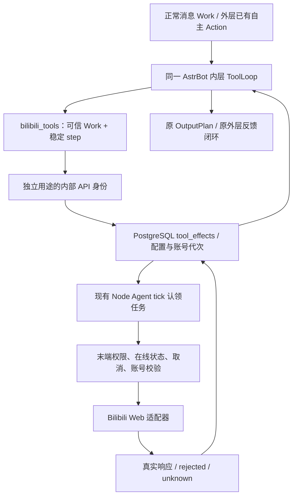

# Bilibili 集成实施记录与 Plan vs Actual

日期：2026-11-03。**完整 Bilibili 计划尚未全部完成；当前已在 Linux 部署，最新实现及真实验收见第 11 节。第 1—8 节保留早期实施状态，不代表当前部署结论。**

## 1. 实施依据与架构复核

实施依据保持原文，不以本记录替换或缩小原计划：

- 第一轮：`../qq-ai-saas-research/bilibili-audit-20261103/FishBot-Bilibili-源码调查与验证报告.md`。
- 第二轮：`../qq-ai-saas-research/bilibili-design-20261103-round2/FishBot-Bilibili-完整能力与低资源接入工程计划.md`，包括能力矩阵及 P0—P7 验收门槛。
- 本轮追加：一级 Bilibili 标签、每 QQ 一个账号、主动/被动共用、流式媒体、重新测磁盘、不执行 Git、不重启在线 QQ、不做未经授权的 B 站真实写操作。

复核现有入口后保留：外层 `autonomous_runtime.py` 只选择目标；内层原生 AstrBot ToolLoop 执行工具；`bot_pipeline.py` 继续管理聊天 Work、OutputPlan、发送许可、协议回执及状态提交。B 站工具结果作为内层执行反馈返回原自主循环，不生成第二套人物记忆、QQ 发送器或自主调度。

新增工具动作日志与现有自主 Action 是父子执行关系：前者记录 B 站协议副作用；后者仍拥有自主任务。自主模式撤销、QQ 离线、配置代次变化均使旧工具任务失效。没有每 QQ 新进程或新定时器。

## 2. 实际修改位置

| 文件 | 职责 |
|---|---|
| `packages/contracts/bilibili.ts` | 独立配置、13 类 scope、严格操作参数、执行结果合同 |
| `packages/database/migrations/009_bilibili_tools.sql` | 设置、加密账号、登录、工具动作、取消意图、服务冷却表 |
| `packages/database/tool-effects.ts` | admission、租约、代次与权限栅栏、稳定身份、unknown、崩溃恢复 |
| `packages/database/index.ts` | 注册 009 迁移 |
| `packages/shared/tool-bridge.ts` | 与用户会话、QQ token 分离的内部工具身份 |
| `apps/control-api/src/bilibili.ts` | 租户配置、二维码、绑定/解除、刷新、执行记录、内部工具 API |
| `apps/control-api/src/app.ts` | 注册 API，补加密数据存在时的 master key 丢失保护 |
| `apps/node-agent/src/bilibili/web-adapter.ts` | 有界 HTTP、CSRF、WBI 辅助、字幕时间轴、凭证身份验证 |
| `apps/node-agent/src/bilibili/account-broker.ts` | QR 流程、凭证加密、每日检查、保存新凭证后确认旧凭证、刷新恢复 |
| `apps/node-agent/src/bilibili/executor.ts` | 原 tick 中认领任务、末端 dispatch、工具目录、协议结果归一化 |
| `apps/node-agent/src/agent.ts`、`main.ts` | 初始化/停止/恢复执行器；密钥保护 |
| `adapters/astrbot/bilibili_tools.py` | 主动/被动共用工具、Work 绑定、原生 ToolLoop 结果、取消传播 |
| `adapters/astrbot/behavior.py`、`autonomous_runtime.py` | 小范围接入同一工具注册表及可用性目录，保留原管线 |
| `apps/web/src/bilibili-controls.tsx`、`bot-detail.tsx` | 一级标签、单账号、权限、独立模型/资源设置、执行回执、取消 |
| `apps/node-agent/src/media/lifecycle.ts`、`scripts/media-launcher.mjs` | **未启用**的流式下载、媒体进程所有权及 cgroup 基础模块 |
| `tests/bilibili*.ts`、`tests/bilibili_tools_test.py` | 集成、原生运行时、生命周期、媒体边界、浏览器与只读探针 |
| `tests/pipeline-robustness.test.ts` | 原有 Python 套件已有 7 项，包装器仍断言 4 项；改为要求全部 7 项 |

没有改动 PostgreSQL 架构选择、QQ Session、模型 Key、人格、普通记忆、48MiB/40 秒策略或 Guard。已有其他 AI 的人物语音/输出修改保留；这里只在工具装配位置局部修改两个既有 Python 文件，没有批量替换它们。

工作前后 SHA256 清单在 `.local/bilibili-implementation-20261103/before-files.json`、`changed-files.json`。未执行 Git 命令。没有新增 npm/Python 依赖，也没有安装完整 B 站插件或导入 GPL/AGPL SDK。

## 3. 功能完成矩阵

“代码接通”不等于真实账号通过。下表写工具全部**未做真实 B 站写操作**；默认不开写权限。

| 能力/工具 | 当前代码 | 验证边界 |
|---|---|---|
| `search` | 视频关键词搜索，有限页/条数 | 隔离适配及 ToolLoop；未宣称当前公网搜索风控通过 |
| `popular` | 热门发现 | **Linux 真实匿名请求成功返回 2 项** |
| `ranking` | 分区排行榜 | 适配代码；真实平台兼容性待验收 |
| `video_info` | 详情、作者、分 P/CID | 代码；不是看过声画 |
| `related` | 相关视频 | 代码；真实平台待验收 |
| `comments` | 评论及楼中楼读取 | 代码；真实平台待验收 |
| `transcript` | 分 P/CID、语言、时间戳、覆盖区间、字幕来源与限制 | 隔离测试通过；无字幕明确返回缺口 |
| `account_info` | 可信本人 UID 验证 | QR/凭证隔离模拟测试；未登录真实账号 |
| `feed` | 推荐/关注更新首批读取 | 代码；账号验证未执行 |
| `library` | 历史、稍后再看、收藏夹、收藏内容 | 代码；非完整历史游标/文件夹 CRUD |
| `notifications` | 未读数量 | 只读；账号验证未执行 |
| `notification_items` | 回复、提及、点赞明细 | 可能标记已读，因此按独立副作用权限和日志处理 |
| `dm_read` | 会话/指定 UID 私信读取 | 代码；真实账号与平台已读语义仍需验证 |
| `like` | 点赞/取消，先读取目标状态 | 代码；未真实操作 |
| `coin` | 1—2 币、已有投币检查 | 代码；**尚未实现完整余额预检**，未真实投币 |
| `favorite` | 加入/移出本人收藏夹，先验证归属 | 代码；未真实操作 |
| `comment` | 评论、root/parent 回复 | 模拟保留准确字符串 ID；缺 ID/不安全数字 ID 为 unknown |
| `delete_comment` | 删除本系统当前账号有回执的评论 | 限制性实现；不能删除任意历史评论 |
| `follow` | 关注/取消关注 | 代码；未真实操作 |
| `dynamic_post` | 文字动态 | 代码；**未实现图文上传/转发/动态评论** |
| `dynamic_delete` | 删除本系统当前账号有回执的动态 | 代码；未真实操作 |
| `dm_send` | 授权 UID 私信、要求消息 key | 代码；未真实操作，默认无接收人 |
| `profile_signature` | B 站签名 | 代码；未真实操作 |
| `analyze` | 参数合同存在，执行明确拒绝，工具目录不暴露 | **不可用**；未接通 ASR/视听远程模型 |

账号：每 bot 数据库主键最多一条账号；额外限制同一 B 站 UID 不同时绑定多个 bot，避免跨 bot 共享凭证与写锁。QR 真正读取 Set-Cookie，再调用本人接口核对 UID；不接受模型提供 Cookie/路径/任意账号。已绑定账号重登必须同 UID。解绑清本地绑定并撤销旧动作，不声称远端已注销。

刷新：使用原 Agent tick；idle 超过约 24 小时检查一次，手动刷新同入口。新凭证先加密持久化，再确认旧 refresh token；刷新中崩溃进入 refresh_unknown，要求重新验证，不自动重放轮换请求。此链路仅模拟验证，真实扫码与续期未验收。

## 4. 可靠性边界

- 配置 CAS、bot generation/revision、B 站设置 revision、account UID/revision、QQ 新鲜在线状态均参与执行检查。
- 自主工具需要现有持久 autonomy Action/epoch 仍有效，并且开启 B 站自主授权。被动私有读取/写操作要求可信主人发送者；聊天内容不能授权。
- Work/step 唯一键和参数摘要用于重入；相同未知写操作即使换 Work 也禁止盲发。
- 发送前持久 dispatching；发出后失联、缺 ID、租约丢失保留 unknown；不以 HTTP 超时推断没执行。
- 取消意图按 Work/step 持久化，解决 admission 响应丢失或取消先于 admission 的竞态。已发出操作不能承诺撤销。
- Python task cancellation 清理后继续传播 CancelledError，不消费迟到结果。
- 单 bot 任务串行，前台优先；当前全局执行器一次一个任务，未额外开常驻服务。
- 412/429/平台风控进入冷却，不绕验证码、不自动换出口；目录把冷却传给外层。
- 读通知明细可能产生已读效果，不能因为 HTTP GET 就当成无副作用读取。
- 返回 confirmed 只表示平台接受/返回对象 ID，**不是公开可见、审核通过或对方已读**。
- 未测量的网络输入字节/实际费用不伪填成已知 0；不执行媒体模型时模型请求确为 0。

## 5. 实际测试与 Linux 数据

证据目录：`.local/bilibili-implementation-20261103/`。

| 检查 | 结果/证据 |
|---|---|
| TypeScript、Python 编译 | 通过；Python 三个修改模块 py_compile |
| Web 与 production 构建 | 通过；`build.log`、`production-build.log`；保留原大 chunk 警告，没有屏蔽 |
| 合并回归 | 84 项：83 通过、1 项 Windows 上跳过 Linux 专项；`regression.log`，0 失败 |
| 最终 B 站专项复验 | 13/13 通过；`final-bilibili.log`。取消清理最长等待再收紧到 2 秒后，Python 生命周期专项再次通过 |
| API/数据库/协议边界 | `tests/bilibili.test.ts`：跨租户、内部身份、配置、unknown、取消、刷新顺序、恢复、ID 精度 |
| 原生 AstrBot ToolLoop | 实际安装的 AstrBot 通过 HTTP 模型 fixture 发工具调用，经过真实 Control API/Node Agent/PG 封装/OutputPlan；模型与 QQ/B 站端为隔离 fixture，不是生产真实模型验证 |
| Python 取消 | 真实 aiohttp 服务验证取消传播、持久取消请求、旧配置拒绝 |
| 浏览器 | headless Chromium，实际认证 API 保存，桌面/390px 无横向溢出、无页面异常；截图人工查看；没有 QQ commands |
| 媒体边界 | Windows 流式超限清理、URL/IP 限制、子进程取消等待通过；Linux 专项在 Windows 跳过；另以 `linux-preflight.log` 在真实 Linux 验证缺少 cgroup 拒绝启动 |
| Linux PostgreSQL | 001—009 在独立 QA schema 的事务中执行；单账号、跨租户外键检查通过后 ROLLBACK，确认 schema 已消失 |
| Linux 公网读取 | 生产机器隔离短命 Node 进程匿名热门接口返回 2 项，171.47ms；无账号、无写操作、无模型调用 |

上述不能证明完整生产工作负载、所有 Web API、真实账号续期、模型理解质量、媒体容量或正常聊天 P95 已通过。

Linux 只读探针数据（不是常驻增量，也不是视频峰值）：

| 指标 | 实测 |
|---|---|
| 全机 RAM 总量 | 1775.3 MiB |
| 最终 MemAvailable | 约 794.6 MiB |
| 最终磁盘可用 | 10,041,884,672 B，约 9.35 GiB；旧“磁盘不足”结论不再沿用 |
| 单独 Node 探针 RSS | 约 47.75 → 69.15 MiB |
| 探针结束前 PSS / USS | 约 49.64 / 43.23 MiB；进程结束释放 |
| 探针 CPU 时间增量 | 约 91ms；major faults 增量 23 |
| 探针期间 MemAvailable | 829392 → 825592 KiB，含其他在线负载，不能全归因于探针 |
| zswap 实际池 | 117212 → 117192 KiB |
| PSI memory full avg10 | 0.21 → 0.21；仅短点样本 |
| 最终整机 Swap 已用 | 约 986.7 MiB |

API/Agent/PostgreSQL PID 与 startedAt 未改变，Guard heartbeat 新鲜且 armed。测试文件从 Linux /tmp 和容器删除。没有清理生产数据，没有调整现有内存参数。

**媒体 P0 的实质阻碍：** Agent 中 `/sys/fs/cgroup` 为只读，且 Agent 当前位于公共 API cgroup。FFmpeg 虽存在，但不能据此把解码负载塞进 API/共享 AstrBot。媒体进程基础模块要求专用委派与 Guard；当前明确 fail closed。尚未接入宿主内存控制器的媒体归属，也没有长工具 Work waiting/续执行桥接，故不能启用视频理解。

## 6. Plan vs Actual

| 原计划阶段 | 实际 | 状态 |
|---|---|---|
| P0 统一合同、动作 fence、长任务恢复、媒体归属 | 合同、账号/配置 fence、短任务租约和恢复已落地；长媒体 continuation/cgroup 未完成 | **部分完成** |
| P1 公共只读工具 | 搜索、发现、详情、评论、字幕已接通；Linux 热门真实读通过，其余不能一概称公网通过 | **部分完成** |
| P2 账号服务 | QR、唯一绑定、加密、手动/每日检查与恢复代码和模拟通过 | **部分完成；缺真实账号** |
| P3 视频理解 | 只有未启用的媒体安全基础模块，远程视听/ASR 未实现 | **未完成，不开放** |
| P4 互动写入 | 基础写工具和幂等/unknown 已实现；真实写验证及进阶接口缺失 | **部分完成；未授权不真实写** |
| P5 UI 与外层接入 | 一级页、同一内层注册表、权限目录、日志/取消已接通 | **本地已验证，生产未部署** |
| P6 Linux 负载容量 | 磁盘、匿名 HTTP、事务迁移、Guard/容器检查完成；媒体/多账号/聊天 P95 未测 | **部分完成** |
| P7 高级互动/投稿 | 未实现图文动态、完整通知增量、投稿、文件夹管理等 | **未执行** |

保留的偏移：

1. P0 媒体门槛未满足时，先交付独立短 HTTP 工具和 UI，不假装媒体已可用。这不豁免 P0 的媒体要求；`analyze` 仍拒绝且不暴露给模型。
2. 同 UID 全局独占绑定比“每 bot 一个”更严格，避免多个 bot 共同修改同账号导致串行与回执归属失真。后续若产品要允许共享，必须先明确账号级 Owner/调度，不能只去掉唯一键。
3. 保存新 B 站设置后由新页面控制开关；没有新配置 manifest 的旧机器人维持旧搜索路径。新页面已关闭时不回落绕过到旧搜索。旧路径的最终迁移尚未全面完成。
4. 未直接装整套插件/SDK：使用研究中的机制与协议事实独立实现薄适配器；平台 RSA 公钥注明 MIT 参考来源。没有声称通过商业许可证完整法务审核。
5. 不做生产部署：本次真实 Linux 验证是隔离探针与回滚事务；不能把构建产物称为线上版本。安全上线与媒体宿主归属仍需专门收口。

## 7. 后续必须完成的工作

按依赖顺序继续，不能先打开 analyze 再补保护：

1. 实现持久长任务 waiting/continuation 与 lease 心跳；模型不等待大文件轮询，恢复仍沿用原 Work/Action。
2. 设计不重启在线 QQ 的 Agent/共享运行时更新步骤；落实专用媒体 cgroup 委派，登记宿主内存控制器 Owner，验证 Guard 压力取消和子进程完全退出。
3. 接通分 P 播放地址、文件流式落盘、statfs/磁盘总额、临时文件清理、音轨/关键帧及证据覆盖；再接远程视听提供商和实际费用，先短片再长视频。
4. 使用用户明确授权的测试 B 站账号验证 QR、UID、24h 检查/刷新、只读能力；没有授权不登录生产账号。
5. 分项授权测试评论/楼中楼、点赞/取消、收藏、投币、动态、DM 和通知真实回执；先结果查询/未知演练，再真实写。
6. 补余额检查、私有接口分页/增量、推荐/关注去重、通知游标、文件夹管理、图文动态和平台能力矩阵中的余项。
7. 最后完成 2GB Linux 媒体峰值、Swap IO、PSI、CPU、取消泄漏和前台聊天 P95；仅在实测通过后开放媒体 scope。

## 8. 回退

当前未部署，生产没有这批代码的回退操作需求。将来部署后先关闭 B 站 enabled/allowAutonomous：配置代次撤销未执行动作，旧未知回执保留，不盲目重发。发生故障只停 B 站执行器/撤销能力，保留 PostgreSQL 009 表、加密账号、QQ Session 与已有审计；不要删除表或回滚用户资料来“回退”。

## 9. 后续实施实况（2026-11-03，保留上文阶段记录）

本节更新前述阶段状态，上文不是当前部署结论。原研究计划未改写。

| 要求 | 当前实现与证据 | 尚未收口 |
|---|---|---|
| 公共管线与长任务恢复 | 媒体 Work 持久 pending、租约心跳、取消墓碑、原会话 continuation、回执丢失后不重复投递；原生 AstrBot 集成测试通过 | 真实 B 站账号媒体端到端未验收 |
| Linux 媒体归属 | 专用委派 cgroup，父层 memory.high=192MiB、memory.max=max、CPU 20%、pids.max=64；不开放全局 cgroup 写权限；Guard 压力拒绝任务 | 容器重建后须重新执行委派脚本；不是自动持久的宿主挂载 |
| 视频理解 | 复用当前机器人图片模型，流式写盘、低清源、限制下载、4 张抽样帧、覆盖时间标记、取消后等待子进程退出并清理；没有本地常驻媒体进程 | 下载仍为有界整文件；无 ASR、音频理解、完整视听或长视频容量验收 |
| UI 与部署 | 一级 B 站页、账号/授权/任务/取消/资源设置上线；API 独立更新，Node Agent 热替换执行器；共享 AstrBot 在空闲边界更新 | 未绑定专用账号，账号功能不能标真实通过 |
| 权限与写操作 | 多租户、配置/账号/模式代次、稳定动作 ID、unknown 防重及模拟回归通过 | 无真实点赞、投币、评论、收藏、动态、私信；用户只提供 BV1Nn436kEPz，未明确分项写授权 |
| 高级能力 | 公共读取、基础账号读写与通知工具已实现 | 图文动态、投稿、完整通知增量、文件夹管理、投币余额预检等仍有缺口 |

实际验证：

- 原生图片/工具/长任务及管线回归 7/7；维护热替换回归 2/2。图片关联测试覆盖同发送者、同会话、运行代次、45 秒过期及迟到取消。
- Linux 真实 FFmpeg 测试通过，使用合成音视频和隔离模型 fixture：约 3.01 秒，媒体 cgroup 峰值 charge 108,232,704 B（约 103.2MiB，含文件页缓存，不能称为 PSS），CPU 0.470 秒，结束后没有遗留子任务 cgroup。测试进程 RSS 约 77MiB，不能与 cgroup charge 直接相加。
- 同次全机 MemAvailable 666,052→679,396 KiB，zswap 90,680→90,580 KiB，memory PSI full avg10 2.46→1.65；全机还有在线业务，不能据此推断任务改善压力。io.stat 未采到，记未知。未验收前台聊天 P95 或多账号媒体容量。
- 真实媒体模型探针曾因 MemAvailable 未达 Guard 门槛返回 resource_wait，未降低门槛；真实 B 站媒体读取遭遇 risk_control，未绕过或循环重试。
- 独立 DS4.1 真实图片请求识别了测试数字与图形，HTTP 200，实际返回 248 tokens，价格未知。这只证明图片理解接口，不代表 B 站视频端到端成功。

部署复核：Agent PID 730881、三个 QQ 协议 PID 731088/731390/731502 保持不变，均通过 get_status/get_login_info 在线校验。共享 AI 更新后 PID 997435。Guard 服务 active；既有 QQ 48MiB、40 秒 PAGEOUT 策略未调整。没有 Git 操作。

部署偏移与纠正：首次迁移因运行用户无 DDL 权限中止；随后误在容器旧默认数据库执行新增迁移，确认新增六表全为空后，事务撤回该库新增对象及版本记录。在真实业务数据库 fishbot_cutover_20261031c 重新备份并以迁移角色执行 009/010，仅向运行角色授予六表 DML。生产备份位于受限 control 目录；未删用户数据。增量发布途中发生审计文件同名、目标目录缺失，已补唯一审计名、目录创建与旧/新校验允许的幂等续传；最终源目录及运行目录 SHA 校验通过。

### 图片故障修复（用户 20:08 群聊反馈）

根因：FishBot 生成的模型 provider 缺少 modalities；当前 AstrBot 对缺失值判断为不支持图片，剥离实际图片后模型只看到附件提示。修正生成配置显式声明 text/image/tool_use；不声明音频或视频能力。同一发送者先发图、45 秒内补文字时，复用既有可信引用台账及 get_msg 核验，将最近真实图片附入本轮模型输入，原始入站记录不变，不关联其他群、其他发送者或旧代次。

Linux 小双白 revision 34/applied 34，实际配置含上述 modalities。发布时发现维护模块固定 ESM URL 命中旧模块缓存，已改为制品摘要版本 URL 后重新应用；仅看磁盘代码更新不能证明运行实例采用了新实现。原生 ToolLoop 测试确认图片字节进入模型请求。修复后的真实群聊新图尚待用户复测，不把隔离测试当作真实群聊验收。其他在线机器人的既有 provider 尚未重新应用；新启动和后续正常应用配置会使用修正后的默认生成逻辑。

回退时先停用 B 站功能并撤销未执行动作，保留 unknown、账号密文及数据库记录；使用 control 中逐文件原始备份恢复本轮拥有的文件，不覆盖其他工作。不删除迁移表、QQ Session 或记忆来回退。当前没有 B 站绑定账号或真实写副作用。

后续群聊身份修复见 `group-identity-fix-20261103.md`：共享 AI 空闲更新后 PID 1001873，三 QQ 和 Agent 进程保持；三成员实际模型配置现均含图片能力声明，更新此前“其他成员尚未重新应用”的阶段结论。

## 10. 21:20 阶段收口：绑定账号与真实媒体链路

保留前述历史记录，以本节更新当前证据；不改写原研究计划或把未验证项勾成完成。

| 原计划要求 | 实际修改/验证 | 当前状态 |
|---|---|---|
| 独立配置与真实账号 | 专用账号已扫码绑定；真实 nav UID 校验、余额读取、指定 BV 视频信息和收藏夹读取通过，非模拟 | 账号登录/读取通过；凭证自然到期轮换仍未真实验收 |
| 基础工具组合 | 新增用户搜索、字幕字面检索、同机器人历史分析检索；与原有工具共用权限、Work、回执 | 源码和隔离回归通过；各平台接口真实覆盖仍有限 |
| 写权限与幂等 | 配置可限制 BV 写入范围；评论核实 aid/BV 对应；相同动作不得更换身份/原会话，unknown 内容摘要不因补 BV 字段绕过 | 模拟/真实数据库回归通过；没有执行真实点赞、评论、收藏或投币，不冒充实际写入成功 |
| 投币保护 | 读取真实余额及既有投币数，未知/不足/超过平台上限拒绝，拒绝后不 POST | 隔离测试通过；真实余额读取通过，未实际消耗硬币 |
| 图片模型 | 可复用机器人模型或独立 OpenAI 兼容图片模型，独立 Key 加密且缺失时拒绝，不误回退其他 Key | 配置、加解密/调用及媒体回归通过 |
| 真实视频理解 | 已绑定账号读取指定 BV 的前 10 秒，真实下载、FFmpeg、4 帧、当前 DS4.1 图片模型，约 10.18 秒；实际 1297 tokens | 真实媒体下层链路通过；不是 QQ 入站→工具→回复全链路；仅帧，不是完整视频或音频 |
| 资源与恢复 | 任务结束清理、专用媒体 cgroup；新增宿主短 oneshot/timer，60 秒检查委派，Guard 未 armed 时跳过，防容器重建后丢挂载 | Linux 安装及重复应用通过；未重启生产容器做破坏性恢复测试 |
| 风控冷却 | 实际 HTTP/平台错误保留脱敏端点与状态；冷却期本地拒绝不再重新延长 15 分钟 | 隔离回归及部署通过；旧记录无法补出当时平台响应码 |

真实指定视频实验：下载 456,591 B，上传帧 JPEG 合计 68,737 B，4 帧时刻 0/2.5/5/7.5 秒，时间容差 1.25 秒；解码源不含音轨，audio.analyzed=false，明确不宣称已听视频。模型实际 usage 为输入 1056、输出 241、总计 1297 tokens；实际金额未知。任务后探针进程 RSS 95,305,728 B，只是结束时 RSS，不是峰值 PSS/USS，不能据此宣称 2GB 容量验收。另一次合成媒体+真实模型约 8.64 秒、1218 tokens；不能用合成材料代替真实 B站覆盖。

验证入口与结果：production 构建通过；当前原生回归 10/10，B站权限及管线 21/21；媒体测试 4 通过、1 项 Windows 不适用 Linux 测量跳过；真实登录 API 的桌面/390px 浏览器保存、一级标签、无 QQ 命令、无横向溢出和无页面错误通过。真实账号读取不执行写入、不刷新登录凭证。没有新增本地模型、常驻媒体进程、完整第三方机器人或依赖包。

Plan vs Actual：原计划广泛能力尚未全部收口。ASR/真正音频和视听模型需要相应服务；当前用户只提供图片能力，因此未伪装音视频支持。字幕优先的自适应升级、精确区间下载、长视频容量、图文动态/投稿、收藏夹管理、完整通知游标、账号真实凭证续期、多账号容量与前台 P95 延迟尚未全部验收。真实点赞/收藏/评论的现有工具需要在指定测试视频完成有真实 Work 的验收，不用伪造主人 QQ 入站替代。仍保留已有功能及 48MiB/40秒/Guard，不因收口降低保护。

本轮 Linux API 独立更新，Agent 原进程热装 B站执行器，共享 AI 空闲更新到 1009159；三个 QQ 协议与 Agent PID/创建时间保持，三个 QQ 在线。制品在规范源码目录与运行目录逐项 SHA 验证；本轮新增独立回退快照位于受限 control/bilibili-closeout-20261103/pre-release.tar.gz，原始备份继续保留。不得以删除数据表、账号、Session 或记忆回退。没有 Git 操作。

## 11. 22:25 后续实施：任务续接、更多工具与真实评论

### 实际修改及边界

- `packages/contracts/bilibili.ts`：当前共 38 个结构化操作；新增视频状态、收藏夹详情/增改删、稍后再看写入、UP 主资料/稿件、视频标签和动态详情。收藏夹管理、稍后再看各有独立 scope，旧收藏权限不自动扩张。动态详情按 `private.read` 管理，防止登录账号可见的非公开内容通过公开权限泄露。
- `apps/node-agent/src/bilibili/executor.ts`：绑定账号的网络操作使用原账号版本，解密后再次核对 UID/版本；冷却期间本地分析历史/持久结果仍可读，不请求平台或解密 Cookie。Guard 尚未准入时不领取媒体任务，保持排队，普通轻量读取不被堵住；领取后压力变化仍可中断并清理，不能保证每次排队都最终执行。
- 历史记录、关注更新、收藏/稍后再看、通知及私信补上页界限或游标。截断列表的下一游标以最后实际返回条目为准，不直接使用完整平台页的末尾；未知分页能力明确保留为空。超过 JS 安全整数范围的数字不作为可靠游标。通知明细继续要求可能产生已读副作用的独立授权。
- `packages/database/tool-effects.ts` 与 `adapters/astrbot/bilibili_tools.py`：媒体完成后续接原 Work、真实发送者、原会话/事件、账号/配置代次和有时限的完成租约；不能把结果事件重新计算成另一个工作身份。续接不再一律剥除写工具，而是按当前原始授权逐项校验。分析失败时也能在原有效授权内查历史或换办法；取消、换配置、换账号、租约失效仍阻止旧任务产生副作用。没有增加第二套 QQ 发送器或调度器。
- `video-evidence.ts`/`web-adapter.ts`：模型空内容不算理解成功；新增保留结束原因和平台返回 usage，避免失败请求的已知用量丢失。没有擅自提高模型额度或把空结果当成功。
- `apps/web/src/bilibili-controls.tsx`：补独立授权选项，桌面与手机保存回归通过；没有覆盖其他 AI 的前端文件。
- `scripts/delegate-bilibili-media.py`：宿主支持时启用媒体 cgroup 的 IO 计量，不设置新的 IO 配额；Linux oneshot 实际返回 `ioAccounting=true`。保持媒体 high=192MiB/max=max、CPU 20%、pids=64；QQ 的 48MiB、40 秒 PAGEOUT、zswap/Swap、Guard 配置没有改变。

### 真实账号与 QQ 结果：不能混为一次全链路通过

1. **真实入站存在**：21:27:08 主人 QQ 在私聊发出指定 BV 的看画面、点赞和评论请求。保留原协议事件及 Work，并核对原始发送者；没有构造一条假的主人 QQ 消息。
2. 请求最初被先前真实 HTTP 412 形成的冷却阻挡。冷却自然结束后，操作人员从原始可信请求恢复只读分析，并非自动冷却到期恢复功能；这一项自动恢复尚未完成验收。
3. 21:38:06—21:38:36 真实视频分析成功：指定视频前 10 秒、4 帧，下载 456,591 B、图像合计 68,737 B；实际 usage 为 1064 输入、249 输出、合计 1313 tokens，金额未知。原会话收到 3 条确认回执。但旧续接只开放读取，未完成后续写入；随后已修复。
4. 修复后的第二次真实续接遇到图片接口空内容，按失败回复 1 条；第三次在解码期间被 Guard/压力中断，模型请求数为 0。失败没有被记为观看成功，也没有触发不明重发。因此**真实模型自动完成“分析→点赞→评论→QQ回报”的一次完整成功仍未验收**；隔离原生 ToolLoop 已验证该合同。
5. 另行进行**后端真实账号验收**：从同一可信主人请求和已成功的画面证据出发，经持久 ToolEffects/原 Agent 执行指定视频的正常评论。平台返回评论 ID `322835907776`；随后评论列表回读到相同账号、ID 和文字：
   > 聊天界面里一串奶蛙表情太有喜感了，配上语音条的画面更魔性了。
   这证明绑定账号、授权、原任务身份、平台提交和当前账号视角回读有效；不是模型自动完成的证据，也不证明匿名访客或其他账号均可见。
6. 点赞提交前已是目标状态，工具返回 `alreadySatisfied=true`，之后 `video_state` 回读 `liked=true`；本次没有发送新的点赞 POST，不能据此声称验证了从未点赞到点赞的写入。投币数回读 0，没有消耗硬币。未执行动态、私信、关注、收藏夹或稍后再看真实写入。
7. 临时测试授权通过 CAS 恢复到测试前配置，B站 settings revision=3、scope=`public.read`、`allowAutonomous=true`。绑定账号、已发生评论与全部回执保留；没有修改 QQ 配置。视频理解/账号私有与写权限目前需用户在 B站页面主动勾选，未留下测试期间扩大的授权。

### 构建、回归与 Linux 实况

- 生产构建通过。一次 B站权限/原生运行时/媒体完整回归为 35 通过、1 项 Windows 环境跳过 Linux 专属检查；随后补充发现工具的权限/原生运行时回归 32/32。最终失败恢复和动态私有授权变更另补 2/2 定向复验。较早一次合并运行因测试期待的错误文本不匹配失败，后来改为断言实际 403 和身份错误，而非放宽身份校验。
- 真实 FFmpeg 的 Windows 合成媒体回归覆盖成功、独立图片模型、空结果用量、取消、临时文件和孤儿目录清理；这些模型与账号是隔离 fixture，不能计为真实 B站账号或真实模型验证。Linux 既有 FFmpeg/cgroup 证据仍保留，不用 Windows 数据替代 Linux 容量验收。
- 浏览器桌面/390px 的一级页面、配置保存、多租户访问、无 QQ 启停命令、无页面错误通过。新脚本 Python 编译通过；Linux 委派 oneshot 成功启用 IO 计量，无常驻新增服务。
- 后续在真实 Linux 运行“缺少专属 cgroup 时必须在 spawn 前拒绝”的 preflight，通过；最终 get_status/get_login_info 和两目录制品摘要复核通过。该轻量门禁检查不替代 Linux 媒体容量测试。
- Linux 根盘实测 40G，总用量 29G、可用约 9.3G，不能沿用之前磁盘不足的结论。
- 60 秒观测窗口实际落在媒体任务退出后：媒体子进程 0、采样进程 PSS/USS 为 0，**不是任务峰值**。媒体 cgroup charge 83,070,976 B（约 79.2MiB），累计历史峰值 108,744,704 B（约 103.7MiB），包含文件页缓存和此前任务，不能称本次峰值 PSS。窗口内整机 MemAvailable 873,748→878,252 KiB，Swap 已用 1,010,136→1,015,856 KiB，zswap 89,068→79,556 KiB，memory PSI full avg10 2.96→1.35。存在并行 QQ/API 业务，不能作 B站功能改善压力的因果结论；此窗口 IO 计量尚未启用，记未知，而非 0。
- 期间 Guard 有宿主 full stall 回退和 API 容器生命周期变更保护，未降低门槛。媒体压力中断说明保护生效，同时说明没有完成稳定容量验收；没有证明前台额外 P95≤5秒。
- 最终部署 Agent PID 730881，三个原有协议 PID 731088/731390/731502、创建时间和 QQ 配置代次保持，三个真实 QQ 在线；另一个用户自行启动的协议进程也被保留。共享 AI 在空闲边界更新到 1024133，未重启 Agent/NapCat/在线 QQ。源码与运行目录逐项制品 SHA 校验通过；没有 Git 操作。

### Plan vs Actual：完整计划仍有缺口

| 原阶段 | 当前结论 | 尚未通过/未实现 |
|---|---|---|
| P0 公共合同/环境 | Work、租约、幂等、隔离、取消/未知回执、媒体归属和构建可运行 | Node 完整流式上传峰值；所有故障组合及生产容器重建验证未完成 |
| P1 只读证据 | 搜索/热门/详情/分P/相关/字幕/评论/标签/UP工具、历史分析及游标代码已实现；部分真实 GET 通过 | 各读取端点并非均在真实账号通过；合集/系列、更多搜索筛选等仍有缺口 |
| P2 账号绑定 | 已真实扫码、本人 UID/余额/收藏夹读取；一QQ一账号、加密、刷新事务与隔离回归 | 真实到期凭证轮换、两真实账号并发隔离/恢复未验收 |
| P3 视频理解 | 磁盘有界下载→FFmpeg→真实图片模型的采样帧可用，证据明确区分声音与画面 | 仍下载有界整文件；精确区间流、自适应字幕/补帧、ASR、音乐/音效、保音轨与AV、长视频未完成；当前图片模型不能替代 |
| P4 互动 | 基础账号写工具、独立授权与 unknown 防重；真实评论已提交并回读；已点赞状态核对通过 | 新点赞 POST、收藏/投币/动态/私信等尚无真实写入验收；不为凑覆盖擅自扩大授权 |
| P5 外层/UI | 主被动共用注册表/账号工具；外层只选目标，内层执行；媒体原任务续接和一级 UI 已接入 | 真实模型一次完整分析到评论/QQ回报仍受空响应/压力影响；无人输入自主B站任务、插队及完整结果反馈待更多真实证据 |
| P6 2GB 灰度 | 真实账号和媒体试验、Guard 中断、临时文件清理、IO计量已做 | 本次未取得媒体全周期 PSS/USS/IO、并发容量、聊天P95和实际账单；不宣称性能验收通过 |
| P7 高级能力 | 收藏夹CRUD、稍后再看、视频状态、B站签名等代码及独立权限已加入 | 图文动态/图片私信、通知增量唤醒、评论管理更多操作、投稿/上传等仍未实现，不能算完整高级能力已交付 |

偏移说明：实际发现并修复了本地结果被平台冷却误拦、媒体续接丢失原 Work 和写工具、资源未准入就领取任务等原计划未细化的缺陷；均在原公共管线和原注册表内修复，无新增机器人主循环、人格、QQ发送器或本地模型。对音频/视听服务的缺少信息已单独提出；其余缺口也不归咎于该服务，按上表保留。

回退使用 control/bilibili-finish-20261103 的 `pre-continuation-release.tar.gz`、`pre-cursors-release.tar.gz`、`pre-discovery-release.tar.gz` 和原始逐文件备份，核对当前摘要后仅恢复本轮拥有的产物。先关闭 B站能力/撤销未执行动作，保留 unknown、真实评论、账号密文、PG、QQ Session 和记忆；不要删除数据或自动反向发操作。

## 12. 加强验收：真实点赞 POST、评论核对与恢复边界

本节为后续实测，不改写第 11 节当时的未通过项。没有修改产品代码、执行 Git 操作或重启 Agent/QQ；验收脚本仅保存在忽略的 `.local/bilibili-acceptance-20261103` 和 Linux 受限 control 同名目录。

- **实际点赞写入通过**：指定 BV1Nn436kEPz 原为已点赞。经过原持久 ToolEffects/Agent 执行取消赞、重新点赞，实际端点 POST 各一次；状态回读依次为 false、true。重新点赞 action ID 为 `b200e324-d2c7-4398-b2ee-f772dcc519eb`，最终保留已点赞。临时传输探针只统计此 BV 的点赞端点，finally 恢复原传输函数。
- **真实防重复通过**：重新提交同一动作返回相同 action ID，没有额外 POST；另一步要求保持已点赞返回 alreadySatisfied，同样没有额外 POST。本轮点赞 POST 总计 2 次，不把状态已满足当作新写入成功。
- **评论回读及旧动作拒绝通过**：重新读取原评论 `322835907776`，UID、ID、正文全部一致；原旧配置动作重放被拒绝。本轮新增评论 POST 为 0。仅证明绑定账号视角可读，不证明匿名或其他账号可见。读回 action ID 为 `ce93432e-5b98-420d-8ac9-e326b3121766`。
- **故障边界隔离回归 4/4**：未知 POST 在新 Work/重启后不重发；配置/账号撤销、不可信身份、离线和取消拒绝投递；崩溃恢复只回收未开始任务；续接绑定原 Work 和完成租约。使用 `tests/bilibili.test.ts` 定向入口，证据为 `failure-boundaries.log`。未在生产写请求中注入超时，不把 fixture 当真实平台故障验收。
- **真实 AI 全链路仍待通过**：已请求主人发送新私聊，观察窗口未收到新测试入站；没有伪造 QQ 事件，也没有把操作人员驱动的后端验收计为模型自主调用。旧视频分析的成功、空响应及 Guard 中断仍按第 11 节分别记录。
- **权限和在线保护**：临时授权只限指定视频的点赞及只读/画面分析，不允许新评论、投币、动态或私信。恢复前确认无 queued/claimed/dispatching B站任务；CAS 恢复原配置到 revision=7。没有修改 QQ 配置。最终三个原有 QQ 均经真实 get_status/get_login_info 确认在线，协议 PID 731088/731390/731502、Agent 730881、共享 AI 1024133 保持，源码/运行制品 SHA 复核通过。

证据：`like-result.json`（真实 POST 与逐步回读）、`comment-check.log`（评论一致性/无新增 POST）、`failure-boundaries.log`（4 项隔离回归）、`restore.log`（恢复与在线复核）。这些含运行数据的探针文件不提交仓库。

Plan vs Actual：原 P4 的“新点赞 POST 未验收”缺口已关闭；真实评论新增提交仍沿用第 11 节证据，本轮强化回读和防重复。P5 的真实模型单次完整链路，以及 P6 的媒体峰值/聊天 P95，均未因本轮后端通过而标记完成；ASR/AV 等其余缺口不变。初次探针使用已过期的 QQ 短期引用，执行前拒绝且未改变授权/发送 POST；随后改为读取 PG 持久工具记录中的真实 Work/发送者/协议事件并核对当前身份，没有延长引用保留期或绕过权限。
