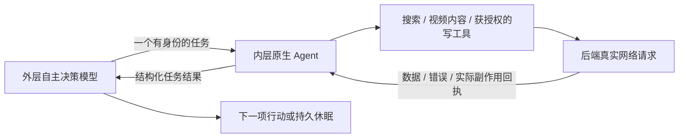

# B站工具与内层 Agent 接入判断

核查日期：2026-11-02。结论基于独立下载的实际源码、离线测试和一次只读真实网络请求。研究目录为 `../qq-ai-saas-research/bilibili-tools-20261102/`；未安装到生产，未进行B站登录、评论或投稿，未修改 Windows 前端。

## 推荐路线

保留当前 AstrBot 原生内层工具循环，由内层选择并调用受控联网工具。学习 B站项目的工具实现，不因为需要联网而在内层后面再叠一套 DSH 模型循环。

这里“内层联网”指内层调用后端工具，模型没有自动获得浏览器、Shell、账号凭据或任意网络权限。外层仍不调用搜索工具。DSH 可以作为同一执行合同下的替代适配器；当前没有证明多套 Agent 嵌套能带来净收益。若将来某项复杂任务确需独立专业 Agent，应作为有界单任务委托，继承 action ID、取消、工具/Token预算、租户及回执约束，不能绕过公共管线。

## 发现并追踪的项目

| 项目与固定版本 | 实际调用链 | 值得吸收的能力 | 接入判断 |
| --- | --- | --- | --- |
| [kukemc/bili-cli](https://github.com/kukemc/bili-cli)，`e17ab4da33a5b32a5fb4706e0a6dbb9ed994085a`，MIT | CLI命令 → `runtime.run()` → `bilibili-api-python`或HTTP → JSON结果；MCP封装另外派生CLI子进程 | 搜索；字幕/远程或本地转写；预览图读取；评论/私信/动态；视频投稿及审核查询 | 最接近用户所说“看视频、评论、发视频”的工具项目。它不是自主模型内核。优先参考明确的命令和结果合同，不能直接把任意 `run_bili` 暴露给租户模型 |
| [CZX2244/dsh-bilibili](https://github.com/CZX2244/dsh-bilibili)，`c53af9dee30cf04ee759ac6857d5803196fb2a95`，0.8.0，MIT | `lib/index.js` 注册工具 → `extractAll()` → 视频元数据/字幕/评论/弹幕；必要时转写、抽帧 | 字幕优先；文本和视觉分两遍；显式时间点补读；独立通道失败降级；取消信号 | `extractAll()` 使用 Node 标准库，不依赖 DSH 核心。可适配为普通内层工具；不必启动 DSH。源码默认视频下载上限800MiB及可选本地模型不适合照搬到2GB生产机 |
| [chenluQwQ/astrbot_plugin_bilibili_ai_bot](https://github.com/chenluQwQ/astrbot_plugin_bilibili_ai_bot)，`9f8f37bbc27b71d5f3cf0ea33edb61387da86028`，AGPL-3.0 | `_watch_one_video()` → 视频分析 → 模型评价 → `_interact_with_video()` → 实际评论等操作 → 记忆/日志；联网单独走 `WebSearchMixin` | 区分元数据和已分析媒体；来源记录；真实动作记录；兴趣形成搜索词；搜索结果有缓存 | 学习机制；不直接搬入整个账号、人格、记忆和调度模块。其多步看视频流程及评分阈值不应代替 FishBot 外层逐任务重新决策 |
| [whyever77/dafeiyu-astrbot](https://github.com/whyever77/dafeiyu-astrbot)，既有研究固定版本 `7ee692a7479aa2774fa41ff54390ad8bef46d8d3` | AstrBot 原生 Agent → `df_bili_read/watch/propose` → 独立B站工具端 → 真实结果和经历记录 | 工具门面、只读与写操作分权、来源和执行经历、重媒体处理分离 | 证明 AstrBot 原生循环也能驱动这些能力，无需凭“DSH生态有工具”推断必须换内核。参考部署将重视频工作放在 Windows，不符合本轮新增生产服务的目标 |

另从B站视频检索发现 [dsh-bili-whale](https://github.com/jisongmuli/dsh-bili-whale)，从GitHub发现 [dsh-bili-workbench](https://github.com/Userluckytian/dsh-bili-workbench)。后者说明其B站账号操作复用 `bili-cli`，出片另含渲染依赖。这两项本轮只作线索，没有完成同等深度源码/运行验证，不作为内核选择依据。B站检索入口：[相关公开视频](https://www.bilibili.com/video/BV1ZVHV64EaH/)。

## 可复核的关键源码

- [bili-cli video.watch](https://github.com/kukemc/bili-cli/blob/e17ab4da33a5b32a5fb4706e0a6dbb9ed994085a/src/bili_cli/commands/video.py#L454)：先取真实信息和字幕；可选转写，热评和画面预览；返回实际文本来源。`frames_sheet` 只是图片路径，接入后还必须真正交给视觉模型，不能凭路径声称看懂了画面。`record=false` 为默认值；开启后会向B站报告观看记录，不能当无副作用的读取。
- [bili-cli 评论发送](https://github.com/kukemc/bili-cli/blob/e17ab4da33a5b32a5fb4706e0a6dbb9ed994085a/src/bili_cli/commands/comment.py#L218)：dry-run分支、写前限速、实际发送、记录返回rpid。限速/日志不是 FishBot 的 action ID 与不明结果处理的替代品。
- [bili-cli 视频投稿](https://github.com/kukemc/bili-cli/blob/e17ab4da33a5b32a5fb4706e0a6dbb9ed994085a/src/bili_cli/commands/upload.py#L257)：构造稿件元数据，校验账号/参数，执行 `VideoUploader.start()`，返回真实 aid/bvid。投稿一个现有文件与创作、渲染视频是不同能力。
- [bili-cli MCP](https://github.com/kukemc/bili-cli/blob/e17ab4da33a5b32a5fb4706e0a6dbb9ed994085a/src/bili_cli/mcp_server.py#L27)：通过子进程调用CLI，不是DSH推理服务。通用命令入口、可读本地文件、默认进程超时需收窄适配。
- [bili-cli 凭据目录](https://github.com/kukemc/bili-cli/blob/e17ab4da33a5b32a5fb4706e0a6dbb9ed994085a/src/bili_cli/config.py#L23)：支持 `BILI_CLI_HOME`，Linux凭据写入设0600。接入必须由后端选定租户/机器人目录，不能让模型指定账号或环境变量。
- [dsh-bilibili 工具注册](https://github.com/CZX2244/dsh-bilibili/blob/c53af9dee30cf04ee759ac6857d5803196fb2a95/lib/index.js#L202) 与 [独立提取函数](https://github.com/CZX2244/dsh-bilibili/blob/c53af9dee30cf04ee759ac6857d5803196fb2a95/lib/extractor.js#L1314)：前者只是DSH适配层；后者执行真实网络与媒体工作。源码转写缓存TTL为7天，与README所写24小时有出入，具体行为以固定源码为准。
- [AstrBot BiliBot 主流程](https://github.com/chenluQwQ/astrbot_plugin_bilibili_ai_bot/blob/9f8f37bbc27b71d5f3cf0ea33edb61387da86028/core/proactive.py#L1599) 和 [联网实现](https://github.com/chenluQwQ/astrbot_plugin_bilibili_ai_bot/blob/9f8f37bbc27b71d5f3cf0ea33edb61387da86028/core/search.py#L35)：联网由HTTP/API工具执行。当前源码已使用异步客户端，不能拿历史插件审查中的同步客户端问题当成本版本缺陷。

## 本轮实际运行

1. 三个新研究副本均通过 GitHub API 固定 commit，并记录下载归档SHA256；源码放在产品仓库之外。
2. `dsh-bilibili` 原始测试初次因未安装其声明依赖 `qrcode` 无法启动；在研究副本安装声明依赖（禁用安装脚本）后，43/43单测通过，退出码0。原失败日志与后续成功结果分开记录，没有修改上游测试。
3. 不启动DSH，直接导入其 `extractAll()`，对真实BV视频做一次只读测试，禁用下载、抽帧、ASR和写观看历史。7.871秒返回HTTP412，未取得正文、字幕或图像。Windows临时Node进程峰值RSS约88.6MiB；它不是Linux常驻成本、PSS或可比内核性能结论。
4. FishBot已有真实QQ测试曾获得B站搜索元数据，也多次遭遇服务不可用。这说明网络能力已经能够由内层工具执行，但接口可用性并不稳定；不能将切换内核当作已解决风控或联网可靠性的证据。

## 能力接入顺序和边界

第一步完善已有搜索与任务反馈：统一可用/受阻/冷却、保留来源、按实际返回构建证据。先修正普通聊天与自主任务交接，不用更多工具掩盖生命周期缺陷。

第二步增加按需的视频内容只读工具：元数据、字幕、时间戳；缺字幕如实返回。需要视觉时先使用少量预览图，并验证图像真的进入现有视觉模型。ASR使用已配置的远程服务；不默认安装本地模型或整段视频处理流水线。缓存限量且按账号可见性隔离；不为每QQ新增驻留服务。

第三步才接B站账号写操作：独立账号绑定和明确授权，评论/动态/投稿各自分权；真实action ID、写前校验、返回rpid/aid/bvid并核对实际状态。未授权时仅显示不可用，不能用模型文本模拟发布。本轮没有B站账号授权，也没有执行这些写行为。

## Plan vs Actual

原主动AI计划的外层/内层分工、AstrBot与DSH同合同选择、公共管线、共享运行和持久生命周期均保留。新增调查是用户要求的能力参考，不是增加第二套Agent。源码和离线测试证明工具可独立于DSH使用；真实视频内容请求失败，不能标成“看视频验收通过”。评论、投稿、完整视频理解尚未接入或验收；研究成果不冒充生产能力。本轮没有前端修改或部署，也没有Git写操作。
