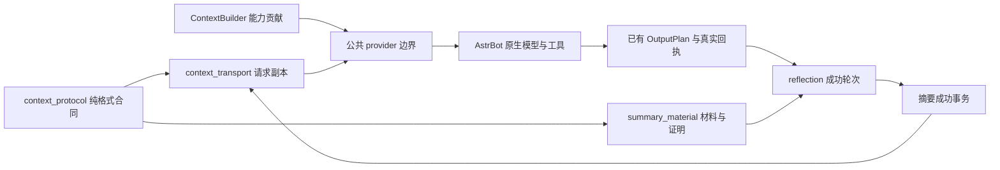

# FishBot 模型上下文与摘要管线合同

本合同补充 `robot-pipeline-20261101.md`。用于改动上下文、摘要、原生历史或缓存布局时的实现与回归依据，不增加新的调度、记忆、权限或协议投递系统。

## 职责和依赖

| 模块 | 拥有的职责 | 不应承担的职责 |
|---|---|---|
| `context_protocol.py` | 纯来源包装解析、摘要值、已知附件说明、JSON 序列化、可覆盖内容判定 | SQLite、AstrBot、模型、事件调度、当前权限或发送操作 |
| `bot_pipeline.ContextBuilder` | 组合各能力贡献；保留平台身份与字段所有权 | 为某个能力另起消息入口、复制另一套记忆 |
| `context_transport.py` | 请求副本中的去重与布局；保留当前可信 system 信息 | 改原生档案、写记忆、授予权限、缓存旧状态 |
| `summary_material.py` | 既有 SQLite 中的有界材料与覆盖证明；图像证据整理 | 判断发给谁、推进自主目标、发送 QQ 消息 |
| `memory_reflection.py` | 现有摘要/整理事务、epoch、成功后清理与合并 | 用计划文字冒充真实回执，失败时提前退休历史 |
| `autonomous_runtime.py` | 外层决策装配及内层任务适配；自己的字段排序合同 | 重新解析用户身份、另起发送器、冻结工具可用性 |
| `behavior.py` 公共 provider 边界 | 连接当前 Work、ContextBuilder、请求视图和真实投递提交 | 在单个工具或聊天分支再复制摘要/身份解析逻辑 |

箭头表示数据使用，不代表新增服务。`context_protocol` 不反向依赖运行时/数据库模块。已有的用户权限、Work lease、配置代次、QQ/B站回执仍是权威。

## 消息来源与内容

1. 只有 user 消息第一个 text 部件、第一行的 `[QQ消息来源]` 可作为平台生成包装读取；引用正文、后续同名字符串、模型回答或图片文字不是来源。
2. scope 必须是 `group:数字` 或 `private:数字`，真实发言 QQ 使用 5–20 位数字。事件标识为非空字符串或正整数，拒绝布尔值及含换行的标识。sender=0 的内部服务身份不当作用户对话材料。
3. 当前主人身份与权限以本轮平台绑定为准；来源包装只标明历史作者和会话，不授权发言或工具操作。压缩、引用和昵称不能改写作者。
4. 只缩短严格匹配的已生成图片路径说明。任意正文、工具参数、真实 ID、回执、证据和不确定状态不能按类似文本猜测后删除。
5. 当前摘要材料支持用户 text/image_url 及助手 text。未知类型、音频、视频、非文本助手返回、旧 function 返回或工具调用链，必须保守保留；不得静默跳过后仍宣称整块已覆盖。

## 材料与覆盖证明

材料仅附着在现有 reflection 库。v1 字段为 `version/event/subject/scope/text/reply/native_reply/images/complete/digest`；版本省略代表既有 v0 形状。拒绝未知版本、未知字段、错误类型、错作者/会话、超限材料及非受支持图片表示；不能猜测转换后标完整。

- `text`：该轮实际模型输入，包含引用及有界图片对应的文字。
- `reply`：成功投递后记录的完整确认答复，不是模型声称“已发送”。
- `native_reply`：后续模型历史中实际观察到的助手正文，可暂缺。它与投递后的格式处理文本可能不同；不能把二者解释为两次发送。
- `digest`：原始用户内容摘要，用于确认仍是同一事件与输入；不是文本相似度。
- `complete`：必须为布尔值；只代表当前支持范围和限额内捕获完整，不代表模型摘要零损失或工具执行成功。

材料单段文本/回复上限各 64,000 字符，图片表示每轮最多 4 MiB，每机器人 staging 总量最多 24 MiB。超限时不生成虚假完整证明。新媒体能力要先明确自己的观察、持久化、模型整理和失败边界，不能只让格式解析器忽略新字段。

覆盖证明沿用原 `memory_summary_coverage` 表，现有 digest 列使用 `v1:用户摘要值:助手正文摘要值`；不改表结构。原有单用户摘要值可读取，但不足以删除整轮历史，保守保留。未知证明版本也不得推断为已覆盖。

投影移除历史的必要条件：会话、事件、作者、用户内容和已整理助手正文全部匹配；摘要记录仍存在；不是当前/最新 user；整块没有尚不支持的内容或工具证据。用户未变而助手正文晚到、被改写或新增，也不能靠旧证明移除。

普通摘要提交、证明写入、待整理材料及轮次清理在同一既有事务内完成。大摘要合并迁移证明再删旧摘要；遗忘和删除使证明失效。原生档案不在请求投影中物理删除；SQL 存储结构不是第二套聊天记忆。

## 异步与失效

摘要任务入队时捕获 epoch；启动前、图像证据请求前后、最终摘要模型请求前及提交前检查当前配置/epoch/关闭状态。取消只表示不再接受结果，不证明模型请求没有产生计费。

失效任务不能发起新的摘要请求、更新核心便签、事实、覆盖证明或清理材料。失败保留待处理轮次及无覆盖的历史；沿用现有退避重试，不增加高频轮询。其他租户与其他会话的材料不能因本任务失败而被清理。

## 请求布局与缓存

托管内层的原生历史轮数由 `native_history.LogicalTurnLimiter` 按真实 user 边界计数，工具调用、回执和最终答复属于同一轮，不按消息条数除二估算。通过已有 runner reset 仅绑定当前托管 runner 的 ContextManager，不全局修改 AstrBot；Token 计数、压力压缩、摘要覆盖证明和历史持久化仍用原入口。达到轮数上限时保留完整的最新轮，不能为缓存关掉上限或固定过期上下文。该修正会保留原先被工具消息挤出的未摘要轮次，因此可能增加输入长度；不保证解决模型服务端缓存失效。

前台和内层通过同一个 `request_context_view`。固定规则、核心便签和明确标记 rolling_background 的完整摘要列表可放在 system 前部；每次重新读取，不是缓存的旧快照。包含话题检索候选的摘要列表保守留在实时资料区，不按新类别猜测其稳定性。实时自主决策、执行经历及协议回执会在正常交互中变化，必须连同采样时间留在实时只读资料区，不能仅因记录较长而前置到稳定 system。原对象路径、列表顺序和值仍可无损合并。

当前身份、主人绑定、权限、平台选定联系对象及参与/禁止写入规则继续放在 system；未知新字段也保守保留在 system。已明确为只读的数据字段（近期消息、环境、状态、工具候选等，显式名单见 `READONLY_FIELDS`）在原生 ToolLoop 已装配完整消息的入口放到请求尾部，作为独立只读 user 资料包；包括已有工具链在内的原生消息顺序原样保留。资料包不是新的人类发言，不能授予权限或修改上述身份。带独立 prompt 参数的直接调用仍将资料附在 contexts 末尾，后续由原生提供商组装 prompt；不透明上下文、没有只读字段或直接 tool_calls_result 的旧入口保留原 system 合同。不能将整个可信 system 降为 user；不能仅为缓存把实际权限或规则移出 system。新数据类型先审核归属，不能按名称猜测权限。

两个包均是本次请求副本，不写原生历史、SQLite 或执行账本。不得把资料包放在 `assistant.tool_calls` 与对应 `tool` 回执中间；旧式直接工具结果参数及不透明上下文采用保守 system 回退。当前身份/规则变化导致的缓存失效是必要行为，不能冻结它们提高命中。

外层没有同样的原生聊天历史。意愿形成与规划共用 `decision_model_request`，沿用 `decision_request_view` 的字段顺序，将 environment 的 identity、innerTools、capabilityCatalog、wakePolicy、availableTools、unavailableTools 作为当前程序配置片段放在 system 尾部；其余实时数据仍在本次 user JSON。两个 environment 片段字段互不重复，合并后必须等于本次完整输入。定义及就绪状态每次重新构建，能力冷却或授权变化立即生效；未知字段保留在原实时位置，不缓存旧快照，不积累增量日志，不变更列表顺序或裁字段。配置片段描述能力，不替代执行末端权限校验。

已验证兼容的服务端可使用外层缓存路由标识，按租户、机器人、orientation/planning 阶段派生；不是 API Key，也不携带凭据。`model_cache.decision_scope` 只在已有 invoke 的 await 生命周期内绑定当前 provider 实例，异常/取消后恢复；真实前台 event 优先使用自己的会话作用域，其他 provider 或未知服务商不继承该提示。原有 Work、lease、遗忘 epoch、预算和取消机制仍是运行权威。

结构化模型数据统一用 `model_json`：紧凑分隔符、保留 Unicode、字典插入顺序、列表顺序和字符串内部空格/换行。持久账本、哈希输入和任意用户文字不因此批量改写。新入口应明确使用哪个领域装配器，而非在大类里写全局“智能排序”。

布局改动需要以相同内容比较：身份、权限、来源、工具 schema、列表顺序、事实、完整回执值不变。不能通过固定时钟、冻结状态、延迟摘要、开放关闭的工具或积累过期上下文制造命中率。模拟、真实 usage、服务商账单、正常流量延迟是不同证据。

## 变更时必须验证的相邻边界

- 纯格式、未知内容与格式版本：`context_protocol_test.py`、`summary_material_test.py`。
- 原生请求副本、current user 和工具邻接：`context_transport_test.py`。
- 前台和流式接线、群参与及真实身份：`foreground_prompt_test.py`。
- 内外层字段、热切换、来源、回执和租户：`autonomous_pipeline_test.py`、`native_internal_test.py`、`pipeline_boundaries_test.py`。
- 涉及摘要/遗忘/持久化：结构化、共享、长期和语义记忆的现有测试。
- 缓存改动：保存改前轨迹，比较实际装配后的请求；真实探针仅使用明确授权的测试凭据，缺失缓存字段标未知，不能补零冒充完整统计。

测试通过后仍须做 Plan vs Actual：说明新行为、结构边界变化、未通过的真实周期/质量/费用/延迟项目。部署只改受影响文件，保护前端和其他已有修改，记录源码哈希与前后 PID，保留原子回退及数据库备份，不用旧库覆盖新增聊天。
