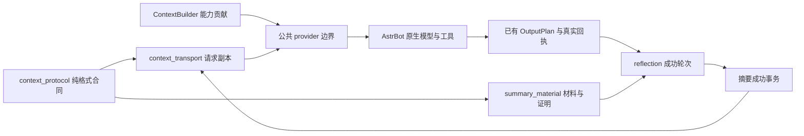

# FishBot 模型上下文与摘要管线合同

## 2026-11-08 群聊执行与覆盖补充

- 每个 BehaviorStore 的 Scope 主聊天执行从批次选定后到 Work 最终结算持有一个 FIFO 执行权；入站观察、不同 Scope 及已有安全后台读取继续独立。超时、取消和配置失效必须释放等候计数与执行权。它不替代 Journal 的持久化与历史权威。
- 入站时间属于来源证据，不能作为排队 Work 读取当前资料的截止时间。实际装配时读取当前目的会话已确认的机器人回复，保留真实 recipient_id、消息回执及原始作者；旧已提交 wire 不因此改写。
- Freshness 的 responded_events 仅可引用本次 latest_messages 中的真实事件。模型看到消息不等于回应；只有整项 Work 完成且全部计划消息收到有效协议 ACK，才在既有 outgoing provenance 发布 complete 覆盖证据。partial、unknown、失败、未结算均不能免除后续消息。只有批次全部事件已有完整证明时才整体静默；混有独立问题时继续处理，不能按近似文字吞消息。
- 群参与和发送复核复用 message_provenance.timeline。参与判断的动态消息已有 source_event 时，公共时间线不重复携带同一成员原文；机器人真实发送记录始终保留。未关联来源的记录不按文本相似度去重。
- 疲劳和热聊窗口只由程序管理，不把技术计数注入模型。模型仍判断参与价值、真实拒绝与社交边界；@只激活判断，不强制回复。群参与旧模型的 cooldown_intervals 仅做格式兼容校验，不决定等待时长。
- 以上均不新增业务轮、覆盖许可或历史清退权。35 轮、Hold、Scope、System、未知外部效果及租户隐私合同保持原约束。

本合同补充 `robot-pipeline-20261101.md`。用于改动上下文、摘要、原生历史或缓存布局时的实现与回归依据，不增加新的调度、记忆、权限或协议投递系统。

## 职责和依赖

| 模块 | 拥有的职责 | 不应承担的职责 |
|---|---|---|
| `context_protocol.py` | 纯来源包装解析、摘要值、已知附件说明、JSON 序列化、可覆盖内容判定 | SQLite、AstrBot、模型、事件调度、当前权限或发送操作 |
| `bot_pipeline.ContextBuilder` | 组合各能力贡献；保留平台身份与字段所有权 | 为某个能力另起消息入口、复制另一套记忆 |
| `context_transport.py` | 请求副本中的去重与布局；保留当前可信 system 信息 | 改原生档案、写记忆、授予权限、缓存旧状态 |
| `summary_material.py` | 既有 SQLite 中的有界材料与覆盖证明；图像证据整理 | 判断发给谁、推进自主目标、发送 QQ 消息 |
| `memory_reflection.py` | 现有摘要/整理事务、epoch、成功后清理与合并 | 用计划文字冒充真实回执，失败时提前退休历史 |
| `autonomous_runtime.py` | 外层决策装配及内层任务适配；自己的字段排序合同 | 重新解析用户身份、另起发送器、冻结工具可用性 |
| `behavior.py` 公共 provider 边界 | 连接当前 Work、ContextBuilder、请求视图和真实投递提交 | 在单个工具或聊天分支再复制摘要/身份解析逻辑 |

箭头表示数据使用，不代表新增服务。`context_protocol` 不反向依赖运行时/数据库模块。已有的用户权限、Work lease、配置代次、QQ/B站回执仍是权威。

## 消息来源与内容

1. 只有 user 消息第一个 text 部件、第一行的 `[QQ消息来源]` 可作为平台生成包装读取；引用正文、后续同名字符串、模型回答或图片文字不是来源。
2. scope 必须是 `group:数字` 或 `private:数字`，真实发言 QQ 使用 5–20 位数字。事件标识为非空字符串或正整数，拒绝布尔值及含换行的标识。sender=0 的内部服务身份不当作用户对话材料。
3. 当前主人身份与权限以本轮平台绑定为准；来源包装只标明历史作者和会话，不授权发言或工具操作。压缩、引用和昵称不能改写作者。
4. 只缩短严格匹配的已生成图片路径说明。任意正文、工具参数、真实 ID、回执、证据和不确定状态不能按类似文本猜测后删除。
5. 当前摘要材料支持用户 text/image_url 及助手 text。未知类型、音频、视频、非文本助手返回、旧 function 返回或工具调用链，必须保守保留；不得静默跳过后仍宣称整块已覆盖。

## 材料与覆盖证明

材料仅附着在现有 reflection 库。v1 字段为 `version/event/subject/scope/text/reply/native_reply/images/complete/digest`；版本省略代表既有 v0 形状。拒绝未知版本、未知字段、错误类型、错作者/会话、超限材料及非受支持图片表示；不能猜测转换后标完整。

- `text`：该轮实际模型输入，包含引用及有界图片对应的文字。
- `reply`：成功投递后记录的完整确认答复，不是模型声称“已发送”。
- `native_reply`：后续模型历史中实际观察到的助手正文，可暂缺。它与投递后的格式处理文本可能不同；不能把二者解释为两次发送。
- `digest`：原始用户内容摘要，用于确认仍是同一事件与输入；不是文本相似度。
- `complete`：必须为布尔值；只代表当前支持范围和限额内捕获完整，不代表模型摘要零损失或工具执行成功。

材料单段文本/回复上限各 64,000 字符，图片表示每轮最多 4 MiB，每机器人 staging 总量最多 24 MiB。超限时不生成虚假完整证明。新媒体能力要先明确自己的观察、持久化、模型整理和失败边界，不能只让格式解析器忽略新字段。

覆盖证明沿用原 `memory_summary_coverage` 表，现有 digest 列使用 `v1:用户摘要值:助手正文摘要值`；不改表结构。原有单用户摘要值可读取，但不足以删除整轮历史，保守保留。未知证明版本也不得推断为已覆盖。

投影移除历史的必要条件：会话、事件、作者、用户内容和已整理助手正文全部匹配；摘要记录仍存在；不是当前/最新 user；整块没有尚不支持的内容或工具证据。用户未变而助手正文晚到、被改写或新增，也不能靠旧证明移除。

普通摘要提交、证明写入、待整理材料及轮次清理在同一既有事务内完成。大摘要合并迁移证明再删旧摘要；遗忘和删除使证明失效。原生档案不在请求投影中物理删除；SQL 存储结构不是第二套聊天记忆。

## 异步与失效

摘要任务入队时捕获 epoch；启动前、图像证据请求前后、最终摘要模型请求前及提交前检查当前配置/epoch/关闭状态。取消只表示不再接受结果，不证明模型请求没有产生计费。

失效任务不能发起新的摘要请求、更新核心便签、事实、覆盖证明或清理材料。失败保留待处理轮次及无覆盖的历史；沿用现有退避重试，不增加高频轮询。其他租户与其他会话的材料不能因本任务失败而被清理。

## 请求布局与缓存

托管内层的原生历史轮数由 `native_history.LogicalTurnLimiter` 按真实 user 边界计数，工具调用、回执和最终答复属于同一轮，不按消息条数除二估算。通过已有 runner reset 仅绑定当前托管 runner 的 ContextManager，不全局修改 AstrBot；Token 计数、压力压缩、摘要覆盖证明和历史持久化仍用原入口。达到轮数上限时保留完整的最新轮，不能为缓存关掉上限或固定过期上下文。该修正会保留原先被工具消息挤出的未摘要轮次，因此可能增加输入长度；不保证解决模型服务端缓存失效。

前台和内层通过同一个 `request_context_view`。固定规则、核心便签和明确标记 rolling_background 的完整摘要列表可放在 system 前部；每次重新读取，不是缓存的旧快照。包含话题检索候选的摘要列表保守留在实时资料区，不按新类别猜测其稳定性。实时自主决策、执行经历及协议回执会在正常交互中变化，必须连同采样时间留在实时只读资料区，不能仅因记录较长而前置到稳定 system。原对象路径、列表顺序和值仍可无损合并。

当前身份、主人绑定、权限、平台选定联系对象及参与/禁止写入规则继续放在 system；未知新字段也保守保留在 system。已明确为只读的数据字段（近期消息、环境、状态、工具候选等，显式名单见 `READONLY_FIELDS`）在原生 ToolLoop 已装配完整消息的入口放到请求尾部，作为独立只读 user 资料包；包括已有工具链在内的原生消息顺序原样保留。资料包不是新的人类发言，不能授予权限或修改上述身份。带独立 prompt 参数的直接调用仍将资料附在 contexts 末尾，后续由原生提供商组装 prompt；不透明上下文、没有只读字段或直接 tool_calls_result 的旧入口保留原 system 合同。不能将整个可信 system 降为 user；不能仅为缓存把实际权限或规则移出 system。新数据类型先审核归属，不能按名称猜测权限。

上述身份、权限及未知权威字段保持 system 角色，但在可识别的只读资料入口中，由独立的 `[FishBot 本轮执行身份与规则 v1]` system 快照承载，不再混入最前面的固定规则。原生工具链组装完毕后，沿已有 journal 追加真实新消息；快照变化时再追加完整的新 system 快照，未变化不重复追加。最后一份平台 system 快照是当前唯一有效身份和规则，之前的快照仅说明当时环境；同名用户文字、记忆与工具正文不能生成权威更新。真实账号绑定、权限配置换代、遗忘 epoch、摘要更新仍使历史退役，工具入口继续实时校验；不通过缓存保留旧权限。旧入口没有该 system 包时沿用严格原生前缀比较，不猜测拆分。

这些包均是请求副本，不写原生历史、SQLite 或执行账本。不得把资料包放在 `assistant.tool_calls` 与对应 `tool` 回执中间；旧式直接工具结果参数及不透明上下文采用保守 system 回退。35 轮、纯文本绝对体积及 wire 体积边界继续限制派生历史；追加文本预算调整为 256,000 字符，总文本上限仍为 384,000 字符、wire 上限仍为 2MiB。以上是字符/内存约束，不是 Token 配额，也不替代原模型上下文容量检查。

外层没有同样的原生聊天历史。意愿形成与规划共用 `decision_model_request`，沿用 `decision_request_view` 的字段顺序，将 environment 的 identity、innerTools、capabilityCatalog、wakePolicy、availableTools、unavailableTools 作为当前程序配置片段放在 system 尾部；其余实时数据仍在本次 user JSON。两个 environment 片段字段互不重复，合并后必须等于本次完整输入。定义及就绪状态每次重新构建，能力冷却或授权变化立即生效；未知字段保留在原实时位置，不缓存旧快照，不积累增量日志，不变更列表顺序或裁字段。配置片段描述能力，不替代执行末端权限校验。

已验证兼容的服务端可使用外层缓存路由标识，按租户、机器人、orientation/planning 阶段派生；不是 API Key，也不携带凭据。`model_cache.decision_scope` 只在已有 invoke 的 await 生命周期内绑定当前 provider 实例，异常/取消后恢复；真实前台 event 优先使用自己的会话作用域，其他 provider 或未知服务商不继承该提示。原有 Work、lease、遗忘 epoch、预算和取消机制仍是运行权威。

结构化模型数据统一用 `model_json`：紧凑分隔符、保留 Unicode、字典插入顺序、列表顺序和字符串内部空格/换行。持久账本、哈希输入和任意用户文字不因此批量改写。新入口应明确使用哪个领域装配器，而非在大类里写全局“智能排序”。

布局改动需要以相同内容比较：身份、权限、来源、工具 schema、列表顺序、事实、完整回执值不变。不能通过固定时钟、冻结状态、延迟摘要、开放关闭的工具或积累过期上下文制造命中率。模拟、真实 usage、服务商账单、正常流量延迟是不同证据。

## 变更时必须验证的相邻边界

### 2026-11-06 新增事件与短运行尾巴

本节是按用户最新澄清实施的合同，2026-11-06 01:24 已部署到两个共享 AI 组；上文“不积累增量日志”的外层段落描述此前线上基线，不适用于本节版本。部署与后续线缆格式对齐证据见 `cache-append-release-20261106.md`。

- `decision_context` 是纯请求协议：将明确归属的消息、摘要、事实和执行资料装入不可变 `contextRecords`，保留来源与完整值。`contextRecordRef` 只引用本次机器人请求历史中的资料，不授予权限；未知字段保守保留。程序可以无损还原本轮完整输入。
- 机器人核心便签在 `sharedContext.persona_core_note` 只提供一份，适用于同一机器人各会话；原值不一致时保守保留，不能用一人的便签覆盖其他值。
- 首份 `contextState` 加后续 `contextChanges` 描述当前选用材料、目标、联系人和任务等真实变化；无变化不重复注入。记录从未知变确认是新观察，不回改旧回执、不把模型决策当成功证明。当前不再选用的记录不冒充本轮当前字段。
- 时间、精力、已流逝秒数等运行值用一次 `runtimeLayout` 定义槽位，首轮提供 `currentRuntime`，后续 `runtimeUpdates` 只提供变化槽位。布局变化时完整重新绑定运行值。旧短尾巴按当时状态保留，最新值覆盖旧值，不重复积累完整实时快照。
- 每次新增形成新的消息块；上一轮请求的消息块与真实模型答复原样保留，禁止把新增内容揉回旧块。回放的运行尾巴与 AstrBot 当前 prompt 使用相同的单 text 部件表示，避免字符串/文本数组格式跨轮变化。按观察轮次追加，材料内保留真实原始时间，补充获得的旧经历不能冒充刚发生。
- orientation/planning 共用 `AppendHistory` 与同一失效规则，各租户、机器人、阶段、提供商、配置及遗忘代次隔离。它是可丢弃的传输历史，不是新持久记忆或授权存储；无独立 Task、扫描器或定时器。
- 实际数据库摘要版本变化才退休历史；本轮话题选择另一条已有摘要只追加选择变化。遗忘、内存关闭、身份/权限/配置或提供商变化、取消、异常、空闲与长度/轮数边界仍清理或重建。摘要版本校验读取现有表，不增加第二套存储。
- 联系目标等动态候选从 `capabilityCatalog` 留在实时数据侧，不再改变前部 system 定义；真实身份、内层工具授权、wakePolicy 等保留原权威和末端校验。所有当前值仍来自本轮存储，不冻结状态。
- 保留最多30轮、160,000历史字符、32,000新增历史字符与30分钟空闲边界，可能提前重建。不得为维持缓存而推迟摘要或保留已明确遗忘的资料。

当前接口拒绝显式断点，本实现不发送不支持的字段，也不添加生产预热请求。隔离真实 API 的缓存 usage、离线还原、模拟协议投递、线上 QQ 效果和账单必须分别报告。

### 2026-11-06 外层与复核候选补充（尚未加载线上）

本轮候选将工具临时状态与安静时段 `activeNow` 从可信配置片段分离。`innerToolStatus` 与静态 `innerTools` 按数组位置一一对应；`wakeStatus.quietHours` 补充 `wakePolicy.quietHours` 当前状态。定义、enabled/authorized、身份和未知权限字段留在可信部分，实际末端校验保持原权威。与已部署版本的区别、Linux 候选结果与保护期暂缓加载见 [核查记录](outer-preflight-cache-audit-20261106.md)。

新增缓存诊断不得把缺失的上游 cached_tokens 补成零。SDK 历史默认零不证明上游明确返回零。只记录阶段/身份关联、响应 ID、计数、哈希和历史重建原因，不为追缓存持久保存提示词正文。

### 2026-11-06 精简呈现候选（未加载线上）

前台与外层共用 `context_transport.social_context_view`：heat/energy展示一位小数，真实排序、衰减与持久化不变；有原始时间的消息不再重复距今秒数。外层使用现有执行简报，当前反馈和真实回执完整保留。`decision_wire`仅在请求副本将资料转换为表头/行、共有字段和短引用；来源、任务身份、权限不交给短引用决定。连续历史仍由原有AppendHistory所有，原安全边界保留。变更、真实API、Linux隔离测试和未上线范围见 [精简核查](context-compact-candidate-20261106.md)。

- 纯格式、未知内容与格式版本：`context_protocol_test.py`、`summary_material_test.py`。
- 原生请求副本、current user 和工具邻接：`context_transport_test.py`。
- 前台和流式接线、群参与及真实身份：`foreground_prompt_test.py`。
- 内外层字段、热切换、来源、回执和租户：`autonomous_pipeline_test.py`、`native_internal_test.py`、`pipeline_boundaries_test.py`。
- 涉及摘要/遗忘/持久化：结构化、共享、长期和语义记忆的现有测试。
- 缓存改动：保存改前轨迹，比较实际装配后的请求；真实探针仅使用明确授权的测试凭据，缺失缓存字段标未知，不能补零冒充完整统计。

测试通过后仍须做 Plan vs Actual：说明新行为、结构边界变化、未通过的真实周期/质量/费用/延迟项目。部署只改受影响文件，保护前端和其他已有修改，记录源码哈希与前后 PID，保留原子回退及数据库备份，不用旧库覆盖新增聊天。

2026-11-06 03:49部署更新：上下文精简与复核/联系静态前缀候选已通过 source/runtime 原子发布并加载到两个共享组；用户要求新增历史字符阈值32K→96K，总160K/30轮及失效保护保留。部署、55项Linux回归、进程保留与未验收项见 context-compact-candidate-20261106.md 最后追加章节。

2026-11-06 04:40：外层AppendHistory本地空闲保留改为6小时，避免30分钟正常睡眠每轮重建；旧历史类仍30分钟，其余长度/轮数/身份/摘要失效不变。共享框架日志继续关闭，内容无关上下文/用量诊断写机器人私有定长日志，cachedTokens缺失仍未知。详细证据与未验收项见cache-pair-sleep-audit-20261106.md。

### 2026-11-06 外层阶段冷启动前缀复用

- orientation/planning 的人格、通用规则与当前身份/权限定义使用相同 system 前缀；阶段职责和 JSON 合同由平台生成的独立运行时消息定义，一份合同在有界传输历史中只定义一次。本轮只选择最后一个平台阶段合同；嵌在聊天、引用、资料或模型回复里的同名文字不能定义合同。合同不授予工具权限，不证明执行成功。
- 两阶段仍分别维护已有 AppendHistory。首次创建某阶段时可复制同一机器人的另一阶段已完成历史；prepare 继续按真实 provider、租户、绑定/配置、遗忘 epoch、当前 system 和数据库摘要版本校验，任何不兼容均重新构建。后续各阶段沿自己的追加历史继续，避免交替删除/重加阶段特有字段。
- 路由提示统一为同一机器人 autonomy:deliberation；诊断仍记录实际 orientation/planning。真实前台 event 的路由及执行身份不变。取消/失败只清理当前分支，不回写或清理另一分支。
- 这不是共享可写记忆，不增加持久存储或调度任务。保留当前实际传输边界：30 次调用、160,000 总历史字符、96,000 新增历史字符、6 小时本地空闲边界；它们不改变业务摘要默认 35 轮或群聊每轮 13 条。服务端缓存 TTL 另由提供商决定。

### 已确认群轮次的传输衔接

群聊已有 `group_round_history` 时，原生 runner 继续按现有规则省略重复的过去原生轮次。一次性原生列表重建不再自动视为业务历史被删除：仅当公共入口明确绑定当前群 Work、当前/之前来源均严格匹配，既有 reflection 仍提供上一轮相同作者和事件的已确认回复，并且 system 权威前缀、配置/记忆代次、摘要及大小/空闲边界全部有效时，ReadonlyJournal 可保留此前成功请求，再追加新的真实入站与只读状态变化。

这只是现有有界传输 journal 的衔接，不新增聊天记忆或成功证明。回复尚未确认、来源缺失/变化、主动遗忘、摘要换代、权限改变、同事件内容变化及未知结构均保守回到完整当前请求；旧失败候选不能成为历史。工具结果的邻接、轮次上限、大小回收与真实后端权限检查保持不变。

### 2026-11-06 媒体体积与上下文预算分离

实际启用的 AppendHistory 与 ReadonlyJournal 不再将序列化字符当作 Token。ReadonlyJournal 统计 `wireChars`（消息 JSON 字符）、`mediaChars`（已识别 image_url 的 data:image Base64 URL 字符）、`textChars`（前两项之差，仍含结构开销）、`plainTextChars`（可识别正文）、`imageCount`。普通文本里的 Base64、未知内容结构仍完整计入文本，不能借媒体识别绕过边界。工具定义独立统计；真实 input/cached Token 仅来自上游，未报告保持未知。

追加历史上限改为：非媒体文本 384,000 字符、相对当前基线新增 96,000 字符；ReadonlyJournal 另限消息序列化总量 2 Mi 字符。外层现用 AppendHistory 使用相同文本/增量政策。30 次传输调用、6 小时本地保留、摘要/遗忘/身份/权限/配置失效不变；业务摘要默认 35 轮不受影响。未使用的旧 DecisionHistory/SnapshotHistory 保留原政策。

触边时按原规则重建为完整当前请求；完整当前请求本身仍超限，则照常提供完整内容但不保留为后续追加缓存，不能为了命中删图片或截正文。诊断必须区分 `added_text_limit`、`text_size_limit`、`wire_size_limit`，并依据 commit 实际返回值显示是否保留。超出诊断解析上限的 HTTP 请求记录有界的 `wire_body_limit` 元信息，不静默遗漏，也不加载整个大请求做诊断。

### 群聊主动事件与提醒交接补充（2026-11-08）

- 群聊的 scheduled_contact / owner_contact / tool_continuation 必须遵守同一 Scope Journal。服务来源由既有 pipeline_events 的 scope、event、subject 精确查证，不从正文、昵称或来源标记猜测。可在保留旧 wire 的前提下追加新服务事件；从服务事件进入下一 Work，须核验同 Scope、同事件的完整真实发送回执。原 group_turn 三字段和持久化格式保持兼容。
- 模型可在 propose_background_task 中显式 accept_agreement=true，接受当前真实用户提出的 proposed 约定；约定 revision CAS、接受与 durable handoff 同事务，排队失败整体回滚，重复调用返回同一项。代码不识别关键词、不自动承诺；取消或修订仍阻止旧版本执行。该标志仅是本地幂等证据，不进入既有严格 PG TaskHandoff 协议。
- AI Worker 维护暂停不等于自主调度永久关闭。停止协调器后，必须在所有 Worker 恢复且无 recovery-needed 状态时明确恢复 closed/timer/heartbeat；验收须同时验证 QQ 在线、AI ready、自主调度器运行和任务交接，不能仅看协议进程。
- 安全部署优先使用当前 PID/创建时间匹配的原生 queued=0、pending=0、busyMembers=0、idle=true，以及连续稳定事件计数；旧 memory-activity 文件可能保留陈旧 active 标志，不能取代原生队列事实。无原生证据时保留严格旧静默窗口；不得中断在途执行或伪造空闲。

### 2026-11-08 统一聊天 Journal（最新产品决定）

- 已激活 `fishbot_shared_context` 的机器人，全部私聊和主动群白名单使用唯一聊天逻辑键 `bot_shared`；真实 Work.scope、sender、工具授权和 QQ 目标不改变。默认最多两个群；26号本次明确授权保留四个，以该机器人的持久化 group_limit=4 表达，不在通用运行代码硬编码账号例外。
- 已提交或可能提交的 wire 由 Journal 唯一持有。SDK只贡献新事件及当前工具循环增量；不得再用另一 SDK 窗口重构共享前缀。来源事件键为 `(原渠道,原事件ID)`，不能只用渠道内消息ID。暂存输入在 Journal 持久接纳后删除，不是第二份已提交历史。
- 同一机器人主模型和工具循环只有一个任务所有者可写；取消等待者不能释放其他任务的锁。不同机器人并行，终局响应持久追加后释放锁，最终 QQ 投递在锁外；模型生成、QQ确认和有效业务轮仍分别结算。
- 白名单内所有渠道累计同一个35轮计数。只有原有真实确认、完整主业务回复合同满足时计轮；辅助请求、内部提醒/主动触发、工具中间调用、NO_REPLY、失败、partial/unknown均不能另铸一轮。摘要、Hold、coverage及消费许可继续使用原事务和证明，800/1500字默认不变。
- 本次一次性会话结束仅依据用户明确授权：旧参与会话完整原样归档，新建共享逻辑会话，不叫“合法35轮压缩”，不合并旧 wire、不搬运旧轮数、不改旧 System 记录、不复用旧许可、不重放未知操作。后续正常运行没有自动重置入口。System独立保护以及新会话建立后的35轮不可变性保持不变。
- 本节替代本文件早期与其冲突的“各渠道独立聊天Journal/计轮”和旧外层描述；自主研究的现有内部执行生命周期、辅助判断、实际发送与记忆库不因此强行合并。实现、验证、授权及回滚限制见 `FishBot-统一共享上下文与跨Scope同步实施报告-20261108.md`。
# 2026-11-08 晚间：未来增量与真实投递投影

- Journal 已提交 wire 与独立 System 规则不变；共享模式只预处理 SDK 的本轮新输入和工具续轮，历史媒体直接沿用 Journal 字节，不重新走图片转换。
- 平台 EVENT 可以在未来追加 `eventChanges`，复用已有 `set/remove` 路径协议；代码必须验证应用后与完整当前事件合同相等。持久化 authority 仍保存完整最新快照。无变化不追加，增量不更省时使用原有完整包／未变 policy 省略格式；不接受模型生成的补丁。
- assistant 原稿不等于真实发送。共享 `dialogue.deliveries` 从既有 Work、反馈与协议回执查询，带原始 Scope/event/recipient，区分 confirmed/partial/unknown/not_sent；下一次新 readonly 包在持有模型写锁后刷新。禁止回写旧 assistant，禁止把无 SOURCE 的投递说明另造为永不退休的用户轮。
- 新动画模型副本复用已固定 SDK 的有界3×3时间序列采样，并注明为采样；QQ原始素材不变。静态图片不统一降低现行分辨率。已经提交的动画保持原字节直至合法检查点。
- 工具目录按名称稳定排序；约定与 B站工具不因普通发言者更换而删增已启用能力。真实 owner、当前 Work、权限、能力版本仍由执行层验证；目录可见不授予权限。失效清单不能借用旧清单伪装当前可用性。

### 目录、时间与七轮提醒补充（2026-11-09）

- 同配置的工具声明、Schema、顺序不因主人/成员、私聊/群聊或工具结果续接改变。续接保留目录，但不能凭合成事件取得新的 QQ 发送、约定或任务权限。桥接清单首次发布、真实配置变更仍可改变外部能力目录。
- 新 EVENT 的 authority.current_time 由平台生成带 +08:00 的当前时间；原始事件时间仍表示其历史来源。明确钟点交给既有 run_at 校验和计算，不能把旧执行记录时间当当前时间。该字段只合法追加，不改变 System 或旧 wire。
- 七轮提醒沿既有完整、已确认业务 Work 结算计数；共享机器人使用同一 bot_shared 计数，重复结算不重复计数。失败、NO_REPLY、部分/unknown 发送、服务事件及工具续轮不计数。部署后从零起算，不追认不明旧轮次；七轮完成后的下一次请求仅增量追加短提醒，后续不重复直到下一周期。
- 周期提醒不是权限或记忆的更新周期：身份、授权、取消、约定版本与关键状态仍即时提供。它不创建、消费或替代合法 35 轮退休许可。

### 2026-11-09 固定基础区与存储合同（取代早期冲突描述）

- 新逻辑会话或真实许可重建的最终 Provider messages 顺序为 System → 大摘要 → 小摘要 → 长期事实 → 动态热区。基础区是数据消息，不改写 System；旧会话不因升级搬移任何已提交消息。
- 摘要仅大、小两类。正常基础区大摘要至多一份、小摘要零至两份；第三份小摘要先以 `pending_small` 暂存，同一异步处理任务立即尝试大融合。其检查点为 `pending_merge`，融合、覆盖继承和许可发布原子完成后才可使用；失败保留原料并由既有 retry 恢复。
- 摘要不再做关键词、FTS、向量或相关性选入；旧 `rolling/recall/semantic_recall` 接口仅兼容读取固定基础区，不保留旧选取算法。Facts 的显式检索工具保留。旧摘要数据库记录不等于已提交 wire；无引用冗余记录可独立清理，但不能破坏 Claims、coverage、许可或独有待融合信息。
- 旧多大摘要仅为下一真实检查点的融合输入；日常旧会话沿用其已提交基础。首次共享检查点必要时连续融合这些输入，不能因为整理数据库而重建旧 Journal 或借旧渠道许可。
- 普通事实、关系、Core Note、表达学习及已完成经历由检查点整理/固定；热区保留真实聊天、待执行/失败/unknown 和关键任务结算、有效约定及身份权限的必要变化。普通已完成工具经历的全文在基础区，热区保留身份与实际结算；显式经历查询、原始工具返回与原始证据不截断。没有变化不追加采样时钟。
- Stateless 辅助判断仍需必要当前状态，不能借其他判断的读取游标省掉它没看过的材料。相同请求内可以用确切正文引用去重；迟到确认不消除纠正/拒绝，反馈必须保留真实作者、事件与时间。
- Journal v2 仅改变持久化编码：`base` 按逐条精确 JSON 引用 `wire`，不假定前缀关系；历史媒体原字符串按 Scope 隔离存储、同事务写入并校验 SHA/长度，读取时完全还原原消息及键序。旧 v1 可读，不对旧 wire 做重采样、重新序列化或内容变换。
- 配额计算包含所有保留 blob；本轮不自动 GC 有潜在历史引用的媒体。v2 写入后的应用回滚必须保留 codec，或停写后做经校验的无损反向转换，不能直接运行只支持 v1 的旧代码，也不能拿旧 DB 覆盖新增回执和许可。
- 主动模式、普通群参与、普通主人联系分别由独立开关控制；关闭主动模式不撤销用户已授权的提醒。配置 revision 更新后仅由可信当前 lease 重新校验旧提醒，原 accepted 授权、来源和指纹不可改写；租户、机器人、generation、事件和副作用防重放合同继续生效。模型自建任务由可信来源围栏独立暂停，不得借提醒通道绕过开关。

### 2026-11-09 消息归属、静默 Hold 与 Freshness

- 新事件统一经 `context_protocol.event_message` 形成 SOURCE＋内容分段；旧 Journal 消息不做规范化。排队事件已由其他 Work 提交时，沿用 Journal 的原消息；协议入口 digest、真实作者冲突仍拒绝，不以事件 ID 相同忽略正文或媒体变化。
- 已有 `memory_message_sources` 只追加模型输入 digest、输出 digest／物理定位、真实 Work 归属与结算元数据，不保存第二份正文。输出与 Journal completion 同事务落盘；实际发送和原稿仍是不同证据。
- 共享摘要材料 v3 保留物理块证据，另标每条模型输出的真正 Work 及终态。不能将紧邻某 user 的 assistant 自动当作该 user 的已发送回复；未绑定、进行中、partial／unknown 不获得退休 Coverage。
- 无 round_id 的 Hold 可以进入原恢复循环，但不生成业务轮。只补全明确引用该事件的原 pending_coverage 批次，且须材料完整、Work 归属及终态可验证；摘要、Coverage、Hold 清理及原许可晋升同事务 CAS。已消费许可永不复活；缺证据保留阻断并计诊断，不反复调用模型猜测。
- 私聊／群聊 Freshness 共用 `review_request`：未变参考资料 → 当前会话 → 最新状态 → 本次草稿与新消息。只对同一请求内、同事件／作者／来源／正文及兼容附件的重复投影使用可还原引用；不同事件、草稿与真实发送不得合并。
- Freshness 是独立判断路径，不计主聊天 35 轮，也不强行建立辅助 Journal 或辅助摘要。每次从权威数据取得必要当前状态；无新目标会话消息不调用，原次数限制、版本校验、CAS 和最终发送围栏不变。参考资料真实变化时前缀应相应变化，不能冻结过期约定换缓存。

### 2026-11-09 Work 接管与部分退休补充（覆盖冲突的旧整批阻塞描述）

- 已激活共享上下文的机器人，每个真实 Scope 只有一项持久主 Work 所有权；同 Scope 新输入归当前 Work，其他 Scope 保留独立执行权，共享 Journal 仍经原唯一写者串行提交。输入队列只是未处理协议载荷，不是另一份已提交历史。
- 主模型真实见过、Freshness 判断涵盖、真实已发送分别记账。Freshness replace/drop 后存在未见输入时，原 Work 继续主模型处理；最多连续四次后将未处理真实输入持久交接，不能重放未知副作用。恢复沿用首次可信观察时间，不使用 SDK 重放时间。已结算输入保留父 Work 证据；一项 Work 最多结算一个有效业务轮。
- Freshness 以主模型真正已见事件集合排除多余调用；目标会话有未见新事件，或关键权限/约定状态版本变化时才复核。私聊、群聊共享构造机制，保留各自规则，不共享判断游标、不增加辅助历史或摘要模型。
- 每个真实 35 轮批次独立生成小摘要。第三小摘要仍须同一连续流程融合；融合失败时暂存产品不发布为新基础，后续新的 35 轮仍能生成暂存产品，原料及重试状态保留。成功融合后仅发布符合大/小摘要数量约束的基础。
- 同一真实检查点可只退休独立可证的完整物理块。部分退休只接受含真实终态和输出归属的 v3 Coverage；v1/v2 不自动升级。无证明的正文、媒体、工具依赖与 System 按字节和顺序保留，缺失则拒绝候选并释放未提交预留。容量路径同样校验，不能绕过。消费许可与 Journal 新基线及退休审计同事务提交，消费后不可复活。

### 2026-11-10 管理员手动整理例外

- 自动整理仍严格累计 35 个合法完整业务轮；普通用户、QQ 消息及配置保存不能绕过。按用户明确授权，只有服务端确认的管理员可通过 `POST /v1/admin/bots/:id/force-compress` 显式设置 `allowPartial:true`，提前整理当前非空批次。
- 检查点记录实际完成轮数，不补造到 35；独立 `memory_checkpoint_admin_overrides` 账本将真实管理员、请求 ID 与单个新检查点绑定。既有检查点不补写授权、不复活。请求幂等、运行实例换代和忙碌保护继续执行。
- 手动整理使用同一模型摘要、材料、Coverage 和三小合大事务；只放宽该次新批次的轮数门槛。System、真实发送证明、租户及受众边界、未知效果保护、媒体语义及归档要求不放宽。没有完整证明的材料继续保留；模型失败不生成检查点。
- 摘要提交和 Journal 历史退休分别验收。新许可仍由下一次真实请求在原事务入口消费；接口报告摘要完成，不能据此宣称全部历史已退休。
- Hold 不清除以换取许可。只依据精确原始批次、事件 digest、Work 终态及真实回执修复；证据永久缺失的块继续保护。`memory_checkpoint_issues` 持久去重记录证据缺口，`memory_checkpoint_retirements` 记录实际退休与保留事件及前后 wire 摘要；零退休不能称为压缩成功。
- 辅助模型只精简模型侧摘要来源追溯 ID 的展示（末六例与总数），数据库完整来源、摘要正文、Claims、约定及工具/发送证据保留；稳定参考资料在前，动态状态在后。不能据字符减少宣称真实 Token 或缓存收益。
