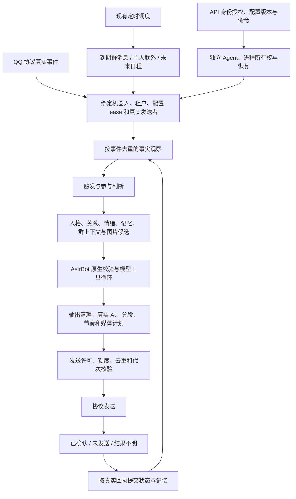
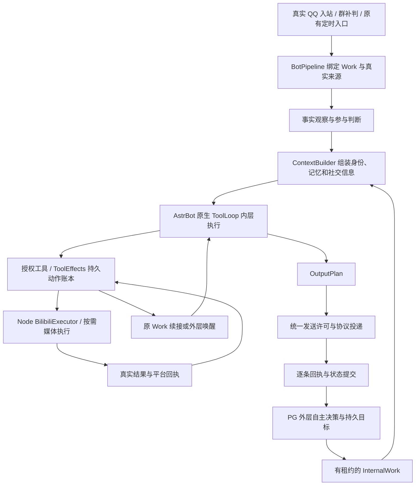

# 机器人管线：实现合同与验收计划

用户要求覆盖整个机器人与通用模块，完成管线建设并保证功能不退化；不是仅审查自动搭话。本文记录当前真实调用关系、建设范围与验证依据。生产基线为 `4fa78c9` 加私有部署清单中的 AI 源码补丁；Windows 的其他前端工作保持不动，Git 暂不提交。

## 当前真实链路

这张图是实施时固定的目标合同。建设前的入口主要位于 `behavior.py`、`initiative.py` 和原生 SDK，当时阶段尚未完全显式分离。下文分别记录实际接入点、验证结果和仍有边界的项目，不能因画出流程就宣称已经实现。

## 管线不变量

1. 可信身份只由协议、当前机器人配置及租户绑定产生。记忆、昵称、用户文本、模型结果不授权新的账号、主人或目的地。
2. 原始消息观察一次；到期补判不是新的用户消息，不得刷新真实入站时间、重复加亲密度、重复学习或重新触发外部管理操作。
3. 同一群的实时判断与到期补判使用同一个时钟和判断器。冷却期间的新消息保留最新一条，到时用最近上下文判断；没有新消息不反复调用模型。真实互动使旧待判断内容和迟到结果失效。
4. 群参与判断、主人联系、未来联系日程有不同意图。不得把未来日程的每日规划额度、30–600 分钟等待或全局定时发送额度叠加到普通群入场。
5. 模型判断意愿与相关性；代码负责身份、白名单、明确管理暂停、安静时段、预算、去重和结果有效性。临时没话题不能变成永久拒绝。
6. 上下文有界并保留来源；当前私聊和跨会话材料分别保留空间。关闭记忆、遗忘、摘要替换和租户边界在异步返回后仍有效。
7. 回复模型和工具共享当前工作上下文，工具权限在执行时再次核验。工具成功才能声称外部操作完成；网络超时不是重试外部写入的许可。
8. 输出先形成发送计划，再按顺序投递；真实 At 在首段、图片在末段且只发一次，保留 1–4 条分段和打字模拟。QQ 自带 Face 与平台鱼动图分开。
9. 每个异步边界后检查 lease、配置版本和实际目的地。已确认发送、明确未发送和结果不明分别处理；迟到结果不得创建新 Store 或覆盖新配置状态。
10. API/Agent/AstrBot/QQ 的运行所有权分开；Web/API 更新不应带来其他组件重启。保留 PostgreSQL、QQ Session、身份、模型 Key 与记忆，内存 Guard 和回退继续生效。

## 建设前已证实问题与待核验边界

| 项目 | 当前证据 | 处理方向 |
| --- | --- | --- |
| 主人判断漏当前私聊原始材料 | 判断的原生 contexts 为空，记忆函数默认排除当前 scope；生产私聊待摘要记录存在 | 增加有界私聊窗口，已独立通过原生 SDK 并部署 |
| 冷却到期不检查已收到的群消息 | 入站只调用 `presence.ready`，未到时直接返回；定时器没有恢复该事件的入口 | 增加每群一条的持久待判断输入，复用同一原生处理入口，不重造发送者 |
| 群补判与未来日程混用 | 备用路径使用 `companion_plan_budget`，生产当日 count=6；未来计划还限制 delay>=30 分钟 | 群补判独立于未来规划预算；保留一个群时钟和一个模型判断入口 |
| 默认值与校验分散 | Schema、preset、Python fallback 与 UI 分别出现数值；当前运行 Agent 仍拒绝群间隔 10 | 同步合同、默认值和运行校验；不能只改网页或直接绕过 Agent 校验 |
| 重复入站与普通回复的幂等边界 | 关系事件、主动发送、跨群工具各有去重；需核验普通回复的重复投递及重连路径 | 建立统一事件身份与阶段合同，先复现再改变状态语义 |
| 跟聊配置含概率字样但实现仅区分 0/非0 | `followupReplyProbability` 在当前门禁只检查是否<=0 | 保留当前跟聊能力，整理配置语义；不贸然恢复随机拦截 |
| Agent 停止与部署换代耦合 | `NodeAgent.shutdown()` 会停止全部 AI 和协议子进程 | 单独设计配置/运行更新路径，不能用常规 Agent 重启来实现页面参数变化 |

## 实施次序

1. 固定现有功能清单和真实入口，补齐群补判、重复入站、异步失效、部分发送等针对性用例，保留当前跨会话记忆、图片、At、工具和租户隔离回归。
2. 统一工作身份、阶段输入输出和结果状态；把实时消息、群补判、主人联系和未来日程作为明确来源，复用上下文、模型工具、输出和投递阶段。先在现有进程和存储中完成，不新增消息队列服务或运行时框架。
3. 收敛阶段所有权：观察、时机、语义判断、发送许可、发送回执、状态提交各负责一类事情。逐段迁移，防止同一个条件在多个入口互相叠加。
4. 同步用户最新默认值：主人 30 分钟判断、空闲 10 分钟、每日主动发送 10 次；群 10 分钟判断、有新消息才检查；日程规划判断不设每日次数上限，仍受时机、实际发送额度和未回应保护。显式停用和定制值不能被无条件覆盖。
5. Windows 回归、Linux 原生 SDK、实际运行与消息回执验证；核对 QQ 在线、身份/数据、进程归属和内存保护。未取得真实正向回执的项目单独报告，不能把 Mock/SDK 成功当作生产成功。
6. 对照本计划作 Plan vs Actual，说明尚未完成的阶段、偏移、部署边界及回退方式；用户未要求本轮立刻提交，不进行 Git 写操作。

## 已实现的接入点

`bot_pipeline.py` 使用当前机器人原有 SQLite 连接保存工作身份与结果，不增加服务、进程或常驻队列。`behavior.py` 的真实处理入口、上下文组装和发送循环已使用这些合同；原生 AstrBot 继续负责模型工具循环及原有安全、白名单和限流阶段。

| 阶段 | 所有者和能力接入方式 | 固定边界 |
| --- | --- | --- |
| 输入绑定 | `BotPipeline.bind`；实时入站和已有调度统一生成 `Work` | 同一机器人内按 scope、真实发送者、协议消息 ID 去重；自消息拦截在事实观察前 |
| 事实观察 | `behavior.execute` 的 observe 阶段 | 记忆、亲密度、风格、表情学习仅记录真实输入一次；补判不重复观察 |
| 时机与判断 | `GroupPresence`、主人判断和 `Planner`；`initiative` 管理现有调度 | 群消息保留每群最新一条真实协议输入，到期重走原入口；三类判断分别拥有其时钟和预算 |
| 上下文 | `ContextBuilder.contribute` | 平台身份保留独立字段归属；记忆、人物状态、社交、会话和投递各有归属，不得覆盖其他能力 |
| 模型与工具 | 原生执行器、`ToolLoopAgentRunner.reset`、`qq_actions/group_actions/tenant_tools` | 按当前工作和配置 lease 授权；外部写工具保留各自的幂等与回执记录，不把文本承诺当成功 |
| 输出计划 | `OutputPlan` | 先生成完整 1–4 段与有限非负延迟；真实 At 在首段，已批准图片只在末段；保持打字模拟与间隔相加 |
| 投递与回执 | 现有 `send` 和统一 `_dispatch_send` 末端校验 | 媒体下载、等待后再校验代次；协议调用前保存尝试，收到成功回执后才计确认 |
| 状态提交 | 当前 lease 的 Store，原有记忆/关系提交与 `BotPipeline.finish` | 区分 silent、sent、partial、unknown；重启后未完成发送记 unknown，禁止补判重发不明结果 |
| 控制面 | 原有 API 授权、配置 revision、Agent 命令及进程所有权 | 不以 AI 行为管线接管协议生命周期；页面/API 更新与在线 QQ 分开 |

事件证据只保留阶段、状态、原因码和计数，不存聊天内容；最多 2048 条且仅保留一天。去重保证受该保留窗口约束，不宣称永久去重。健康指标只保留最近一次工作的 16 个阶段采样。待判断群输入每群一条、最多 100 群、一天 TTL、单条序列化后最多 16384 个字符，位于原有每机器人数据目录；不进入共享日志或 Git。判断已预留后不会因进程重启反复调用模型；入队但尚未预留的中断可在 30 秒后恢复。

后续新增能力先确定属于“观察、上下文、判断、授权工具、输出”哪一段，再使用该段现有入口；需要跨段时显式传递当前 Work 的结果，不另造发送器或将局部开关变成全局门禁。

## 实际部署与 Plan vs Actual

2026-11-01，Windows 修改后已在真实 Linux 完成隔离测试、构建及生产部署。14:41 部署公共管线，14:50 独立更新 Web/API，14:55 补齐部分发送回执的计时与上下文归属边界。源码节点为前述提交加明确记录的未提交补丁，不将它冒充新的 Git 提交。

| 原计划 | 实际修改、验收与边界 | 状态 |
| --- | --- | --- |
| 1. 固定入口并覆盖相邻能力 | 补充原生 SDK 的重复协议消息 ID、群到期补判、迟到结果和部分发送测试；保留跨会话同人记忆、真实 At、图片、工具、专属/共享 AI 及多租户回归。 | 完成受影响范围；不是所有插件和生产组合的穷举验收 |
| 2. 统一身份和阶段 | 新增 `bot_pipeline.py`，实时消息、群补判、主人联系、未来日程接入 Work、ContextBuilder、OutputPlan 和统一投递回执。复用原生模型工具执行器及每机器人 SQLite，没有新增队列服务、模型常驻进程或运行框架。 | 完成主干和接入合同；没有重写原生 SDK 的全部内部阶段 |
| 3. 收敛职责与生命周期 | 去重在事实观察前；群补判不重复加关系分或记忆；平台身份不能被其他上下文覆盖；配置/停止使旧结果失效。协议成功逐段确认，首段已成功而后段超时仍刷新实际互动时钟，只保存已确认的联系人文本前缀，不把未发送后缀写成完整回复。结果不明不自动重发。 | 单元及 Linux 原生 SDK 验证完成 |
| 4. 同步最新默认值 | Schema、preset、Python fallback 和相关 UI 一致；经正常带 revision 的配置 API 更新 7 个现有非删除机器人。群 10 分钟；主人 30 分钟判断、空闲 10 分钟、每日判断 48 次、每日定时发送 10 次；日程规划 `-1` 表示不限判断次数，0 为停用。显式停用、定制参数、白名单、安静时段和主人身份均核对保留，停止/离线账号没有被启动。 | 完成；不限的是日程规划判断，不是无限发送 |
| 5. Windows、Linux 和真实运行 | Windows 最终 6 个测试入口全通过，Linux 原生测试与独立生产构建退出 0；实际 Linux 网页的参数、提示和 390px 移动端无溢出检查通过。真实主人联系和群补判证据见下文。 | 已取得的证据通过；主动群插话的新版正向生产发送尚未观察到 |
| 6. 对照计划、部署与回退 | 本表及下文逐项记录偏移、失败和限制；本轮 12 个运行/合同/UI 源文件与 Windows 逐一核对，9 个原始哈希一致，3 个仅有 CRLF/LF 行尾差异，规范化后全部一致。代码回退、行为库快照及配置前态保留，Git 同步按用户最新指示后置。 | 本轮实现和验收收口；Git 提交/标准检出目录同步未执行 |

### 真实消息与到期补判

以下为北京时间，使用正常生产入站与调度，不伪造聊天、不强制模型答应联系，也未为本轮成功重置时钟或额度。

- **主人联系：14:51:05** 正常调度开始，模型在 **6305 毫秒**后选择联系；14:51:15 入队，14:51:29 完成。管线记录 `owner_contact / commit / sent`，2 次协议发送均确认。联系人未回应数为 1，后续仍受未回应保护，不连续追发。此前 13:49 的沉默和 14:19 的 10 秒超时也保留，未隐藏失败。
- **正常群聊：14:56–15:00** 最终源码收到真实群对话，当前工作进程的 5 次正常回复均完成，自动发送 4 张平台鱼动图。首个完整例子为 3 条确认消息、末条一张鱼动图；保持模型选择 1–4 段、打字模拟与分段间隔相加。
- **冷却到期补判：14:59:57**，调度器自动拾取约 14:49 收到并保留的真实群消息，累计 `groupDeferredChecksQueued=1`、`groupDecisionRequests=1`，判断用时 **6630 毫秒**；对应输入事件仍是原消息，不是新造消息。这次模型判为 `target=other`，该账号的“允许旁观补充别人之间的对话”关闭，因此保持安静；没有协议发送尝试。下一条新群输入另行保留，等待下一次间隔。群补判运行正常，不等于每到 10 分钟必定发言。
- 本群正常交流持续刷新本群 interaction；不再依赖下一条新消息启动补判。各群时钟独立，主人真实互动另外刷新主人时钟，后台普通旁观消息不当作主人与机器人交流。

普通消息账本保存原始输入来源 `message`；同一事件补判更新原记录的结果，不另造一条用户输入。最近一次运行指标中的 Work 来源可为 `deferred_group`，会被后续真实工作替换；不能只按账本 `source='deferred_group'` 的行数断言没有补判。页面的“最近判断”来自当前工作进程指标，AI 重载后可能暂时无记录；持久判断/发送记录仍在数据库中。后者是现有展示边界，不能用页面的暂无记录推断历史没有联系。

### 实际验证证据

- Windows：`test-results/pipeline-receipt-final-windows.log` 最终 6/6 通过；`pipeline-final-windows.log`、`pipeline-unit-windows.log` 覆盖原生重复入站与阶段边界；类型检查退出 0。`pipeline-partial-windows.log` 核验首段 ACK、后段超时后只提交已确认前缀和真实时钟。
- Linux：私有证据根目录 `/opt/fishbot-companion-full-20261101/communication/robot-pipeline/`。`verify-result.json` 含单元、原生自主机制、入站、跨会话、定时器、共享社交、独立 AI 和媒体测试；`build-result.json` 为独立类型检查及生产构建成功。最终两文件补丁另有 `receipt/verify-result.json` 的单元与两组原生 SDK 成功记录，覆盖最终部署哈希。
- 实际 Linux Web 浏览器验收使用只读会话，检查实际新资源、群最小值/默认值 10、到期补判说明、主人 30/10/48、定时发送 10、不限规划和手机布局；无页面异常，临时会话随后删除。未覆盖另一位 AI 的 Windows 样式与交互改动。
- 15:05 的只读收口：3 个 QQ 在线，1 个共享 AI、实际成员 3；Agent、PostgreSQL、网关及仍在线的 3 个协议 PID/启动时间保持一致。此前每次部署时为 4 个在线且所有协议 PID 均保留；**小弟在 14:56:28 收到 stop 命令，14:56:29 完成，代数 19→20**，其停止不是部署掉线，未主动重启它。原有离线和停止实例仍保留数据。
- 最终只有 4 个生产容器，无测试容器；本轮测试数据库/角色清理检查无残留。Guard armed、未 disabled、心跳正常，Guard 与 controller 源码哈希和原策略保持一致。空闲共享 AI/NapCat high=48 MiB、独立 AI=16 MiB、PAGEOUT=40 秒未改动。

### 偏移、失败与未执行项

1. 原生重复投递回归先复现普通回复可重复调用模型，随后将事件去重提前；这是实现统一管线所需的实际修复。部分发送后仍按零互动处理也在边界验收中发现并修正，新增的逐段确认没有把未确认内容当成功。
2. 运行 Agent 缓存的合同早于磁盘源码。为保留在线 QQ，未重启 Agent；仅将其已有日程规划下界校验从 0 更新为与磁盘一致的 -1，使用一次性回环调试连接完成并关闭。API 和磁盘完整合同校验群间隔至少 10；运行 Agent 的旧缓存本身没有这项完整的新字段校验，不能宣称其全量 Schema 已热替换。下一次正常 Agent 启动加载磁盘完整合同；未增加常驻接口或兼容分支。
3. Web/API 独立更新引起内存 Guard 检测到预期 API 容器身份变化并短暂放宽；初次发布因此回退，随后发布等待 Guard 自己的冷却恢复后才通过（约 135 秒）。没有清除保护标记、降低保护强度或改变 Guard 参数。
4. 旧测试中“同人记忆不得跨群/私聊”及已废除黄头像的预期与用户已明确的现行合同冲突，按真实跨会话隔离和鱼 GIF 资产修正，并保留其他人、其他机器人与关闭能力的检查；没有恢复已废除功能来制造通过。首次 Linux 多入口共用测试数据库造成密钥目录冲突，改为各阶段独立数据库/角色后通过；构建容器文件权限问题按实际 UID 修复后通过。
5. 默认配置 API 正常 Schema 解析顺带移除 5 个旧配置中的已废除 `dailyMemeLimit/memeProbability` 字段；最初后验脚本仍索引这些字段而失败，没有重跑写入。只读复验逐个对比完整解析结果，7 个配置均符合正常 Schema，其余受支持字段保留。该正常化符合用户此前取消图片每日上限与概率机制的要求，不恢复旧限制。
6. 本轮不是内存策略 A/B，也未完成长期在线、多样消息的延迟 P95 基准。真实首个群回复模型耗时约 19.7 秒、首段约 25.2 秒、三段完成约 34.4 秒；不把这些样本包装为“额外 P95≤5 秒已验证”。原有分段、模型服务和超时保护保持，长期延迟与所有功能组合仍需持续观察。
7. `followupReplyProbability` 的历史名称与当前非随机跟聊门禁语义仍存在差异，未在本轮擅自恢复随机拦截；原生 SDK、安全、工具许可和各类外部写操作账本继续各自履职，不宣称已将所有内部模块重写成一个新框架。
8. 本轮未执行 Git 写操作，也未将未提交补丁伪装成 Linux 标准检出目录已同步的新提交。Windows 另一位 AI 的 `style.css` 和相关未跟踪设计/交互文件保留，不算本任务产出。

### 回退与后续接入

公共管线回退目录为 `rollback-144104`，Web/API 为 `control-rollback-145057`，最终回执修复为 `receipt/rollback-145550`，均在上述 Linux 私有证据根目录。回退按相应源码/产物和正常配置版本执行；行为库快照仅供保护与调查，**不将旧快照覆盖部署后新增的真实聊天和记忆**。QQ Session、身份、模型 Key 和账号数据不随代码回退清除。

后续能力接入规则已写入项目 `AGENTS.md`。新增能力仍须给出本阶段输入、归属和结果，并验证相邻阶段及失败/迟到边界；“管线已有”不能替代新能力本身的测试和真实回执。

## 追加复查计划：布局、健壮度与阶段交接

用户要求再次核查管线布局、结构和 Bug 并直接优化。本轮沿用当前主干，不另造框架；先保存已有修改前态，保护另一位 AI 的前端文件，不进行 Git 写操作。

1. 复查同轮多段输出与 admission lease 的交接：确认首段真实回执刷新计时后，既不能使自己的后续分段失效，也不能覆盖期间到来的真实互动、手动暂停或配置换代。
2. 复查突发消息合并时 source event、实际选中 event、工作账本与发送预约的所有权：沉默或未开始发送必须释放正确的预约，不误退已确认/不明结果。
3. 复查阶段异常、取消和退出：上下文组装失败也须归还活动计数，后续消息不能永久卡在忙碌；异步迟到不得恢复已释放 Store。
4. 先增加能稳定复现交错的用例，再作最小修复；Windows 与 Linux 原生 SDK 回归后按受影响 AI 文件部署，保留在线 QQ/Agent、数据、内存保护和回退。对照本追加计划记录真实结果及未执行项。

### 追加复查结果与 Plan vs Actual

本轮确认并修复 3 个阶段交接 Bug。运行代码只改 `behavior.py`，没有引入新框架、常驻任务或额外模型判断，也没有调整用户参数和前端布局。

| 追加计划 | 复现、修复与验收 | 状态 |
| --- | --- | --- |
| 1. 多段输出与判断许可交接 | 原版自主接话首段 ACK 会增加群 version，使同一轮后续分段失效，末段图片也到不了。这是上一轮逐段回执修复引入、旧单段用例未覆盖的回归。现在仅在原许可仍有效时，把本轮自己的真实 ACK 产生的版本续接到本轮许可；新互动/暂停/换代造成的失效不能被续接覆盖。完整提交不再重复刷新已逐段记录的时钟。 | 修改前失败，修改后通过；Linux 原生 SDK 完整 3 段、首段 At、末段鱼图一次通过 |
| 2. 合并后的工作与预约归属 | 合并消息实际选中后来的 event，但 finally 只查初始 event 的预约；模型沉默时会泄漏 pending，误占每小时名额。现在源事件显式持有实际选中的事件，分别完成各自账本并清理各自未开始的预约；sent/unknown 不退还。 | 修改前 pending 稳定复现，修改后立即 released；Linux 原生合并消息及沉默用例通过 |
| 3. 异常后的活动计数 | context 阶段中途异常发生在原 try/finally 之前，active 会泄漏，使后续自主工作被长期判为忙碌。将活动所有权覆盖完整上下文/模型阶段，故障注入后 active 归零且下一条消息仍可处理。 | 修改前失败，修改后通过；既有停止、换代、迟到与部分发送回归保持通过 |
| 4. 双平台、部署与保护 | Windows 两组共 9 个测试入口通过，类型检查退出 0；Linux 单元、原生多段/合并、自主机制、跨会话和类型检查五阶段全部退出 0。15:44–15:45 只更新 1 个 AI 文件，空闲后优雅重载共享 AI；Agent、API、PostgreSQL、网关及所有协议进程 PID/启动时间不变，配置版本、7 个身份文件及受保护数据库表一致。 | 部署完成；保留 4 个行为库快照与代码回退 |

Linux 本轮私有证据位于 `/opt/fishbot-companion-full-20261101/communication/robot-pipeline/robustness/`，包括 `verify-result.json`、`deploy-result.json`、`final-audit-private.json`。五阶段分别耗时 40.5、27.1、60.9、26.3、29.8 秒；生产 AI 切换约 21 秒，QQ 协议保持在线。回退目录为该目录下的 `rollback-154404`，仍只回退代码，不覆盖新聊天数据。

Windows 证据为 `pipeline-robustness-before-windows.log`（真实失败）、`pipeline-robustness-after-windows.log`、`pipeline-robustness-windows.log`、`pipeline-robustness-regression-windows.log` 和类型检查日志。新用例用 barrier 固定“发送期间新互动”和“合并时选中后来的消息”，不用等待碰竞态；同一修复版本再经 Linux 原生 SDK 验证。

发布前首次检查发现一个新实例尚未登录，在修改生产代码前停止。后续发布条件保护当前所有协议进程，并要求原在线账号持续在线；不把等待登录误判为部署掉线，也允许用户自然完成登录。此次切换完成时 4 个 QQ 在线、共享成员 4 个，Guard 与 OOM 状态正常，内存保护代码及参数未改。此调整是对发布验收状态的纠正，没有放宽在线账号保护。

本轮未新增真实生产消息来强制制造主动接话，正向多段自主接话证据来自 Linux 原生 SDK 与隔离协议/模型。生产状态与哈希核对不能代替长期延迟或全部功能组合验收。未发现必须重写当前层次的依据；仍使用既有输入/观察/判断/上下文/原生模型工具/输出/投递/提交职责，并保留外部写工具自己的权限和幂等账本。

用户随后明确授权本轮全部验收完成后提交推送 Git，并读取最新 Pi 对话制作展示版本。此前“暂缓 Git”属于历史指示；后续提交、远程及 Linux/Windows 同步以实际 Git 收口记录为准。另一位 AI 的 Windows 样式和未跟踪前端草稿继续保留，不并入本轮管线提交。

## 2026-11-03 管线整理与异步所有权修复

本轮以当前源码复核正常消息、主动工作和 B站持久工具三条入口，整理职责及任务所有权；历史计划/部署记录不作为当前实现已通过的替代证据。此次在 Windows 修复和验证，未部署到 Linux，未修改前端或生产配置，未执行 Git 操作。

### 当前管线及数据权威

| 边界 | 权威及本轮整理 |
|---|---|
| 输入与身份 | `bot_pipeline.py` 的 Work 固定机器人、会话、真实发送者、事件和配置 lease；模型文字不创建主人权限 |
| 主动与被动 | 继续共享 ContextBuilder、原生 ToolLoop 和 OutputPlan；外层管理目标，内层执行任务，没有新增调度器 |
| 工具准入与状态迁移 | `ToolEffects` 管理准入、领取、续租、投递和结算；新增 `beginDispatch`，从执行器移回最后一次持久投递校验 |
| 平台执行 | `BilibiliExecutor` 只负责适配与执行，调用账本投递许可；保留真实回执、unknown 防重和 Guard |
| 异步结果 | Python 工具在提交返回后先验证当前 Work；失效时取消原工作，不返回过期 pending 证据 |
| 热更新 | B站维护复用固定 tick/shutdown 钩子，通过一个当前执行器引用切换；不逐次包裹旧执行器 |

### 已修复的问题

1. **过期租约可复活或投递**：旧实现只检查 owner/state，恢复尚未执行时，已过期 owner 仍能续租或进入 dispatching。现在续租和最终投递 UPDATE 都检查 `lease_until > clock_timestamp()`，续租还检查取消标记；旧 owner 不能操作替代执行器的工作。投递校验集中到账本事务内。
2. **停止后迟到启动媒体任务**：`stop()` 可能发生在发布清单/领取任务的 await 期间。现在每个领取边界检查 stopped/abort；已领取的迟到任务用已取消信号结算，不创建新的独立媒体控制器和任务。
3. **迟到排队响应遗漏取消**：analyze 的 queued/claimed 分支原来在验证 Work 之前直接返回。现在提交返回后立即检查；失效进入原取消路径，不追加 pending evidence。
4. **连续热更新积累闭包引用**：每次维护原先都包装上次 tick/shutdown，保留旧执行器链。现在复用同一组 hooks，切换当前 owner；失败恢复原 owner 和函数。当前原生 tick 与既有维护入口仍有固定两次轻量 tick 调用，由执行器 mutex/nextRun 阻止重复执行；本轮未新增兼容入口，也不将这一点隐瞒为单次调用。已有旧版本闭包不会因源码修复自动从已运行进程中消失。

### 验证及 Plan vs Actual

- `tests/bilibili.test.ts` + `tests/bilibili-runtime.test.ts` + `tests/bot-pipeline.test.ts` + `tests/pipeline-robustness.test.ts`：36/36 通过，包括新 barrier 交错测试、真实原生 AstrBot 工具循环、媒体持久续接/授权写入/单次回复，以及基础 Work/重复输入/失败回执。这里的 QQ、模型与 B站端点为隔离 fixture，不能算新的真实账号写入验收。
- `tests/autonomous-maintenance.test.ts` + `tests/autonomy.test.ts`：3/3 通过，覆盖真实子进程 PID/日志管道保留、连续更新、失败回退、主人/群时钟和迟到投递边界。初次新增断言期待一次 tick，但源码证明原生与既有维护钩子合计固定两次；据此改为验证连续版本不增长调用链，没有降低工作幂等校验。
- `tests/pipeline.test.ts` + `tests/pipeline-runtime.test.ts` + `tests/pipeline-robustness-runtime.test.ts`：3/3 通过，覆盖原生 OneBot→模型→回复、人格与会话隔离、语义入站、多气泡及末段图片。
- `npx tsc --noEmit` 通过；独立 esbuild 生产维护包编译通过，输出位于忽略的本轮 `.local` 目录，未覆盖 Web 构建产物。
- 原计划的输入绑定→观察→判断→上下文→模型工具→输出→许可→回执→提交职责保留；唯一职责移动是把原有投递事务从执行器收回既有账本，没有新服务、队列、数据库表或 QQ 发送器，没有改变回复分段、人格或权限默认值。
- 本轮变更 4 个产品源码文件、3 个测试文件及本报告追加段落。精确前态快照、差异与日志保存在忽略的 `.local/pipeline-cleanup-20261103`；未把既有工作区改动归为本轮产出。
- Linux 线上激活和新的真实消息验收未执行，本节不声称线上已修复。原 B站全计划的视频/音频、真实单次完整模型链路及容量/P95 缺口仍见 `bilibili-integration-20261103.md`，不能因本轮 42 个顶层测试通过而标记全部完成。

## 2026-11-03：平台表情与 QQ 收藏语义统一、异常换行清理

本节对应用户“检查废弃管线、平台与 QQ 收藏共同选择、收藏图有语义；奶娃稍后”的要求，以及随后追加的 ` ` 大量外泄问题。没有修改任何机器人的已保存人格或奶娃语音配置。

### 实际改动与职责

- `meme_reactions.SELECTION_RULE` 为运行时与社交上下文提供同一条选图合同；平台图片表情包与当前 QQ 收藏图片按语义共同供选，不按“收藏”二字提前排除平台图片。候选菜单最多 8 个，两个来源都有候选时各保留一个位置，剩余按原相关性和多样性补充；最终发不发、发哪张仍由模型选择，没有强制概率或新发送器。
- `qq_favorite_tools` 的真实列表复用当前 QQ 的缓存语义；被单项禁用的收藏不能绕过工具 prepare 再发出。QQ 原生小黄脸仍沿用原有禁用规则，与收藏图片分开。
- 收藏同步复用原 API 路由与异步所有权，在缺少描述时按需调用当前机器人远程图像模型。全 API 串行标注，每次同步最多尝试 8 项；这是单批资源上限，不是每日额度。重新同步继续处理缺项，已确认/不确定结果与人工编辑均持久保存，不重复计费。模型无法确认时保持禁用，人工修改优先于迟到的自动结果。
- GIF 仅取首、中、末帧缩略图，明确不是完整动态理解；临时预览有大小、时间、清理限制。Linux 有内存/PSI 检查，聊天繁忙时跳过本批，需后续重新同步，不新增重试守护进程。没有声称当前提供商一定支持图片；真实提供商调用与 Linux 峰值尚未验收。
- Windows 并发轮询与文件替换复现 `EPERM`，导致同步整体保留旧库；原子更新对 Windows 的短暂 EPERM/EACCES/EBUSY 最多追加 4 次短等待，其他错误立即保留原失败流程。重复 15 次专项运行通过，仍保留失败告警。
- `message_layout.normalize_chat_layout` 在公共模型输出清理和分段入口处理 QQ 不渲染的 ` `、空行堆积及尾部分隔线；保留代码块、行内代码、列表、正常段落以及 1–4 气泡。助手历史走同一清理；用户、工具及工具参数历史不改写。最终协议路径仍使用原 OutputPlan 与回执。

### 检查发现但未盲删

`memeProbability`/`dailyMemeLimit` 已经不是现行运行时选图门槛。`randomReplyProbability` 仍出现在配置合同/预设中，但未找到运行时消费者；本次明确记录，不为了删字段破坏已有配置。`followupReplyProbability` 尚作为跟聊启用条件，`proactiveChance` 尚用于非模型计划路径，旧 B 站 research fallback 也有未启用 bridge 时的调用条件，不能一概当死代码删除。

### 实际验证及 Plan vs Actual

- 14 个顶层回归通过：收藏 API/语义、社交、协议合同及鱼默认规则；QQ 列表语义、禁用项、跨账号、异步迟到与人工覆盖均有覆盖。Python 回复布局 11/11，通过原异常样本、HTML 代码保留和原 1–4 分段回归。
- 原生共享 AstrBot 与独立运行时 2/2 通过：真实 SDK、真实 OneBot WebSocket、隔离模型与 QQ 协议；新增选择 QQ 收藏图并验证 Image 段与格式清理，不能冒充生产 QQ 回执。
- TypeScript 检查通过；独立 Web 构建通过，未覆盖其他 AI 的前端构建输出。
- 生产只读查验显示小双白仍有 facts 14、memory_summaries 30、relations 110；被称为“新面孔”的发送者在该群好感度为 19。可排除“数据库全部清空”，但没有当时完整模型输入证据，不能断言每条记忆已入提示词或给出模型为何忽略关系的确定根因。
- 与原要求的偏移：自动补语义由用户同步入口按需触发，未增加独立侧边常驻 AI；不确定项需确认，不能假装全量收藏语义完成。没有迁移已保存人格，没有改奶娃专属配置，没有执行 Git。
- 本节源码与测试为当前 Windows 工作区成果；Linux 隔离验证另见本轮日志。尚未激活到线上运行时，不能将本节测试或早先生产版本的验收当成本版线上生效。

补充 Linux 隔离证据：未替换线上源码、未重载 Agent/QQ/AI，在独立 `/control/favorite-semantics-20261103-isolated` 运行当前 Python 副本；布局 11、社交 35、协议合同 25、鱼规则 4，共 75 项通过。初次归档遗漏表情包资源，随后隔离 SDK 的 PYTHONPATH 指向错误，均修正隔离入口后复测；不当作产品逻辑失败，也不隐瞒。表情包只读复用服务器现有资源；SDK 使用服务器 `/opt/astrbot`。这不覆盖新的 API 远程模型调用、Linux 自动语义峰值或线上真实收发。磁盘实测 40G 总量、29G 已用、9.2G 可用。

## 2026-11-04：内外层共用执行经历及记忆失效边界

对应用户要求：优化记忆/上下文，检查漏洞与逻辑；判断哪些信息应互通，而不是直接将两个角色的全部提示词合并。执行依据冻结于本轮忽略目录 `memory-context-20261103/plan.md`，没有事后修改计划来隐藏偏移。

### 根因与数据权威

此前内外层已经复用人物事实、压缩摘要、未摘要消息及部分自主任务结果，但普通内层 B站工具的 `tool_effects` 回执没有进入公共记忆上下文。23:33 那次“最近做过什么”实际调用的是 popular/ranking；这只说明本次拿到了热门元数据，不能证明之前没看过、没有执行经历，或人物记忆被删除。B站远端观看历史、FishBot 分析记录和聊天摘要是三种来源。

现在两层共用相同权威材料，各自保留当前任务上下文：

| 材料 | 权威来源与使用边界 |
|---|---|
| 人物、关系、摘要、近期对话 | 保持原 SQLite / ContextBuilder；人物按可信 QQ ID 关联，保留原会话来源 |
| 外层目标及决策 | 原 PostgreSQL autonomy 生命周期；决定做某事不等于做过 |
| B站实际执行经历 | 新 `ExecutionMemory` 只读投影原 `tool_effects`；内外层读同一账本，没有第二份人物记忆或新表 |
| QQ 签名/空间等普通工具 | 只读原 `qq_action_attempts` 和 `pipeline_events`，只接受唯一会话归属，不从助手宣称重建事实 |
| 当前任务身份和权限 | 仍由 Work、租户、真实发送者、配置代次及执行末端校验决定；记忆文本不授予权限 |

`AutonomyRepository.experience` 将当前账本投影随原策略刷新传入外层；前台与内部任务通过原 bridge 按需读取，进入同一 ContextBuilder。内层新增只读 `hosted_recall_experience`，可按动作名、BV号或关键词找较早经历。关闭 B站工具不删除历史，也不阻止这一本地只读回顾。关闭人物记忆则停止注入与提供该回顾工具。

### 修复的边界问题

1. 普通 B站工具原来只有 analyze 保存前台来源；现对所有普通工具保存绑定 Work 的 scope/event 和真实 sender。旧无来源记录不猜会话；仅保留真实主人查询自己旧公开活动的保守路径。
2. 查询始终绑定 tenant/bot，历史账号 UID 与当前绑定不符时不返回。`self` 查询必须持有当前有效自主 Work；私聊必须匹配真实 sender；只有真实主人可显式请求导出自己其他会话的公开活动。
3. 跨会话导出只包含允许公开的操作、视频、覆盖区间及回执，不导出私聊任务正文、分析叙述、评论正文、私信、通知或凭证。无私聊来源的独立自主公开活动可共享事实元数据；私聊衍生目标不能伪装成这种独立活动。
4. 保留 pending、失败、unknown 和真实后续回执；同一 action ID 的新确认可以替换旧 unknown 快照。采样画面明确标为 frames，失败标为 unconfirmed；未知音频状态用 null，已证未分析音频用 false。没有匹配或读取失败都不能推导为“从没做过”。
5. 记忆更正/遗忘的 epoch 过去只阻止迟到写回。现在原生模型入口、内部 RunControl 与最终投递共同阻止旧上下文继续请求模型、执行后续工具或发下一气泡。已投递操作仍结算真实回执；不会把取消等同于撤销已发生的副作用。
6. 内部上下文读取/准备现纳入原任务的异常及 finally 清理：取消时结算原 Work、释放未启动发送额度，重放同一 Work 不再执行。并发读取互相独立，一个旧 reader 失效不取消新 reader。

### 资源与实现边界

默认只取 6 条、外层 8 条、最多 12 条经历；SQL 投影不读整份媒体/响应，单条分析最多 700 字，整组条目最多 6500 字符。HTTP 最多 20KB、总等待 1.2 秒，无轮询或自动重试，分块返回完整读取后才解析。失败显示 unavailable，不伪装成空历史。复用现有共享 AstrBot、bridge 和 PG；没有新增本地模型、常驻进程、第二套记忆、调度或 QQ 发送器。

### 验证、上线与 Plan vs Actual

| 原要求 | 实际实现与证据 | 状态 |
|---|---|---|
| 内外层使用同一执行事实 | PG 账本投影、原生 AstrBot 工具回顾及外层策略；关闭 B站工具后仍可回顾 | 完成 |
| 真实来源、隔离和最小披露 | 租户/机器人/账号、主人导出、自主 epoch、私聊范围及无来源旧记录测试 | 完成 |
| 失败/unknown 不虚报成功 | 后续真实回执更新、失败分析无画面结论、读取不可用不等于遗忘 | 完成 |
| 并发、重置及恢复 | barrier 重置测试、逐条回执保留、发送额度回收、API/DB 关闭重开恢复 | 完成 |
| 相邻能力不退化 | 70 项相邻回归、33 项 B站/维护回归；专项传输/投递及 4 项原生运行时回归通过 | 已执行对应范围 |
| Linux 验证 | 真实 `/opt/astrbot` SDK 隔离副本；85 项 unittest 及原生前台/自主/投递管线通过 | 已执行对应范围 |
| 线上实际数据 | PostgreSQL 只读查询 2–5ms；已部署接口 5–48ms，三个 QQ 实际 get_status 均在线 | 完成 |
| 真人询问后的模型表现、P95 | 未用生产自动发消息替代用户对话；未新增真实聊天 P95、长时负载或视觉标注峰值测试 | 未验收 |

Linux 线上接口已找回小双白同一视频的两条失败回执，以及一条 **0–10 秒采样画面分析、未分析音频** 的成功记录；当时 `analyze` 工具不可用。无 Work 的 self 请求、非主人跨会话导出均被拒绝。不能把该只读验收称为新的 B站写入或真人聊天效果验收。

2026-11-04 00:20 CST 受控上线：API 独立更新；Agent PID 730881 与三个协议进程的 PID/创建时间、ChildProcess 所有权均保留。共享 AstrBot 在已确认空闲边界从 1024133 替换为 1047875，三个成员就绪，在线 QQ 未重启。本次后端源码与编译产物在 Windows/Linux 对齐，生产数据未回退或删除。回退保存于服务器独立 `memory-context-20261104-release/before`，按前后摘要校验恢复代码；恢复通过原 ProcessHost，只替换 AI，不重建 QQ。

本次上线同时激活上两节已完成的管线清理、收藏语义/共同选图和 HTML 空行清理后端，避免同一行为文件只部署一半依赖。前端没有部署或覆盖；已有角色配置没有迁移。上两节“尚未激活”是当时记录，以上为本次更新结果。原方案未增加新服务；实际额外补了同账本的 QQ 协议回顾和记忆重置后的计算/投递屏障，这是根据并发缺陷扩展的相关范围。

内存控制脚本、48MiB / 16MiB 阈值、40 秒 PAGEOUT 与 Guard 均未修改。上线期间 Guard 先记录短暂检查失败，随后记录一次 full stall 超过 5 秒/20 秒的回退，共两次回退后进入 60 秒冷却，随后控制器继续工作；日志仍有 48MiB 空闲阈值及有效 PAGEOUT 的 40 秒间隔。采样时 RAM 可用约 783MiB、Swap 已用约 912MiB、memory PSI full avg10 1.89%；这些是切换后的单点，不能证明相对上线前的稳定资源收益或无延迟退化。

测试入口修正已保留记录：Linux 初次归档遗漏 runtime_memory/memory_snapshot 辅助文件，补齐后重测；新增一项投递检查后 wrapper 仍期待七项，改为严格要求八项。原收藏专项 fixture 原先依赖已废弃的“收藏”关键词排除平台候选，现显式构造无平台图包，保留其原发送/冷却断言。没有屏蔽有效失败或降低检查强度。未执行 Git 操作。

## 2026-11-04：消息归属、跨会话时间线与跟聊语义

### 执行依据及问题

依据本次 00:42 实际链路核查和用户“再次检查记忆，结合五个环节修复”的要求实施：私聊指令 → 读取群 → 工具群发 → 群内跟聊 → 私聊报告。实际工具回执中人物 ID 与成员名正确，模型在构造发送正文时把甲叫成丙；随后把乙的新话误认成自己的原句。不是协议把多个 QQ 合成同一个人。历史数据和错误助手输出均保留，不伪造更正后的生产聊天。

发现的结构缺口：近期记忆只保留纯文本，遗漏 @/引用关系；读群工具让模型分别查成员表和消息表；跨会话工具发言留在发起会话的原生历史，目的群只有缺少时间与事件标识的辅助片段；旧助手称呼容易被后续报告再次采用。另发现公共上下文未严格遵守关闭摘要，以及群发送迟到回执在配置变化后未先结算原尝试。

### 实际修改

- `message_provenance.py` 仅给现有 `memory_pending` / `dialogue_feedback` 保存附属元数据，不复制聊天正文或增加一套消息历史。来源保存真实作者、当时显示名、@、引用对象；删除主记录时触发清理元数据。重投不能给同一事件改作者。
- `group_actions.read_context` 在每条消息上绑定其真实作者名、事件与时间；旧消息缺少当时名字时只按同一 QQ 的当前协议成员名补充，并标明来源。最近实际发言者优先进入成员列表，不从其他成员借名字。
- `bot_pipeline.conversation_context` 为内外层提供同一有界 `conversation_timeline`：目的会话的入站与自己真实发送按时间排列，包含跨会话工具群发；不携带发起私聊的指令正文。已覆盖的近期消息和旁听片段不再重复注入。最多 16 条，字符预算约 3600；没有新常驻进程、模型或定时器。
- `Participation.confirmed` 复用现有发送记录保存逐条已确认前缀，不把未发后缀记成经历，也不把每个气泡作为一次完整跟聊计数。QQ 消息编号按实际目的会话分组，避免私聊报告继承本轮工具群发的编号。
- 摘要请求携带作者来源及同会话已发送记录，继续使用原有成功保存后替换来源、失败保留和 epoch 屏障。关闭记忆/关闭摘要的上下文读取边界补齐；事实、向量和已存在账号数据没有重置。
- 群发送的失败状态不能因附带一个 message_id 而成为成功；配置换代后到达的有效回执只结算原尝试，不触发新会话的发送/记忆回写。unknown 保持禁止盲目重发。
- 面向模型明确区分真实观察、自己的已发送内容和旧助手说法；投递确认不证明正文的人物或事实正确，报告需回到事件归属核对。这不构成“模型永不误认”的保证。

### 用户追加与范围偏移

用户追加“群里几乎句句接”后，核到 120 秒跟聊窗口把同一对象的消息标成明确对机器人说话。现区分 `explicitly_addressed`、同对象跟聊和多人窗口；跟聊资格不代表回复义务，同对象未明确 @ 也保留沉默选择。未缩短既有窗口，未新增随机概率或统一冷却，不削弱明确 @ 与正常连续交流。是否实际降低过度接话率仍需要真实群聊观察。

用户另要求切换小双白模型并开启 max：专属配置已变为 `gpt-5.6-luna` / 新授权服务地址，第 36 版已应用；新增可选 `reasoningEffort` 合同并通过 AstrBot 原生 `custom_extra_body.reasoning_effort` 传递。其他机器人不强制改变思考强度。真实服务接受 max；一次隔离来源重放返回 200、505 tokens（其中 reasoning 140），耗时 3946ms，人物及原话归属正确。它是模型重放，不是一次新的真实 QQ 对话。Key 不进入本文或源码。

### 验证与受控部署

| 要求/环节 | 证据 | 状态 |
|---|---|---|
| 真实作者、@ 与引用分离 | 原生消息组件采集、重投改名拒绝、按 ID 绑定名字 | 专项通过 |
| 群工具选人与消息来源 | 读群真实工具入口，逐条作者名；不同名字不串用 | 协议 fixture 通过 |
| 跨会话发言与回执 | 工具群发进入目的时间线；原私聊正文不导出；未知不假成功 | 专项及原生集成通过 |
| 群内跟聊 | 真实原生请求中，同对象跟聊仍为候选且非明确呼叫；原有正常跟聊保留 | 原生集成通过，实际回复率待观察 |
| 摘要、召回、重启 | 来源进入摘要、清理联动、重启保留、关闭摘要生效、迟到忘记屏障 | 专项通过 |
| 报告不沿用错误事实 | 通用来源规则、同一账本和时间线；真实模型重放正确辨别三方与原话 | 机制及重放通过，真人效果未新增验收 |
| 隔离及相邻功能 | Windows 15 个回归组；Linux 90 项 unittest 与前台/自主/投递原生脚本 | 对应范围通过 |
| 思考参数 | Schema/适配器/原生 SDK 的真实请求序列化测试，服务商实际接受 max | 通过 |
| Linux 上线 | API 独立重启，Agent 及三个协议 PID/创建时间、ChildProcess Owner 均保留 | 完成 |

2026-11-04 01:16 CST 上线：Agent 730881 保持；QQ 协议 731088 / 731390 / 731502 保持；共享 AI 经现有 ProcessHost 在空闲边界从 1047875 更新为 1059630，三个成员就绪。没有重新登录 QQ、覆盖前端或重启 Agent。既有 B站执行器保持，未顺带重新安装其调度实例。后端 34 个源码/产物目标的前后摘要已经校验，生产数据没有回退。

线上三个机器人均在线，原有记忆 API 返回 200；小双白原事实/摘要仍在。实际只读时间线取到 16 条（含 4 条自身旧发言），3373 字节，读取 9.43ms；旧资料缺少来源的地方明确为未知。上线核验时还没有新的真人入站元数据，不能把旧资料读取或隔离 fixture 说成新版本真人交互验收。RAM 可用约 782MiB、Swap 使用约 910.7MiB，memory PSI full avg10 4.85%，均为部署后单点；未完成新聊天 P95 或长期性能对照，不据此宣称性能无退化。48/16MiB、40 秒 PAGEOUT 和 Guard 未修改。

### Plan vs Actual 与回退

五个链路环节均已落到公共管线和现有记录，不追加第二个原生会话写入器，不增加外层摘要、权限或 QQ 发送通路。额外改动是用户追加的跟聊语义与 max 参数，以及本次审查发现的摘要开关、失败回执和迟到结算边界，均有对应测试。没有修改前端布局、每日额度、Embedding 配置、好感度规则或机器人账号数据。

Linux 发现一份测试文件落后 Windows：Windows 已有更强的真实身份测试；审核差异后保留全部较强断言，并叠加本次断言，没有降低测试。专项初次执行暴露“重启样本使用未来时间”和“尝试状态未明确 unknown”：前者修正测试时间，后者修正实现，复验通过。

运行回退保存在独立控制目录 `conversation-memory-20261104-release/before`，安装器逐文件对照原摘要并支持恢复；恢复 AI 仍通过原 ProcessHost 保持 QQ 子进程所有权。新增附属表是可保留的向后兼容数据，不需删库。真人群聊归属质量、过度接话率、长时资源及 P95 属于尚未新增验收的观察项，不能据测试通过宣称这些全部解决。本轮未执行 Git 提交或推送。

### 后续真实入站与跟聊专项（01:47 上线）

随后线上出现新入站，已只读核对 37 条来源记录：作者 QQ 与原始入站作者没有不一致，13 条包含 @、9 条包含引用；18 条自身记录带实际确认回执。此证据确认真实保存链开始工作，不等于模型之后每次称呼、记忆表达都已正确；未重写旧消息或伪造新聊天。

用户追加要求检查“谁的话都接”。01:16:52 更新后的一个 49 条群输入窗口中，20 条为等待外层观察、12 条正常回复、4 条模型无输出、3 条模型错误、4 条容量等待超时、2 条合并、4 条结果不明。7 条有明确 @/引用机器人，其中 6 条有发送确认；33 条有新来源且未明确指向机器人，其中 9 条有发送确认。错误提示的发送也计入后者的确认数，不能都称为正常聊天；来源已被摘要/清理的 9 条不猜其原始指向。结果不明没有盲目重发。

真实代码的 120 秒跟聊窗口是群级候选入口，自己的下一次发言又刷新窗口。原有逻辑允许其他成员自然加入，因此并非“任何人都不该进入模型”；但候选入口之后的主动任务提示仍写“普通闲聊、连续对话直接自然回应”，参与选择与表达/执行规则没有清楚排序。实际已有沉默，不能说每条必回；同时也有无需补充的评价被继续接住，不能说已经收敛。

本次将参与规则集中到 `participation.MODEL_GUIDANCE`，在原生请求注入时先于回复格式、表情和任务提示使用：根据作者、@、引用、双方实际发言和话题判断自己是否想贡献内容；没有想表达的内容可以旁听，不用逐条确认、表态或收尾。思考发言动机留在模型内部，不能将过程念到群里。决定参与后再使用人格、工具与输出规则。`autonomous_runtime.foreground_prompt` 同时明确任务登记规则只适用于决定参与之后，移除了无条件“直接自然回应”的措辞。

仍复用 `[NO_REPLY]`、原生 ToolLoop 和 OutputPlan；跟聊判断与回答在同一次模型调用中完成，不新增独立判断调用、随机概率、硬性回复配额或另一套发送器。被动模式与主动模式的前台跟聊共同适用。原有冷场语义参与判断已发出许可时，不重复加本次判断；正常 @、同一人跟聊及其他成员自然加入继续保留。用户后来要求“群聊先想清自己为什么发言，避免无差别回复”，已由此通用规则覆盖，没有再叠加一份角色专属限制。

验证与限制：

- Windows 相关原生跟聊、来源、分段/末图及自主管线共 7 个不同顶层测试通过，类型检查通过。新增用例让模型 fixture 在候选轮返回 `[NO_REPLY]`，实际原生管线完成 silent、没有协议发送，之后自然跟聊仍能恢复；保留原有身份、白名单、额度和部分发送断言。
- Linux 隔离副本的 38 项 unittest 及前台提示、原生自主输出、管线边界脚本通过。首次测试给了一个无效的虚拟语义许可，被真实 stale 屏障拒绝；改为在真实原生语义准入用例断言“不重复判断”，没有绕过屏障。首次隔离叠加误以为旧测试目录是标准 adapters 层级，实际为平铺目录；生产未写入，修正复制目标后重新执行。
- 使用当时实际 `gpt-5.6-luna / max` 做四个隔离场景的新旧规则对照，共八次真实模型调用。两版都对两项旁听场景沉默、对同人问题及新成员自然接话回应。此结果支持合同没有破坏这四项行为，**没有证明新规则能显著降低真实群回复率**；不是 QQ 实发或长时 A/B。没有按此小样本宣称 P95 改善。

01:47:29 CST 仅更新受影响的 Python 后端与测试：Windows/Linux 12 个源码/运行目标摘要一致，Agent 730881 与 QQ 731088 / 731390 / 731502 的 PID、创建时间及 ChildProcess 所有权保持。共享 AI 在原 ProcessHost 的空闲边界从 1059630 更新为 1065950，三个成员就绪。没有重启 API、Agent、NapCat/QQ，没有覆盖 Windows 前端。回退为独立 `followup-choice-20261104-release/before`，沿用受原始摘要保护的恢复和 ProcessHost；长期目标、QQ Session、聊天与账号数据未回退。

内存检查中看到控制器反复正常退出，进一步核实是 PSI 超阈值后 Guard 写入 disabled、进入 240 秒递增冷却。没有把这种保护性退出误修成强制启用，也未绕过 Guard；zswap 保持启用，48/16MiB 与 40 秒 PAGEOUT 参数未改。历史失败的参数实验单元没有擅自重跑。

### 用户最新模型切换与 Plan vs Actual

用户指定新服务并允许中/高思考。实际 `/models` 只提供 `gemini-3.8-flash`、`gemini-3.7-flash`，因此选择前者，并通过正常 revision 配置 API 只更新当前小双白关联机器人为 `https://chuanapi.com/v1`、`reasoningEffort=high`；revision/applied_revision 均为 37，协议 generation 保持。最早未取得可用模型列表不是服务失败，而是筛选器只找先前的 GPT 等命名；随后按真实返回列表选型，没有虚构原模型仍可用。

完成无外部副作用的真实模型文本、工具参数生成与工具结果回读；Windows 非流式请求需显式 `stream=false`，原生 AstrBot 已如此发送，无需改产品传输层。Linux 使用已加密保存的新 Key 实测 HTTP 200、正文有效，约 4050ms；运行配置和原生 provider 均为新模型及 `reasoning_effort=high`。这是接口/工具合同验收，不冒充真实 QQ 聊天 P95 或所有模型行为都已验收。服务返回的模型标识按服务提供方记录，不另行保证其底层模型来源。

通过其他机器人的配置 revision、generation 和加密 Key 记录指纹，确认它们没有被本次模型切换改动。原模型配置和加密凭据已在服务器私有控制目录备份；临时明文输入已删除，不进入源码、报告或 Git。

Plan vs Actual：原定记忆五环节已经在同一来源/目的会话与回执链上完成；用户追加的跟聊与模型切换也已部署。额外修复限于已证的来源、摘要开关、迟到回执和提示职责冲突，没有引入新模型常驻进程、分类器调用或全局硬限。真人消息的身份表达、群内接话频率、长时资源和 P95 仍保留为待观察项。没有以规则重排或隔离测试通过冒充这些效果已经全面达标；本轮未提交、推送或覆盖并行前端成果。

## 2026-11-04：群聊发送前复核与热跟聊合并

### 执行依据与职责

依据用户追加的两个管线要求：发送前判断草稿是否过时、是否合并最新内容；热跟聊收到消息后固定收集 5 秒再交给模型。用户确认合并后按一轮聊天行动生成总回复，不按人数乘以分条数。沿用通常 1–2 条、需要时最多 4 条的表达规则，不用拼接气泡强制压成一句。

`group_freshness.py` 是现有 BehaviorStore 所有的有界临时观察缓冲，不是第二套记忆、调度器或发送器。最多 128 个群、每群 32 条、10 分钟过期，复核最多取 12 条新记录。真实入站在参与准入前登记作者、事件、@ 和引用；自己实际发送的确认回执也可供并行 Work 判断，不能将普通旁听记成工具完成。

同一群在当前 Work 生成/投递期间没有新消息时，不增加模型调用。有新消息才通过当前 provider 做 `keep / replace / drop` 结构化复核，不开放工具、不重跑任务，不允许新造媒体或 @ 标记。尚未发送时可重建原 OutputPlan；已有部分确认时只能保留或放弃余下部分，不重发确认过的气泡。最终保存的原生助手历史与实际确认正文一致，保留中间工具证据，不将撤销草稿写成已说过的话。

复核返回后重新检查配置租约、工作状态和最新观察游标；检查期间再来消息时不能沿用旧许可。媒体准备后的实际投递端也检查游标，避免异步准备期间错过新消息。跨群工具发送在原授权入口检查，不能借复核改变任务目的地或生成另一条副作用路径。

用户要求不要轻易超时，因此复核继承实际 provider 超时（当前 60 秒），按 Work 共享总等待预算并限制重试/改写次数。复核失败时，尚未开始发送的正常提问保留原答并引用最初真实消息 ID；未经请求的主动发言、分条尾部暂停。部分发送与 unknown 保持原回执语义，不盲目重发。该降级不是让慢接口一律丢弃提问，也不代表复核永远不会等待。

热跟聊复用现有 `st.batches`，第一条消息拥有固定 5 秒窗口，后续消息加入但不重新计时。该群按原 followupSeconds 处于会话窗口时启用；关闭跟聊不另行开启，冷群、私聊保留既有 burstDebounceMs。收集时不抢占模型槽，不因普通群心跳唤醒模型。每条保留真实作者、@、引用与事件；合并后只有选中 Work 执行，其余记录结算为 combined。模型决定哪些内容值得回应，也可旁听；总分条量不随参与人数相乘。

这个 5 秒只覆盖当前收集窗口；之后又出现的新一轮消息仍可能生成下一轮工作，发送前复核处理其与已有草稿的交错。没有承诺把整个活跃群永久锁成一次模型调用。

### 实际验证与边界

- Python 七项专项覆盖同群/跨群、无变化零调用、保留/改写/撤销、复核期间新消息、配置失效、取消、部分发送、失败降级、有界缓存与原生历史。
- Windows 原生 AstrBot + Mock 协议专项实际覆盖改写/保留/撤销、引用原消息降级、第一气泡确认后停止尾部、真实回执及原生历史一致性。群参与与分段/表情专项回归、TypeScript 检查通过。
- 同一原生专项在 Linux 隔离副本通过（47.8 秒，0 失败）：三位真实 fixture 作者的三条消息收集至少 4.5 秒后只发起一次回复请求，最终一共两个气泡；账本为 combined、combined、sent。隔离副本使用自己的数据库、Mock 与 AI，未发送生产 QQ 测试消息。
- 当前真实模型三项只读复核 HTTP 200，分别 7.99 / 5.52 / 6.09 秒、1780 / 1826 / 1865 Token，决策符合样本。初始 5 秒试验存在超时，按用户要求改为当前 provider 时限；这组小样本不等于真实群聊 P95。复核本身不调用工具，但每次仍有额外模型开销。

### Plan vs Actual

复用 ContextBuilder、原参与判断、OutputPlan、协议投递及回执账本，没有新增 QQ 发送器、记忆系统或独立常驻服务。用户追加的 5 秒窗口是通用管线行为，主动与被动模式的前台群跟聊共同适用，没有只修改某一机器人的配置。批次中间 Work 原先可能停留 waiting，因此同时补了所有合并 Work 的结算及取消清理；这是本轮生命周期审查发现的相关修复。

保留前端并行成果，未调整主动模式休眠配置、人格、QQ Session、持久记忆、B站凭证、48/16MiB、40 秒 PAGEOUT 或 Guard。尚未有这版真人三人连发、长时群接话质量与正常聊天 P95 的新增验收，不把 Mock 与只读模型结果冒充生产实聊通过。

### Linux 上线与回退

发送前复核于 02:36 CST 上线；热跟聊 5 秒窗口于 02:57:36 CST 上线。Windows 当前候选与 Linux 源码、运行目录均按文件摘要核验。第二阶段仅替换 behavior.py 及专项测试；共享 AstrBot 通过原 ProcessHost 在空闲边界从 1076178 更新为 1080800，三个成员全部就绪。Agent 730881、QQ 731088 / 731390 / 731502 的 PID、创建时间和 ChildProcess 所有权保持，配置 revision/generation 未改，没有重启 API、Agent 或 NapCat，没有覆盖前端。

第一次第二阶段部署因活动记录仍为上一 AI 的 PID 而被严格检查拒绝，安装器恢复代码和调度，未触碰 QQ。真实新进程当时只处理旁听消息，还没有模型活动，不伪造活动文件或跳过 PID 校验。02:55 正常自主周期唤醒后，活动记录由新进程自然写入；等待其完成任务并回到空闲，再使用独立重试目录成功安装。

上线后 Guard 服务为 active、zswap 仍为 Y；未修改原内存策略。主动模式 02:55 实际从休眠进入模型判断、派发只读字幕研究，02:57 返回后再次选择休眠；其平台结果仍以实际工具回执为准，不能把模型“任务完成”的理由等同于视频理解成功。当前配置最短休眠为 1800 秒，之前模型选 720 秒被按此下限延后，未擅自改回历史值。

回退目录分别为服务器控制区 `group-freshness-20261104-release/before` 与 `hot-followup-20261104b-release/before`。逐文件校验当前/原摘要后恢复，并沿用原 ProcessHost 在空闲边界替换 AI；不删除任何账号或聊天数据。新 AI 空闲且尚无模型活动时，活动文件可能仍属于旧 PID，维护工具会拒绝以它证明新进程空闲；不能手工覆盖该文件绕过检查。本轮没有 Git 写操作。真实生产群聊效果和 P95 仍须后续观察，不能以本次上线健康检查代替。
