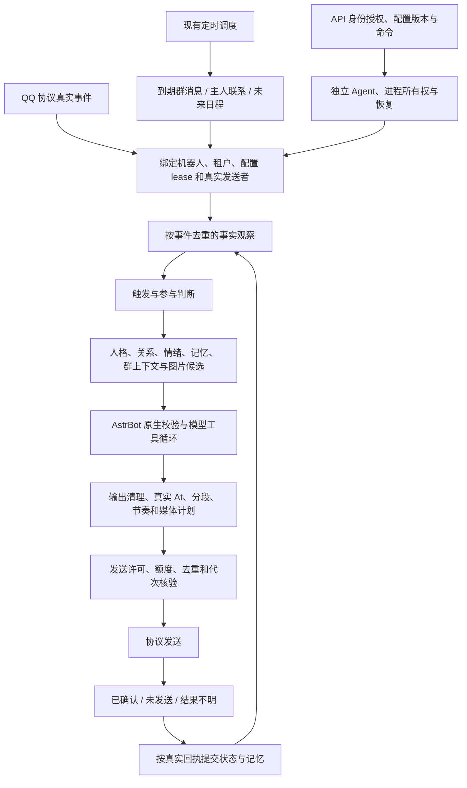

# 机器人管线：实现合同与验收计划

用户要求覆盖整个机器人与通用模块，完成管线建设并保证功能不退化；不是仅审查自动搭话。本文记录当前真实调用关系、建设范围与验证依据。生产基线为 `4fa78c9` 加私有部署清单中的 AI 源码补丁；Windows 的其他前端工作保持不动，Git 暂不提交。

## 当前真实链路

这张图是实施时固定的目标合同。建设前的入口主要位于 `behavior.py`、`initiative.py` 和原生 SDK，当时阶段尚未完全显式分离。下文分别记录实际接入点、验证结果和仍有边界的项目，不能因画出流程就宣称已经实现。

## 管线不变量

1. 可信身份只由协议、当前机器人配置及租户绑定产生。记忆、昵称、用户文本、模型结果不授权新的账号、主人或目的地。
2. 原始消息观察一次；到期补判不是新的用户消息，不得刷新真实入站时间、重复加亲密度、重复学习或重新触发外部管理操作。
3. 同一群的实时判断与到期补判使用同一个时钟和判断器。冷却期间的新消息保留最新一条，到时用最近上下文判断；没有新消息不反复调用模型。真实互动使旧待判断内容和迟到结果失效。
4. 群参与判断、主人联系、未来联系日程有不同意图。不得把未来日程的每日规划额度、30–600 分钟等待或全局定时发送额度叠加到普通群入场。
5. 模型判断意愿与相关性；代码负责身份、白名单、明确管理暂停、安静时段、预算、去重和结果有效性。临时没话题不能变成永久拒绝。
6. 上下文有界并保留来源；当前私聊和跨会话材料分别保留空间。关闭记忆、遗忘、摘要替换和租户边界在异步返回后仍有效。
7. 回复模型和工具共享当前工作上下文，工具权限在执行时再次核验。工具成功才能声称外部操作完成；网络超时不是重试外部写入的许可。
8. 输出先形成发送计划，再按顺序投递；真实 At 在首段、图片在末段且只发一次，保留 1–4 条分段和打字模拟。QQ 自带 Face 与平台鱼动图分开。
9. 每个异步边界后检查 lease、配置版本和实际目的地。已确认发送、明确未发送和结果不明分别处理；迟到结果不得创建新 Store 或覆盖新配置状态。
10. API/Agent/AstrBot/QQ 的运行所有权分开；Web/API 更新不应带来其他组件重启。保留 PostgreSQL、QQ Session、身份、模型 Key 与记忆，内存 Guard 和回退继续生效。

## 建设前已证实问题与待核验边界

| 项目 | 当前证据 | 处理方向 |
| --- | --- | --- |
| 主人判断漏当前私聊原始材料 | 判断的原生 contexts 为空，记忆函数默认排除当前 scope；生产私聊待摘要记录存在 | 增加有界私聊窗口，已独立通过原生 SDK 并部署 |
| 冷却到期不检查已收到的群消息 | 入站只调用 `presence.ready`，未到时直接返回；定时器没有恢复该事件的入口 | 增加每群一条的持久待判断输入，复用同一原生处理入口，不重造发送者 |
| 群补判与未来日程混用 | 备用路径使用 `companion_plan_budget`，生产当日 count=6；未来计划还限制 delay>=30 分钟 | 群补判独立于未来规划预算；保留一个群时钟和一个模型判断入口 |
| 默认值与校验分散 | Schema、preset、Python fallback 与 UI 分别出现数值；当前运行 Agent 仍拒绝群间隔 10 | 同步合同、默认值和运行校验；不能只改网页或直接绕过 Agent 校验 |
| 重复入站与普通回复的幂等边界 | 关系事件、主动发送、跨群工具各有去重；需核验普通回复的重复投递及重连路径 | 建立统一事件身份与阶段合同，先复现再改变状态语义 |
| 跟聊配置含概率字样但实现仅区分 0/非0 | `followupReplyProbability` 在当前门禁只检查是否<=0 | 保留当前跟聊能力，整理配置语义；不贸然恢复随机拦截 |
| Agent 停止与部署换代耦合 | `NodeAgent.shutdown()` 会停止全部 AI 和协议子进程 | 单独设计配置/运行更新路径，不能用常规 Agent 重启来实现页面参数变化 |

## 实施次序

1. 固定现有功能清单和真实入口，补齐群补判、重复入站、异步失效、部分发送等针对性用例，保留当前跨会话记忆、图片、At、工具和租户隔离回归。
2. 统一工作身份、阶段输入输出和结果状态；把实时消息、群补判、主人联系和未来日程作为明确来源，复用上下文、模型工具、输出和投递阶段。先在现有进程和存储中完成，不新增消息队列服务或运行时框架。
3. 收敛阶段所有权：观察、时机、语义判断、发送许可、发送回执、状态提交各负责一类事情。逐段迁移，防止同一个条件在多个入口互相叠加。
4. 同步用户最新默认值：主人 30 分钟判断、空闲 10 分钟、每日主动发送 10 次；群 10 分钟判断、有新消息才检查；日程规划判断不设每日次数上限，仍受时机、实际发送额度和未回应保护。显式停用和定制值不能被无条件覆盖。
5. Windows 回归、Linux 原生 SDK、实际运行与消息回执验证；核对 QQ 在线、身份/数据、进程归属和内存保护。未取得真实正向回执的项目单独报告，不能把 Mock/SDK 成功当作生产成功。
6. 对照本计划作 Plan vs Actual，说明尚未完成的阶段、偏移、部署边界及回退方式；用户未要求本轮立刻提交，不进行 Git 写操作。

## 已实现的接入点

`bot_pipeline.py` 使用当前机器人原有 SQLite 连接保存工作身份与结果，不增加服务、进程或常驻队列。`behavior.py` 的真实处理入口、上下文组装和发送循环已使用这些合同；原生 AstrBot 继续负责模型工具循环及原有安全、白名单和限流阶段。

| 阶段 | 所有者和能力接入方式 | 固定边界 |
| --- | --- | --- |
| 输入绑定 | `BotPipeline.bind`；实时入站和已有调度统一生成 `Work` | 同一机器人内按 scope、真实发送者、协议消息 ID 去重；自消息拦截在事实观察前 |
| 事实观察 | `behavior.execute` 的 observe 阶段 | 记忆、亲密度、风格、表情学习仅记录真实输入一次；补判不重复观察 |
| 时机与判断 | `GroupPresence`、主人判断和 `Planner`；`initiative` 管理现有调度 | 群消息保留每群最新一条真实协议输入，到期重走原入口；三类判断分别拥有其时钟和预算 |
| 上下文 | `ContextBuilder.contribute` | 平台身份保留独立字段归属；记忆、人物状态、社交、会话和投递各有归属，不得覆盖其他能力 |
| 模型与工具 | 原生执行器、`ToolLoopAgentRunner.reset`、`qq_actions/group_actions/tenant_tools` | 按当前工作和配置 lease 授权；外部写工具保留各自的幂等与回执记录，不把文本承诺当成功 |
| 输出计划 | `OutputPlan` | 先生成完整 1–4 段与有限非负延迟；真实 At 在首段，已批准图片只在末段；保持打字模拟与间隔相加 |
| 投递与回执 | 现有 `send` 和统一 `_dispatch_send` 末端校验 | 媒体下载、等待后再校验代次；协议调用前保存尝试，收到成功回执后才计确认 |
| 状态提交 | 当前 lease 的 Store，原有记忆/关系提交与 `BotPipeline.finish` | 区分 silent、sent、partial、unknown；重启后未完成发送记 unknown，禁止补判重发不明结果 |
| 控制面 | 原有 API 授权、配置 revision、Agent 命令及进程所有权 | 不以 AI 行为管线接管协议生命周期；页面/API 更新与在线 QQ 分开 |

事件证据只保留阶段、状态、原因码和计数，不存聊天内容；最多 2048 条且仅保留一天。去重保证受该保留窗口约束，不宣称永久去重。健康指标只保留最近一次工作的 16 个阶段采样。待判断群输入每群一条、最多 100 群、一天 TTL、单条序列化后最多 16384 个字符，位于原有每机器人数据目录；不进入共享日志或 Git。判断已预留后不会因进程重启反复调用模型；入队但尚未预留的中断可在 30 秒后恢复。

后续新增能力先确定属于“观察、上下文、判断、授权工具、输出”哪一段，再使用该段现有入口；需要跨段时显式传递当前 Work 的结果，不另造发送器或将局部开关变成全局门禁。

## 实际部署与 Plan vs Actual

2026-11-01，Windows 修改后已在真实 Linux 完成隔离测试、构建及生产部署。14:41 部署公共管线，14:50 独立更新 Web/API，14:55 补齐部分发送回执的计时与上下文归属边界。源码节点为前述提交加明确记录的未提交补丁，不将它冒充新的 Git 提交。

| 原计划 | 实际修改、验收与边界 | 状态 |
| --- | --- | --- |
| 1. 固定入口并覆盖相邻能力 | 补充原生 SDK 的重复协议消息 ID、群到期补判、迟到结果和部分发送测试；保留跨会话同人记忆、真实 At、图片、工具、专属/共享 AI 及多租户回归。 | 完成受影响范围；不是所有插件和生产组合的穷举验收 |
| 2. 统一身份和阶段 | 新增 `bot_pipeline.py`，实时消息、群补判、主人联系、未来日程接入 Work、ContextBuilder、OutputPlan 和统一投递回执。复用原生模型工具执行器及每机器人 SQLite，没有新增队列服务、模型常驻进程或运行框架。 | 完成主干和接入合同；没有重写原生 SDK 的全部内部阶段 |
| 3. 收敛职责与生命周期 | 去重在事实观察前；群补判不重复加关系分或记忆；平台身份不能被其他上下文覆盖；配置/停止使旧结果失效。协议成功逐段确认，首段已成功而后段超时仍刷新实际互动时钟，只保存已确认的联系人文本前缀，不把未发送后缀写成完整回复。结果不明不自动重发。 | 单元及 Linux 原生 SDK 验证完成 |
| 4. 同步最新默认值 | Schema、preset、Python fallback 和相关 UI 一致；经正常带 revision 的配置 API 更新 7 个现有非删除机器人。群 10 分钟；主人 30 分钟判断、空闲 10 分钟、每日判断 48 次、每日定时发送 10 次；日程规划 `-1` 表示不限判断次数，0 为停用。显式停用、定制参数、白名单、安静时段和主人身份均核对保留，停止/离线账号没有被启动。 | 完成；不限的是日程规划判断，不是无限发送 |
| 5. Windows、Linux 和真实运行 | Windows 最终 6 个测试入口全通过，Linux 原生测试与独立生产构建退出 0；实际 Linux 网页的参数、提示和 390px 移动端无溢出检查通过。真实主人联系和群补判证据见下文。 | 已取得的证据通过；主动群插话的新版正向生产发送尚未观察到 |
| 6. 对照计划、部署与回退 | 本表及下文逐项记录偏移、失败和限制；本轮 12 个运行/合同/UI 源文件与 Windows 逐一核对，9 个原始哈希一致，3 个仅有 CRLF/LF 行尾差异，规范化后全部一致。代码回退、行为库快照及配置前态保留，Git 同步按用户最新指示后置。 | 本轮实现和验收收口；Git 提交/标准检出目录同步未执行 |

### 真实消息与到期补判

以下为北京时间，使用正常生产入站与调度，不伪造聊天、不强制模型答应联系，也未为本轮成功重置时钟或额度。

- **主人联系：14:51:05** 正常调度开始，模型在 **6305 毫秒**后选择联系；14:51:15 入队，14:51:29 完成。管线记录 `owner_contact / commit / sent`，2 次协议发送均确认。联系人未回应数为 1，后续仍受未回应保护，不连续追发。此前 13:49 的沉默和 14:19 的 10 秒超时也保留，未隐藏失败。
- **正常群聊：14:56–15:00** 最终源码收到真实群对话，当前工作进程的 5 次正常回复均完成，自动发送 4 张平台鱼动图。首个完整例子为 3 条确认消息、末条一张鱼动图；保持模型选择 1–4 段、打字模拟与分段间隔相加。
- **冷却到期补判：14:59:57**，调度器自动拾取约 14:49 收到并保留的真实群消息，累计 `groupDeferredChecksQueued=1`、`groupDecisionRequests=1`，判断用时 **6630 毫秒**；对应输入事件仍是原消息，不是新造消息。这次模型判为 `target=other`，该账号的“允许旁观补充别人之间的对话”关闭，因此保持安静；没有协议发送尝试。下一条新群输入另行保留，等待下一次间隔。群补判运行正常，不等于每到 10 分钟必定发言。
- 本群正常交流持续刷新本群 interaction；不再依赖下一条新消息启动补判。各群时钟独立，主人真实互动另外刷新主人时钟，后台普通旁观消息不当作主人与机器人交流。

普通消息账本保存原始输入来源 `message`；同一事件补判更新原记录的结果，不另造一条用户输入。最近一次运行指标中的 Work 来源可为 `deferred_group`，会被后续真实工作替换；不能只按账本 `source='deferred_group'` 的行数断言没有补判。页面的“最近判断”来自当前工作进程指标，AI 重载后可能暂时无记录；持久判断/发送记录仍在数据库中。后者是现有展示边界，不能用页面的暂无记录推断历史没有联系。

### 实际验证证据

- Windows：`test-results/pipeline-receipt-final-windows.log` 最终 6/6 通过；`pipeline-final-windows.log`、`pipeline-unit-windows.log` 覆盖原生重复入站与阶段边界；类型检查退出 0。`pipeline-partial-windows.log` 核验首段 ACK、后段超时后只提交已确认前缀和真实时钟。
- Linux：私有证据根目录 `/opt/fishbot-companion-full-20261101/communication/robot-pipeline/`。`verify-result.json` 含单元、原生自主机制、入站、跨会话、定时器、共享社交、独立 AI 和媒体测试；`build-result.json` 为独立类型检查及生产构建成功。最终两文件补丁另有 `receipt/verify-result.json` 的单元与两组原生 SDK 成功记录，覆盖最终部署哈希。
- 实际 Linux Web 浏览器验收使用只读会话，检查实际新资源、群最小值/默认值 10、到期补判说明、主人 30/10/48、定时发送 10、不限规划和手机布局；无页面异常，临时会话随后删除。未覆盖另一位 AI 的 Windows 样式与交互改动。
- 15:05 的只读收口：3 个 QQ 在线，1 个共享 AI、实际成员 3；Agent、PostgreSQL、网关及仍在线的 3 个协议 PID/启动时间保持一致。此前每次部署时为 4 个在线且所有协议 PID 均保留；**小弟在 14:56:28 收到 stop 命令，14:56:29 完成，代数 19→20**，其停止不是部署掉线，未主动重启它。原有离线和停止实例仍保留数据。
- 最终只有 4 个生产容器，无测试容器；本轮测试数据库/角色清理检查无残留。Guard armed、未 disabled、心跳正常，Guard 与 controller 源码哈希和原策略保持一致。空闲共享 AI/NapCat high=48 MiB、独立 AI=16 MiB、PAGEOUT=40 秒未改动。

### 偏移、失败与未执行项

1. 原生重复投递回归先复现普通回复可重复调用模型，随后将事件去重提前；这是实现统一管线所需的实际修复。部分发送后仍按零互动处理也在边界验收中发现并修正，新增的逐段确认没有把未确认内容当成功。
2. 运行 Agent 缓存的合同早于磁盘源码。为保留在线 QQ，未重启 Agent；仅将其已有日程规划下界校验从 0 更新为与磁盘一致的 -1，使用一次性回环调试连接完成并关闭。API 和磁盘完整合同校验群间隔至少 10；运行 Agent 的旧缓存本身没有这项完整的新字段校验，不能宣称其全量 Schema 已热替换。下一次正常 Agent 启动加载磁盘完整合同；未增加常驻接口或兼容分支。
3. Web/API 独立更新引起内存 Guard 检测到预期 API 容器身份变化并短暂放宽；初次发布因此回退，随后发布等待 Guard 自己的冷却恢复后才通过（约 135 秒）。没有清除保护标记、降低保护强度或改变 Guard 参数。
4. 旧测试中“同人记忆不得跨群/私聊”及已废除黄头像的预期与用户已明确的现行合同冲突，按真实跨会话隔离和鱼 GIF 资产修正，并保留其他人、其他机器人与关闭能力的检查；没有恢复已废除功能来制造通过。首次 Linux 多入口共用测试数据库造成密钥目录冲突，改为各阶段独立数据库/角色后通过；构建容器文件权限问题按实际 UID 修复后通过。
5. 默认配置 API 正常 Schema 解析顺带移除 5 个旧配置中的已废除 `dailyMemeLimit/memeProbability` 字段；最初后验脚本仍索引这些字段而失败，没有重跑写入。只读复验逐个对比完整解析结果，7 个配置均符合正常 Schema，其余受支持字段保留。该正常化符合用户此前取消图片每日上限与概率机制的要求，不恢复旧限制。
6. 本轮不是内存策略 A/B，也未完成长期在线、多样消息的延迟 P95 基准。真实首个群回复模型耗时约 19.7 秒、首段约 25.2 秒、三段完成约 34.4 秒；不把这些样本包装为“额外 P95≤5 秒已验证”。原有分段、模型服务和超时保护保持，长期延迟与所有功能组合仍需持续观察。
7. `followupReplyProbability` 的历史名称与当前非随机跟聊门禁语义仍存在差异，未在本轮擅自恢复随机拦截；原生 SDK、安全、工具许可和各类外部写操作账本继续各自履职，不宣称已将所有内部模块重写成一个新框架。
8. 本轮未执行 Git 写操作，也未将未提交补丁伪装成 Linux 标准检出目录已同步的新提交。Windows 另一位 AI 的 `style.css` 和相关未跟踪设计/交互文件保留，不算本任务产出。

### 回退与后续接入

公共管线回退目录为 `rollback-144104`，Web/API 为 `control-rollback-145057`，最终回执修复为 `receipt/rollback-145550`，均在上述 Linux 私有证据根目录。回退按相应源码/产物和正常配置版本执行；行为库快照仅供保护与调查，**不将旧快照覆盖部署后新增的真实聊天和记忆**。QQ Session、身份、模型 Key 和账号数据不随代码回退清除。

后续能力接入规则已写入项目 `AGENTS.md`。新增能力仍须给出本阶段输入、归属和结果，并验证相邻阶段及失败/迟到边界；“管线已有”不能替代新能力本身的测试和真实回执。

## 追加复查计划：布局、健壮度与阶段交接

用户要求再次核查管线布局、结构和 Bug 并直接优化。本轮沿用当前主干，不另造框架；先保存已有修改前态，保护另一位 AI 的前端文件，不进行 Git 写操作。

1. 复查同轮多段输出与 admission lease 的交接：确认首段真实回执刷新计时后，既不能使自己的后续分段失效，也不能覆盖期间到来的真实互动、手动暂停或配置换代。
2. 复查突发消息合并时 source event、实际选中 event、工作账本与发送预约的所有权：沉默或未开始发送必须释放正确的预约，不误退已确认/不明结果。
3. 复查阶段异常、取消和退出：上下文组装失败也须归还活动计数，后续消息不能永久卡在忙碌；异步迟到不得恢复已释放 Store。
4. 先增加能稳定复现交错的用例，再作最小修复；Windows 与 Linux 原生 SDK 回归后按受影响 AI 文件部署，保留在线 QQ/Agent、数据、内存保护和回退。对照本追加计划记录真实结果及未执行项。

### 追加复查结果与 Plan vs Actual

本轮确认并修复 3 个阶段交接 Bug。运行代码只改 `behavior.py`，没有引入新框架、常驻任务或额外模型判断，也没有调整用户参数和前端布局。

| 追加计划 | 复现、修复与验收 | 状态 |
| --- | --- | --- |
| 1. 多段输出与判断许可交接 | 原版自主接话首段 ACK 会增加群 version，使同一轮后续分段失效，末段图片也到不了。这是上一轮逐段回执修复引入、旧单段用例未覆盖的回归。现在仅在原许可仍有效时，把本轮自己的真实 ACK 产生的版本续接到本轮许可；新互动/暂停/换代造成的失效不能被续接覆盖。完整提交不再重复刷新已逐段记录的时钟。 | 修改前失败，修改后通过；Linux 原生 SDK 完整 3 段、首段 At、末段鱼图一次通过 |
| 2. 合并后的工作与预约归属 | 合并消息实际选中后来的 event，但 finally 只查初始 event 的预约；模型沉默时会泄漏 pending，误占每小时名额。现在源事件显式持有实际选中的事件，分别完成各自账本并清理各自未开始的预约；sent/unknown 不退还。 | 修改前 pending 稳定复现，修改后立即 released；Linux 原生合并消息及沉默用例通过 |
| 3. 异常后的活动计数 | context 阶段中途异常发生在原 try/finally 之前，active 会泄漏，使后续自主工作被长期判为忙碌。将活动所有权覆盖完整上下文/模型阶段，故障注入后 active 归零且下一条消息仍可处理。 | 修改前失败，修改后通过；既有停止、换代、迟到与部分发送回归保持通过 |
| 4. 双平台、部署与保护 | Windows 两组共 9 个测试入口通过，类型检查退出 0；Linux 单元、原生多段/合并、自主机制、跨会话和类型检查五阶段全部退出 0。15:44–15:45 只更新 1 个 AI 文件，空闲后优雅重载共享 AI；Agent、API、PostgreSQL、网关及所有协议进程 PID/启动时间不变，配置版本、7 个身份文件及受保护数据库表一致。 | 部署完成；保留 4 个行为库快照与代码回退 |

Linux 本轮私有证据位于 `/opt/fishbot-companion-full-20261101/communication/robot-pipeline/robustness/`，包括 `verify-result.json`、`deploy-result.json`、`final-audit-private.json`。五阶段分别耗时 40.5、27.1、60.9、26.3、29.8 秒；生产 AI 切换约 21 秒，QQ 协议保持在线。回退目录为该目录下的 `rollback-154404`，仍只回退代码，不覆盖新聊天数据。

Windows 证据为 `pipeline-robustness-before-windows.log`（真实失败）、`pipeline-robustness-after-windows.log`、`pipeline-robustness-windows.log`、`pipeline-robustness-regression-windows.log` 和类型检查日志。新用例用 barrier 固定“发送期间新互动”和“合并时选中后来的消息”，不用等待碰竞态；同一修复版本再经 Linux 原生 SDK 验证。

发布前首次检查发现一个新实例尚未登录，在修改生产代码前停止。后续发布条件保护当前所有协议进程，并要求原在线账号持续在线；不把等待登录误判为部署掉线，也允许用户自然完成登录。此次切换完成时 4 个 QQ 在线、共享成员 4 个，Guard 与 OOM 状态正常，内存保护代码及参数未改。此调整是对发布验收状态的纠正，没有放宽在线账号保护。

本轮未新增真实生产消息来强制制造主动接话，正向多段自主接话证据来自 Linux 原生 SDK 与隔离协议/模型。生产状态与哈希核对不能代替长期延迟或全部功能组合验收。未发现必须重写当前层次的依据；仍使用既有输入/观察/判断/上下文/原生模型工具/输出/投递/提交职责，并保留外部写工具自己的权限和幂等账本。

用户随后明确授权本轮全部验收完成后提交推送 Git，并读取最新 Pi 对话制作展示版本。此前“暂缓 Git”属于历史指示；后续提交、远程及 Linux/Windows 同步以实际 Git 收口记录为准。另一位 AI 的 Windows 样式和未跟踪前端草稿继续保留，不并入本轮管线提交。
