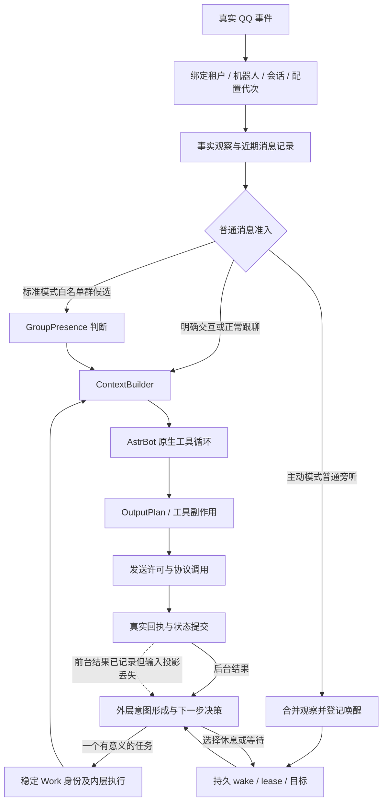
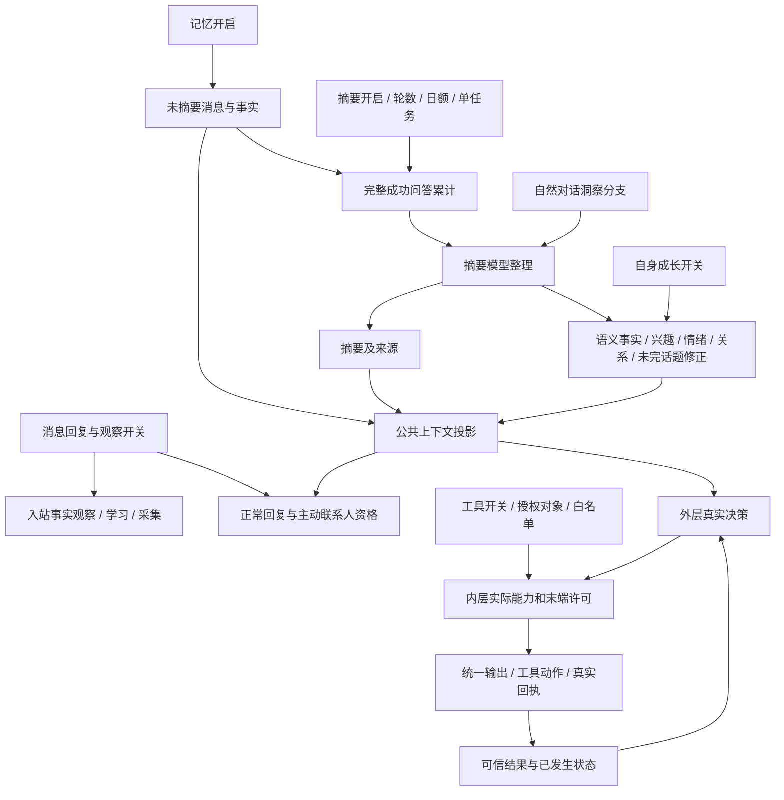
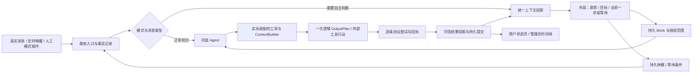
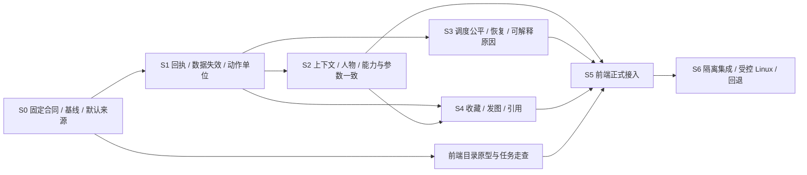

# FishBot 管线、功能、主动模式与前端：联合详查及分阶段实施计划

调查日期：2026-11-03，北京时间。源码基线：`b5cfcf5615bd5b0561b865cacfa3f8781ce31de5`。

**本轮交付是调查和计划。未修改 FishBot 产品代码、生产配置或数据，未部署，未执行 Git 写操作，未发送 QQ 测试消息，也未主动唤醒线上机器人。** 新增内容仅为本文和独立研究目录内的调查探针、隔离页面截图及私有采样。

结论：现有公共管线已经承担了真实身份、准入、上下文、投递和回执等核心职责，可以继续作为系统主干；目前更突出的问题是各段对“执行事实、一次行动、能力状态和配置状态”的解释不一致。应先修正这些合同，再根据同一套职责重排前端。直接继续加提示词或拆页面，都会留下同类问题。

优先修正四项有确定证据的缺陷：**前台无消息 ID 仍能标为成功（F16）；更正一个人物会误清同群他人的待摘要材料（F17）；前台可信执行结果没有完整进入外层（F01）；对外动作按分条扣额，与 1–4 条回复冲突（F02）。** 其后处理人物/上下文投影、18 项默认分叉、调度恢复和前端。合理休眠本身不列为缺陷，不以强迫机器人联系主人或群发来代替自主性。

本版新增完整阶段表、状态归属、时钟/额度、逐功能证据、默认字段清单，以及 **真实 QQ 自定义表情收藏、发表情包、引用别人回复** 的源码比较与实施计划。后者包含本次 GitHub/B 站实际检索，不把本地保存或视频介绍当成真实 QQ 能力通过。

阅读导航：[管线与边界](#pipeline) · [25 项问题](#findings) · [前端布局](#frontend) · [逐功能实际情况](#features) · [追加三项能力/开源参考](#media) · [实施工作包](#plan) · [验收矩阵](#verification) · [本轮收口](#actual) · [全部参数](#defaults)。

范围更新：按用户后续指示，**F25“三条回复偏多”的效果调查与优化暂缓，K05/T16 不纳入本轮实施及完成门槛**。既有统计保留作历史证据；F02 后台分条被预算误截断仍属于执行合同修复，继续保留。

再次更新：**后续实施取消摘要及其关联语义整理的每日调用次数上限**，保留调用/成本统计、单任务运行、单次处理边界与失败退避。本文现状表中的 `dailySummaryLimit` 与日额度是调查时的实际实现，尚未修改生产；目标计划不再依赖该日额度。远程 Embedding 的资源路线与启用前门槛补充在 §7.1。

## 1. 范围、方法与证据边界

本次将三个问题合并调查：公共机器人管线及主动模式的结构；用户与管理员前端的信息架构；近期实际运行中的异常、低效和功能生效情况。

| 证据层 | 本轮实际做了什么 | 可以支持什么 | 不能支持什么 |
|---|---|---|---|
| 当前源码 | 追踪公共入口、外层调度、内层工具、上下文、发送与持久状态的调用关系 | 职责、条件、预算单位和状态流转的实际实现 | 某个历史故障必然由某段代码造成 |
| Linux 只读采样 | PostgreSQL、每机器人 SQLite、运行状态、内存及压力快照 | 采样时的状态、已保留账本与实际回执 | 全时段稳定性、完整群历史、未记录的模型输入 |
| 原生 SDK 隔离探针 | 使用当前 Linux 适配代码和 AstrBot SDK，替换模型与 QQ 协议返回 | 实际模型输入装配及预算边界的确定性行为 | 真实模型决策质量、真实 QQ 收发延迟 |
| 浏览器隔离观察 | 使用现有 React 页面、临时账号和数据库，隔离 API 请求，检查桌面和手机页面 | 页面结构、控件数量、长页、路由及脚本错误 | 真实用户的完成率、生产网络条件下的页面性能 |
| 一致 SQLite 备份重建 | 从私有一致性副本调用当前上下文方法，统计内容重复 | 持久材料部分的重复结构 | 完整线上模型输入大小、精确计费 Token |
| 默认与参数核对 | 枚举 79 behavior 字段、10 顶层字段和自主字段，核对 Schema/预设/实际调用方，运行创建解析探针 | 默认入口分叉、读取范围及死字段 | 静态命中行数代表功能完整程度 |
| 开源与公开视频 | 固定 7 仓库提交读取实际文件；B 站公开元数据/可检索介绍；Linux 协议包只读检查 | 具体机制、候选可行性及访问限制 | 已看完视频、真实协议写操作通过或参考项目质量排名 |

生产主采样为 00:38–00:44，主动记录、功能状态和分条统计补采至 01:17、01:28、01:38；页面、SDK、默认值与协议包探针随后完成。过去 24 小时经历过多个版本、调试和重载，报告把它与 R55 00:14:06 之后的小样本分开。SSH 仅复用既有私有连接脚本；不导出或在本文展示模型 Key、SSH 凭据、QQ Session、真实 QQ、群号或私聊正文。

审查采用 `plan-execution-review` 的要求与证据对照方法，以及 `async-lifecycle-audit` 的所有权、失效与迟到提交检查方法；两者均保持本轮只读范围。

<a id="pipeline"></a>

## 2. 当前架构：主干成立，交界处仍有缺口



图中的虚线是本轮确认的缺口，详见 F01。内层执行内部任务时通过公共上下文、输出和回执设施接入，并非所有步骤都重新经过一次真实消息入口；不能只因为有 `bot_pipeline.py` 就推定两条路径的合同完全一致。

### 2.1 应保留的现有实现

- `bot_pipeline.py` 已有 Work、ContextBuilder、OutputPlan、内部 action 与协议 receipt；不需要再造发送器或人物记忆库。
- 外层通过现有共享 AstrBot 执行模型请求；内层使用 `native_internal.py` 中的原生工具循环，没有每 QQ 新增一个常驻 Agent。
- 后台任务使用服务身份，不把发件人伪装成主人。租户、机器人、配置 revision、运行 generation、自主 epoch 和真实协议绑定参与校验。
- 前台明确交互保持正常内层回复路径。后台外层决定目标，内层执行具体任务并返回结果；无需强制每条普通聊天都先走外层。
- `active + live` 接管旧的主动调度，影子模式不接管；不能同时启用两套真实主动发送。
- PostgreSQL 保存长期目标、周期、唤醒和租约；每机器人 SQLite 保存现有记忆与本地执行账本。两者有实际恢复边界，不应假设跨库原子提交。
- `unknown` 不盲目重发，配置或身份失效后的旧任务不能获得新的发送权。
- QQ 离线时自主状态挂起，不因自主唤醒而重新启动 QQ。当前用户停止的账号也应继续保持停止。

### 2.2 模式、范围和控制权应明确到表格

| 情况 | 谁决定是否处理 | 谁执行 | 范围和保护 |
|---|---|---|---|
| 私聊、明确 @、引用及正常跟聊 | 现有消息准入与内层 | 同一内层工具循环及输出管线 | 真实身份、消息去重、当前配置及可用工具 |
| 标准模式的普通群消息 | GroupPresence | 同一内层 | 群参与白名单、首次参与判断窗口及独立额度 |
| 标准模式的定时主动联系 | 现有 Planner / 主人联系等调度 | 同一内层 | 授权对象、安静时段、未回应及定时联系额度 |
| 主动模式的普通群消息 | 旁听事实进入外层决策 | 外层委派后由内层执行 | 共用白名单；不能重新套用标准群首次判断间隔 |
| 主动模式的自主目标 | 外层模型 | 内层工具循环 | 实际内层能力、服务任务权限、动作预算及回执 |
| 人工停止或 QQ 离线 | 后端状态机 | 停止新自主执行并保留数据 | 不擅自启动 QQ，不影响共享组其他成员 |

“注意力、兴趣、情绪、疲劳”与“权限、未回应保护、协议幂等”不是同类开关。当前正常跟聊、明确交互，以及已通过语义参与判断的群回复，会绕过 `Participation.blocked_reason` 的疲劳否决；旧定时群联系仍有频率保护。主动模式的自主疲劳另作为决策信息。**本轮没有证据表明应把这些保护全部移除或合并为一个计数器。**

### 2.3 逐阶段合同：真正在哪里观察、执行和提交

下面描述当前实现，不把目标图当成现状。`behavior.py` 的前台 `execute/send` 与 `autonomous_runtime.execute` 是两个执行入口，复用了一部分设施，但没有完全一致的阶段语义。

| 阶段 | 当前入口与输入 | 当前读写和所有权 | 失败、迟到及下一阶段 | 计划要明确的合同 |
|---|---|---|---|---|
| 0. 协议归一化 | NapCat/OneBot 事件、真实发送者与消息段 | 原始消息与归一化消息并存；识图消费归一化 Image，自动收图仍消费原始消息 | 不支持的媒体应明确不可用；不能构造不存在的 CDN 地址 | 同一媒体引用保留原类型、可读图片及来源，各消费者自行声明支持范围 |
| 1. 成员绑定 | adapter 入队前绑定 `_hosted_lease` | tenant、bot、generation、revision、协议 self ID 归平台所有 | `enabled=false`、服务群不符和戳一戳在普通 Work 绑定前返回 | 列清“没有进入聊天管线”的合法原因，不能把没有 Work 一律当采集失败 |
| 2. Work 与去重 | `BotPipeline.bind()`；内部为 `bind_internal()` | 前台以原会话/人物/event 去重；内部以稳定 action ID 和身份摘要绑定 | 自己发出的事件不再作为新用户输入；旧 action 不重新执行 | event、goal、action、协议 sequence 各有身份，不互相替代 |
| 3. 原始事实观察 | 前台 `execute()`，模型准入之前 | `memory_pending`、contacts、主人互动时钟、群参与时钟、companion、ambient；收图/表达学习也在这一段 | 尚未回复的真实消息仍可被记住；不能据此声称内层已经完成任务 | 观察可写入事实，但不产生工具成功反馈；同 event 的各观察器去重 |
| 4. 合并和指向识别 | 800ms 默认连发合并；私聊/@/引用/跟聊/普通群区分 | 合并选择实际承载 Work；未选中的消息可标 combined/waiting；人物仍来自协议 | 合并中换配置不得继续用旧事件；等待合并不等于模型沉默 | 说明合并后的作者、输入范围、原 event 集合和最终账本归属 |
| 5. 是否参与 | 正常交互直接准入；标准群 GroupPresence；主动旁听交外层 | 标准群有 inbox、版本和到期判断；主动模式有自己的 wake 和候选权限 | 明确交互与跟聊绕过首次参与等待；普通旁听不能反复取消自主执行 | 决定“是否回应”的模块只运行一套；权限/额度与模型兴趣分别解释 |
| 6. 上下文构建 | 前台传入观察 state；后台重新构造目的会话；外层聚合多个会话 | 共用 facts/summary/pending 等存储，但关系、语义增强和自身兴趣的投影不同 | 远程召回失败可回退；记忆 reset/成员换代后迟到结果失效 | 共用材料和来源合同，按角色与目的会话投影；不共享一个可变 Prompt 对象 |
| 7. 模型与工具 | AstrBot 原生工具循环；后台 `RunControl` | 模型调用、工具步骤、证据、checkpoint、使用量属于当前 Work | 工具失败不是全能力失效；时间片按无进展计算；前台明确交互可取消后台 | 完成一个有意义的任务后交还外层；不能把每次工具调用都当高层目标完成 |
| 8. 输出装配 | 前台/后台聊天共用 `send()` 和 `OutputPlan` | 清理控制标记、模型选图、真 At、最多 4 条、图片只在最后一条 | 图片读取失败可降级文字；图冷却在投递前预留，当前未必实际送达 | 模型原文、清理后文本、计划条数和实际条数分别可观察；一轮不是固定三条 |
| 9. 末端许可 | 每条发送前再查当前 lease、generation、action、目标和时段 | 请求回复许可与自主联系许可不同；工具还校验真实登录 QQ | 停止/换代撤销尚未派发部分；已经派发不能撤回 | 预算按逻辑动作，协议按 sequence；能力开关不能授予对象权限 |
| 10. 协议尝试与回执 | `dispatch`、`CQHttp.call_action` | 尝试先登记；内部消息要求 message_id；前台当前在无异常返回后直接确认 | 返回 `{}` 的前台探针仍被标 sent，见 F16；网络超时不能盲目重发 | 区分“未尝试、尝试中、不明、协议确认、用户可见读回”，统一最底层证据要求 |
| 11. 已确认部分提交 | 每条实际确认后刷新互动时钟和已发送前缀 | 不能把未发后缀当记忆；迟到回执仅结算旧动作，不能创建新成员 store | 后一条失败时，前一条的外部事实必须保留 | 按 sequence 幂等提交真实前缀；不要等全轮成功才承认已经发生的事 |
| 12. 全轮状态提交 | `send()` 循环正常结束后更新表达、关系、motives、reflection 等 | 成功回复后还会补一次 directed 观察；同 event 去重避免重复加好感 | 部分失败会跳过后续整轮提交；辅助记忆/参与状态是否完整保留须单独验证 | 把“每条确认即可提交”与“完整回答后才能提交”的字段逐一分类，不能一个 success 管全部 |
| 13. 外层反馈与恢复 | 前台 `completed()` → PG latestFeedback；后台 result → coordinator | 真实结果与聊天文本分离；PG 保存周期/目标，SQLite 保存本地动作和回执 | 前台结果已到 snapshot，却被规划输入投影丢弃；跨库没有原子事务 | 原结果不可变、投影有界且新鲜；恢复先查动作，不把未知重发成第二个动作 |

**需要保留的正确实现：** 发送等待期间的代次检查、逐条确认后更新互动时钟、成员卸载后的原账本结算、摘要按内容快照删除原材料、显式互动优先、旁听不充当执行反馈。这些不能在“简化管线”时删除。

**尚不能宣称已经可靠的部分：** 无 message_id 的前台确认、部分投递后的辅助状态提交、前后台上下文一致性、跨库崩溃恢复，以及多个慢成员下的许可续期。计划必须分别验收，不能只运行一次成功聊天。

### 2.4 五条实际路径的差异

| 路径 | 参与决定 | 上下文与执行 | 回执/记忆/反馈的实际差异 |
|---|---|---|---|
| 正常前台私聊/@/跟聊 | 当前准入；即时任务由内层决定如何执行 | 真实作者身份；有关系 state、可选语义增强、主人群工具、原生会话历史 | 完整回复后写 reflection；前台结果经观察器交外层，但 F01 丢弃结构化内容、F16 可过度确认 |
| 标准模式普通群参与 | GroupPresence 小模型判断；到期 inbox 可补判 | 判断结果提供 handoff_hint，然后走正常回复 | 每小时主动入场额度；成功后才补记自然加入者的 directed 关系，不凭旁听加分 |
| 标准定时联系 | Planner/主人判断/成员选择；同一旧调度所有权 | `_hosted_initiative` 内部事件，仍走公共聊天与分条 | 不伪造用户问答，不计为用户主动互动；标准疲劳、日额度和未回应保护仍可拦截 |
| 主动模式后台任务 | 外层选当前一个任务，内层多步工具执行 | 服务作者为 0；消息任务按目的会话构建上下文，research 为 self | action/effect 持久；不把自主聊天伪造成新用户问答；研究结果有证据时进入原有 self 记忆；关系与远程语义投影不完整 |
| 工具跨群发言/资料动作/戳一戳 | 即时工具意图或协议通知的独立准入 | 受控工具参数、实际主人/服务任务授权、协议 self ID | 群工具有独立尝试账本，不自动等同于当前会话的 OutputPlan；戳一戳不调用模型、没有普通 Work；应作为明确的工具动作子类型展示 |

这不是五套都要推翻重建。目标是保持各入口合理的身份差异，统一事件归属、执行证据、末端许可和提交语义。尤其不能为了让后台获得群查询工具而把服务任务伪装成主人。

### 2.5 状态所有权与“全局/局部”的实际边界

| 状态 | 当前归属 | 局部变化如何影响其他部分 | 必须防止的误解或退化 |
|---|---|---|---|
| 租户、机器人、QQ 绑定 | 平台 PG + 当前成员 lease | 绑定或 generation 变化使旧执行失效 | 共享 AstrBot 不是共享人物数据或主人权限 |
| BotConfig revision | 每机器人配置版本 | 保存产生新 revision；Agent 应用后才改变运行配置 | 前端草稿、数据库新版本、已应用版本不能混称已生效 |
| 自主 epoch | 每机器人自主配置/模式版本 | 模式或自主配置变化取消旧周期和未执行意图 | 与 BotConfig revision 是两个合同，不合并成一个含糊的“版本” |
| 好感度 | 每机器人 `(scope,subject)` | 成功交互影响该会话下该人；标准成员选择读取分数 | 同一人的跨群事实互通，不等于关系分数已全局统一 |
| 主人身份 | 每机器人配置 + 真实发送者 | 影响称呼、主人工具授权和主人联系对象 | 不能从昵称、好感度或模型文本推导 |
| 人物心境/情绪 | 主要按 scope；关系表另有每人短期情绪 | 当前会话情绪进入表达；摘要可语义修正 | “此人的反应”“自己的持续心境”“平静/过期”不是同一字段 |
| 自身兴趣 | 人格 `*`、会话 scope、自主选择 `self` | 当前投影没有把 self 兴趣一致带入普通会话 | 不把群聊热词当真正喜好；跨层兴趣需要相同来源语义 |
| 事实、摘要、临时消息 | 每机器人库；真实人物可跨会话召回 | 事实更正使相关派生记忆失效；当前还误清同群他人 pending | 保留互通，同时标明原会话与真实人物；不能靠清空全部群记忆完成更正 |
| 跟聊与短期疲劳 | Participation 的每 scope 进程内状态 | 一次回复刷新本群对话窗口；模型上下文能看到近期自己的发言 | 进程重载会冷启动，不等于持久关系或事实丢失；不能让群 A 回复延长群 B 窗口 |
| 参与判断时钟 | 标准模式每群；主人判断独立 | 真实定向交互刷新对应判断基线；普通新消息进入到期待判断 | 标准群判断间隔不能再次限制外层自主群行动 |
| 发送额度 | 每机器人日计数/滚动小时计数，当前部分跨 scope | 私聊主动联系当前也消耗名为群搭话的小时额度 | 必须显示实际扣费对象；不能让改 UI 标签暗中改变线上保护 |
| 自主目标、周期、wake、lease | PG 每租户/机器人；执行槽由一个 Node Agent 共享 | 前台明确交互让后台任务让出；事件与时间合并唤醒 | 普通群旁听不是任务完成；模型休眠不是进程退出；排队不是模型拒聊 |
| B 站服务冷却 | 当前 Python 进程/外部服务级 | 一个共享运行时内的限流会影响其他机器人搜索 | 服务限流是合理公共边界，不能误显示成该机器人永久禁用 |
| 共享运行组与内存控制 | 实际进程/cgroup，成员仍独立 | 成员退出只移除该成员；进程资源统计只计一次 | 不能按机器人名字重复计算共享 PSS；单成员停用不杀其他 QQ |

当前 `observe()` 的通知是“最新定向事件 + 合并旁听槽”，并非第二套完整聊天池。`observedThrough` 确认通知已处理，不删除事实、摘要或 pending；外层每次还要读取当前存储。不要把“外层判断后清掉通知”误做成删除聊天记忆。

### 2.6 时钟、额度与门槛逐项分开

| 项目 | 当前默认/样本 | 实际作用与刷新点 | 是否硬拦截 |
|---|---|---|---|
| 连发合并 | 800ms 预设 | 聚合一次输入；增加首条等待 | 合并等待，不是拒聊 |
| 跟聊 | 120 秒 | 本 scope 最近真实回复，兼顾同一对象与自然接话；@他人影响指向 | 关闭时不自动跟聊；不限制明确 @/私聊 |
| 标准首次群判断 | 10 分钟起 | 有消息待判断且到期；定向交互刷新窗口；到期消息有 inbox | 标准首次参与等待；不应用到外层自主行动 |
| 标准疲劳 | 300 秒/4 次参考 | Participation 记录本 scope 发言 | 普通自发路径可拦截；明确交互、正常跟聊、通过语义判断的前台路径绕过 |
| 主人主动联系 | 30 分钟/空闲 10 分钟 | 主人 interaction、last_attempt；主动模式候选使用这两个条件 | 资格门槛，不代表到点必发 |
| 标准通用主动间隔 | 3600 秒 | 旧调度还会按 last_bot/last_attempt 叠加；普通授权对象也使用 | 可能让旧主人联系实际晚于页面上单独的 30 分钟 |
| 未回应 | 默认 4 次达到暂停 | 真实回应重置；群里主人定向互动也可更新主人联系状态 | 保护保留；不把旁听沉默当拒绝 |
| 每小时主动额度 | 20，滚动一小时 | 当前 `autonomy_sends` 同时含群与私聊自主发送，F18 | 已用完则拒绝新自发发送；正常响应不占 |
| 每日主动发送 | 10，北京时间 | 旧定时及外层候选共用；普通群语义入场未完全同口径 | 硬额度；不同入口需在 UI 明确，不称为仅旧定时设置 |
| 安静时段 | 预设 01:00–07:00 | 限制自发联系；普通请求回复不因此禁止 | 对联系硬拦；不禁止一切内部研究 |
| 图片冷却 | 每 scope 20 秒起 | 当前在准备图片时预留，成功发送后记具体图片 | 有候选并被模型选中仍须过冷却、可读性与末端校验 |
| 摘要 | 默认每会话 10 轮；主样本 30 轮 | 完整成功问答触发，而非每收到 10/30 条消息；每机器人一项反思任务 | 关摘要/日额用完/任务忙会阻止语义整理 |
| 摘要、向量、好感度日界线 | 当前 UTC 00:00，即北京时间 08:00 | 分别使用 UTC 日号预算 | 与联系的北京时间日号不一致，F14 扩展 |
| 普通休眠 | 默认 300 秒；主样本 600 秒 | 模型明确休息后的普通间隔；任务结果/重要事件可提前重评 | 不是“任何时候都等这么久” |
| 无进展超时 | 自主默认 90 秒 | 内层模型/工具真实进展刷新，不以周期总时长直接停活跃任务 | 防挂死；预算让出与模型休息应分别记录 |
| 后台周期预算 | 24 模型/32 工具/50 万 Token，日上限 0 | 单周期有限、日额默认不限；尚有对外动作单位冲突 | 防失控；不得把普通分条算作多个高层任务 |

这些字段不能简单合并成“冷却”“疲劳”或“主动频率”三个滑杆。页面应说明：谁的时钟、上次什么时候刷新、现在由哪个条件阻止、下一次最早什么时候有资格。模型是否行动则另显示实际决策依据摘要。


<a id="findings"></a>

## 3. 问题清单与优先级

P0 表示先修正合同，否则后续功能与界面可能继续误判；P1 表示可靠性、成本和使用逻辑；P2 表示需补实验或渐进优化。优先级不表示本轮已经修改。

| 编号 | 发现 | 证据强度 | 优先级 | 影响 |
|---|---|---|---|---|
| F01 | 前台执行结果在外层输入装配时整体被剥离 | 当前调用链 + 实际模型输入隔离复现 | P0 | 外层知道有新反馈，却可能不知道内层真正查到或执行了什么 |
| F02 | 默认 2 个对外动作按协议发送条数扣减，与一轮可发 1–4 条冲突 | 原生 SDK 边界复现 | P0 | 3、4 条回复被中途截断，并误记成部分完成或取消 |
| F03 | 同一自主经历与近期消息在多会话上下文中重复 | 当前实现 + 一致副本统计 | P1 | 输入膨胀、成本上升，重复历史更容易压过最新事实 |
| F04 | 历史失败仍影响当前可用性判断；意图提示存在自相矛盾的记忆说明 | 近期决策 + 当前提示和状态结构 | P1 | 工具已可尝试，模型仍沿用旧冷却叙述 |
| F05 | 前台与内部任务的工具装配存在能力差异 | 当前调用链 | P1 | “内层能做什么”不能简单用前台工具清单代替 |
| F06 | 全 Agent 单个后台执行槽，策略推送与租约更新依赖同一串行扫描 | 当前实现；容量影响尚未压测 | P1 | 多主动机器人或慢运行时时可能长时间排队、许可过期 |
| F07 | 无已记录外部 effects 的旧研究 unknown 缺少最终收口，持续查询 | 生产未结算记录 + 查询逻辑 | P1 | 永久挂起记录与周期查询；不能靠重发或改成成功解决 |
| F08 | 草稿、已保存、运行实例已应用三种状态在部分界面混用 | 前端状态传递及文字 | P1 | 用户以为白名单、权限已生效，实际运行仍使用旧配置 |
| F09 | 配置、能力开关、数据管理和状态检查混排，存在重复编辑入口 | 10 个路由隔离观察 + 源码 | P1 | 页面过长、配置关系难懂，产生反复修改与客服成本 |
| F10 | 部分说明及时间格式与实际合同不符 | 当前源码 + 数字时间复现 | P1 | 15 分钟、每日 6 次等旧说明误导；最新意图时间显示“暂无” |
| F11 | 原因记录粒度不足，不能区分多种正常沉默与异常退出 | SQLite 阶段记录及现有状态字段 | P1 | “没回复”“没主动”难以定位，前端也只能给模糊结论 |
| F12 | 未摘要原始消息接近全局保留上限；淘汰按全机器人最近条目处理 | 948 条采样 + 1000 条/7 天保留代码 | P2 | 活跃群可能挤出其他会话材料，尚未证明本次已丢失重要内容 |
| F13 | 语义召回、空间成功、图片与情绪状态容易被界面过度概括 | 当前配置、工具能力与实际账本 | P1 | “开了”不等于远程向量已工作；协议确认不等于用户可见验证 |
| F14 | 好感度日计数采用 UTC 日界线，与主动联系的北京时间日界线不同 | 当前计算代码 | P2 | 界面统称“每日”却没有说明，实际重置时间不同 |
| F15 | 好感度进入普通回复上下文，但未一致进入自主外层与后台内层上下文 | 当前调用链 + 隔离上下文构造复现 | P1 | 有持久分数不代表自主选择联系人或后台表达已取得该分数 |
| F16 | 前台协议无 message_id 仍被记为 confirmed/sent | Linux SDK + 空响应隔离复现 | P0 | 成功率与状态提交可能高估；后台已有更严格合同 |
| F17 | 更正一人记忆会删除同群其他人的 pending | 临时数据库真实失效方法复现 | P0 | 原材料被扩大失效，影响后续摘要与记忆互通 |
| F18 | 名为群搭话的小时额度同时消耗于私聊 | 实际预留方法隔离复现 | P1 | 无关功能互相吃额度，界面解释错误 |
| F19 | 跟聊概率实为开关，部分触发/随机参数未被准入消费 | 字段索引 + 实际调用链复核 | P1 | 保存成功却不产生用户预期的行为 |
| F20 | 79 字段中 18 项 Schema/鱼预设分叉；缺 behavior 又走分散 fallback | API 同解析入口探针 | P1 | 新建/导入/缺字段配置表现不同，默认难以可靠同步 |
| F21 | 语义人物成长依赖成功问答摘要，存在触发饥饿与隐藏依赖 | 当前链路 + 生产状态 | P1 | 大量旁听材料不代表会持续成长，开关关系难理解 |
| F22 | 自主形成的 self 兴趣未一致进入普通目的会话 | 实际人物上下文隔离复现 | P1 | 后台与日常聊天的人物喜好不连续 |
| F23 | 聊天开关关闭不停止自主研究/资料动作，能力页却统称不生效 | 当前权限链 + SDK 研究探针 | P1 | 控制面与页面含义不符，不能作为暂停自主的替代 |
| F24 | 短期跟聊/近期发言/标准疲劳在重载后冷启动 | 当前初始化与持久化边界 | P2 | 持久记忆没丢，短时行为却可能变化；需限定恢复 |
| F25 | 主机器人实际多数三气泡，其他样本多为一二条 | 01:38 保留消息账本统计 | 暂缓 | 按用户指示不继续处理；历史统计保留，独立于 F02 预算截断 |

## 4. 结构性问题的修正方案

### F01：保留可信执行反馈，不恢复未经核实的自我宣称

当前调用链：

1. `autonomous_runtime.py:232 completed()` 从前台 Work 收集状态、工具结果、证据和协议回执，保存在独立的 `foregroundFeedback`。
2. `apps/node-agent/src/autonomous.ts:38 freshSnapshot()` 将它交给 PostgreSQL 的 `latestFeedback()` 保存。
3. `think()`、`orient()` 将 `recentForeground` 缩成 `at / eventId / scope / senderId / owner / directed`。
4. 规划输入又移除 `environment.foregroundFeedback`。共享聊天记忆能够保留对话材料，却没有保证补回这次结构化工具结果。

隔离探针向前台结果放入互不相同的工具、证据和回执标记，实际捕获原生 SDK 的模型请求：运行时 snapshot 包含结果，但模型请求中三个标记均不存在；实际 QQ 调用为 0。现有测试还明确要求 `recentForeground` 不含整个 `result`，原意是防止把聊天正文中的完成宣称当成真执行，过滤范围却过大。

**计划：** 沿用同一个 `latestFeedback` 和新鲜度栅栏，投影一份有界的可信执行结果。保留 Work/action 归属、结果状态、工具名与受控返回、证据等级、实际副作用、回执、未完成事项和时间；回复正文另标为非执行证据。没有结果就明确未知。禁止把正文“我已发空间”升级成空间成功，也不新建一套通知或聊天历史。

验收必须同时证明：真实工具证据进入外层；裸文本完成宣称不会进入可信结果；较旧反馈和其他租户结果不能覆盖最新任务；同一反馈只投影一次。

### F02：把“一项聊天行动”与“分条协议投递”分开计量

`packages/contracts/autonomous.ts:13` 默认 `cycleExternalActions=2`。Node 协调器按每个 confirmed/unknown effect 累加，`behavior.py` 的协议边界也按 effect 数量限制；而 OutputPlan 明确允许一轮回复最多 4 条。

本轮原生 SDK 探针结果如下，模型与 QQ 接口均为替身，走的发送边界为当前实际实现：

| 对外动作预算 | 本轮模型内容要求 | 实际 QQ 发送调用 | 最终状态 |
|---:|---:|---:|---|
| 2 | 1 条 | 1 | completed |
| 2 | 2 条 | 2 | completed |
| 2 | 3 条 | 2 | partial / task_canceled |
| 2 | 4 条 | 2 | partial / task_canceled |
| 4 | 4 条 | 4 | completed |

这是确定的合同冲突；不能据此宣称历史每个 partial 都由它导致。它也不能单独解释标准前台为什么经常生成三段。

**计划：** 对外行动预算按有身份的一次逻辑行动计量，聊天行动持有一个 OutputPlan，计划内仍有最多 4 条、图片一次及真实艾特限制。协议层继续逐条记录 sequence、尝试和回执，保留独立的物理调用边界。发送第一条前校验整项计划的预算和当前身份；发送过程中再次检查代次及停止条件。

收到 unknown 的逻辑行动不能释放后重发；收到前两条成功、第三条不明时，要显示部分送达和待核对部分。预算拒绝应返回具体 `external_action_budget`，不能混成用户取消。已有历史账本不重新解释；迁移时明确配置单位与版本。

这项修正不靠把所有回复并成一条，也不靠无限提高全部工具额度。模型继续自由选择 1–4 条，一般 1–2 条，需要时 3–4 条。

### F03：共用材料，避免重复灌入

当前 `bot_pipeline.py:13 conversation_context()` 给每个会话附带自主经历。外层 `shared_context()` 又读取自己、主人及多个近期会话，随后叠加本轮反馈、近期行动和状态。

一致 SQLite 副本重建出的持久材料部分为 47,189 字节、7 个会话；其中自主经历共 19,286 字节，约占 40.9%。近期消息出现 63 次，按原会话与 event 识别只有 42 条。这里没有完整恢复所有进程内旁听状态，**不是线上完整提示词大小，也不是 Token 节省预测**。

**计划：** 人物与聊天仍读现有同一存储；全局自主经历只提供一次，以 action ID 引用会话相关部分；同一模型请求内按原会话、事件、身份去重。保留压缩摘要和未摘要材料的边界、来源与隐私标记，不通过丢弃近期事实制造 Token 降幅。细节由授权内层读取，外层看到跨会话材料不意味着允许向群转述私聊。

动作规划 think 每次决策调用模型；意图形成 orient 仅在特定状态触发，并非每轮固定再调用一次。先消除输入重复并测各阶段的实际收益，再决定是否需要调整；不未经对比删除“自身意愿形成”，也不假定换便宜模型就能保持人格与规划质量。

### F04/F05：统一当前能力描述，保留权限差异

当前已经有从内层装配器生成的 `capabilityCatalog / innerTools`，也有 `decision_feedback()` 的当前 readiness，不能说系统完全没有同步能力。实际问题是它们与历史 summary、重复经历及提示说明并存：`orient()` 先写“此阶段不读取内层聊天记忆”，随后又加入共用 `sharedContext` 的说明，模型同时接到相反描述。

近期记录出现 B 站工具已可尝试、决策仍沿用旧冷却理由。应纠正状态表达，但不把这等同于必须马上使用 B 站或必须联系某人。

另外，前台 `group_actions.tools()` 依赖真实主人事件；内部任务使用服务身份，所以不能直接获得同一组群查询工具。内部 `inspect_context` 读取人物状态，并不是读取目标群近期消息或群成员的替代品。

**计划：**

- 每项能力呈现“已配置、当前任务已授权、此刻可尝试、执行结果”四个不同维度，并带采样时间、作用范围及受控原因码。未知保持未知。
- 历史失败保持不可变；冷却截止与当前状态单独提供。提示只保留一套通用的事实优先级，不枚举“受阻后必须换哪件事做”。
- 复用现有群读取实现，增加受限服务任务调用适配：绑定目标群、机器人真实成员身份及当前授权，读权限与发消息权限分开。绝不把服务身份改成主人来绕过校验。
- 能力目录仍由实际装配结果产生；前台和后台可因 principal、scope 不同而不同，但区别必须明确。外层知晓可委派什么，不新增另一套决定内层功能开关的权限。
- 当前 B 站能力仅是公开视频搜索元数据，不是观看、评论、投稿或通用浏览器；这些未实现能力不能在 UI 或模型上下文中写成已具备。

### F06/F07：调度的公平性和未结算动作必须可收口

`AutonomyCoordinator` 目前只有一个全局 `active`。租户公平排序能决定下一个周期先给谁，却无法在一个长周期内让其他机器人得到后台执行机会。周期 90 秒目前是内层无进展超时，而非固定执行总时长；不能为了公平把它重新改回“做着事到 90 秒强停”。

策略、经历查询、IPC 和租约续期位于同一串行扫描；运行许可约 14 秒，PG 租约 30 秒。少量在线账号尚不能证明容量故障，但慢成员和规模增长可能拖延其他成员续期。需通过故障注入确认，不能只把间隔改大。

**计划：** 使用有界共享执行资源，在有意义任务完成处保存结果并公平让出；心跳与状态扫描避免被模型任务或慢成员拖住。默认并发先保持保守，依据共享运行组实测决定槽位；不增加每 QQ 常驻 Task、定时器或新服务。

本次还有一条 22:35 的旧 research unknown，无已记录外部 effects，后续持续按 30 秒查询。恢复应区分：纯读取且可证明没有外部副作用的任务，以中断/不可恢复状态关闭旧执行并允许重新规划；带发送或外部写操作的 unknown 保留查证或人工结算，禁止自动重发。两类都不能假装 completed，也不能永久无限查询。

### F08–F13：把可解释状态建立在同一事实之上

一份运行投影应贯穿 API、页面和管理员排障，最少包括：保存 revision、应用 revision、自主 epoch、当前运行身份、采样时间、目标与 Work/action、阶段、受控停止原因、下一次唤醒及原因、授权范围、已确认/不明副作用、预算使用和反馈版本。

这属于从现有记录做有界投影，不是再加一份人物记忆或完整提示词日志。页面展示模型给出的公开选择理由和事实依据，不记录或展示隐藏思维链。

未知、数据过期、模型选择不回复、白名单不允许、等待冷却、排队、任务受阻、已发送和投递不明，应有不同状态。当前 `no_output` 与 `group_model_silent_or_stale` 无法完成这个区分，应拆成稳定的机器原因码，再映射中文解释。

另一个具体交叉点是 `candidates()`：旧页面中的 `config.proactive` 总开关、安静时段、共用发送额度、未回应和联系人间隔，仍会限制主动模式的联系人候选。它们不是只属于旧定时器。当前不能因“外层已开”就认为已获联系授权，也不能把候选为空统一解释成模型不想聊天。计划将共用联系授权移到明确位置，逐项说明适用模式和拒绝范围；标准调度是否运行则由模式所有权单独显示。保留既有值与保护，不暗中放开权限。

### F16：前台无消息 ID 仍标成功，必须先统一回执合同

`behavior.py` 的 `dispatch()` 在上游未抛异常后调用 `pipeline.confirmed()`；前台 `CQHttp.call_action` 只在存在 `message_id` 时追加回执，但缺失时不拒绝“确认”。后台内部消息却明确要求消息 ID。

Linux 原生 SDK 隔离探针让假协议对 `send_private_msg` 返回 `{}`：`attempted=1、confirmed=1、confirmedMessages=1、status=sent`，实际收集的消息 ID 列表为空。只有一次替身调用，没有真实 QQ 发送。

**计划：** 在现有协议边界返回有类型的发送结果；消息只有有效协议证据才 confirmed。无 ID 的无异常返回保留“已尝试、结果不明”，不自动重发，不刷新“确认成功”的人物状态。签名/空间的非消息 ACK 单独解释，不要求它们伪造 message_id。历史 sent 不批量重写为失败，也不能据探针声称已有某条生产消息丢失。

### F17：更正人物记忆会误清同群他人的临时记忆

`memory_reflection.invalidate(scope,subject)` 为了清除旧摘要和跨会话派生材料，使用了 `DELETE memory_pending WHERE scope=? OR (person_filter...)`。这同时删除当前群全部 pending。

隔离数据库中放入同群 A/B 各一条未摘要消息，执行更正 A 所使用的 invalidate：B 的 pending 从 1 变为 0。更正/忘记入口同时存在于聊天命令和管理 API；不是仅测试专用方法。原始 facts 不是由这条语句全部删除，不能把问题夸大为整库损坏。

**计划：** 人物原材料按可信人物和原 event 精确失效；混合摘要包含被更正人物时可保守整条作废，但保留其中其他人的原材料以便重新整理。摘要、向量、FTS 派生物按来源关联失效，版本/epoch 栅栏保持。没有来源的旧摘要按明确保守规则处理，不用扩大原始消息删除范围补救。先验证不再复活被忘记事实，再验证其他人物记忆没有被删。

### F18/F19：参数名称、作用范围与实际读取不一致

- 小时“群搭话”额度实际含私聊自发发送。探针设额度为 1，先预留一次私聊，再预留群消息，群预留失败；这是一项真实跨模块耦合，不是独立群额度。
- `followupReplyProbability` 当前只检查是否大于 0，0.01 与 1 不产生相应的概率差异。不要继续显示成“80% 跟聊”，也不要为匹配旧字段名重新加抽签，违背当前模型判断方向。
- 顶层 `trigger=mention/all` 和旧 `randomReplyProbability` 有配置入口/合同，但现有聊天准入没有按它们切换行为。静态索引之后又核对了实际 `eligible()`、调用方和 adapter 配置；不能以字段可保存证明功能有效。
- `attentionEnabled` 只控制标准 GroupPresence 判断输入的一部分；前台 dialogue、后台/外层人物材料不以它为总开关。UI 不能称为所有智能能力的总基础。

**计划：** 不启用新随机行为。持续接话改为开关与窗口的准确表达；未消费字段退出新编辑入口并制定已有数据处理方式；群参与与自主联系额度标明实际范围，再按明确合同拆分或保留。先保证保存值、运行读取和页面文案一致，不采用隐藏兼容逻辑长期维持两种含义。

### F20：预设、Schema 与缺失 behavior 是三种不同默认入口

本轮逐项核对 79 个 behavior 字段，发现 `defaultConfig` 的鱼预设与 `BotConfigSchema` 缺字段回填有 18 项差异。使用与 API 相同的创建解析方式复现：不提供 config 时分条为 true；提供 `behavior:{}` 时分条为 false；整个 behavior 不提供时它仍为 undefined，运行时再走各处 `.get()` 的默认。

差异包括摘要/自动捕获、学习、分条、打字、空间签名、表达共享范围、收图、安静时段等。差异本身可能源于早期安全默认或迁移选择，**当前缺少版本化默认合同，不能仅凭不同就批量覆盖旧用户**。

**计划：** 新建预设、导入/缺字段补全、已有显式覆盖分开处理；默认值有一个可追踪来源和版本。对缺失键采用确定的迁移规则；保留已有显式 false、0、空白名单、旧人格和自定义间隔。页面显示“当前值/来自哪版默认/是否覆盖”，不把 `undefined` 直接显示成 false。新增能力默认开启仍受对象授权、白名单与实际工具可用性约束。

### F21/F22：语义成长依赖摘要，自主兴趣却未贯通普通对话

摘要不只是文本压缩。`Reflection.maybe_start()` 的自然洞察分支还负责从真实来源修正事实、关系、情绪、兴趣、未完话题及发言反馈。它需要成功问答达到每会话轮数、摘要开关、日额度、模型可用和单任务空闲；`selfDevelopment=false` 又会提前退出其中人物成长部分。正常规则观察仍存在，因此不能说关摘要后所有情绪与好感度都停止。

主机器人实际摘要阈值为 30；大量普通群消息只有 pending，不等于已经达到 30 轮成功问答。01:28 样本有 26 条摘要，但人物信号只有 1 条、自身兴趣 3 条，其中 1 条为自主选择；这证明数据链部分工作，不足以证明所有语义成长经常更新。

自主 `reflect_interest` 写在 `scope=self`，普通 `companion_state.context(private/group)` 读取目的 scope 和 `*`。隔离探针中同一条自身兴趣在 self 可见、在私聊不可见。于是外层形成的喜好未必能进入日常聊天，不能把两边都叫“同一人物”便当作已贯通。

**计划：** 保留一个人物存储；公共自身兴趣与局部共同话题分层投影。语义成长与压缩可以复用一次有界整理调用，但须分别标明触发、结果和失败，界面不能用“关闭摘要不影响成长”掩盖依赖。先解决现有触发饥饿和来源投影，不给每个人物新增定时模型任务。关闭自然表达时文本摘要仍有纯文本回退，本轮已核对，不列为 JSON 解析必坏。

### F23/F24：开关含义与重载恢复边界需要说清

`enabled=false` 会阻止正常聊天观察和主动联系人候选，但自主运行身份不因此失效，研究和签名/空间任务仍可装配。隔离探针关闭聊天开关后，内部只读研究完成并调用替身模型两次，联系人为 0，QQ 发送为 0。能力页却把其他功能一律标为“聊天总开关已关闭，暂不生效”。

**计划：** 明确“消息回复与观察”“自主生命周期”“具体工具授权”的控制面。聊天开关说明其真实范围；想停止自主研究和资料动作时使用现有自主暂停/模式控制。暂停动作必须有实际应用确认，不能靠 UI 禁用开关表示已取消服务任务。不新增隐式的另一套自主权限。

`Participation.scopes` 当前为进程内状态，初始化不从账本重建；重载后短期跟聊、近期自己的发言和标准短期疲劳冷启动，持久 facts、关系与执行记录仍在。**计划**用现有近期确认记录有界恢复仍在有效期的会话时钟/对象，或显式定义哪些短暂信息不恢复；不把全部 Prompt/内存缓存持久化。验收应分别测适配器重载、成员换代与 QQ 真重新登录。

### F25：允许 1–4 条不等于实际回复分布达标

**后续范围调整：用户要求先不处理，本项仅保留既有调查结果，不再推进下面原拟方案。**

01:38 只读查询保留的 pipeline_events：主机器人近 24 小时 `source=message,status=sent` 共 76 轮，2 条 24 轮、3 条 51 轮、4 条 1 轮，没有 1 条；R55 短窗口为 2 条 2 轮、3 条 4 轮。另一机器人的样本为 1 条 52 轮、2 条 21 轮、3 条 1 轮。统计的是账本确认的协议发送数，受 F16 的确认缺陷与保留窗口限制，不能当作所有用户收到的独立审计。

当前分条器不会强制三条：显式分隔或空行产生分条，单行折断修复不应抹掉真正空段，代码/列表保留格式，超 4 条才合并尾部。实际偏三条更需要核对模型输出、角色提示、近期自我回复示例及重复上下文，不能认定只改 split_messages 就能修好。

**原拟方案，现暂缓：** 同一人物、模型、近期上下文对照，分别记录模型自然段、清理后段落、OutputPlan、确认条数。通用表达合同维持通常 1–2 条、需要时 3–4 条，评估内容是否预演对方/强收尾；不强行剪成两条，不用图片触发合并，也不把两句话挤进一个气泡冒充自然改善。


<a id="frontend"></a>

## 5. 前端重新组织方案

### 5.1 当前页面问题有实际测量，不只是视觉偏好

在 1440×1000 桌面、390×844 手机的隔离页面中：

| 页面 | DOM 中表单控件数 | 桌面页面高 | 手机页面高 |
|---|---:|---:|---:|
| 人格与模型 | 8 | 2533px | 本轮未测 |
| 聊天与记忆 | 42 | 5157px | 6882px |
| 能力管理 | 30 | 7402px | 本轮未测 |
| 主动聊天 | 23 | 3202px | 4576px |
| 主动模式 | 15 | 1864px | 本轮未测 |

控件数包含折叠高级区域，不能解读为全部默认展开。10 次路由观察未发现脚本错误或横向溢出；问题主要是长页、职责混排和重复入口。现有纸张风格、动画资源控制及已有手机适配有可保留价值，本轮没有证据支持推倒重做视觉或 Canvas 引擎。

“聊天与记忆”同时负责触发、上下文、记忆、主人、表达学习、群白名单、打字与疲劳；“能力管理”既编辑同一批开关，又管理事实、摘要、人物状态和主动对象。主人 ID 至少有三处编辑入口。用户很难知道自己是在设置功能、改数据还是查看运行状态。

### 5.2 建议的信息架构

机器人一级入口保持明确：**概览 / 配置 / 主动模式 / QQ 连接 / 运行记录**。主动模式继续作为一级能力；配置内部使用可以展开的分类与子菜单，手机用同一目录的抽屉，不再把全部表单纵向堆在一个路由。

```text
概览
  在线与服务状态、当前配置是否已应用、正在做什么、最近异常

配置
  基础运行
    人格与主人       名称、人格、提示词、唯一的主人身份编辑位置
    模型与接口       对话模型、服务地址、Key 与必要的调用设置
  聊天回复
    接收与群参与     服务群范围、正常触发、跟聊、标准群参与白名单与判断
    回复方式         1–4 条分段、间隔与打字模拟、长度、自然表达及节奏信息
  记忆与人物
    聊天记忆         捕获、摘要、召回设置；进入对应事实和摘要管理
    人物成长         关系、情绪、兴趣、未完话题与表达学习；重置有明确范围
  能力与素材
    能力总览         只读依赖、实际生效状态和设置入口，不重复编辑全部开关
    工具与 QQ 动作   B 站搜索、群动作、空间、资料与签名授权
    图片与表情       平台鱼表情包 / 收藏学习 / 普通图库 / QQ 内置表情子页
  标准模式主动互动
    主人及授权对象   旧定时主动联系、对象、频率和未回应保护
    保护与时段       共用发送授权、安静时段及各自适用范围

主动模式
  状态与切换、当前目标、行动与回执、休眠与唤醒、调节信息、后台用量
  高级设置按需展开；工具权限和白名单只读引用并跳转到唯一编辑位置

QQ 连接
  当前状态、会话恢复、扫码、登录进度、失败与离线清退解释

运行记录
  对话 / 自主 / 工具动作 / 连接与命令，以同一条 Work 时间线关联
```

分类名称可以在原型中微调，但不能把“标准模式主动互动”与“主动模式”混为一个开关。高级项不等于其他能力的必需前提；关闭注意力辅助不能在 UI 中暗示所有工具、记忆和正常回复都失效。

### 5.3 页面与状态交互原则

1. 每个配置字段只有一个正式编辑位置。总览卡片显示生效和依赖，点击进入详情；数据删除、重置与普通设置分离，明确所属机器人与对象。
2. 草稿、已保存、运行已应用分开。当前 `BotDetail` 传入草稿配置后，主动页却称其为“已保存白名单”，必须修正；正在运行的实例继续按已应用版本解释。
3. 主动状态先回答：是否生效、正在做什么、最近实际完成什么、为何等待、何时再次判断。休眠、受阻、排队、离线挂起和人工暂停有不同文案。
4. “自主思考间隔”改成准确描述普通休息后的再评估间隔；任务完成可立即重评、事件可提前唤醒、特定等待可更长。标准群窗口单独标为标准模式首次参与判断。
5. 修正 `autonomousDate()` 只接受字符串的问题。当前意图时间为毫秒数字，函数却返回“暂无”。API 时间合同统一，0、null、无效值不伪装成当前时间。
6. 删除“至少 15 分钟”“默认每天 6 次规划”等旧硬编码说明；依据当前合同显示默认值及用户覆盖。空间设置同时解释实际授权与回执能力。
7. 页面保留现有生命周期保护；切换机器人、路由离开、保存中切换和迟到请求都按页面所有权提交。不要因为拆页丢失未保存配置或将旧机器人的请求写入新页面。
8. 不给每个新子页增加独立轮询。复用机器人状态订阅，明细按需读取，后台页暂停更新，时间线分页或有界显示，避免监控与装饰明显增加 CPU。

### 5.4 管理员和普通用户各自看什么

普通用户看自己的机器人、配置依赖、QQ 状态、工作进度与可执行的下一步。管理员默认看全平台在线/离线/残留、共享运行组、投递不明、应用失败、过期状态和高成本任务；再按租户与机器人下钻。

管理员内存页继续以整机实际 RAM、唯一进程 PSS、Swap 为核心；共享 AstrBot 按真实运行进程计一次。进程采集未知须显示来源、时间、权限或归属缺口，不能用 0 掩盖。旧实例记录不等于仍有运行进程，也不能只删除页面记录解决残留。

后台 Token 分开呈现模型报告、估计、保守预留/失败结算，不能把账本总量直接当精确费用。管理员排障不默认暴露私聊正文、模型 Key 或完整模型输入。

## 6. 近期真实运行记录：哪些正常，哪些还不能验收

### 6.1 在线状态与主动运行

00:38 采样的 9 个未删除机器人中，4 个在线、3 个停止、2 个离线。主机器人处于主动实际执行模式；两个授权测试号为被动模式；一个用户停止的机器人保持停止并处于离线挂起状态。上述统计指账号与运行状态，不能直接当作协议进程数。

主机器人过去 24 小时有 160 个自主周期、372 次记账模型调用，账本 Token 为 3,818,238。原因包括 sleep 109 次、Token 余量 11 次、内部任务失效 10 次、前台忙 9 次、无效 JSON 6 次、预算耗尽 6 次等。这些记录跨越多个历史版本，部分失败还有保守结算，不能作为当前版本的精确成本或故障率。

R55 从 00:14:06 至此次采样只有约 24 分钟、11 个周期：sleep 9 次、前台忙 1 次、运行或决策失败 1 次；账本 Token 合计 548,613。休眠决策仍需规划模型请求，部分状态另有意图形成调用，说明“没有对外动作”也可能有较高输入成本。但采样很短，不能外推固定月账单，也不能因此认定休眠错误。

过去 24 小时主机器人的自主 action 账本存在已确认的群发送、签名和空间协议结果，但没有已确认的后台私聊给主人 action。另有普通主人联系路径的发送记录，两者不能混为同一能力。当前资料不足以把每次“没有来找主人”归到同一原因；需补上当轮候选资格、当前反馈和最终决策的关联证据。

#### 01:17 追加：最近几次实际主动行为

本次只读关联最近 10 个周期与实际 action。周期最终 reason=sleep 表示最后选择休息，不能据此认定整轮没有做事。

| 时间（11 月 3 日） | 实际记录 | 结果边界 |
|---|---|---|
| 00:44–00:46 | 主动去群里回应群友的调侃，连续登记了两个 message 任务 | 第一个 canceled、未确认发送；第二个 1 次协议操作确认，之后 task_canceled，记为 partial；取消原因尚未细分，不能直接归为 F02 |
| 00:47–00:50 | 多轮选择给群友留出回应空间，等待自然接话 | 没有新增后台 action；期间还有一轮 internal_work_stale，需结合触发记录解释 |
| 01:00 | 继续等待，理由包括安静时段与群聊暂无新回应 | 没有新增后台 action |
| 01:10–01:11 | 实际调用 B 站搜索，尝试检索拌饭酱做法 | 工具返回 search_unavailable，未取得搜索结果，无已记录外部 effects；之后选择休眠 |

01:17 采样时 active/live 已应用，状态 sleeping，计划下次 01:21:42 唤醒，普通间隔为 600 秒；这是该时点计划，不表示本文交付时仍在等待这一时间。另读取到当前安静时段为北京时间 01:00–07:00，主人间隔 30 分钟、空闲要求 10 分钟，BotConfig revision 30 已应用。搜索仍围绕相近白饭主题，模型虽在末次理由中选择不再死磕，是否后续真正换目标需继续观察，不能仅凭该句宣称已改善。

### 6.2 图片、记忆、情绪与工具

| 项目 | 本次看到的真实证据 | 判断与后续 |
|---|---|---|
| 平台表情包 | 早期重载后 3 个请求均记录自动图；01:28 进程指标为 12 请求/6 回复，图 6 次且自动 6 次 | 指标说明该路径在工作；受 F16 和指标保留口径限制，不等于独立审计的用户可见成功率 |
| 分条与自然对话 | 公共输出支持 1–4 条，提示通常 1–2 条；后台存在 F02 冲突 | F02 预算合同继续修；F25 分布和自然度优化按用户要求暂缓 |
| 亲密度 | 主机器人 105 条人物关系，27 条正亲密度，最高 28；其他样本也有正值 | 不是系统普遍全 0；仍需按真实互动核对归属、更新与重置 |
| 情绪 | 主样本没有仍在有效期内的情绪事件 | 可能正常过期，不足以认定情绪完全没接入；UI 应区别平静与过期未知 |
| 长期摘要 | 主机器人已有 26 条摘要、7 条事实、3 个兴趣、4 条表达模式 | 持久化在工作；不能以某次重载后的计数 0 否认已有数据 |
| 临时记忆 | 主样本有 948 条 pending，代码按 7 天及全局最近 1000 条保留 | 检查繁忙群的材料公平保留、摘要失败与淘汰先后；不直接无限放大上限 |
| 语义召回 | 功能开关启用，采样在线配置的远程 Embedding 模型为空 | 当前不能验收为远程向量索引已运行；区分模型语义候选与远程向量召回 |
| B 站 | 有真实 returned，也有 unavailable / service_cooldown 历史结果 | 搜索元数据不等于阅读或观看；可用性应按当前工具状态解释 |
| 空间和签名 | 自主账本分别有已确认协议结果 | 协议 ACK 不自动证明空间可见或签名已读回；UI 和结果等级要保留这一限制 |

#### 好感度专项：查到了什么，尚未证明什么

好感度已追踪到 `behavior.py:71 observe()` 的真实事件入口、`relations / relation_events / relation_progress / relation_evidence` 写入、`companion_insights.py` 的语义修正、上下文注入，以及 `data_admin.py` 和能力管理页的读取、展示与重置。

- 基础增减是轻量规则，不是模型每轮自由打分：真实定向的普通互动每 5 分钟最多 +1，明确正负表达的间隔至少 1 分钟，单个真实 QQ 在单个会话每日最多计入 10 次变化，范围 -20 至 100。重复 event 不重复计分，旁听和内部定时任务不凭空加分。
- 摘要洞察可以依据真实来源修正已经计入的事件，不能再造一次互动、突破日额度或用认主话术赋分；这不等于所有分数都来自模型语义判断。
- 记录键是 `(scope, subject)`，数据库本身按机器人隔离。因此同一个人在私聊、不同群的好感度目前分别累计。长期事实记忆互通，不代表好感度已经统一；这是需要明确展示和产品决定的范围，不能悄悄合并。
- 主人身份由可信 QQ 与配置识别，不由好感度授予；短期情绪会过期，好感度持续保留。开启自身心境后，注入模型的当前情绪也可能来自人物心境，而不是表格里某人的短期反应，两者不应混称。
- 进一步追踪确认 F15：普通前台传给 `conversation_context()` 的现有 state 含 `affinity` 和“初识/熟悉”；主动外层 `shared_context()` 与后台内层 `internal_context()` 未传入这一 state，其默认构造只有 facts 和 conversation_summaries，人物 context 也未补入好感度。隔离 SQLite 构造复现了同一记录在普通路径有 affinity=1、后台路径缺失字段。因此前面的“进入 AI 上下文”只对普通回复路径成立，不能泛化到全部模式。
- 标准主动联系的 `select_members()` 会将好感度以 `affinity / 20` 纳入群成员排序；这属于候选排序，不等于外层模型看到了分数，也不授予新联系权限。计划将可信关系状态作为公共上下文的一部分，按真实人物和原会话投影到需要的决策，明确未知与范围，不写死“达到分数就必须联系”。
- 重置按人物与会话定位，并检查 `expectedLastSeen`；清除分数进度和证据、使在途反思失效，保留事实记忆和旧事件去重。存在对应隔离测试源码，但本轮没有执行生产重置或重新跑完整测试。
- 新发现 F14：日计数用 `int(now // 86400)`，在北京时间 08:00 跨日；主动联系的日额度使用北京时间。计划统一“每日”的时间语义并测试切日，不通过重置生产分数修正。

生产正分数据证明它不是完全未接入；目前还不能据此证明每次加减都合理、所有定向互动路径都被识别，或模型实际表达确实体现了分数。后续验收需关联真实入站、delta 证据、数据库值、当轮上下文和页面；并覆盖重启、重置、不同群、不同机器人以及语义修正迟到。

#### 各功能调查覆盖，不等同于全部功能验收通过

| 功能域 | 本轮覆盖 | 仍需的功能验收 |
|---|---|---|
| 好感度、认主与关系 | 入口、计算、存储、上下文和展示；有生产关系数据 | 真实互动逐条归因、重置和重启后的完整回归 |
| 自身情绪、兴趣与未完话题 | 状态归属、衰减、持久数据、摘要洞察与外层使用 | 新情绪来源、模型表达效果、迟到更新与不同会话边界 |
| 普通记忆、摘要、语义召回 | 持久数据、临时材料、上下文构造、索引配置和保留规则 | 摘要失败及饱和、远程 Embedding 真实索引/召回与质量对比 |
| 正常回复、跟聊和群参与 | 准入分支、白名单、模式所有权及近期阶段记录 | 边界时间、明确叫名、多人跟聊和真实模型沉默归因 |
| 主人联系、主动目标与休眠 | 调度、权限、目标/动作/回执和近期真实周期 | 无新输入、插队、恢复、多机器人公平性等完整场景 |
| 分条、打字模拟、表情和图片 | 发送装配、预算边界复现、近期平台表情包发送数据 | 分条自然度、QQ 收藏/自定义表情识图及图片输入完整链路 |
| B 站、空间、签名与群工具 | 实际工具装配、权限、能力目录及历史结果 | 当前配置逐项真调用、可见结果读回、服务任务群读取适配 |
| QQ 登录、离线与资源管理 | 当前在线/停止/离线状态、挂起关系及保护服务快照 | 重新登录、短断线、清退恢复、残留归属与长时间稳定性 |
| 前端与管理员 | 页面组织、重复入口、状态来源及隔离浏览器观察 | 所有写操作、异常路径、权限与完整移动端操作回归 |

### 6.3 内存与压力的边界

主采样时整机实际 RAM 已用约 916 MiB、可用约 859 MiB，总 RAM 1775 MiB；逻辑 Swap 已用约 958 MiB。随后读取到 zswap 实际压缩池约 134.5 MiB，它已经包含在整机 RAM 使用中，不应再相加。

同一时段 CPU PSI some avg10 为 1.45，内存 PSI some/full avg10 为 0.28/0.27，IO PSI some/full avg10 为 0.64/0.59。这些是压力占比统计，不是 CPU 使用率。Guard 和内存控制服务保持 active。

本轮没有改动 48MiB `memory.high`、40 秒 PAGEOUT、zswap/Swap、Guard 或离线清退。上述只是快照，没有受控 A/B、Swap IO 增量或足够消息样本，**不能宣称当前额外 P95 延迟已通过 ≤5 秒验收**。重载后 3 个前台样本的首条回复约 14–35 秒，包含模型与发送因素，数量不足以比较版本性能。

<a id="features"></a>

### 6.4 功能详查的判定方式与最新样本

以下区分：**C=已追当前源码调用链；P=本轮有生产只读数据；R=隔离复现；B=隔离浏览器观察；U=仍需实际功能验收。** C/P/R 不能合并成“全部验收通过”。生产计数有累计数据和进程内数据两种，缺失指标保持未知。

01:28 补采时，9 个未删除机器人为 3 在线、3 停止、3 离线，区别于 00:38 的 4 在线；这只是两个时刻，不据此推断掉线原因。主机器人配置 revision 30 已应用，主动 live；主要社交开关已启用，QQ 内置 Face 关闭、普通图库关闭，远程 Embedding 模型为空。事实 7、关系 105、pending 965、问答轮 30、摘要 26、兴趣 3、有效表达模式 4；事实/摘要向量均为 0。后续章节各按这个时刻解释，不能把重载后计数当成全部历史。

### 6.5 消息接收、跟聊、参与判断、注意力与疲劳

| 功能 | 实际生效链路与状态 | 当前证据、限制和计划 |
|---|---|---|
| 普通私聊/@/引用机器人 | 真实作者 → Work → early_directed → 观察 → 准入 → 内层；服务群范围仍先过滤；引用机器人的结构化 Reply 算明确交互 | C/P。即时工具任务不必经外层；没有证据支持改成全部先规划。增加 no_output 细分，区分模型空答、前台容量、停止、上游接口错误，不把 API 故障混入策略沉默 |
| 连发合并 | 同 scope 的短时间消息聚合，最多保留有界批次；最终 event/Work 随选定消息调整 | C。合并、等待、回复三种状态不能重复计入成功率。U：多人同时发言、最后一条为图片、被 @ 的较早消息、换代与取消时仍正确绑定作者 |
| 正常跟聊 | 同对象 continuing 与同会话 contextual 分开判断；都基于真实最近回复，不是看到关键词就开新主动任务 | C。默认 120 秒，概率字段实际只是开关。U：与第三人互相 @ 不误跟、换对象可自然接话但不获得主人身份、重载恢复有效窗口 |
| 标准群主动入场 | `group_allowed` 白名单 → inbox/defer → 到期 GroupPresence → handoff_hint → 正常内层 → 发送预留 | C/P。已有定时补判，不再是只等冷却后的下一条新消息；声明“没有白名单所以所有群话都不回”不成立，明确 @/引用/跟聊是另一条路径。U：群内静默到期、显式互动刷新、并发只判断一次 |
| 话题/注意力 | Participation 提供参与者、近期自己的话、对象连续性和真实后续反应；GroupPresence 结合当前群话题、指向、人物兴趣判断是否加入 | C。attentionEnabled 仅对部分判断输入起作用，不能说关闭就所有上下文消失。当前信息不全是长期持久态；按 2.5/2.6 标明。不要叠加关键词 veto 或新的随机回复倍率 |
| 标准疲劳 | 本 scope 的滚动回复次数为参考，同时 `blocked_reason` 对某些自发路径硬拦；明确交互、跟聊和已通过语义入场的前台路径传 directed 绕过 | C。既不能说完全只是提示，也不能说每 5 分钟 4 条封顶一切回复。计划在页面按入口解释；不重复计分条的 2–4 个气泡为 2–4 轮疲劳 |
| 主动疲劳/空闲倾向 | 从自主真实动作/时长重建；外层获得 fatigue、availableEnergy、idleActivation、initiativePressure 和最近聊天时间 | C/P。单纯判断后休眠不重置行动空闲；低疲劳不是必须发言。计划区分实际做事、模型判断、排队与外部阻塞，不用同一个百分比包办它们 |

### 6.6 人格、主人、好感度、情绪、喜好、动机与表达学习

| 功能 | 实际生效链路与状态 | 当前证据、限制和计划 |
|---|---|---|
| 人格 | BotConfig.systemPrompt 与当前角色模板进入内层及外层；切换模板会改变提示词，普通模型不应生成自己的权限 | C/B。模板与自定义提示分开保存；计划检查不同角色是否同样被全局追加规则覆盖；通用社交风格不写死大肥鱼个例或强收尾套路 |
| 认主 | `ownerUin` 与协议发送者计算 identity.owner；后台服务 sender=0，通过 recipient.owner 识别主动联系的主人 | C。人物称呼、关系与管理权限分开；主人 ID 多处编辑移到唯一位置。U：假昵称/引用主人文字不变主人，共享成员分别认主，内层工具拒绝服务任务冒用作者权限 |
| 好感度 | 真实定向观察 → relation_events 去重 → relation_progress 冷却/日额 → relation_evidence → relations；成功回复再补 directed 观察 | C/P/R。105 条关系、27 条正值，最高 28；不是普遍未接入。普通回复有注入，外层/后台缺失 F15；群成员选择有 affinity/20 加权。计划补相同归属的关系投影，不把分数变成授权或强制主动率 |
| 好感度语义修正 | 摘要洞察只修正已计入且来源可核验的事件，校验 snapshot 与版本，不额外制造互动 | C。它依赖摘要和自身成长分支；并非每个消息都模型算分。U：负面玩笑、否定、同 event 重复、reset 与迟到反思、08:00 切日 |
| 对人的短期情绪 | relation 的 emotion/expires，单独按人/会话更新，有短期有效期 | C/P。过期不能显示为“模型当前就是平静”；它不是自己的完整心境。计划与关系表分栏并给来源/时间 |
| 自身心境和角色反应 | `emotion_state` 规则观察 + companion_emotion TTL/neutral + companion_mood 衰减；摘要洞察可依据来源修正 | C/P。主样本当前没有有效期内情绪不等于功能从未工作。前台可能以自身心境覆盖 state.emotion，但保留关系来源；界面分别解释强度、自然恢复与未知 |
| 自身喜好 | persona 解析为 `*`；聊天热度按 scope；自己明确表达/摘要洞察形成 bot_expression；自主反思写 self | C/P/R。主样本 3 条分别来自人格、聊天热度、自主选择；不能据此说角色偏好已经丰富。F22 补 self → 各目的会话的公共自身偏好；保留来源，不把用户喜好强塞给机器人 |
| 长期动机/未完话题 | outgoing 或摘要记录 open；默认约 30 分钟可继续，7 天有效；联系后可 contacted，后续洞察 resolved/abandoned | C/P。主样本 1 条 open；它不是 PG 长期任务，也不保证按点执行。计划明确“有个还想聊的话题”与“登记了真实委托”的区别，避免一句客套自动建任务 |
| 表达学习 | 普通真实群消息收集 social_samples → 单个有界模型学习 → 引文/格式检查 → social_patterns → 当前作用范围提取；用户可禁用模式 | C/P/B。主样本 samples 已到 2000 上限，历史 learning 15、patterns 4；近期 learnedPatterns=0 不能等同失败，可能未达来源/质量条件。计划显示候选/接受/拒绝理由及样本时间，不为增长计数降低审查 |
| 发言后反馈 | dialogue_feedback 先 observing；真实定向回应可 engaged，摘要可标 confused/corrected/rejected；超时仅 unobserved | C。普通静默不会自动判被讨厌；连续明确 rejected 可影响标准入场参考，外层仍看真实情境。U：多人混聊不把第三人的态度归到主人，不能继承永久拒绝联系标记 |

### 6.7 记忆是多种材料，不能统一说“已经互通”

| 层次 | 当前来源、消费方与更新条件 | 已确认边界、改进和验收 |
|---|---|---|
| AstrBot 短会话历史 | 原生会话历史，按 historyTurns 截断；与 FishBot 的长期摘要不同 | C。不能把截断回合叫语义压缩。计划在数据页列清“当前历史/长期事实/摘要/待摘要”，关闭某一项说明其他项保留与否 |
| 长期事实 | 可信真实人物；显式记住/更正/忘记优先；自动捕获只接有限明确自述；同机器人真实人物跨群/私聊召回 | C/P。事实有版本、来源和 block，保留重启持久化。互通不包括其他租户/机器人；群摘要多人归属不能当成当前用户个人事实。U：同名用户、跨群纠正、删后不复活 |
| 未摘要消息 | 入站即可写 memory_pending，无回复时 answer 为空；成功回复后补 answer；被压缩的精确来源材料才删除 | C/P。主样本 965 条接近 1000 全局上限，保留 7 天。计划让活跃群不挤掉所有冷会话，先测摘要积压/饥饿；上限不无限增大 |
| 长期摘要 | 每会话成功问答累计到阈值 → 单个 Reflection 任务 → 真模型 → 来源版本校验 → summary/people 索引 → 删除对应材料 | C/P。主样本阈值 30、持久摘要 26；无回复旁听不推进成功问答轮数。失败保留材料但当前需后续成功回复才重试；繁忙其他 scope 可让这次触发错过。计划有界记录待整理债务并在现有后台任务结束后择一继续，不增加每人定时器 |
| 语义候选 | 无 Embedding 时以 FTS/词法/时间等选有界事实及摘要候选，交回复模型理解相关性 | C/P。semanticContextTurns 记录不意味着调用了向量 API；前台有候选增强，后台/外层主要词法召回。计划统一召回接口及来源标签，避免外层每次定时唤醒都重复远程计算 |
| 远程向量 | 需 memorySemantic 与非空 embeddingModel；用当前模型 Key/指定服务；事实和摘要有独立索引、共用每日向量请求额 | C/P。当前配置模型为空且两个向量表为 0，不能验收“远程语义索引已正常”。有前台增量维护/检索实现，尚需真实模型和换模型重建测试。失败回退有界词法，页面显示配置/索引覆盖/最近成功/回退 |
| 记忆编辑与忘记 | 管理 API 或聊天命令 → 原事实版本校验 → 失效派生摘要/向量/在途整理 → 写当前事实/block | C/R。F17 已复现误清他人 pending。优先修精确来源失效；保留防复活与 epoch；摘要删除和“清掉这整个会话所有材料”须分开命名与操作 |
| 后台实际经历 | 研究任务完成且有工具证据、memory 开启、epoch 未变时写入现有 self 事实记忆；已有 task/action/evidence 保存 | C/P。只读搜索元数据不能变成已看完视频；后台主动发言不伪造用户回话。计划外层可信反馈与这份经历引用对齐，避免每个会话重复塞整份自主经历 |

“外层和内层共用”应指同一个权威记忆与执行账本，**不是两者每轮无条件取得完全相同的所有会话内容**。外层用于决定任务，内层按目的会话和真实人物重新取材料；功能投影不完整要修，人物/来源边界不能因此取消。

### 6.8 回复节奏、表情、图片输入与素材

| 功能 | 实际链路 | 当前状态与计划 |
|---|---|---|
| 1–4 条聊天 | 模型空段/显式边界 → 软折行修复 → split_messages → OutputPlan → 逐条校验投递 | C/P/R。F25 分布优化暂缓；F02 后台预算冲突仍处理，两者不能混作同一根因。保留现有 1–4 条输出能力 |
| 打字与间隔 | 每条 typing_delay，非首条再加 sendIntervalMs；当前默认分条间隔 800ms、打字上限 3 秒 | C。延迟相加是现有合同，不要重构时重复加两遍。测试单句/代码/图片/取消；延迟比较同时记录模型完成到首发与最后一条时间 |
| 软折行和内部标记 | 合并邻接 Plain 后再解析；修复普通中文行内换行，保留空段/代码/列表；清理模型内部标记 | C/R。U：流式 chunk 把 MEME ID/AT/边界切开、中文硬换行、列表，不泄漏控制字且不抹掉自然段；不靠一次正则覆盖所有格式 |
| 平台鱼动图 | `blue-fat-fish` 实际素材 → 有界候选 → 模型选择真实 ID → 许可与文件读取 → 最后一条 Image | C/P。01:28 重载后指标有 6 次回复、6 次自动图；只是短样本。去掉每日概率门不等于每轮强制图；计划候选/选择/抑制/投递分开显示，旧废弃包不回流 |
| QQ 内置表情 | Face 消息段受 qqFaces 开关过滤，与 Image/MFace 不同 | C。当前主机器人关闭；新增收藏和图片能力不应重新打开黄脸系统表情，也不能把“发表情包”误接成系统 Face |
| 自动收别人表情到平台 | 原始 group image 且 sub_type=1 → 下载 → PNG 缩略 → 可选远程标义 → pending → 人工审核 → 来源群候选 | C/P。当前各样本 inbox 都为 0，不能声称采集成功。GIF 转 PNG 丢动画；mface 归一化识图不等于 raw collector 已识别。追加任务要求进一步区分平台素材与真实 QQ 收藏，见新增专项 |
| QQ 收藏导入/本地候选 | 与实际登录 QQ 绑定的 qq-favorites/index 及 PNG/GIF 文件，enabled/meaning/大小/路径校验后进入候选 | C。这是已有导入和读取，不代表已完成“看到他人表情 → 添加到 QQ 云收藏”。U：切换 QQ 不串库、过期/失效收藏、同一素材去重和动图保持 |
| 普通图库 | 独立 gallery_candidates，通常明确索图才选；独立于聊天表情 | C/P。主样本关闭是配置事实，不当缺陷。独立素材页保留，不把角色图或照片自动当表情发出 |
| 图片/自定义表情识图 | 入站媒体归一化到真实可访问 Image；授权 CDN URL 和不可读占位；实际视觉能力仍依赖所选模型 | C。U：新登录账号私聊/群聊 image、mface、无 URL、过期 rkey、GIF 动画。说明“读不到媒体/模型不支持视觉/上游失败”，不得凭 OCR 风格文字伪造看图成功 |
| 真艾特 | 模型指向平台可信 QQ；渲染前查询当前群成员；最多 3 位，不能 @ 全体 | C。前台与主动任务都经末端成员核实。U：退群、换群、同名、模型编 ID、第一气泡 At 与最后气泡图同时正确 |
| 引用别人回复 | 入站 Reply 已用于指向判断和 reply_to 上下文；输出会保留既有 Reply 到第一条 | C。目前不能以“识别了用户引用”证明“模型可主动选一条别人消息引用”。追加为完整输出意图和校验能力，详见新增专项 |

### 6.9 主人联系、实际工具、外层自主与恢复

| 功能 | 当前实际机制 | 差异、未完成项和计划 |
|---|---|---|
| 标准主人联系 | Planner 在不被 active/live 接管时判断；主人 ID、interaction、安静时段、未回应、每日检查与发送额度共同生效 | C/P。保存了历史 model_contact/model_silent/timeout 等记录，不等于主动外层有主人私聊 action。旧通用 3600 秒门与 30 分钟主人门要解释清，不为“更主动”删保护 |
| 标准自主群成员联系 | 仅已见且真正互动过的可信群成员；候选排序结合未完话题/关系/最近活动，发送前复核成员并真 At | C。与标准群语义插话不同；后者是看群新话是否参与，前者是主动选择联系人。两者 UI 分开但共用权限和真实发送账本 |
| 即时群查询/跨群发言 | 当前主人事件装配 group_context/group_send 工具；读取实际群信息与有限 pending，发送只限明确授权目标 | C。主动模式前台仍可即时完成；后台服务任务未同等装配 F05。已发送群工具结果不应仅剩一句私聊“我发了”，要进入 F01 的可信结果 |
| B 站搜索 | 当前 FunctionTool 公共只读接口，12 秒请求、最多 5 条标题/作者/简介/链接；服务级冷却 | C/P。没有观看、评论、投稿、完整视频知识。availability 只是未处冷却，不是健康探测成功。计划把“可尝试/实际返回/受阻/待重试条件”显示清，避免无新信息重复研究 |
| 签名、昵称等资料 | 意图/当前 QQ 权限 → 真实 self ID 查询 → 已有限额和动作账本 → 协议 | C/P。签名有主人指令/自主签名两类额度；部分其他资料动作仍是较窄意图条件，不能称全部任意工具。U：协议 ACK 后实际读回、晚回执、停用后不继续 |
| 空间 | 已有模型意图与 hosted_qq_publish；可见范围来自配置；协议 action/QQ 绑定校验 | C/P。真实 ACK 存在，但可见性/审核/空间页读回未全验证。当前“空间成功”只能按证据等级说明，不用文案替代真实读回 |
| 外层意愿与下一步 | think 每轮真实模型决策；orient 仅在特定连续休眠/受阻条件且预算足时额外调用，不是所有周期必定两个模型阶段 | C/P。前版绝对化说明已修正。需要量化两阶段价值、历史意愿有效期与重规划，而不是默认删除或每轮强加一次 |
| 内层执行 | 原生 ToolLoopAgentRunner，当前任务内多工具/模型步骤，返回真实 toolResults/evidence/effects/unfinished | C/R/P。研究完成须有证据与结构化结果，未读原文不声称研究已掌握知识。F01/F02/F16 优先修；不能增加另一套联网 Agent 来遮住反馈缺陷 |
| 即时任务与持久任务 | 普通聊天即时执行；跨轮/延后工作由 propose_background_task 保存稳定 handoff → PG 接受/目标来源 → 后续委派 | C。pending、accepted、task completed 是三个阶段。U：重复用户消息、已即时完成不再登记、延迟任务切换模式、原请求回复许可仅使用一次 |
| 暂停、插队、模式切换 | 模式 epoch + Work 代次 + 新前台反馈栅栏；明确交互取消后台，普通旁听合并；active/live 只让一套主动调度拥有发送权 | C/R。取消不撤销已发送；shadow 不发送也不写自主兴趣。U：取消正在等待模型/工具/协议各位置，回被动无遗留真实主动动作，旧回执不写新成员状态 |
| 持久休眠与重启 | PG wake/lease/goal/cycle/action + SQLite effect；统一 5 秒 tick，不为每 QQ 留活跃等待 Task | C/P。休眠可恢复；外层排队/未知动作/额度等待应分别标识。F06/F07 未压测/未最终收口，不称全场景可靠 |

### 6.10 登录、清退、资源、前端与管理员的调查边界

| 功能 | 当前已查 | 下一阶段的明确验收 |
|---|---|---|
| 老账号启动/扫码 | 当前独立 launcher、resume 意图、保留 identity/session，失败进入真实扫码状态；QQ 手机能聊天不证明第三方会话已获准 | 无启动生产号。U：可恢复直接上线、不可恢复展示扫码、168/确认无回执/二维码过期提示、重复启动与刷新不创建孤儿 |
| 离线自动清退 | startup120s/login180s/offline300s，区分用户停止、登录未完成、协议故障和持续离线；持久 observation + 末端确认 + generation 检查 | U：短断线回连、真正离线、故障、服务重启恢复时钟、重登录竞态、共享最后/非最后成员清退；全部账号/Key/人格/记忆/Session 不删 |
| 内存分层 | 48MiB/40 秒策略、Guard 与采样快照；共享进程唯一计数，进程归属带 PID/创建时间 | 本轮不调内存。U：实际 RAM/PSS/Swap/zswap/IO/PSI/延迟同窗口；未知指出具体归属缺口，不回填 0；后台能力不得新建每 QQ 常驻进程 |
| 配置保存与应用 | API 有 expectedRevision、行锁和新版本；保存后入 apply 命令；自主另有 epoch/runtime_epoch；Key 只读 hasKey | 保留正确后端并发合同。U：草稿跨子页、过期保存409、应用失败、热更新中到达消息、两个客户端同时编辑、运行状态不能冒充新配置生效 |
| 行为数据管理 | API 先 owned 校验；在线通过当前成员/generation/revision；停止后短进程维护，限并发，移除敏感环境变量 | 保留现有模式，不新增绕过运行所有权的直接写库。数据页有 100 条/类和 companion 30 条上限，空筛选不等于全库无数据；增总数/分页/来源与范围解释 |
| 页面异步生命周期 | useLiveResource 有 URL、序号、AbortController；保存另有 pending/lifetime；手机观察未横溢 | 这些已有保护不应在拆页时退化。U：切机器人旧结果、导航未保存、失败保留草稿、并行数据删除、慢请求结束不能覆盖后来设置 |
| 管理员运营 | 平台总览和按机器人下钻已存在；内存未知、残留、连接故障、自主异常有不同来源 | 管理员默认先见受影响 QQ 数、异常类型、实际动作和可操作下一步；不要把所有控制与私有数据混入一页，不暴露凭据/完整模型上下文 |

### 6.11 配置依赖图：哪些只是信息，哪些会切断功能



图表示主要依赖，不表示自然对话开关关闭就完全没有文本摘要，也不表示规则情绪/规则关系都依赖摘要。**注意力、关系和疲劳是决策材料；具体硬门与参数作用点见 2.6。** 前端子目录必须按这些实际依赖设计，不能单凭名字把“自然聊天”“成长”“记忆”列成彼此完全无关的三个总开关。


## 7. 推荐的目标结构

保留现有内核与公共模块。本轮确定的主要问题位于 FishBot 的合同、输入投影、调度边界和前端解释；没有取得需要更换 AstrBot 内核才能解决的证据。当前不建议在这个任务里引入另一套 Agent 框架、MCP 网关、消息队列服务或新的常驻进程。



目标与执行身份保持不同：goal 可跨周期存在，Work/action 是一次实际执行，OutputPlan 是当前行动的输出计划，receipt 是某次协议尝试的事实。前台与后台复用同一基础材料和执行证据格式，不能把一个可变的大上下文对象在不同任务之间直接传来传去。

正常生命周期：待唤醒 → 取得租约 → 读取最新事实 → 决策 → 持久化当前意图 → 内层执行 → 结算实际结果 → 再决策或持久休眠。遇到明确用户交互、模式切换、配置替换和离线时，使相应任务失效；普通旁听只合并事实，不能伪装成新的工具执行结果反复取消判断。

每个 await 之后，分别检查当前操作真正需要的身份：状态更新看租户、机器人与目标版本；外部副作用还要检查运行身份、服务许可、目标范围和 action。取消不是回执，模型返回也不是发送成功。重启恢复必须先查旧 action 与实际效果，再决定继续或重新规划。

### 7.1 远程 Embedding：服务器可承担的路线与现有实现门槛

推荐远程 API 计算向量，FishBot 本地只持久化向量并做有界相似度比较；不在这台约 2GB 服务器增加本地模型、向量数据库服务或每 QQ 常驻 worker。调查样本仅 7 条事实、26 条摘要，当前规模的向量检索材料较小；实际新增 PSS/CPU/等待时间仍需隔离与受控运行测量，不能从这个数量直接承诺多租户扩容上限。

当前实现有两处需要在启用前处理：

- `behavior.py` 对事实与摘要顺序调用两次 `semantic_recall()`；两者分别生成同一查询的向量，单次外层等待上限均为 6 秒。接口慢时可能叠加接近 12 秒检索等待，尚不能满足额外 P95 ≤5 秒的目标；这属于代码允许的等待路径，不是已测得的真实 P95。
- 摘要路径最多读取/解析 1000 条 JSON 向量，支持最高 4096 维；事实路径也有单独缓存。Python float/list 与 JSON 文本的内存、逐维循环成本不能按 float32 数值本体估算。举例，1000×768 维的 float32 数值本体约 2.93MiB，但这不是当前实现的实际进程内存，更不能按每 QQ 固定增加 2.93MiB 宣传。

计划采用：同一查询向量在事实/摘要间复用；新建或修改的记忆有界增量索引，避免首次聊天承担历史全量；向量读取/候选规模受控，优先复用当前 SQLite 与现有公共任务设施；共享运行时限制并发，不每个自主唤醒都重新请求；检索有统一总等待边界，失败或超时回退词法/FTS。维度按实际可用模型和质量测试选择，不因追求低维而牺牲召回。

验收记录 1) 向量索引覆盖与召回质量，2) JSON 解析和比较的瞬时 PSS/CPU，3) 并发与接口变慢时正常消息延迟，4) 请求/Token/费用统计，5) 记忆更正/删除后派生索引失效及租户隔离。没有真实远程模型配置前仍显示“未配置”，不将普通词法召回标成向量成功。

<a id="media"></a>

## 7A. 追加能力专项：真实 QQ 收藏、发表情包、引用别人回复

这是本轮追加的调查与计划，不替代前面的管线/功能/UI 工作。三项均应作为通用机器人能力，按每个机器人已有内层授权生效，主动外层只获知可用工具与结果，不另设一套“主动模式专属表情权限”。本轮没有向真实 QQ 添加收藏、发送图片或引用消息。

### 7A.1 实地参考：GitHub 源码与 B 站演示分开作为证据

本次另外检索 GitHub 与 B 站，下载了以下 7 个仓库的固定提交目录及按需源码到独立研究目录，未安装到 FishBot。比较重点是实际收藏/发送/引用调用链，不按 README 或 Star 数推断可靠性。

| 项目与固定提交 | 实际追踪的关键文件/函数 | 值得复用的机制与不直接照搬的部分 |
|---|---|---|
| [NapCatQQ](https://github.com/NapNeko/NapCatQQ/tree/98d781d19815d1625b24d717ce280ecf0a4f6d0c)，`98d781d19815d1625b24d717ce280ecf0a4f6d0c` | `packages/napcat-onebot/action/extends/CustomFace.ts`：AddCustomFace、FetchCustomFaceDetail、DeleteCustomFace；`action/router.ts`；`napcat-core/apis/msg.ts:addFavEmoji/fetchFavEmojiList`；`napcat-onebot/api/msg.ts` 的 reply/image/mface 转换 | 真实账号收藏有原生链路，优先现有协议，不换内核；添加接口要求本地文件，不可套用其他协议对 URL/base64 的约定；发送收藏不假设存在 send_custom_face |
| [MaiBot](https://github.com/Mai-with-u/MaiBot/tree/c6429547af711555e3d4d1b8d04b413572cb616c)，`c6429547af711555e3d4d1b8d04b413572cb616c` | `src/maisaka/builtin_tool/send_emoji.py:handle_tool` → `src/emoji_system/maisaka_tool.py:send_emoji_for_maisaka`；`builtin_tool/reply.py` 的真实目标查找/分段引用；`quote/rules.py:decide_quote` | 学习目标消息有效性、分段与附件整体计划、发送结果结构化；它的额外视觉选图子代理、随机候选和固定引用概率不直接引入 2GB FishBot，也不恢复我们已取消的概率入口 |
| [Neo-MoFox](https://github.com/MoFox-Studio/Neo-MoFox/tree/c4cc1b25943a85c283fb96b670710b0f7262bf5e)，`c4cc1b25943a85c283fb96b670710b0f7262bf5e` | `plugins/emoji_sender/service.py:ingest_once/_compress_image_for_vlm/search_candidates/send_by_id`；`action.py:SendEmojiMemeByIdAction`；`tool.py:SearchEmojiMemesTool` | 学习“检索候选→按真实 ID 选择→统一发送”和原 GIF 与识图缩略图分离；不照搬向量服务、全库扫描或温度随机选图 |
| [dsh-qq-tools](https://github.com/cyhddyx/dsh-qq-tools/tree/e173ae686258007360e9c8a048df8baf38a7ad90)，`e173ae686258007360e9c8a048df8baf38a7ad90` | `lib/shared.js:makeFavoriteFaceTool`、表情列表/发送工具、群/私聊 reply_to 参数；`test/smoke.mjs` | 收藏明确接收“已见消息+图片序号”，发群/私聊首条放 Reply；但其收藏管理/专用发送基于 SnowLuma，方法和返回不能直接当 NapCat 合同 |
| [dsh-qqbot](https://github.com/zaofan-make/dsh-qqbot/tree/2923f8960b88dadf6d57527a4e9eba7f97628de5)，`2923f8960b88dadf6d57527a4e9eba7f97628de5` | `src/middleware/sticker-capture.ts:stickerCapture`；`features/sticker-store.ts`；`features/quote-cache.ts` 与 `transport/quote-images.ts` | 在回复门控之前非阻塞采集、原图去重、本地有界引用材料；官方 QQ OpenID 路由不照搬到我们的个人 QQ。引用短号需保留映射代次，不能只复制按天重置编号 |
| [Tulpa](https://github.com/fumingyang2004/Tulpa/tree/6753a28a9757c93c0ad34ed54064965df2cb081c)，`6753a28a9757c93c0ad34ed54064965df2cb081c` | `chatlocal/mcp_sticker_library.py:StickerLibrary.remember/verified_bytes/pool/candidates`；引用测试源码 | 学习真实见图来源、scope/account 隔离、复用前验证字节、轻量倒排与使用记录；这个本地库本身没有 QQ 联网操作，不能称为真实账号收藏已完成 |
| [cortico-world-qq-final](https://github.com/hth768/cortico-world-qq-final/tree/15ab11ec00737df3090e4251535a1598c3d54587)，`15ab11ec00737df3090e4251535a1598c3d54587` | `src/sticker.ts:StickerStore/favoriteSync`；QQ 收藏同步说明 | 学习本地可用与 QQ 已同步是两个状态、内容 hash 去重、历史补同步；回调与 emojiId 返回适配仍须按 NapCat 验证，不能复制“没同步就悄悄当成功” |

研究副本记录源码来源与提交；机制复用优先。若后续复制实现，按实际文件许可证保留必要标识：本次 MaiBot 为 GPL-3.0，Neo-MoFox 为 AGPL-3.0，几个 DSH/Tulpa/Cortico 候选为 MIT；NapCat 当前文件集使用自己的许可证，不能笼统说全部 MIT。这里没有把参考源码移入产品。

B 站不是可靠性测试，但可帮助核对实际产品形态：

| 视频 | 本次取得的证据 | 在计划中的用途 |
|---|---|---|
| [麦麦项目 README 链接的演示](https://www.bilibili.com/video/BV1amAneGE3P/) | 公开视频元数据接口实际返回成功；标题“当你发现聊了99+的群友是DeepSeek.......”；采样播放 685,313、点赞 38,991，约 68.5 万播放 | 是有可核查传播量的群友型机器人候选；再去当前源码确认表情/引用，不能把演示效果直接当成当前版本保证。统计来源：[B站公开元数据](https://api.bilibili.com/x/web-interface/view?bvid=BV1amAneGE3P) |
| [Neo-MoFox 部署系列](https://www.bilibili.com/video/BV1SiGy6zEj5/) | 检索可读的视频页介绍指向官方仓库与插件体系；直接请求视频/元数据遇到 412 | 用来发现并定位真实项目，不编造独立播放排名，也不称已播放完整视频 |
| [DSH B站鱼演示](https://www.bilibili.com/video/BV1EPnG6DEJC/) 与 [部署教程](https://www.bilibili.com/video/BV1fgnz6hETR) | 公开介绍展示自主社交与资料消费方向；直接请求受 412 限制 | 作为需求体验参考；不能据视频文案认定其模型自主性、QQ 收藏或引用链已验收 |
| [Tulpa 仓库演示链接](https://www.bilibili.com/video/BV16jHL6AE5z/) | 仓库明确链接；本轮页面请求受 412 限制 | 保留候选和访问限制，不将无法核验的效果写成结论 |

**B 站调查边界：** 本轮成功读取了麦麦的真实公开元数据，并查看其他可检索的演示介绍；未获取完整播放、字幕或逐帧观察证据。实现结论以实际源码为主，不声称“热门视频里看见成功，所以我们也能直接成功”。

### 7A.2 需求一：把别人表情保存成机器人自己的 QQ 自定义表情

目前 FishBot 的自动收图是平台 SQLite 中的待审核 PNG，QQ 收藏导入则是账号绑定的本地副本。二者都不是“添加到登录 QQ 的真实收藏面板”。这项追加需要真正的账号写操作和读回证据。

重要结果：官方当前源码已经有 `add_custom_face`、`fetch_custom_face_detail`。本轮只读检查 Linux 安装包，manifest 标为 NapCat **4.18.41**，运行 bundle 也包含这两个 action 名，未发现 `send_custom_face`。这比旧插件“NapCat 没有自定义表情接口”的说明更新；但只读字符串和版本检查不是接口运行验收。manifest 的 commit 字段含义尚需核对，无法用它从官方对应源码路径还原，本轮不把它当作与上述官方固定提交完全匹配的证据；后续 P0 需核对发布包来源与摘要。

建议链路：

```text
真实消息/媒体引用
  → 本机器人、原会话、原 event 与媒体序号核实
  → 取得原图字节，识别真实格式/大小/动画，内容 hash 去重
  → 保存原图 + 独立缩略预览/含义 + 既有范围规则
  → 内层在已授权收藏能力下选择“收藏到 QQ”
  → 稳定 action ID、真实登录 QQ 再校验
  → 写入 NapCat 进程可读的受控本地文件
  → add_custom_face
  → fetch_custom_face_detail 读回并按 MD5/resId 核对
  → 记录账号收藏结果；本地素材状态保持独立
```

实施要点：

1. **不用模型传任意本地路径。** 工具接收平台已见的 media handle 或 event+图片序号，后端解析到当前机器人的受控文件。NapCat 的 `_handle` 先 `stat(file)`，不能把 DSH/SnowLuma 的 URL/base64 参数原样搬来；Linux Agent 与协议进程的文件可见性必须真实测试。
2. 原 GIF 保留为原 GIF，识别用缩略/多帧预览另存；不得把第一帧 PNG 同步到 QQ 后称为“动图已保存”。本地 hash 与 QQ 返回 MD5/resId 分别保存，不凭模型生成 emojiId。
3. action 以真实 bot/QQ/素材 digest 绑定，pending/confirmed/unknown 分明。超时先查询收藏列表核对；无法确认时不自动重新添加，避免重复。账号满额、不支持、文件格式拒绝显示实际原因，不自动删除用户旧收藏腾空间。
4. “自动收集到平台”和“自动同步到 QQ 收藏”必须独立；当前收图范围与用户选择保留。能力通用，但不能在一次 UI 默认升级时偷偷把所有历史素材推入所有 QQ。支持明确收藏一张及显式选择的历史补同步；是否自动同步有唯一开关和来源范围。
5. 协议暂不可用时保留已取得的本地素材，明确“仅平台保存，QQ 未确认”；不能显示笼统成功。清退/停止保留原图、收藏映射和 QQ Session。

P0 通过标准：在隔离协议替身中验证路径、去重、回执和异常；后续授权测试 QQ 真正添加 1 张静图及 1 张动图，在 QQ 收藏列表和客户端可见，重启后仍可用；另一机器人不能取得该账号映射。**当前仍未进行真实添加。**

### 7A.3 需求二：机器人可以真正发表情包

已有鱼动图自动发送必须保留，同时扩展成完整的素材来源与选择链路：平台鱼包、当前账号 QQ 收藏、获准收集的群表情；普通图库及 QQ 内置 Face 仍分别管理。

建议采用 **有界候选 → 内层模型选择/不选择 → 同一 OutputPlan 投递**。参考 Neo-MoFox 的候选与按 ID 选择、MaiBot 的统一消息组，以及 Tulpa 的复用前字节校验；不默认增加每轮一次的视觉子代理、额外向量服务或概率抽签。

- 接口提供真实候选 handle、含义/来源、格式与是否动画，必要时按需看少量预览；小库可用现有索引，远程向量是独立增强，不能成为发图必需条件。
- 模型可发纯表情、图文或纯文字，已选定且合法的候选应进入真实投递；不能再由未公开概率二次抛弃。冷却、失效文件、代次变化和权限拒绝保留具体原因。
- QQ 收藏优先解析当前账号真实条目和原图；现有 NapCat 没有 `send_custom_face` 不能照搬 SnowLuma 专用 action。通过已支持的 Image/sub_type 或实际有效的媒体段发送；商城 MFace 与自定义 GIF 分开，支持范围经 P0 验证后再标可用。
- 图片与文字作为一项逻辑聊天行动，图片在约定气泡中只出现一次。1–4 条文字不因带图而合并；纯图片没有文字也必须经过相同发送身份和回执。
- 候选刷新、文件删除与正在发送存在并发：发送前取得有界字节并校验当前素材版本；确认后才更新使用次数/最近使用，unknown 不重复发送。素材从 QQ 删除后，本地保留/停用策略要明确，不能误删用户平台素材。

验收覆盖：群/私聊、标准/主动后台、纯图/图文、静图/GIF、收藏/平台、候选被删除、QQ 换号、返回无 ID、分条中断及重载。必须核对真实 QQ Image/动画与回执，文本 `[MEME:...]` 或模型说“已发”不算成功。

### 7A.4 需求三：自主选择并真正引用别人回复

当前入站 Reply 和输出保留能力是基础，还缺少完整的“模型选目标 → 目标可核验 → 输出引用”的产品合同。参考 MaiBot 的真实目标查找和首条引用，DSH 工具的 reply_to 与有界原文读取；不复制固定引用概率。

建议链路：

```text
可信近期消息候选（scope、sender、event、message_id、时间、摘要）
  → 内层选择本轮需要回应的真实消息 handle 或不引用
  → 后端解析并核实与当前目的会话一致
  → Reply 组件进入同一 OutputPlan 的首条
  → 后续条保留正文/图片，默认不逐条重复引用
  → 逐条协议回执及所引原 event 关联
```

- 引用对象必须来自真实当前会话消息或经授权查询取得的消息；摘要、模型文字中的 QQ/编号、昵称和跨群短 ID 不是引用许可。保留 bot/QQ/协议会话代次，不直接复用跨天短号。
- 前台可以引用当前/近期别人消息，后台群任务也可以引用允许目标群的真实消息；后台读工具缺口 F05 要先补，否则不能给模型一个无法验证的 reply_to。
- 优先使用内层工具/结构化回复选项保存引用意图，避免再新增一批会泄漏的正文魔法标记；最终仍交现有 Reply/OutputPlan。具体装配在 P0 用当前 AstrBot SDK 验证，不新建发送器。
- Reply 通常只放第一条；真 At、引用、图片最后一条可以共存。只有确有指代需要才引用，模型自行决定，不每轮强引，也不按固定百分比抽签。
- 原消息已撤回、协议映射过期、查询失败或会话不符，返回明确不可引用；必要时正常文字回应，不能伪造引文或因引用失败无声吞掉整轮正常回复。

验收覆盖：回复群 A 的甲而非最近发言乙；同名用户；群/私聊消息号碰撞；引用对方图片；原消息撤回；3–4 条回复首条只有一个引用、最后图片一次；配置换代和重登录后不误引；多租户/多 QQ 不串消息。

### 7A.5 接入管线的方式与前端位置

新增能力不继续扩散为“每种 QQ 能力各写一个外层专用任务路由”。保留外层选择当前目标、内层实际做事：由实际工具装配统一提供读写类型、当前授权、输入 handle 范围、证据和副作用；既有内部协议 allowlist 与 action 结算同步适配。不能把收藏工具偷偷塞进原本只读的 research 并绕过外部动作预算。

前端放在 **配置 → 能力与素材 → 图片与表情**：

- 平台表情：鱼动图及已批准收集素材，含义/动画/来源/启停。
- QQ 自定义表情：真实绑定 QQ、列表同步时间、QQ 已确认/仅本地/待核对、明确收藏和补同步。
- 收集范围：哪些群可采、哪些可同步 QQ、是否自动；普通照片/图库单独。
- 聊天回复 → 引用与艾特：模型按需、关闭引用等清晰选项；不重复放一套白名单。
- 能力页只读显示依赖及实际协议支持，主动模式只读显示内层工具，统一运行记录显示收藏/发表情/引用动作及证据。

三项先补协议/SDK 合同探针，再接来源索引与输出，最后真实 QQ 验收；不能仅把三个开关放到网页就宣布能力完成。


<a id="plan"></a>

## 8. 可执行实施计划：批次、修改点、门槛与默认值

以下全部是后续计划，**本轮没有实施**。优先级由可复核缺陷和数据风险决定，不由页面展示顺序决定。每个工作包独立审查差异与回归；不能等全部重构结束才验证一次。

### 8.1 顺序与依赖



S4 的协议可行性小实验可在 S0 并行做，**不代表提前开放真实收藏或发信**。S3 的并发槽位、S2 的整理策略/意图阶段合并、S4 的收藏发送格式，均以实验结果决定，不把未经验证的路线写成必交实现。

| 批次 | 对应问题 | 最小交付 | 本批不能顺带做什么 |
|---|---|---|---|
| S0 合同与基线 | 全部，尤其 F19/F20 | 记录现状、字段语义、证据等级、默认来源；固定测试及回退点 | 不通过改线上配置“制造基线”，不覆盖另一 AI 前端成果 |
| S1 可信执行与数据保护 | F16/F17/F01/F02 | 无 ID 不确认；人物失效不误删他人；可信反馈进入外层；逻辑行动与分条分开 | 不降低身份/幂等校验，不靠强合气泡或全局放开预算过关 |
| S2 功能贯通与真实控制面 | F03/F04/F05/F14/F15/F18–F24 | 来源清晰的上下文、人物信息、能力/参数/默认合同；F25/K05 暂缓 | 不重建人物记忆，不用写死联系主人或研究主题的提示弥补结构问题 |
| S3 生命周期、恢复与观测 | F06/F07/F11/F24 | 公平让出、续期不被慢成员拖死、unknown 有受控终态、原因可关联 | 不改回总时长到 90 秒强杀，不给每 QQ 增加常驻任务或服务 |
| S4 三项追加社交媒体能力 | §7A、F05/F16/F02 | 原图/GIF、真实 QQ 收藏状态、按需发表情、可信引用目标，全走公共管线 | 不把本地素材叫真实 QQ 收藏，不引入随机发图或第二套发送器 |
| S5 信息架构与运营体验 | F08/F09/F10/F13/F19/F20/F23 | 一级入口+配置子目录、唯一编辑、生效状态、数据管理、管理员排障 | 不只搬动表单，亦不擅自重做风格与动画引擎 |
| S6 集成与受控验收 | 全部 | 功能、恢复、资源与成本证据；Plan vs Actual；独立回退 | 不以隔离替身、短快照或复制了源码冒充真实部署通过 |

### 8.2 S0：先固定四种合同，不先增加一层框架

| 工作包 | 主要落点 | 具体产物/决定 | 进入下一批的条件 |
|---|---|---|---|
| C01 执行事实 | `bot_pipeline.py`、`autonomous_runtime.py`、`packages/contracts/autonomous.ts` | 列明 observed、attempted、unknown、protocol_confirmed、readback_verified；为消息和非消息动作分别列证据要求 | 一份结果样例能同时被前后台解释；聊天自称完成不能升级为实际副作用 |
| C02 行动计量 | 同上、Node coordinator、`behavior.py` | 区分 goal / Work / action / OutputPlan / sequence / receipt；指出哪个预算按什么单位扣 | 1–4 条、图文、签名/空间、收藏的扣额案例逐项确认，不修改旧账本的历史含义 |
| C03 配置与权限 | contracts、API、实际工具装配器 | 每字段唯一来源，模式所有权与工具授权分开；前台真实用户与后台服务 principal 明确 | 附录 79 字段+自主字段有去向；不消费项有处理决定，既有显式覆盖不丢 |
| C04 基线与发布物 | 现有脚本、测试、产物版本 | 固定源码/构建摘要、保存与应用版本、账号状态、测试范围、资源窗口、回退产物 | 能证明哪个进程加载哪份代码；不需要为采基线重启 QQ |

表中的名称表示合同和测试组织，不要求按名称建立新目录、新服务或基类。优先在现有对象上补缺失字段和受控投影。

### 8.3 S1：优先修复可信回执、记忆失效与反馈闭环

| 工作包 | 具体修改与边界 | 主要文件 | 必过案例 |
|---|---|---|---|
| E01 统一消息确认 | 协议返回有类型结果；无有效 message_id 记 unknown；消息 ACK 与签名/空间 ACK 分开；未知不重发 | `behavior.py`、`bot_pipeline.py`、原协议包装 | 成功 ID、空对象、非零错误、超时、迟到成功、错误成员；只确认有证据的 sequence |
| E02 精确失效 | 按原人物/event 失效原材料；混合派生摘要可作废但保留其他人来源；向量/FTS 与在途反思同步栅栏 | `memory_reflection.py`、`hosted_memory.py`、记忆管理入口 | 同群 A 更正/忘记后 B 的 pending 完整；A 不因旧任务复活；跨群同一真实人物可正确更正 |
| E03 可信反馈投影 | 复用 latestFeedback，只保留有界工具返回/证据/回执/剩余事项；正文另标，不恢复整份未经筛选 result | `autonomous_runtime.py`、Node `autonomous.ts`、PG `autonomous.ts` | 真结果进入实际模型请求；文本宣称不升级；新反馈、旧决策、普通旁听和租户隔离同时正确 |
| E04 行动与分条 | 行动拥有一个 OutputPlan；预算按逻辑动作；逐条 side effect 保持可追踪、可取消、不可盲目重发 | `bot_pipeline.py`、`behavior.py`、Node/PG 自主结算、contracts | 1/2/3/4 条+最后图片；第三条不明时前两条真实前缀保留；模式切换撤销未派发部分 |
| E05 提交字段拆清 | 列出按 sequence、按完整回答、按目标完成提交的字段；不把尝试当成功互动，也不遗失实际发送前缀 | 公共管线、人物/参与/记忆观察器 | confirmed 前缀只入账一次；未发送后缀不入人物记忆；partial 可见且不伪装全轮成功 |

E01 与 E02 应先分别形成可审查的小修改；E03/E04 依赖明确的证据和单位。S1 结束不宣布社交效果改善，只宣布这些确定的合同缺陷已由新证据关闭。

### 8.4 S2：让功能实际贯通，修正默认与表达的源头

| 工作包 | 具体交付 | 受影响模块 | 验证与拒绝退化 |
|---|---|---|---|
| K01 同源上下文 | 自主经历每请求一次；同 event 去重；保留原 scope/人物/时间；关系与公共自身兴趣进入应消费的前台、后台、外层 | `ContextBuilder`、`shared_context`、`companion_state`、`semantic_context` | F03 去重前后来源集合一致；F15 关系/F22 兴趣在正确目的会话可见；群回复不泄露私聊原文 |
| K02 能力合同 | 从实际工具装配产生 enabled/authorized/readiness/evidence；解释共享 B 站冷却；后台群读有受限服务 principal | `autonomous_runtime`、`group_actions`、能力 API | 外层所知与当前内层实际工具一致；撤权即失效；不可假扮主人；搜索元数据不叫看视频 |
| K03 整理与成长 | 取消每日摘要次数硬门及对应编辑项；保留用量统计；标记待整理债务，现有任务结束后择一有界继续；说明各自产物 | `memory_reflection`、`companion_insights/state`、contracts、配置页、现有后台入口 | 超过旧每日阈值仍能处理；忙/失败后可有界重试；965 接近上限不靠无限增容；reset 后旧整理不提交；不开每人周期模型任务 |
| K04 参数与作用域 | 清理未消费 trigger/random 字段的编辑入口；持续跟聊以开关+窗口表达；明确小时额度和日界线 | contracts、participation、autonomy/initiative、UI 唯一编辑 | 不新增抽签；明确 @/引用/正常跟聊仍响应；私聊/群额度是否拆分有显式合同和迁移，不偷改保护 |
| K05 三条回复归因（暂缓） | 按用户后续指示，不继续实施回复分布与自然度优化，保留历史统计和既有输出行为 | 本轮不改相关提示或分条器 | 不列入本轮完成门槛；F02 的 1–4 条预算边界另由 E04/T02 验证 |
| K06 默认与开关范围 | 版本化默认来源；修正 18 项入口差异；聊天/自主/工具分别解释；标准短状态有界恢复或明确冷启动 | `index.ts`、`fish-social-preset.ts`、自主合同、adapter、配置页 | omitted config / `{}` / 无 behavior / 缺字段 / 显式 false/0/空名单 / 导入旧配置一致可解释 |

好感度的修正不增加无来源分数，不将高好感视为权限；情绪的修正不把过期改写成平静或假增长。远程向量先验证可用模型与真实索引，再决定是否开启；当前空模型的安装不自动宣称拥有向量召回，也不引入本地常驻 Embedding 服务。

用户要求取消的是此处摘要/关联语义整理的每日次数门槛。实施需移除相应拒绝判断、Schema/界面每日上限配置，历史计数仍可保留观测；不能仅把现有 `dailySummaryLimit` 设为 0——当前代码会把 0 解释成没有可用次数。触发轮数、单任务运行、去重和失败退避继续保留；其他独立日计数不在这项改动中默默改变。

### 8.5 S3：生命周期与恢复按故障点验收

| 工作包 | 具体交付 | 重点故障注入 |
|---|---|---|
| L01 续期隔离 | 心跳/许可续期不被单个慢 IPC 和模型执行阻塞；有界扫描与超时；默认共享槽保守 | 一个成员 IPC 超时、连续策略失败、三机器人排队；其他成员不因扫描拖延失去许可 |
| L02 公平交还 | 一个有意义任务完成后可存进度让出，再次获得执行机会时由外层重评 | 长研究与正常聊天并存；不把每次工具步骤拆成高层决策；不在仍有进展时按总 90 秒强停 |
| L03 unknown 恢复 | 根据副作用证据分类；只读旧工作可安全中断/重新规划，有副作用 unknown 查证/人工收口；查询退避有界 | PG 已登记、本地未返回；协议已发送但回包丢失；无 effects 的旧研究；重启与租约接管 |
| L04 统一原因与时间线 | Work/action/sequence/revision/epoch 关联；排队、模型休息、候选受限、预算、工具失败、未知与取消分开 | no_output 每类均有可判定来源；上游 API 错误单独归类；不展示隐藏思维链或整份私聊 Prompt |
| L05 短态恢复 | 用已有新鲜确认记录恢复仍有效的跟聊/近期发言窗口，或明确不恢复的字段 | adapter 重载、共享成员重绑、QQ 重登录分开；群 A 的时钟不能刷新群 B |

不先承诺提高并发能省 Token 或降延迟。先测串行队列与慢成员影响，再决定是否增加有界共享槽；若没有净收益，保留较低并发，但修正续期阻塞与状态解释。

### 8.6 S4：三项追加能力的落地顺序

| 工作包 | 实施内容 | 进入产品前的门槛 |
|---|---|---|
| M00 协议/SDK P0 | 在授权测试 QQ 核对 NapCat 实际请求/响应、add→detail 读回、GIF、Image/mface、Reply 参数与撤回情况 | 记录运行包摘要和版本；静图/GIF 至少各一份；没有真实证据的格式标不可用，不擅自换协议端 |
| M01 统一媒体来源 | 原始 Image/MFace 与识图归一化共同提供可信媒体 handle；保存原 GIF，预览另做；沿用现有库与账号隔离 | 收到但未触发回复的消息可采；模型不能读取任意路径；QQ 换号不沿用旧账号收藏身份 |
| M02 真实 QQ 收藏 | add_custom_face 使用 NapCat 可读本地原文件；稳定 action，读回 MD5/真实条目；区分本地/QQ 已确认/不明 | 真 QQ 收藏面板或详情可见；重复请求无重复；超时后先核查；重启仍可对应，不删除原账号收藏 |
| M03 选图与投递 | 原平台鱼 GIF 与 QQ 自定义表情均按真实候选让内层选；纯图/图文同一 OutputPlan；无概率二次丢弃 | 群/私聊、前台/后台、1–4 条、动画、取消/unknown；图只出现一次，选图意图与实际结果分别可查 |
| M04 引用别人 | 有界真实消息候选→内层选择 handle→同目的会话校验→首条 Reply；复用工具/结构化输出 | 甲乙交错、同名/跨群 ID 碰撞、图片原消息、撤回/过期、重登录；不能伪造或误引其他租户 |
| M05 工具与配置 | 收藏属于外部写，发图属于消息行动，引用为本轮输出属性；内层授权驱动外层可见能力 | 不把 QQ 写操作塞进只读 research；不新增外层专用权限或第二发送器；自动收藏与平台收图分开配置 |

M00 未过时不把三个开关全面开放。可先交付经验证的子集，但需显示缺项；不能用“暂时按本地保存处理”冒充完成真实 QQ 收藏。

### 8.7 S5：前端按实际用户任务交付

正式实现沿用当前 React、路由、视觉和生命周期保护；先与 Windows 已有成果逐文件核对，保留其他 AI 的修改。每一子页都能从唯一入口回到相应配置，不新建第二份机器人配置对象。

| 用户任务 | 必须经过的页面与反馈 | 完成标准 |
|---|---|---|
| 新用户让一个 QQ 上线 | 概览→QQ 连接→尝试恢复/扫码→明确在线或带步骤的失败 | 区分已扫码/待确认/无成功回执/安全限制；不重复创建实例；刷新后仍能恢复进度 |
| 调群参与与跟聊 | 配置子菜单→接收与群参与→白名单及标准判断窗口→保存→实例已应用 | @/跟聊与主动入场分开说明；当前草稿不冒充生效；说明作用群、下一次资格，不承诺到点必发 |
| 让聊天更自然 | 回复方式→1–4 条、间隔+打字、表达信息；人物成长查看具体来源 | 能理解通常 1–2 与硬最大 4 的区别；不是“固定回几句”控制器；不混入高级 Token 字段 |
| 查记住了什么 | 记忆与人物→事实/待摘要/摘要/关系/兴趣/情绪，按人/群筛选与分页 | 105 条不因 100 上限而丢失最后 5 条的可见性；忘记/重置清楚标范围与不可恢复的数据 |
| 用三项新能力 | 图片与表情→平台/QQ 收藏/采集范围；回复方式→引用与艾特 | 本地素材不叫 QQ 已收藏；原 GIF 可预览；引用无固定概率；只开放已验证格式 |
| 开主动模式并查为何没动 | 主动一级页→模式/应用状态→目标→动作与回执→等待原因/唤醒 | 显示普通休息、排队、离线挂起、工具受阻和许可限制；内层工具只读引用，不重新勾一套 |
| 管理员处理异常 | 平台概览→异常分类→租户/机器人→统一 Work 时间线→具体处理 | 一眼看受影响 QQ 数、状态新鲜度、残留进程与未知动作；不能把停用记录当运行进程 |

保存模型：子页切换保留同一机器人草稿；提交仍带 expectedRevision。409 提示刷新/合并，不覆盖；保存成功但应用失败保留已保存事实并给可执行处理；长请求使用已有 URL/序号/Abort/所有权校验。后台页停止不必要轮询，明细按需和分页，手机子菜单与键盘可操作。

### 8.8 默认值、旧配置和迁移规则

当前三种入口为“省略 config 用鱼预设”“提供 behavior 对象走 Schema 回填”“缺整个 behavior 时运行时分散 fallback”，不能继续默默分叉。附录逐列给出 79 个字段与 18 项差异；以下是后续处理原则，而非已修改的默认。

1. 新机器人与导入解析使用同一份有版本的默认定义。UI 根据实际有效值和来源展示，不将 undefined 当 false；Schema 保留验证职责，不维护另一套无说明的鱼预设。
2. 对旧记录先生成只读差异清单，区分缺失、显式 false、0、空数组、自定义值。缺失字段按明确版本补全；显式覆盖保留，尤其主人、白名单、模型 Key、人格、主动模式及自定义间隔。
3. `trigger`、`randomReplyProbability` 等确认未消费字段先退出新编辑入口；删除合同之前检查导入/客户端引用。不要新增长期“旧字段映射随机行为”的兼容层。新收藏/引用参数用语义清楚的开关或范围，不设计概率。
4. 延续通用产品意图：一轮 1–4 条、通常 1–2；普通自主休息默认 5 分钟；标准群首次参与默认 10 分钟；主人间隔 30 分钟、空闲 10 分钟、默认第 4 次未回应才暂停；每日规划不设次数上限。用户覆盖必须保留。
5. 当前 Schema/预设跟聊窗口均为 120 秒；历史对话中也提过 5 分钟。不能把用户说过某个值当成现已运行的事实。实施时将最终通用意图、保存值与界面说明一起核对后确定迁移，不自行混用。
6. 对外动作预算改单位时带明确合同版本，保存当前旧值及升级说明，历史 effect 仍按原物理事实解释。新代码回退时不能让已执行 action 再获得发送许可。
7. 默认每日 Token 不限，与单周期失控保护、无进展超时、稳定 action、末端授权并存。模型可自主决定任务和休息，不能自行突破真实权限或未知副作用保护。
8. 新增 QQ 收藏默认提供能力，但“自动把所有采集图上传到真实 QQ”是另一种账号写策略。不得仅因平台收图开启就暗中开启全量历史同步；收藏来源范围和自动策略需要独立可见的选择。

调查期间主机器人普通休眠由 00:38 的 120 秒变为 01:17 的 600 秒，revision 30/epoch 16 已应用。这是外部配置变化，本轮未改；后续不得以“同步默认”为由将其覆盖成 300 秒。测试号当前被动状态同样保留。

### 8.9 阶段交付记录与规模边界

每包记录：原问题和证据 → 最终最小差异 → 受影响/不受影响的路径 → 实际执行的测试和失败 → 保存/应用/运行产物版本 → 剩余不确定性与回退。合理偏移说明原因，不事后重写本计划隐藏。

工作量不按新增文件数量衡量。若实现需要新常驻服务、第二发送器、第二人物存储或每 QQ Agent，应退回架构审查；当前没有证明这些是必要条件。S1/S2 可先发布独立修正，S4 可按协议已验证子集逐项交付，S5 也可按用户旅程拆批；最终 S6 仍要联合验收，防止单模块全绿而整体失配。


<a id="verification"></a>

## 9. 验证与部署计划：每个结论都有对应证据

### 9.1 本轮实际运行与尚未运行

本轮运行的是独立调查探针和页面观察：原生 AstrBot SDK + 假模型/协议、临时记忆库、私有一致副本、API 默认解析、隔离页面，以及生产只读查询。它们用于重现特定合同，不属于产品修复回归或真实能力通过。没有运行完整 `npm test`、构建、真实 Embedding、真实 QQ 收藏/发图/引用写操作，也没有重启或热更生产实例。

| 本轮证据 | 实际结果 | 对应问题 | 不能扩大解释为 |
|---|---|---|---|
| 前台反馈模型输入捕获 | snapshot 有工具/证据/回执标记；实际请求三个标记均不在 | F01 | 真实模型一定会按这些结果作出更好的选择 |
| 原生预算探针 | 预算 2 时要求 3/4 条只尝试 2 条；预算 4 可走完 4 条 | F02 | 所有历史 partial 都由预算引起 |
| 空协议返回探针 | 假发送返回 `{}` 仍 confirmed=1/sent，消息 ID 为空 | F16 | 本轮有一条生产 QQ 消息实际丢失 |
| 人物更正失效探针 | 更正 A 后同群 B 的待摘要消息 1→0 | F17 | 整个生产记忆库已损坏 |
| 额度作用域探针 | 限额 1 时私聊预留后群消息预留失败 | F18 | 应取消全部发送保护 |
| 人物上下文探针 | 自身兴趣 self 可见、private 不可见；外层/内部关系投影缺失 | F15/F22 | 所有日常上下文都没有人物信息 |
| 关闭聊天开关探针 | 服务研究可完成，替身模型调用 2 次；联系人 0、QQ 调用 0 | F23 | 线上已发生越权发信 |
| API 默认解析 | 缺 config、空 behavior、缺 behavior 三条入口不同；18 字段分叉 | F20 | 任何已有显式 false 都应改成预设 true |
| 一致副本重建 | 持久材料 47,189 字节；自主经历 19,286 字节；近期事件 63 次/去重 42 条 | F03 | 完整线上 Prompt 或能节省 40.9% Token |
| 10 次隔离页面观察 | 有长页和重复控件；未见脚本错误、390px 横溢 | F08–F10 | 全部前端操作和真实用户流程通过 |
| 开源/协议包只读核对 | 7 仓库固定源码；NapCat 安装包包含收藏 action；B 站一项真实元数据成功 | §7A | 已成功给真实 QQ 收藏、发 GIF、引用或看完演示视频 |

### 9.2 后续测试矩阵与实际入口

下表的 T01–T24 是**后续验收编号，不是本轮通过清单**。优先扩展项目已存在的测试入口：`tests/autonomous_pipeline_test.py`、`bot_pipeline_test.py`、`pipeline_boundaries_test.py`、`send_lifecycle_test.py`、`reply_rhythm_test.py`、`memory_snapshot_test.py`、`behavior_memory_integration_test.py`、`semantic_memory_test.py`、`sticker_native_test.py`；TypeScript 的 autonomous coordinator/lifecycle/API/runtime/group、pipeline robustness、group participation、login/shared lifecycle 和 memory 系列；页面沿用 `tests/browser.ts`。

| 编号 | 边界与通过标准 | 阶段 / 关联问题 |
|---|---|---|
| T01 消息回执 | 真 ID 才确认；空对象/错误/超时为失败或不明；迟到回执只能结算原 action，不能自动重发 | S1 E01，F16 |
| T02 行动与分条 | 1/2/3/4 条均能按逻辑行动预算完成；图片一次、首条引用、真 At；第三条不明保留前两条，未发后缀不入记忆 | S1 E04/E05，F02 |
| T03 前台反馈 | 有真实工具返回与无回复读取也能进外层；裸文本完成宣称不升级；旧反馈不能覆盖新执行；普通旁听不当执行结果 | S1 E03，F01 |
| T04 精确更正/忘记 | A 更正不清 B 原材料；A 派生物失效；迟到摘要不复活；跨群同一真实人物与同名他人区分 | S1 E02，F17 |
| T05 关系与主人 | 真实互动分数变化有原 event；去重/冷却/日界线/重置/重启；前台、后台、外层各获应有信息；昵称/转述不成主人 | S2 K01，F14/F15 |
| T06 兴趣/情绪/动机 | 公共自身偏好进入目的会话，局部热度不变全局偏好；过期情绪不伪装新状态；未完话题与真实任务分开 | S2 K01/K03，F21/F22 |
| T07 摘要与积压 | 超过旧每日摘要上限仍可整理；无回复 pending 保留；忙/失败后有界继续；只替换其来源；接近上限多会话公平；关闭自然表达仍可文本摘要 | S2 K03，F12/F21 |
| T08 召回与成本 | 同源去重前后来源不丢；外层不重复整份经历；查询向量复用、增量索引与有界读取；远程失败/慢响应及时回退；真索引/换模型/删除派生物验证 | S2 K01，F03/F13、§7.1 |
| T09 能力及权限 | 每次实际装配与目录一致；撤权/临时冷却/过期/协议不支持分开；后台受限群读有效、服务身份不能冒主人 | S2 K02，F04/F05/F23 |
| T10 参数与默认 | 79 字段及自主字段逐项去向；三种入口、导入、缺字段、显式 false/0/空名单、自定义值；不恢复随机回复机制 | S2 K04/K06，F18–F20 |
| T11 群参与和跟聊 | @/引用/正常跟聊独立于新入场白名单与判断窗口；有待判断消息时到期补判一次；标准间隔不限制外层行动 | S2 K04，F19 |
| T12 取消与模式切换 | 模型、工具、等待协议三个 await 位置切换模式/解绑/离线；撤销未执行动作，已执行不重复；共享其他成员继续 | S1/S3，核心不退化 |
| T13 多成员公平 | 一个慢 IPC 不拖垮其他许可；前台插队后目标恢复；长任务有进展不按总 90 秒停；普通旁听不不断取消后台 | S3 L01/L02，F06 |
| T14 崩溃恢复与 unknown | PG 已登记/本地未返回；外部完成/回包丢失；只读旧任务安全关闭；外部写不明保留核查；查询有界退避 | S3 L03，F07 |
| T15 短态重建 | adapter 重载/成员换代/QQ 重登录分别验；仅恢复仍新鲜的本 scope 窗口，不跨群刷新或把旧跟聊无限续期 | S3 L05，F24 |
| T16 回复节奏（暂缓） | 按用户指示不继续做分布/自然度专项验收；1–4 条能否完整投递仍由 T02 验证 | 不作为本轮门槛；K05/F25 暂缓 |
| T17 真实 QQ 收藏 | 静图/GIF 原字节→添加→详情/客户端读回；本地与 QQ 状态分开；重启仍映射；重复/超时/满额/换号不误记 | S4 M00/M01/M02，§7A |
| T18 发表情包 | 平台鱼动图与 QQ 收藏，群/私聊、前台/后台、纯图/图文；被选合法候选不被随机丢弃；真实动画/ID可核对 | S4 M03，§7A |
| T19 引用别人 | 甲乙交错、同名、跨群 ID 碰撞、图片消息、撤回/过期、会话换代；首条引用不重复，失效可正常降级 | S4 M04，§7A |
| T20 配置生命周期 | 草稿→保存 revision→应用确认；409、应用失败、保存中切机器人/路由/模式、迟到结果均不串写 | S5，F08/F20 |
| T21 前端任务与权限 | 7 条用户旅程、手机子菜单/键盘、数据分页与重置范围；普通用户只能见自己，管理员看到异常聚合而非默认私聊正文 | S5，F09/F10/F13 |
| T22 登录与清退 | 可恢复直接上线/失败扫码、短断线回连、启动120s/登录180s/持续离线300s、重启恢复、登录竞态、共享最后/非最后成员 | S6，既有功能回归 |
| T23 性能与稳定性 | 同窗口前后台并存：真实消息 P95、RAM/PSS、CPU、Swap IO/zswap/PSI、模型/Token/任务完成率和掉线；无每 QQ 常驻开销 | S6，全部 |
| T24 回退与可追溯 | 代码/产物/进程加载版本一致；关闭主动可回被动；回退不倒灌业务库，不给旧 action 新发送权；配置/Session/记忆保留 | S6，全部 |

已存在的测试入口不代表当前覆盖这些新案例。采用项目真实命令：`npm run build` 为 TypeScript 检查与 Web 构建；`npm test` 以 `--test-concurrency=1` 串行运行 TS 测试；`npm run test:web` 是浏览器入口。Python 原生 SDK 测试使用已准备好 SDK 的隔离环境。不要把全量构建/测试负载直接压到 2GB 在线服务器。

### 9.3 真实模型、QQ 与自主性

实施阶段按前台→影子→受控 live 推进。真实外部行为仅使用明确授权的测试账号和目标；“以前测过”不意味着可以把所有生产号改成主动。先核对授权当前仍有效，两个当前被动测试号不被默认迁移自动开启。

至少记录以下五类闭环，并关联 model/config revision/epoch/Work/action/receipt：

- 无新待办，基于真实人格/兴趣产生目标，内层工具取得结果，外层重新选择下一步或合法休息。
- 主人真实任务完成后，外层取得**最新真实反馈**，根据回应和环境决定继续、换任务或等待。
- 工具失败/不明、新消息、模式切换，能够让出、重新评估、查证或结束，不重复副作用。
- 持久休眠后定时/事件恢复原目标与进度；普通旁听合并，不反复取消正在做的事。
- 多机器人共享同一 AstrBot，主动/被动并存，人物、目标、授权与记忆隔离。

不以“每次一定发言”“一定给主人发消息”作通过条件；合法不行动也是模型选择。检查公开理由是否与当轮事实一致、是否依赖陈旧失败、是否无依据重复研究；不能索取或展示隐藏思维链。只记录可用于排障的决策结果、证据摘要和约束。

### 9.4 资源、部署与回退

对比必须使用同版本、同账号/群及相近业务量的时间窗，记录样本数和外部接口错误；不把失败请求从统计里悄悄排除。先看任务完成、消息可靠性与实际副作用，再看节省。足够样本才报告 P95；不足时给原始分布范围，明确不可比较。

| 维度 | 采集内容与判据 |
|---|---|
| 正常聊天 | 入站→首条/末条、模型与队列分别计时；额外 P95 延迟目标 ≤5 秒；外部 API 故障单列但保留总体可靠性 |
| 自主效果与成本 | 有意义任务完成/受阻/不明、外层/内层请求与输入输出 Token、估计与保守结算分开；去重不能丢事实 |
| CPU/内存 | 整机实际 RAM、唯一进程 PSS/USS、CPU、Swap、zswap 实际池、PSI、缺页与磁盘 Swap IO 增量；共享进程计一次 |
| 在线与数据 | 真实 QQ 在线、收发回执、短断线、清退和恢复；账号/Key/人格/记忆/Session 全保留；未知值不伪装 0 |
| 前端 | 路由/草稿/应用状态正确；后台页无重复轮询，按需分页；现有 Canvas 与请求清理保护保持 |

保持 48MiB `memory.high`、40 秒 PAGEOUT、zswap/Swap、Guard、OOM/PSI 回退及离线清退。不能通过降低这些保护或重新调内存掩盖新功能成本。当前快照不承诺未来固定节省值；尤其不拿单个 USS 低点作验收。

Web/API 独立发布，不为页面改动重启 Agent/NapCat/在线 QQ。涉及 Python 适配器的修改需要证明运行时已加载相应产物；复制文件、API 更新、网页刷新都不是这份证据。共享 AI 如需重载，先排空/撤销相应任务并验证入站处理窗口；无法证明无损时不宣称消息无损，不顺带重启所有 QQ。

回退优先关闭主动实际执行或回到上批产物；保留目标、记忆、配置和已经发生的动作。PG 结构变更采用必要且可回退/向前兼容的最小增量，不以恢复数据库快照覆盖新回执和真实发送。收藏功能回退只停止新同步，不删除真实 QQ 收藏。任何新动作合同都要检验旧代码回退不会重复执行。


<a id="actual"></a>

## 10. Plan vs Actual：这次调查补到了哪里

这里对照的是本轮“深入调查并改进计划”的要求，**不是把后续 S0–S6 开发计划勾成完成**。

后续用户范围调整：F25/K05/T16 暂缓，保留既有调查证据；当前实施与验收不要求优化三条回复的分布。F02 后台预算截断属于独立合同缺陷，仍在范围内。

随后按用户要求取消计划中的每日摘要/关联整理上限；现状字段仅保留为调查证据。远程 Embedding 增加 §7.1 的资源与等待路径分析，以及启用前处理门槛；没有进行生产模型调用或启用配置。

| 要求 | 本轮实际产物与证据 | 状态/偏移 |
|---|---|---|
| 把整个机器人管线梳理细 | 14 个阶段、5 条实际入口路径、14 类状态归属、16 类时钟/额度/门槛；说明每段输入、读写、所有权、失败和提交 | 已完成有界源码调查；跨库崩溃和规模影响仍待实验，不称全系统已可靠 |
| 主动模式的结构冲突与不退化方案 | 可信前台反馈投影、逻辑行动/分条冲突、外层/内层材料差异、能力状态、单槽公平/续期和 unknown 恢复；列出应保留的正确实现 | 已调查并有隔离复现；没有实施修正或替换内核 |
| 逐功能查实际生效 | 功能矩阵追到触发、状态、持久化、上下文消费、模式/权限及前端；79 behavior 字段、10 顶层字段、自主字段核对；发现 18 项默认分叉 | 对列出的产品功能有分层证据；不等于所有分支/真实工具已端到端通过 |
| 好感度是否影响判断 | 普通回复已注入，标准选人有加权，持久关系有正值；外层/后台缺投影用隔离探针确认 | 结论已细化，F15；未伪造互动或更改生产分数 |
| 前端更符合人的思路 | 10 次桌面/手机隔离观察、页面高度和控件数；提出一级入口、配置子菜单、7 条用户任务、唯一编辑及草稿/保存/应用合同 | 设计计划完成；未改页面，未覆盖 Windows 并行成果 |
| 近期真实记录与效果 | Linux 只读 24h 混合版本/R55 短窗口分开；最新主动 action、人物/记忆、回复条数分布与资源快照 | 有界事实，不是长周期验收；不同采样时刻明确，不推断未经证明的掉线原因 |
| 追加真实 QQ 收藏/发表情/引用 | 单列现状与缺项、模型选择/权限/输出/回执链，加入 M00–M05 与 T17–T19；区分原 GIF、本地素材与真实 QQ 收藏 | 已纳入同一计划；无实际收藏/发信写操作，不提前称能力实现 |
| 实际到 GitHub/B站找参考 | 7 仓库固定 commit，追具体源码；安装 NapCat 包只读检查；麦麦公开视频元数据成功，其余受限如实记录 | 源码比较完成；没有获取完整视频/字幕，不把介绍或播放量当可靠性测试 |
| 三部分整体考虑，不直接执行 | 25 个问题联系管线/功能/UI；S0–S6 工作包和 T01–T24 验收；只有报告与独立研究材料 | 已遵守：无产品修改、部署、生产配置/业务数据写入、Git 写、真实 QQ 行为或人工唤醒 |

相较初稿，本次新增了回执过度确认、人物更正误删其他人待摘要材料、额度跨私聊/群、默认三入口分叉、兴趣投影缺口、聊天开关范围、短态恢复边界及真实分条统计；也把原来较粗的“统一上下文/整理前端”拆成可审查的修改点、依赖和验收门槛。参考项目研究是用户追加范围，已纳入计划而没有挤掉原调查。

仍未完成、不能宣称通过：修复后回归，真实模型决策/自然对话效果，真实 QQ 收藏/动画/引用与空间可见读回，真实 Embedding，故障恢复、多成员规模、消息 P95、长时资源 A/B，以及前端完整写操作旅程。这些是后续阶段的验收，不用当前替身探针、已有历史数据或短快照代替。

**推荐下一步：先 S0 固定合同，然后 S1 的 F16 回执、F17 数据失效、F01 可信反馈和 F02 行动单位；再推进功能贯通、调度、追加能力和前端接入。** 当前没有依据换掉 AstrBot，也没有依据强制模型必须联系主人、不能休眠。应修复它取得事实和执行任务的条件，再用真实结果评价自主性。


## 附录 A：主要源码与复核入口

| 路径 | 本次追踪的职责 |
|---|---|
| `adapters/astrbot/bot_pipeline.py` | conversation_context、experience_context、ContextBuilder、OutputPlan、Work、内部 action 与 receipt |
| `adapters/astrbot/behavior.py` | 事实观察、群参与准入、原生工具装配、上下文注入、分条输出、协议边界、提交 |
| `adapters/astrbot/autonomous_runtime.py` | observe/completed、orient/think、shared_context、capability_catalog、task_tools、execute、有效性栅栏 |
| `adapters/astrbot/native_internal.py` | RunControl、模型/工具循环、预算、进展与超时 |
| `adapters/astrbot/group_actions.py` | 真实主人校验、群读取与发送、成员校验 |
| `adapters/astrbot/initiative.py`、`participation.py` | 旧调度所有权、联系人、未回应、跟聊与节奏保护 |
| `adapters/astrbot/memory_reflection.py`、`memory_scope.py` | 摘要、未摘要消息、保留上限、跨会话归属与召回 |
| `apps/node-agent/src/autonomous.ts` | policy、freshSnapshot、全局执行槽、cycle、usage 结算及运行 IPC |
| `packages/database/autonomous.ts` | 配置 epoch、目标、wake、lease、真实反馈、恢复与动作结算 |
| `packages/contracts/autonomous.ts`、`fish-social-preset.ts`、`index.ts` | 自主合同、默认值、标准社交配置 |
| `apps/web/src/bot-detail.tsx`、`capability-manager.tsx` | 当前配置路由、草稿、重复编辑及能力/数据混排 |
| `apps/web/src/proactive-controls.tsx`、`autonomous-status.ts` | 主动模式状态、时间、白名单与预算说明 |
| `tests/autonomous_pipeline_test.py` | 实际原生 SDK 与替身协议边界；当前防伪造测试也固定了结果整体过滤行为 |
| `.local/system-review-20261103/` | 本轮私有采样、上下文统计、SDK/记忆/默认探针、浏览器观察、固定参考源码及来源记录；不得随产品或公开报告附带原始生产材料 |

<a id="defaults"></a>

## 附录 B：79 个行为字段与全部默认来源
该表由当前 contracts/鱼预设及 Python AST 索引生成，再结合调用链解释。**Schema 默认与省略 config 的鱼预设不等于任一已有机器人的实际生效值。** “未声明”是 Schema 没有该默认声明，不是 false。运行读取列仅给部分定位入口，非完整调用图；有命中不证明端到端成功，无命中也不能单凭静态索引下结论。F19 已额外核对相关调用方。表内位置基于本文固定源码基线。

| 字段 | 含义/作用域 | Schema 缺键回填 | 省略 config 鱼预设 | 部分运行读取位置 |
|---|---|---|---|---|
| `groupParticipationEnabled` | 标准群主动入场 | `true` | `true` | `autonomy.py:78`、`initiative.py:153` |
| `groupParticipationGroups` | 群参与白名单 | `[]` | `[]` | `autonomy.py:79` |
| `groupParticipationIntervalMinutes` | 标准首次判断窗口/分钟 | `10` | `10` | `autonomy.py:51` |
| `groupParticipationStyle` | 群参与风格参考 | `"active"` | `"active"` | `autonomy.py:256` |
| `groupParticipationOtherConversations` | 是否考虑别人的对话 | `false` | `false` | `autonomy.py:257`、`autonomy.py:266` |
| `groupDecisionContextMessages` | 群判断材料条数 | `12` | `12` | `autonomy.py:246` |
| `groupDecisionTimeoutSeconds` | 群判断超时/秒 | `10` | `10` | `autonomy.py:261` |
| `ownerContactEnabled` | 主人主动联系资格 | `true` | `true` | `autonomous_runtime.py:300`、`autonomy.py:292`、`autonomy.py:342` 等 |
| `ownerContactIntervalMinutes` | 主人联系间隔/分钟 | `30` | `30` | `autonomous_runtime.py:303`、`autonomy.py:52`、`autonomy.py:333` 等 |
| `ownerContactIdleMinutes` | 主人空闲要求/分钟 | `10` | `10` | `autonomous_runtime.py:303`、`autonomy.py:316` |
| `ownerContactDailyChecks` | 标准主人判断日次数 | `48` | `48` | `autonomy.py:322` |
| `autoSignature` | 自主改签名 | `true` | `true` | `autonomous_runtime.py:611`、`autonomous_runtime.py:546`、`qq_actions.py:25` 等 |
| `dailyAutoSignatureLimit` | 每日自动签名次数 | `2` | `2` | `autonomous_runtime.py:570`、`qq_actions.py:94` |
| `proactiveModelSchedule` | 标准模型规划调度 | `true` | `true` | `companion_schedule.py:32`、`initiative.py:64`、`initiative.py:89` 等 |
| `dailyPlanLimit` | 标准每日规划次数 | `-1` | `-1` | `companion_schedule.py:48` |
| `hourlyInterjectionLimit` | 当前群/私聊共用小时发送额 | `20` | `20` | `autonomy.py:116`、`autonomy.py:132`、`companion_schedule.py:27` |
| `naturalConversation` | 自然对话与洞察分支 | `true` | `true` | `behavior.py:725`、`memory_reflection.py:185`、`participation.py:25` |
| `attentionEnabled` | 标准群判断注意力输入 | `true` | `true` | `autonomy.py:258` |
| `autonomousGroupContact` | 群成员主动联系候选 | `true` | `true` | `companion_state.py:152`、`companion_state.py:160` |
| `selfDevelopment` | 语义人物成长 | `true` | `true` | `companion_insights.py:64`、`companion_state.py:33` |
| `bilibiliSearchEnabled` | B站公开搜索工具 | `false` | `false` | `autonomous_runtime.py:524`、`autonomous_runtime.py:541`、`autonomous_runtime.py:525` 等 |
| `fatigueEnabled` | 标准疲劳（非自主独立配置） | `true` | `true` | `autonomous_runtime.py:472`、`participation.py:41`、`participation.py:54` |
| `fatigueWindowSeconds` | 标准疲劳窗口/秒 | `300` | `300` | `participation.py:41`、`participation.py:53` |
| `fatigueMaxReplies` | 标准疲劳回复参考数 | `4` | `4` | `participation.py:41`、`participation.py:54` |
| `memeSemantic` | 表情向量候选增强 | `false` | `false` | `behavior.py:487`、`social.py:219` |
| `embeddingBaseUrl` | 远程向量服务地址 | `""` | `""` | `hosted_memory.py:148`、`hosted_memory.py:153`、`memory_reflection.py:130` 等 |
| `typingSimulation` | 模拟打字等待 | `false` | `true` | `chat_rhythm.py:8` |
| `typingSpeed` | 模拟输入速度 | `15` | `15` | `chat_rhythm.py:11` |
| `typingMaxDelay` | 模拟等待上限/秒 | `3` | `3` | `chat_rhythm.py:10` |
| `typoEnabled` | 文字偶发错字 | `false` | `true` | `chat_rhythm.py:17` |
| `typoProbability` | 错字概率（非回复概率） | `0.02` | `0.02` | `chat_rhythm.py:18` |
| `pokeReply` | 戳一戳轻回应 | `false` | `true` | `chat_rhythm.py:31` |
| `pokeProbability` | 戳一戳回应概率 | `0.25` | `0.25` | `chat_rhythm.py:38` |
| `memorySummary` | 长记忆摘要/洞察入口 | `false` | `true` | `behavior.py:380`、`behavior.py:483`、`companion_schedule.py:122` 等 |
| `memorySemantic` | 语义候选/远程向量增强 | `true` | `true` | `behavior.py:475`、`behavior.py:479`、`behavior.py:483` 等 |
| `embeddingModel` | 远程向量模型 | `""` | `""` | `behavior.py:479`、`behavior.py:483`、`behavior.py:475` 等 |
| `dailyEmbeddingLimit` | 每日向量请求额 | `100` | `100` | `memory_reflection.py:32` |
| `summaryRounds` | 每会话成功问答摘要阈值 | `10` | `10` | `memory_reflection.py:178` |
| `dailySummaryLimit` | 每日摘要调用额 | `12` | `12` | `memory_reflection.py:182` |
| `qqProfile` | QQ资料/签名工具 | `false` | `true` | `autonomous_runtime.py:611`、`autonomous_runtime.py:546`、`qq_actions.py:25` 等 |
| `qzone` | 空间发布工具 | `false` | `true` | `autonomous_runtime.py:612`、`autonomous_runtime.py:546`、`qq_actions.py:71` 等 |
| `qzoneVisibility` | 空间可见范围 | `"friends"` | `"friends"` | `autonomous_runtime.py:571`、`qq_actions.py:102` |
| `proactiveTargets` | 授权联系对象 | `[]` | `[]` | `autonomous_runtime.py:304`、`companion_state.py:151`、`initiative.py:58` |
| `silenceSeconds` | 标准无消息时长/秒 | `1800` | `1800` | `initiative.py:62` |
| `proactiveIntervalSeconds` | 标准通用联系间隔/秒 | `3600` | `3600` | `autonomous_runtime.py:305`、`autonomy.py:53`、`autonomy.py:318` 等 |
| `proactiveChance` | 旧通用调度概率 | `0.25` | `0.25` | `initiative.py:89` |
| `proactiveRandomInterval` | 旧调度随机间隔 | `false` | `false` | `initiative.py:75` |
| `proactiveMinMinutes` | 旧随机最短/分钟 | `30` | `30` | `initiative.py:76` |
| `proactiveMaxMinutes` | 旧随机最长/分钟 | `600` | `600` | `initiative.py:76` |
| `maxUnanswered` | 连续未回应暂停阈值 | `4` | `4` | `autonomous_runtime.py:295`、`autonomy.py:314`、`autonomy.py:333` 等 |
| `followupReplyProbability` | 当前实际为跟聊启用判据 | `1` | `0.8` | `behavior.py:435`、`participation.py:25` |
| `ambientContextMessages` | 旁听上下文上限 | `12` | `50` | `behavior.py:361` |
| `followupSeconds` | 正常跟聊窗口/秒 | `120` | `120` | `behavior.py:399`、`behavior.py:348`、`participation.py:24` |
| `burstDebounceMs` | 连发合并等待/ms | `0` | `800` | `behavior.py:382` |
| `splitMessages` | 分条发送 | `false` | `true` | `behavior.py:715`、`behavior.py:604` |
| `sendIntervalMs` | 基础分条间隔/ms | `800` | `800` | `behavior.py:611` |
| `enabled` | 聊天回复与观察开关 | `true` | `true` | `autonomous_runtime.py:289`、`autonomy.py:78`、`autonomy.py:308` 等 |
| `memory` | 人物/聊天记忆开关 | `true` | `true` | `autonomous_runtime.py:346`、`autonomous_runtime.py:371`、`autonomous_runtime.py:712` 等 |
| `memoryAutoCapture` | 有限明确自述捕获 | `false` | `true` | `behavior.py:372`、`companion_insights.py:50` |
| `qqFaces` | QQ内置Face | `false` | `false` | `behavior.py:564`、`behavior.py:561` |
| `socialAwareness` | 社会上下文辅助 | 未声明 | `true` | `behavior.py:719`、`behavior.py:361`、`bot_pipeline.py:25` 等 |
| `styleLearning` | 真实表达学习 | `false` | `true` | `behavior.py:668`、`behavior.py:367`、`social.py:186` 等 |
| `expressionSharing` | 学习表达共享范围 | `"local"` | `"bot"` | `social.py:186` |
| `expressionShareGroups` | 指定表达共享群 | `[]` | `[]` | `social.py:186` |
| `memePacks` | 平台表情包选择 | `["blue-fat-fish"]` | `["blue-fat-fish"]` | `social.py:291`、`social.py:223`、`social.py:190` |
| `stickerAllGroups` | 平台收图全部服务群 | `false` | `true` | `sticker_collection.py:56` |
| `memeEnabled` | 平台表情能力 | `true` | `true` | `behavior.py:456`、`behavior.py:459`、`behavior.py:709` 等 |
| `galleryEnabled` | 普通图库 | `false` | `false` | `behavior.py:711`、`social.py:206`、`social.py:301` |
| `stickerCollect` | 平台自动收图 | `false` | `true` | `sticker_collection.py:56` |
| `stickerGroups` | 指定平台收图群 | `[]` | `[]` | `sticker_collection.py:56` |
| `dailyStickerCollectLimit` | 每日平台收图上限 | `10` | `10` | `sticker_collection.py:66`、`sticker_collection.py:65` |
| `memeCooldownSeconds` | 同会话图片冷却/秒 | `20` | `20` | `social.py:277` |
| `cooldownSeconds` | 消息接收冷却/秒 | `0` | `0` | `behavior.py:104` |
| `randomReplyProbability` | 旧随机回复字段，未消费 | `0.03` | `0.03` | 索引未发现；F19 已复核 |
| `quietStart` | 安静开始/北京时间 | `23` | `1` | `autonomous_runtime.py:350`、`initiative.py:14` |
| `quietEnd` | 安静结束/北京时间 | `8` | `7` | `autonomous_runtime.py:350`、`initiative.py:14` |
| `dailyProactiveLimit` | 每日主动联系额度 | `10` | `10` | `autonomous_runtime.py:291`、`autonomy.py:313`、`companion_schedule.py:35` 等 |
| `maxReplyChars` | 正文字符限制 | `500` | `500` | `behavior.py:548` |
| `ownerUin` | 可信主人QQ配置 | `""` | `""` | `autonomous_runtime.py:218`、`autonomous_runtime.py:292`、`autonomous_runtime.py:318` 等 |

### B.1 18 项分叉一览

`typingSimulation`、`typoEnabled`、`pokeReply`、`memorySummary`、`qqProfile`、`qzone`、`followupReplyProbability`、`ambientContextMessages`、`burstDebounceMs`、`splitMessages`、`memoryAutoCapture`、`socialAwareness`、`styleLearning`、`expressionSharing`、`stickerAllGroups`、`stickerCollect`、`quietStart`、`quietEnd`

例如分条、摘要、自动捕获、资料/空间、学习和平台收图，空 behavior 与鱼预设的布尔值相反；表达共享范围和安静时段也不同。实际 API 解析复现见 F20/T10。修正以 §8.8 的缺失/显式覆盖规则执行，不能全量覆盖为右列。

### B.2 顶层配置与自主合同

顶层 10 个字段为 `personaId`、`systemPrompt`、`provider`、`baseUrl`、`model`、`trigger`、`groups`、`proactive`、`historyTurns`、`behavior`。主人/授权不能来自模型提示；`groups` 服务范围与 `groupParticipationGroups` 主动入场白名单不同。`trigger` 目前未按字段名切换准入，详见 F19。Key 为独立安全配置，读取只返回 hasKey；不是此表可以导出的字符串。

自主配置在独立合同中，默认如下；不受整个 behavior 是否出现而自动开启，也不覆盖现有 epoch 对应配置：

| 字段 | 当前默认 | 语义 |
|---|---|---|
| `mode` | `"passive"` | passive/active；真实模式所有权，与工具开关分开 |
| `rollout` | `"shadow"` | shadow/live；shadow 不执行真实自主动作 |
| `fatigueEnabled` | `true` | 自主调节信息开关，不是标准 Participation 疲劳总开关 |
| `fatigueWindowMinutes` | `60` | 自主近期活动观察窗口/分钟 |
| `fatigueRecoveryMinutes` | `30` | 自主恢复尺度/分钟 |
| `fatigueCapacityMinutes` | `20` | 自主活动容量参考/分钟 |
| `initiativeAfterIdleMinutes` | `30` | 长时间没行动后的主动倾向信息/分钟 |
| `cycleModelCalls` | `24` | 单周期模型调用边界 |
| `cycleToolCalls` | `32` | 单周期工具步骤边界 |
| `cycleExternalActions` | `2` | 当前按外部 effect 扣减，有 F02 单位冲突 |
| `cycleTokenBudget` | `500000` | 单周期 Token 边界 |
| `dailyTokenBudget` | `0` | 0 为每日不限，不等于没有其他边界 |
| `cycleSeconds` | `90` | 内层无进展超时/秒，不是总执行时长 |
| `minSleepSeconds` | `300` | 普通休息间隔/秒，当前主机器人有自定义覆盖 |
| `maxSleepSeconds` | `86400` | 自主建议休眠上限/秒 |

## 附录 C：本轮证据索引与复核范围

以下私有材料均在 `.local/system-review-20261103/`，不纳入产品发布或公开附件。本文保留必要统计和来源，原生产材料含隐私，不应为“报告完整”直接附出。

| 证据 | 研究文件/结果 | 对应内容 |
|---|---|---|
| 主要只读采样 | `production-readonly.sh`、`production-detail-readonly.sh`、`sqlite-readonly.sh` | 24h 与 R55 小窗口、关系/记忆/工具/资源 |
| 后续只读采样 | `recent-autonomy-readonly.sh`、`deep-live-readonly.sh`、`segment-history-readonly.sh` | 01:17/01:28/01:38，不同时点明确分开 |
| 实际 SDK 边界 | `budget-probe.log`、`foreground-feedback-probe.log`、`deep-pipeline-probe.log`、`deep-additional-probe.log` | 预算、模型输入、空回执、失效、人物、开关和额度；假模型/协议 |
| 默认与读取 | `defaults-probe.log`、`feature-schema-map.json`、`feature-runtime-map.json` | API 同解析入口、79字段、18分叉；AST 仅用于定位 |
| 材料重复 | `context-sizing.log` | 一致副本持久材料，不是完整 Prompt/Token |
| 页面观察 | `ui-observation.json`、隔离截图、`ui-inventory.json` | 桌面/手机10次、控件/高度、无脚本错误样本 |
| GitHub 实地源码 | `open-source-fetch.log`、`open-source-files.log`、`open-source-detail.log` | 7 仓库固定提交、真实源文件，未装进产品 |
| B站与安装包 | `bili-references.json`、`protocol-source-private.log` | 公开元数据成功/412限制；安装包 action 字符串，不是真实 QQ 调用 |

所有生产查询以只读连接/只读事务或只读文件方式执行。需要实例化有迁移副作用的存储类时使用隔离临时库或一致研究副本，未对运行中的业务库执行维护迁移。没有从报告中的 C/P/R/B 标签推导“全部验收通过”。
