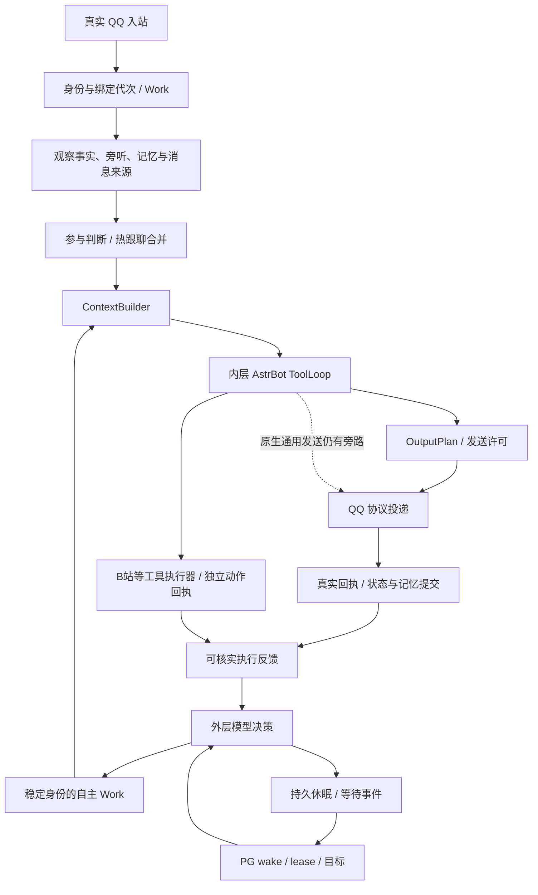

# FishBot 结构性调查与整改计划

调查日期：2026-11-04。范围：当前 Windows 工作树、Linux 源码与运行目录的只读对照，以及隔离回归。本文同时包含调查报告和后续实施计划。

**本轮没有修改产品代码、部署、重启在线实例或执行 Git 写操作。整改计划尚未实施。** 工作树原有未提交修改保留，不能把这些改动算成本轮调查产出。

## 1. 结论与决策

当前系统不是“没有管线”，也不是“所有入口已经完全统一”。它已经具备可继续建设的公共骨架：可信身份、Work、上下文贡献约束、内层 ToolLoop、输出计划、协议回执、持久调度和资源保护都存在。主要结构问题是：**某些共同约束仍依靠各入口自行接线，而不是由实际执行边界统一保证。** 新功能接入时容易接上工具列表，却漏掉发送计划、访问范围、资源准入或反馈语义。

建议保留 PostgreSQL、API/Agent 分离、共享 AstrBot 和现有协议进程管理，不更换内核，不新建第二套记忆、发送器或自主调度。优先做三件事：

1. 补实际执行边界：通用媒体出站、原生发送工具、任务失效后的副作用检查。
2. 明确唯一权威：权限、阶段、能力可用性、受众可见记忆、执行结果分别由谁决定。
3. 用跨入口合同测试约束扩展，随后拆出高耦合接线；避免先大拆文件再追行为差异。

目前最明确、应最先处理的是通用媒体 URL 的网络范围和下载限制。群私记忆的受众边界、主动任务标签与能力授权的耦合、启动失败资源回收，是下一批重点。**没有证据证明已发生跨租户数据泄露或现网 SSRF；不能把风险描述成已发生事故。**

## 2. 证据、覆盖与限制

### 2.1 本轮实际做了什么

- 建立 99 个 Python/TypeScript 文件的指纹索引，共 10,807 行；沿关键调用链定向阅读，并补读 AstrBot 原生发送/下载实现、进程管理、媒体生命周期和前端配置入口。索引不代表逐行完整审计全部 99 文件，也不代表覆盖全部依赖。
- Windows 与 Linux 对照同一组 99 文件：运行目录 99/99 原始字节一致；规范源码目录 80 个原始一致，19 个在统一换行和行尾空白后相同；没有发现其余内容差异或缺文件。
- 运行 12 个可独立执行的 Python 回归脚本，全部退出码为 0；共享边界脚本需要标准输入，首次直接调用失败，随后按原 TypeScript 入口补跑，通过 1 个 Node 测试。不能将首次失败归为产品故障。
- 两项无网络离线探针：测试当前 URL 校验函数；提取当前 Work 阶段方法，测试阶段倒退。未攻击生产地址、未发 QQ/B 站消息。
- 只读采集 Linux RAM、Swap、zswap 和 PSI；没有做新一轮压力、性能 A/B 或长时间可靠性测试。

证据目录：`.local/structural-guard-audit-20261104/`。包括 `source-manifest.json`、`existing-tests.json`、各测试日志、`probe.py`、`probe-results.json`、`linux-readonly.txt`。Linux 对照结果也保存在隔离 control 目录下，不接入生产业务。

### 2.2 证据等级

| 标记 | 含义 |
|---|---|
| 源码确认 | 当前调用关系或条件可直接定位；不等于已在生产触发 |
| 离线复现 | 本轮隔离运行当前函数或项目测试，得到可重复结果 |
| Linux 实测 | 本轮只读从 Linux 取得的数据或文件比较 |
| 结构风险 | 有合理失败路径，但缺少故障注入或真实业务证据 |
| 未验证 | 本轮没有完成相应生产、模型、浏览器或性能验证 |

重要限制：源码一致不能证明进程已经加载同版模块；测试通过不能证明全部运行路径一致；本轮没有读取模型私有思维链，也没有用模型口头解释代替执行证据。

## 3. 系统大类、职责与数据权威

| 大类 | 当前主要模块 | 应拥有的权威 | 不应承担的职责 |
|---|---|---|---|
| 控制面 | `apps/control-api`、contracts | 用户/租户鉴权、配置校验、修订号、命令受理 | 直接操纵 QQ 进程、在 View 中补事务 |
| 生命周期与调度 | Node Agent、shared、autonomous、process-host | 进程归属、共享成员、离线清退、wake/lease、工作所有权 | 让模型突破权限、通过启动 QQ 满足自主计划 |
| 公共机器人管线 | `bot_pipeline.py`、`behavior.py` | Work 身份、上下文入口、发送许可、回执提交 | 重新实现平台协议、把阶段日志当完整状态机 |
| 外层自主决策 | `autonomous_runtime.py`、PG autonomous | 决策目标、下一项工作、根据真实反馈重评估和休眠 | 直接构造 Cookie、绕过内层工具或协议发送 |
| 内层执行 | `native_internal.py`、AstrBot ToolLoop、`inner_tools.py` | 在授权内调用工具、报告完成/受阻/未知 | 自称主人、用文本模拟副作用成功 |
| 人物与认知 | behavior/social、关系、情绪、兴趣、attention | 为模型提供人格、关系与参与判断信息 | 将昵称、自述、好感度当真实身份或权限 |
| 记忆 | per-bot SQLite、摘要/事实/向量、PG 执行经历投影 | 同一机器人事实与来源、遗忘代次、可见经历 | 多套互相独立的人物记忆；任意跨租户召回 |
| 工具与协议 | QQ actions、收藏/引用、Bili executor/effects | 动作末端检查、平台回执、unknown 去重 | 用“提交请求”代替“任务已完成” |
| 资源与治理 | cgroup、Linux controller/Guard、媒体 lifecycle | 主机压力、进程树、文件/字节/像素/并发边界 | 从 USS 单点推导容量；无条件放宽保护 |
| 表现与运营 | React、能力地图、日志/监控 | 显示保存/应用/实际可用状态和依赖 | 作为权限最终裁决者 |

### 3.1 当前真实管线

说明：明确 @、私聊及正常跟聊仍可进入前台内层，不要求每条消息先经外层。主动模式接管原定时自驱入口，避免两边重复发送。外层获取共享认知和执行反馈不等于拥有平台凭证或发送权限。

## 4. 护栏分类与对齐情况

必须区分四种性质：**硬校验、业务准入、模型决策、参考信息**。疲劳、兴趣或好感度不应因为“写在上下文里”就被描述成硬权限。

| 护栏 | 当前执行情况 | 对齐评价 |
|---|---|---|
| tenant/bot/QQ 绑定 | API owned 校验、bridge 签名、工具端绑定与配置代次 | 基础较强；Python 扩展仍是可信服务代码，不是沙箱 |
| 主人身份 | 可信 QQ sender ID 与 owner 配置；引用/昵称不授予权限 | 工具授权与称呼需分开验收；提示词误称不等于获得权限 |
| Work/epoch/generation/revision | 前台 lease、自主 permit、动作与账号版本检查 | 多路径存在；需合同测试确保新增 await 后仍覆盖 |
| 模式与所有权 | active/live/epoch、旧定时器让权、离线挂起 | 架构正确；各功能装配还存在任务标签耦合 |
| 参与和联系策略 | 白名单、跟聊、安静时段、未回应、次数/时钟 | 作用域分散；须明确前台、标准定时、外层自主分别适用什么 |
| 人物信息 | 注意力、情绪、关系、兴趣、疲劳进入判断/上下文 | 不是统一强制打分器；关闭基础信息可能削弱决策质量 |
| 模型与工具预算 | native runner、外层周期、工具、时间等边界 | 应区分技术兜底和产品偏好，不能笼统称“额度”后一并移除 |
| 输出 | OutputPlan、清洗、分条、freshness、逐条回执 | 普通回复较完整；原生通用发送入口未完整经过同一计划 |
| 执行结果 | PG effects、QQ 动作记录、pipeline 回执 | unknown 保护已有；不同能力的结果语义和诊断仍不统一 |
| 网络出站 | 模型 egress、Bili 媒体有较强控制 | 通用发送媒体路径明显弱于专用路径 |
| 资源与清退 | 主机 Guard、动态 high、PAGEOUT、媒体准入、清退 | 重媒体强，轻媒体/多运行时总量还缺一致视图 |
| 对外披露 | 可信主人分流与执行信息提示词 | 主要是模型约束，不是完整确定性数据脱敏或防泄漏边界 |

### 4.1 必须明确的作用域

- **全机**：压力、重媒体并发、磁盘、部分共享 IP 风控。
- **共享运行时**：实际 PID、成员集合、Python 内的 semaphore、模型运行时活动状态。
- **租户/机器人/账号**：权限、人格、持久记忆、B 站账号与 account revision。
- **人/会话/群**：真实 sender、关系、跟聊、联系冷却、受众和安静时段。
- **Work/动作/气泡**：任务所有权、稳定 action ID、一次逻辑聊天行动与多条物理消息、逐条回执。

这些层级不能相互替代。例如一个进程内的 semaphore 不是全机并发控制；共享 AstrBot 的三个成员不是三个 AI 进程；一次聊天三条投递不是三次独立自主行动。

## 5. 具体发现与整改方向

### G01 — 通用媒体网络边界不足【优先 P0；源码确认＋离线复现】

`tenant_tools.py::remote_media_url()` 仅检查 HTTP(S)、主机、端口和字符串形态。本轮探针确认它接受 `127.0.0.1`、`10.0.0.1`、`169.254.169.254`，同时正确拒绝 `file://`。

通用发送工具仍可将媒体 URL 交给原生组件。原生 `astrbot/core/utils/io.py::download_file()` 使用 HTTP 客户端下载，默认允许重定向，正常请求超时可达 1800 秒；证书错误默认允许不验证证书重试。其 `_download_response_to_file()` 流式写盘，但没有在该循环中看到字节上限。流式不等于有磁盘额度。

**边界说明：**原生跨 session 发送本身还有管理员权限校验，共享封装也禁止跨 bot 平台和任意本地路径；不是“完全没有鉴权”。当前证据证明的是 URL/下载边界不足，未进行生产内网访问或证明完整攻击链。

计划：复用现有 `model_egress.py` 和 Node 媒体下载中成熟的公共地址校验、DNS 解析后地址固定、逐跳验证、TLS 校验和流量限制机制，适配通用媒体接收端。不要只加字符串黑名单；允许自建私有模型服务的显式策略不能自动扩展到模型提供的任意媒体 URL。补直连内网、IPv6、DNS 变化、重定向、超大/无长度响应、取消清理测试。

### G02 — 原生通用发送未完整经过 OutputPlan【P1；源码确认】

`SendMessageToUserTool.call → context.send_message → send_by_session → _dispatch_send` 仍有独立发送路径。现有补丁保留了代次检查、部分 freshness 与最终投递/回执保护，但不能等同于先经过 `behavior.send` 的 OutputPlan、分条、节奏、媒体策略与统一行动计量。

风险是新增能力“能发送”但不具备与普通回复相同的语义，而不是已经证明它重复发送。计划使通用发送生成同一输出意图，或进入明确、受限的媒体副作用适配器；保留原生权限及协议发送器。测试同一内容在前台回复、工具发送、自主消息和跨会话授权发送中的边界是否一致。

### G03 — 阶段是日志，不是可校验的生命周期【P1；离线复现】

`bot_pipeline.Work.stage()` 验证阶段名称并保留最近 16 个轨迹点，没有验证阶段之间的合法转移。探针 `commit → ingress` 被接受。不能据此说实际线上任务发生了倒退，但目前 stage 不能防止接线错误。

计划：明确 Work 的状态与阶段日志各自职责，列出可合法重复的工具循环、分条发送、重新复核和中途终止转移；增加状态提交/副作用入口约束，而非简单按 STAGES 下标递增。保留轨迹的有界内存，不为每条旁听消息长期常驻完整追踪。

### G04 — 能力列表已共用，授权与任务标签仍未完全解耦【P1；源码确认】

`inner_tools.features()` 已供前台、内部执行与能力目录复用，这是应保留的改进。但当前装配仍按 `identity.kind` 选择部分工具：群工具限 research/message，引用与收藏限 message；`qq_actions.allowed()` 对内部签名和空间发布仍绑定 profile_signature/qzone_publish 标签。头像则走独立能力许可。

因此“内层勾选什么、外层知道什么”已经部分实现，尚未完全成为统一合同。某些限制可能承担原有副作用授权作用，不能直接删掉条件就宣称完成解耦。

计划：将任务标签作为规划/审计信息，将具体能力权限保留在执行 grant、功能开关、目标范围与动作末端校验中。由实际工具实例派生名称、参数、可用性，再声明 effect 类别、所需授权、受众和资源等级；注册时校验这些元信息。**不另建一份人工维护的外层能力清单。** 同时测试研究任务需要查群、消息任务需要检索、能力禁用后旧 Work 不得执行等组合。

### G05 — 群私记忆互通缺少统一的受众输出策略【P1；源码确认＋结构风险】

`memory_scope.py::person_filter/fact_rows/summary_rows/pending_messages` 已按真实 QQ 关联同一机器人内的群/私事实与近期记忆。用户要求记忆互通，这不是应删除的缺陷。记忆按机器人隔离，也不能把互通说成跨租户泄露。

问题在于事实有来源，未见覆盖所有人物事实的统一“允许向当前受众披露”属性和投影规则。同一人的私聊事实被召回到群回复上下文，不代表可以原样说给全群。当前更多依赖上下文与提示词约束。本轮未验证真实泄露。

计划：在现有记忆上补来源/受众策略，不新建一套人物记忆。区分可以用于判断、可以对当前对象表达、可以在公共群引用；保留群私互通的识别和理解收益。参考已有执行经历 `public_activity_only` 投影：公开动作可以跨会话回忆，私人请求、诊断和原始工具数据不能顺带公开。遗忘必须继续覆盖事实、摘要、向量和迟到写回。

### G06 — 多账本合理，但结果合同还不够统一【P1；源码确认＋结构风险】

当前 PG 自主动作、PG tool effects、SQLite pipeline/effects、QQ 动作/收藏/群发送记录分别服务于不同权威和恢复需求，不能因为表多就合并成一个库。现有稳定 action ID、dispatching、回执与 unknown 防盲重发应保留。

不一致在于部分工具返回结构化 confirmed/rejected/partial/unknown，部分仍主要返回自然语言或 attempted 记录。协议 ACK 证明平台接受，不必然证明头像已展示、评论公开可见，或用户整体目标完成。

计划：先统一对外结果投影和诊断字段：动作状态、证据类型、完成范围、可否查询确认、重试是否安全、原动作引用。跨 PG/SQLite 不假装有单一原子事务；在已有账本上补崩溃恢复和对账。无法查询的 unknown 保持未知，不以再次写入验证上次是否成功。

### G07 — 社交策略与额度的适用范围分散【P1；源码确认】

标准参与、跟聊、主人定时联系、外层自主、QQ 动作和 B 站分别有时钟、计数、权限与兜底。注意力、好感、兴趣、情绪、疲劳是判断信息；部分标准入口还有硬准入。两者需要界面说明，不能笼统说“全部只给模型参考”，也不能把每个配置都视为全局硬拦截。

`behavior-defaults.ts` 当前包含注意力/疲劳、主人联系、摘要和语义召回等默认开关；语义开关为真但 Embedding 模型默认为空，不等于向量召回已可用。默认值、用户保存覆盖、运行时实际应用值是三个不同层次。自动签名等还有单项次数限制；不应因用户要求取消某种每日额度就连安全预算一起取消。

计划：为每项策略记录适用入口、计量单位、重置条件、权威层、默认来源和当前覆盖。明确普通 @/引用/跟聊与自主发言的区别；旧标准群判断间隔不能隐式再次约束外层自主。配置迁移只更新通用默认，不覆盖用户明确设置。统一输出拒绝/延期原因，避免再靠模型猜“为什么不能说”。

### G08 — 资源保护存在强弱两档，但还没有一致总量视图【P1/P2；源码确认】

重媒体已有较完善流程：流式下载、CDN/DNS/跳转控制、临时文件、独占媒体槽、Linux Guard 心跳与可用内存准入、受托 cgroup、子进程退出清理。这些不是待从零建设。

Python B 站图片处理也有域名、字节、像素、尺寸、候选数和缓存上限，但 semaphore 作用于当前 Python 进程；不能把它当全机限制。QQ 收藏图片下载也有自己的边界。轻媒体没有全部经过重媒体准入，多个独立 AI 同时处理时总量需要验证。

计划：保留轻重分级，避免给每张小图套完整视频进程。补轻媒体总量/压力准入和可观察的资源等级；压力升高优先暂停后台研究，前台消息优先。图片下载的 DNS/IP 策略同 G01 对齐。不得借整改修改既有 48MiB/16MiB、40 秒 PAGEOUT、zswap/Swap 或 Guard 策略。

### G09 — 启动失败路径的进程所有权收口不足【P1；源码确认，故障后果未复现】

`process-host.ts::start()` 在 spawn 后才施加可选 cgroup、登记 map、写进程记录。cgroup 失败分支调用 `child.kill('SIGKILL')` 后抛错，没有在该分支看到等待进程树退出；进程记录写入失败也需要核对统一回滚。正常停止路径已有 PID 创建时间/路径验证与递归终止、等待、强杀后再等待，不应重新报告成“正常 stop 没有 join”。

计划：在原 start 内建立临时所有权，只有进程身份、记录与资源绑定成功才提交；失败必须清理本次拥有的进程树并等待完成，不能误杀相同 bot 的新代次。补磁盘写失败、cgroup 拒绝、spawn 后立即退出、并发 start/stop 的故障注入。现有可选 `memory.max` 代码不证明生产正在启用低硬限制，应以实际环境核对。

### G10 — SDK 接线高度集中，升级和扩展风险大【P2；源码确认】

`behavior.py` 约 1118 行、`autonomous_runtime.py` 约 804 行，同时承担大量接线。全局补丁涉及 SDK 执行、发送、工具循环、provider/history 等，正确性依赖固定 SDK 的调用方式。已有隔离测试有价值，但新增能力容易碰到未覆盖的旁路。

计划：先给补丁点建立兼容性合同和启动自检，再按身份/上下文/参与/输出/反馈拆接线函数。公共检查只留一个实现，调用点可以有多个。禁止为了“整洁”替换原 ToolLoop、同时重写外层和内层，或一次性批量格式化所有文件。

### G11 — 发布源码对齐，不等于已加载版本可证明【P2；Linux 实测＋未验证】

本轮 99 文件对照没有发现实质源码差异。现有维护入口可在保留协议子进程的情况下替换部分 Agent 方法和 coordinator，但当前源码、构建物、Python 导入模块、已加载 JS 方法和 UI 缓存版本，尚不能用此次文件哈希统一证明。

计划：把已有安全维护流程固化为可重复的版本化发布入口，输出组件构建指纹、应用修订、能力合同版本和保留进程证据。API/Web 单独发布；Agent/运行时按现有安全边界处理。不能为取得“同版”而重启全部 QQ，不能再以源码拷贝完成等同线上代码全生效。

### G12 — UI 分类已有改善，状态语义仍需补齐【P2；源码确认，未做浏览器验收】

`bot-detail.tsx` 已将主动模式与 Bilibili 设为一级标签，基础配置下有分组子菜单；不能继续按旧报告说“这些都挤在一个界面”。Bili 页面已有 lease/请求序号、取消和 dirty 草稿保护，保存时也避免轮询覆盖编辑。

仍需从后端一致提供：功能开启、依赖就绪、账号授权、当前入口可用、配置保存/实际应用、暂时受阻六种状态。能力地图不能仅凭开关判“可用”；语义召回无模型、协议缺接口、平台冷却、QQ 离线应各自说明。机器人详情仍有读取 rssBytes 的资源摘要，应明确 RSS 名称，不与管理员 PSS 主指标混淆。

计划：UI 消费后端派生状态与原因，保留现有页面层级及并行前端成果。抽查慢请求、账号切换、页面退出、旧轮询返回和保存后的 revision；不以改页面替代后端约束。

## 6. 记忆与内外层协作的专门判断

### 6.1 什么应该共享

应共享同一机器人的可信事实、摘要和未摘要近期消息、人物关系/兴趣、公开活动、正在进行和已结束工作的可核实结果，以及来源和时间。内层已有压缩机制，应复用，不为了外层再长期维护一套平行人物摘要。

不应简单拼成一段共用聊天 transcript：外层内部规划、工具诊断、private 原始请求、公开群话题有不同用途和受众。外层决定目标、内层执行时，还需要当前 Work、目标范围和工具权限。共享数据权威，与按任务/受众投影上下文可以同时成立。

### 6.2 已有机制应保留

- 消息来源包含真实 sender、引用和 self/member 区分，引用内容不变成当前用户权限。
- 反射/摘要与向量写回有 epoch/current 检查，遗忘不能被迟到任务重新写回来。
- 摘要有有界重试和忙碌处理，不能继续使用旧报告“没有重试”的结论。
- 执行经历可从 PG 权威投影，并保留 scope/public 活动边界；服务查询失败不能当成“没有做过”。
- 远程 Embedding 按需工作，无需增加本地常驻向量模型；当前开关与模型配置就绪度必须分开。

### 6.3 应补的协作合同

每次外层决策读取一个带版本的事实/执行快照；普通旁听更新环境信息，真实执行结束才更新执行反馈。新明确请求优先，但不能由无关群消息反复废弃正在做的任务。内层返回目标完成范围、工具证据、未知副作用和新约束，外层再决定继续、换目标、报告或休眠。这里的“报告给主人”应是模型可选择的行动，不是任何错误都机械发私聊。

上述要求需要跨入口竞态测试；本轮没有宣称所有生产交错已经验收。

## 7. 扩展一项新能力的目标合同

新增能力应只实现业务适配，不再复制身份、发送、记忆、重试和定时器：

1. 从真实工具工厂取得 descriptor：名称/schema、依赖、可用性、效果类别和资源等级。
2. 接收服务端绑定的 tenant/bot/Work、配置代次和受限 grant；模型不能选择任意凭证路径或账号。
3. 读操作明确新鲜度、来源和可见范围；写操作使用稳定 action ID，并在末端再次检查有效性。
4. 媒体交给受控下载/处理路径，发送交给公共输出/协议，记忆通过现有经历与事实入口提交。
5. 返回结构化状态、证据和覆盖范围；unknown 不盲重试；取消后的已发生副作用继续记账。
6. 自动进入内层实际能力列表、外层目录和 UI 可用状态；注册测试校验三者一致。

禁止：每新增平台创建一个自主循环；工具内部私建全局人格；借主人称呼授予权限；未经回执把文本结果记成真实动作；给普通旁听创建无界后台 Task。

## 8. 稳定性与资源实测

2026-11-04 18:14:49（北京时间）的单次只读快照：

| 指标 | 本轮值 |
|---|---:|
| MemTotal | 1775.3 MiB |
| MemAvailable | 799.9 MiB |
| 按 Total−Available 计算的 RAM 已用 | 975.4 MiB |
| Swap 已用 | 1019.7 MiB |
| zswap 物理池 | 88.7 MiB |
| zswap enabled / shrinker | Y / Y |
| zswap max_pool_percent / accept_threshold | 25 / 90 |
| 内存 PSI some avg10 / full avg10 | 1.59% / 1.22% |
| CPU PSI some avg10 | 2.53% |
| IO PSI some avg10 / full avg10 | 2.86% / 1.98% |

这些是快照，不是稳定负载均值或容量验收。zswap 已计入整机 RAM，不再叠加；Swap 逻辑页面不能当作额外物理 RAM；CPU PSI 不是 CPU 使用率。内存/IO stall 非零，需要后续结合聊天延迟、Swap IO、major faults、视频任务和 Guard 事件做同时间轴分析，不能单凭 799.9MiB available 宣称没有压力。

本轮没有重设 memory.high、PAGEOUT、zswap 参数或 Guard。后续整改应保持当前策略，只检查新增能力是否按正确活动范围参与治理。

## 9. 本轮测试与尚未验收项

| 检查 | 实际结果 | 能证明什么 |
|---|---|---|
| bot_pipeline、message_provenance | 通过 | 现有管线/消息来源回归未出现断言失败 |
| memory_pipeline_audit、memory_snapshot、hosted_memory | 通过 | 已有记忆回归；hosted_memory 18 项通过 |
| group_freshness、deferred_group | 通过 | 已有群消息新鲜度/延后相关回归 |
| autonomy | 通过，46 项 | 已有自主生命周期与策略回归 |
| fish_alignment、bilibili_images、native_internal、config_audit | 通过 | 相应隔离行为回归 |
| shared_boundary 直接调用 | 失败：缺 JSON stdin | 调用方式错误，保留失败日志 |
| `node --import tsx --test tests/shared-boundary.test.ts` | 补跑通过，1 项 | 按真实入口生成配置后检查共享边界 |
| 当前媒体 URL 校验探针 | 复现接受内网/回环/链路本地 | 当前函数行为，不证明生产利用完成 |
| 当前 Work.stage 探针 | 复现接受 commit→ingress | 阶段轨迹不强制合法转移 |
| Linux 99 文件对照及主机快照 | 完成 | 文件与当时主机状态；不证明加载版本和业务性能 |

尚未验收：全量 npm 回归、前端构建及浏览器交错、真实模型所有工具组合、QQ 多入口发送差异、B 站实际写入恢复、故障注入、长时间负载、额外 P95 延迟≤5秒、全部依赖供应链。调查阶段没有为这些测试制造真实外部副作用。

## 10. 分阶段实施计划

优先级含义：P0 为先收紧的执行边界；P1 为主干一致性和失败恢复；P2 为可维护性、发布和可解释性。不是已上线故障数量评级。

### 阶段 A：冻结证据与合同，先补网络边界

范围：G01、G02 的路径确认与安全下载，保存现有行为基线。沿真实 native sender 验证每一种媒体在哪里取 URL，不只修改最上层校验。

交付：统一适用的网络策略适配、每类媒体字节/时间/磁盘预算、重定向与取消清理；原生发送进入受控输出意图。

验收：回环/内网/链路本地/IPv6/DNS变化/跳转拒绝；合法公共图片、音频、视频正常；本地文件限制和跨 bot 权限不退化；一个逻辑行动仍可分 1–4 条按原节奏发送，逐条确认。

回退：代码级回退适配器版本，失败时只关闭相关媒体工具，保留文字消息和正常会话；不回滚到默认允许不可信内网 URL。

### 阶段 B：公共 Work、结果与能力合同

范围：G03、G04、G06。先定义生命周期与副作用合同，再整理调用点。

交付：合法阶段转移、统一失效检查、由实际工厂派生的 descriptor、任务标签与能力 grant 解耦、结果投影及 reason code。

验收：主动/被动/前台相同功能开关得到一致可用性；禁用后旧动作不能开始；已投递回执仍可落账；超时/崩溃/重启 unknown 不重复发；新工具加入后外层/UI 不漏项；无授权时目录知道能力也不能执行。

### 阶段 C：记忆受众与上下文一致性

范围：G05、G07 的记忆/社交部分以及第6节。

交付：现有事实/摘要/经历的受众投影、context 来源与版本、策略适用范围表、默认值和保存覆盖的迁移规则。

验收：同人群私理解互通；主人私聊隐私不在群中自动复述；公开 B 站经历可回忆；陌生人冒名不改身份；无关旁听不撤销执行；明确新请求可优先；遗忘期间迟到摘要/向量不能复活数据；好感/情绪/疲劳影响模型信息而不授予权限。

### 阶段 D：失败回收与资源协同

范围：G08、G09。

交付：启动临时所有权与失败回滚、轻重媒体分级准入、后台压力降级、子进程和临时文件诊断。

验收：在 spawn/绑 cgroup/写记录/账号修订/取消等边界注入故障；等待退出、零孤儿、零跨 bot 误杀；共享成员停止不影响其他在线号；离线清退保留 Session 和人格记忆；Guard 压力时先停后台媒体，正常聊天可用。

资源验收：Linux 记录实际 RAM、PSS、Swap/zswap、Swap IO、PSI、major faults、CPU 与聊天 P95；不要用 Windows 峰值代替 2GB Linux 验收。配置保持现有内存策略，额外聊天 P95 目标≤5秒。

### 阶段 E：接线整理、发布证明与 UI

范围：G10–G12。只在前述跨入口测试具备后拆接线。

交付：SDK 兼容性自检、版本化维护入口和应用指纹、UI 六态可用性解释、策略来源显示、动作/Work 诊断链。

验收：API/Web 发布不改变 Agent/NapCat PID 与创建时间；运行时更新按独立安全流程；旧浏览器 schema/旧请求不会覆盖新配置；主动模式和 B 站一级标签保持；用户草稿及其他 AI 前端成果不覆盖。

### 阶段 F：跨模块最终收口

必须执行：

1. 主人私聊任务→内层多工具→结果→外层重新决策→持久休眠/唤醒。
2. 群旁听、热跟聊合并、明确 @、引用、后台自主同时存在，不重复发送或把别人的话当当前指令。
3. 工具执行中切换模式、改配置、离线、重连、人工停止；已发生和未发生副作用分别正确结算。
4. 两租户、多机器人共用 AstrBot，目标、模型、QQ/B站账号、记忆与预算严格隔离。
5. 文字＋平台表情＋QQ收藏表情＋引用＋语音的输出路径均受同一身份/计划/回执约束。
6. 对照本报告逐条做 Plan vs Actual：保留合理偏移证据，列出未通过项；不能只贴测试数量宣称全部完成。

## 11. 实施约束与不做事项

- 不新建通用大框架；优先把现有正确机制接到遗漏路径。
- 不用概率、强制找主人或特定人设例子掩盖机制缺陷；模型保留目标与社交选择权。
- 不移除技术保护来制造“主动起来”；技术边界与用户可配置偏好分开。
- 不统一删除 SQLite 或迁移所有聊天到 PG；先处理权威和投影，不扩大数据库改造。
- 不复制私聊原文到所有群以追求“内外完全共享”。
- 不通过全体 QQ 重启验证配置；账号、Session、模型 Key、人格和记忆必须保留。
- 不将所有风险都视为已确认线上 bug，也不把历史已修问题重新列为待从零开发。

## 12. 本轮交付边界

已交付：当前结构图、模块及护栏分类、12项证据化发现、扩展合同、Linux文件/资源快照、隔离测试结果、A–F实施与验收计划，合在本文件。

未交付：整改代码和部署、生产攻击/故障验证、全量资源容量结论。接下来应从阶段A开始，完成一个边界就验证一个边界；不宜立即并行大改全部管线。

## 附录：关键源码与证据复核入口

以下是本报告的定向复核入口，不是声称所有函数均已做形式化安全证明。行号对应本轮快照，后续修改可能移动。

| 主题 | 源码入口 | 本轮关注点 |
|---|---|---|
| 公共身份/上下文/输出 | `adapters/astrbot/bot_pipeline.py`：Work.stage（175）、ContextBuilder、message_receipt、effect_units | 身份不可由贡献者重写；阶段轨迹与合法状态不同；逻辑行动与气泡计量 |
| 普通聊天接线 | `adapters/astrbot/behavior.py`：execute、send、delivery_current、最终 dispatch 接线 | 入口、批量跟聊、参与、发送和迟到回执 |
| 自主执行 | `adapters/astrbot/autonomous_runtime.py`：valid、execute、tools；`native_internal.py` | permit、任务身份、模型工具循环、结果反馈 |
| 共同工具来源 | `adapters/astrbot/inner_tools.py:6` | 工厂共用与 kind 过滤 |
| QQ 操作授权 | `adapters/astrbot/qq_actions.py:57` allowed、execute | 主人/内部服务身份、签名/空间任务类型约束 |
| 共享原生工具边界 | `adapters/astrbot/tenant_tools.py:6` remote_media_url、install | 跨 bot、本地文件、URL范围及委托原生工具 |
| 原生下载 | `references/astrbot/astrbot/core/utils/io.py:199,276`；`core/tools/message_tools.py` | 下载字节/时间/TLS边界、原生跨 session 权限 |
| 人物记忆跨会话 | `adapters/astrbot/memory_scope.py:15`；`hosted_memory.py`、`memory_reflection.py`、`data_admin.py` | 同人召回、摘要/向量、遗忘与迟到写回 |
| 执行经历 | `adapters/astrbot/execution_memory.py`、`packages/database` 中对应经历查询 | 来源范围、公开活动投影、真实执行证据 |
| 消息来源 | `adapters/astrbot/message_provenance.py` | sender、自身消息、提及与引用的区分 |
| 进程所有权 | `apps/node-agent/src/process-host.ts:32`；`scripts/process_control.py` | start 异常窗口；PID创建时间/路径与停止等待 |
| 共享实例与离线 | Node Agent 的 shared/lifecycle 与离线策略、Agent 命令处理 | 成员清退、重新连接复查、代次与数据保留 |
| 账号/写动作 | `apps/node-agent/src/bilibili/account-broker.ts`、`executor.ts`；`packages/database/tool-effects.ts` | 单机器人账号、凭证修订、末端权限、unknown |
| 重媒体 | `apps/node-agent/src/media/lifecycle.ts`、`bilibili/video-evidence.ts` | Guard准入、CDN/DNS、进程树、文件生命周期 |
| 轻媒体 | `adapters/astrbot/bilibili_images.py`、`sticker_collection.py` | 字节/像素/缓存、进程内并发与网络策略 |
| 模型出站 | `adapters/astrbot/model_egress.py` | DNS/IP固定、TLS及响应大小 |
| 通用默认 | `packages/contracts/behavior-defaults.ts`、各能力 contract | 默认开关与依赖就绪、用户覆盖区别 |
| 页面与异步 | `apps/web/src/bot-detail.tsx`、`bilibili-controls.tsx`、hooks | 一级标签、子分组、草稿/lease/seq、实际应用状态 |
| 安全维护 | `apps/node-agent/src/maintenance.ts` | coordinator替换、进程保留、版本证明缺口 |

本轮测试入口修正已另存 `shared-boundary-entry.log`，原始 `existing-tests.json` 中首次缺输入失败仍保留，不改写原始记录。离线探针结果保留 `networkPerformed:false`，明确没有进行网络攻击验证。
